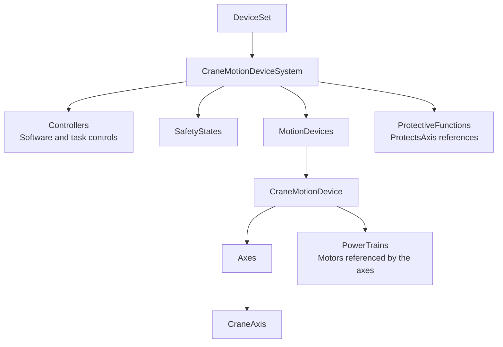

# Cranes and Hoists

The `Opc.Ua.CranesHoists*` libraries implement the released
[OPC 40020-1 Cranes and Hoists 1.00 model](https://reference.opcfoundation.org/specs/OPC-40020-1)
using the existing [Robotics](Robotics.md), [Machinery](Machinery.md) and
[Device Integration](DeviceIntegration.md) infrastructure.
The generated crane types retain their actual Robotics inheritance and native
topology; the runtime is not a parallel collection of generic objects.

**All CranesHoists model, server, client and MCP packages remain preview-only,
including Debug variants.** A released information model does not imply
production certification of these packages or a particular crane.

This is provider-backed monitoring and explicit standard limit configuration,
not physical motion control, a safety controller or a way to bypass protection.
An accepted request is distinct from a provider-reported active hardware limit.

## Contents

- [Library layout](#library-layout)
- [Models and dependencies](#models-and-dependencies)
  - [Version and namespaces](#version-and-namespaces)
  - [Native Robotics topology](#native-robotics-topology)
- [Quick start - server](#quick-start---server)
  - [Register one mandatory-only crane](#register-one-mandatory-only-crane)
  - [Supply explicit samples](#supply-explicit-samples)
- [Quick start - client](#quick-start---client)
  - [Discover and read a system](#discover-and-read-a-system)
  - [Use the client factory](#use-the-client-factory)
- [Server hosting and composition](#server-hosting-and-composition)
  - [Standalone owner](#standalone-owner)
  - [Existing Machinery owner](#existing-machinery-owner)
  - [Existing Robotics or custom owner](#existing-robotics-or-custom-owner)
- [Builder reference](#builder-reference)
  - [System, controller and safety structure](#system-controller-and-safety-structure)
  - [Motion devices and physical composition](#motion-devices-and-physical-composition)
  - [Axes, motors, loads and brakes](#axes-motors-loads-and-brakes)
  - [Protective functions](#protective-functions)
- [Provider contracts and coherent publication](#provider-contracts-and-coherent-publication)
  - [Acquisition identity and sample quality](#acquisition-identity-and-sample-quality)
  - [Static capability versus telemetry](#static-capability-versus-telemetry)
  - [Refresh and validation failures](#refresh-and-validation-failures)
- [Explicit limit requests](#explicit-limit-requests)
  - [Select providers and authorization](#select-providers-and-authorization)
  - [Requested values versus active limits](#requested-values-versus-active-limits)
- [Typed client workflows](#typed-client-workflows)
  - [Snapshots, metadata and relationships](#snapshots-metadata-and-relationships)
  - [Bounded values and events](#bounded-values-and-events)
  - [Configuration through the typed client](#configuration-through-the-typed-client)
- [Lifetime and cancellation](#lifetime-and-cancellation)
  - [Runtime, provider and node ownership](#runtime-provider-and-node-ownership)
  - [Session and observation ownership](#session-and-observation-ownership)
- [MCP integration](#mcp-integration)
  - [Select or embed the crane profile](#select-or-embed-the-crane-profile)
  - [Catalog and data representation](#catalog-and-data-representation)
  - [Default-off authority and request bounds](#default-off-authority-and-request-bounds)
- [Conformance and support limits](#conformance-and-support-limits)
  - [Supported surfaces](#supported-surfaces)
  - [Runtime profile contribution](#runtime-profile-contribution)
- [Model provenance](#model-provenance)
- [Samples and related documentation](#samples-and-related-documentation)

## Library layout

These are assembly/project names. NuGet package IDs prepend
`OPCFoundation.NetStandard.`, for example
`OPCFoundation.NetStandard.Opc.Ua.CranesHoists.Client`.

| Library | Responsibility |
| --- | --- |
| `Opc.Ua.CranesHoists` | Generated model states, identifiers, loaders, proxies and shared signal/provider/snapshot contracts |
| `Opc.Ua.CranesHoists.Server` | Fluent crane construction, coherent acquisition, limit authorization/acceptance and shared-owner hosting |
| `Opc.Ua.CranesHoists.Client` | Bounded discovery, native topology/quality reads, observations and standard configuration requests |
| `Opc.Ua.Mcp.CranesHoists` | Six bounded MCP workflows using host-owned named sessions |

Model/server/client target .NET Framework 4.8 and .NET 8, 9 and 10.
MCP targets .NET 8, 9 and 10. All four package families and their `.Debug`
variants are forced preview; this does not change the repository's root version
or Robotics' independent package policy.
The typed client has no server-runtime dependency. NativeAOT sample applications
use the same public APIs.

## Models and dependencies

### Version and namespaces

| Item | Value |
| --- | --- |
| Specification/model | OPC 40020-1, `1.00` |
| Publication date | 2023-09-01 |
| Wire namespace | `http://opcfoundation.org/UA/CranesHoists/` |
| Generated CLR namespace | `Opc.Ua.CranesHoists` |
| Dependencies | UA core, DI, Machinery and Robotics, reusing their existing model assemblies |
| Metadata | `CranesHoistsModel.NamespaceUri`, `Version`, `SourceCommit`, `NormalizedNodeSetSha256` |

Use generated identifiers and namespace-qualified proxies; a namespace index is
assigned by the actual server, not fixed by the companion specification.
The model's published dependency versions remain recorded in the NodeSet.
They are not a request to generate duplicate copies of DI, Machinery or Robotics
beside the repository's current compatible assemblies.

### Native Robotics topology

The native root is `CraneMotionDeviceSystemState`, derived from the Robotics
system type. Motion devices, axes and motors similarly retain the generated
`CraneMotionDeviceState`, `CraneAxisState` and `CraneMotorState` types.
Controllers, task controls, software and safety states reuse Robotics.

Conceptually, one system contains:



Machinery identification and optional Components/Notifications bindings attach
to those same nodes. The `Machines` discovery path organizes the registered
system; it does not relocate or register the `DeviceSet` root a second time.
Physical composition and protection references remain distinct from ownership
of nodes in the Robotics folders.

## Quick start - server

### Register one mandatory-only crane

This host-configuration helper receives the application-owned provider and
retains the runtime for subsequent refresh:

```csharp
using System;
using Microsoft.Extensions.DependencyInjection;
using Opc.Ua;
using Opc.Ua.CranesHoists;
using Opc.Ua.CranesHoists.Server;
using Opc.Ua.Server.Hosting;

static IOpcUaServerBuilder AddCraneServer(
    IServiceCollection services,
    ICraneDataProvider provider,
    Action<CraneSystemHandle> retainRuntime)
{
    return services.AddOpcUa()
        .AddServer(options =>
        {
            options.ApplicationName = "CranesHoistsServer";
            options.ApplicationUri = "urn:example:cranes-server";
            options.EndpointUrls.Add("opc.tcp://localhost:62557/CranesHoistsServer");
        })
        .AddCranesHoists(options =>
            options.InstanceNamespaceUri = "urn:example:cranes:instances")
        .ConfigureCranesHoists(async (context, ct) =>
        {
            CraneSystemHandle crane = await context.AddCraneSystem("Crane1")
                .WithProvider(provider)
                .WithIdentification(identity =>
                {
                    identity.Manufacturer = new LocalizedText("Example manufacturer");
                    identity.SerialNumber = "Crane1";
                    identity.ProductInstanceUri = "urn:example:crane:1";
                })
                .AddController("Controller", controller =>
                {
                    controller.AddSoftware("ControllerSoftware");
                    controller.AddTaskControl("Main");
                })
                .AddSafetyState("Safety")
                .AddDevice("Hoist", CraneMotionDeviceCategoryEnum.HOIST, device =>
                    device.WithIdentification(identity =>
                    {
                        identity.Manufacturer = new LocalizedText("Example manufacturer");
                        identity.SerialNumber = "Hoist1";
                        identity.ProductInstanceUri = "urn:example:hoist:1";
                    }).AddAxis("Lift", axis => axis.AddMotor("LiftMotor")))
                .BuildAsync(ct);
            retainRuntime(crane);
        });
}
```

This is the minimum useful native topology: a system identity/provider,
controller with software/task control, safety state, identified device, axis and
motor. Setup validates selected providers and acquires the required samples
before exposing the tree.

Register it during host construction and await normal host startup/shutdown.
Use the existing [server hosting](DependencyInjection.md#server-feature) and
[certificate framework](CertificateManager.md) for endpoint policies, trust
and identities. A model builder is not an authorization or safety policy.
Do not dispose the handle at the end of the configuration callback.

### Supply explicit samples

The provider uses the component IDs chosen by the builder. The previous
mandatory-only example requires these telemetry addresses:

| Component ID | Signals |
| --- | --- |
| `Crane1` | `OperationalMode`, `SystemOn` |
| `Hoist` | `SpeedOverride` |
| `LiftMotor` | `MotorTemperature` |
| `Safety` | `EmergencyStop`, `ProtectiveStop`, `SafetyOperationalMode` |

An explicit unavailable-data simulation can supply those addresses without
inventing successful equipment or safety observations:

```csharp
using Opc.Ua;
using Opc.Ua.CranesHoists;
using Opc.Ua.CranesHoists.Server;

static SimulatedCraneProvider CreateUnavailableCraneProvider()
{
    var unavailable = new DataValue(Variant.Null, StatusCodes.BadWaitingForInitialData);
    return new SimulatedCraneProvider(
    [
        new CraneSample(new("Crane1", CraneSignal.OperationalMode), unavailable),
        new CraneSample(new("Crane1", CraneSignal.SystemOn), unavailable),
        new CraneSample(new("Hoist", CraneSignal.SpeedOverride), unavailable),
        new CraneSample(new("LiftMotor", CraneSignal.MotorTemperature), unavailable),
        new CraneSample(new("Safety", CraneSignal.EmergencyStop), unavailable),
        new CraneSample(new("Safety", CraneSignal.ProtectiveStop), unavailable),
        new CraneSample(new("Safety", CraneSignal.SafetyOperationalMode), unavailable)
    ]);
}
```

For real equipment, implement `ICraneDataProvider` and return the complete
selected acquisition with its true wire types, quality and source timestamps.
For a simulation, `SetSamplesAsync` replaces the supplied report; call
`CraneSystemHandle.RefreshAsync` to acquire and publish it.
`SimulatedCraneProvider` never generates movement or active limit changes.

Actual-position capability is not selected in the minimal example. The native
position variable remains explicitly unavailable with `BadNoData`, rather than
pretending the axis is at zero.

## Quick start - client

### Discover and read a system

The typed client borrows a connected session and follows actual crane subtypes:

```csharp
using System;
using System.Threading;
using System.Threading.Tasks;
using Opc.Ua;
using Opc.Ua.Client;
using Opc.Ua.CranesHoists;
using Opc.Ua.CranesHoists.Client;

static async ValueTask ReadCranesAsync(
    ISession session, ITelemetryContext telemetry, CancellationToken ct)
{
    CranesHoistsClient client = session.CranesHoists(telemetry);
    ArrayOf<CraneEntry> cranes = await client.DiscoverAsync(ct);
    for (int index = 0; index < cranes.Count; index++)
    {
        CraneEntry crane = cranes[index];
        CraneSystemSnapshot snapshot = await client.ReadSystemAsync(crane.NodeId, ct);
        Console.WriteLine($"{crane.BrowseName}: {snapshot.Elements.Count} crane elements");
        foreach (CraneSignalValue signal in snapshot.System.Signals)
        {
            if (!signal.NodeId.IsNull)
            {
                Console.WriteLine($"{signal.Signal}: {signal.Value.StatusCode}, " +
                    $"acquired {signal.Value.SourceTimestamp}");
            }
        }
    }
}
```

The default discovery entry point is DI `DeviceSet`. The overload taking a root
NodeId can use `Machines` or another application organizer. A missing model
returns an empty discovery result, but `SupportsModel=true` by itself does not
prove there is a complete crane instance.

`CranesHoistsClient` is not a disposable session owner. Its bounded observations
own their own resources, and the application/container continues to own the
underlying session.

### Use the client factory

`AddCranesHoistsClient(...)` extends an existing
`AddOpcUa().AddClient(...)` registration. Resolve `CranesHoistsClientFactory`
and await `CreateAsync(ct)` to use the container-managed connection.
The factory and direct constructor both borrow that connection.

`CranesHoistsClientOptions` configures topology/browse bounds.
Direct `session.CranesHoists(telemetry, options)` uses the same workflows.
Closing an independently created session belongs to its creator, not to a
crane facade. See [client hosting](DependencyInjection.md#client-feature).

## Server hosting and composition

### Standalone owner

`AddCranesHoists()` creates one Machinery owner with `BuildingBlocks`.
Its options are the existing `MachineryServerOptions`, including the
application-owned instance namespace.
`ConfigureCranesHoists` receives a `CranesHoistsBuildContext` containing both
Robotics construction and Machinery binding contexts.

The hosting callback awaits construction and seals the Robotics context after
configuration. Multiple crane systems use independent IDs/providers and the
same validated construction path.

### Existing Machinery owner

When the application already has a Machinery owner, add only the crane models:

```csharp
using Microsoft.Extensions.DependencyInjection;
using Opc.Ua.Machinery.Server;
using Opc.Ua.Server.Hosting;

static IOpcUaServerBuilder AddCraneModelsToCell(IOpcUaServerBuilder server)
{
    return server.AddMachinery(options =>
    {
        options.Parts = MachineryParts.BuildingBlocks;
        options.InstanceNamespaceUri = "urn:example:cell:instances";
    }).AddCranesHoistsToMachinery();
}
```

Omit the `AddMachinery` call if that owner already exists. Configure with
`ConfigureCranesHoistsFor<MachineryNodeManager>(...)`.
Other families can contribute their model closure to the same owner; they must
not register a second DI/Machinery root.
The [CompanionSuite sample](../samples/CompanionSuite/) demonstrates cranes with
MachineTool, WMTP, GMS and Machine Vision.

### Existing Robotics or custom owner

For an existing Robotics owner, use `AddCranesHoistsToRobotics()` and
`ConfigureCranesHoistsFor<RoboticsNodeManager>(...)`. The hosting extension
uses the Robotics instance namespace for the shared Machinery bindings.
Do not call standalone `AddCranesHoists()` beside it.

Direct construction takes
`new CranesHoistsBuildContext(robotics, machinery, timeProvider)`.
The contexts must use **the same manager and instance namespace**; otherwise
construction is rejected. The model closure must already be loaded and
Machinery BuildingBlocks enabled. Direct callers retain responsibility for the
normal Robotics context sealing/lifetime.

The root is registered once through Robotics.
Machinery participates using `BindMachine` and registration participants,
preserving the existing identification and `DeviceSet` parent/reference.
See [Machinery external-root bindings](Machinery.md#bindings-on-an-externally-registered-root)
for the shared mechanism, rather than adopting the root again with a second
`AddMachine(...).BuildAsync()`.

## Builder reference

### System, controller and safety structure

`CraneSystemBuilder` is single-use. Component IDs are system-local, must be
unique and contain 1-128 non-whitespace characters; a system is bounded to
128 component identities.

| System builder call | Effect |
| --- | --- |
| `WithProvider` | Explicit per-system acquisition adapter; borrowed by default |
| `WithIdentification` | Mandatory Machinery nameplate on the existing generated root |
| `AddController` | Existing Robotics controller builder, including software and task controls |
| `AddSafetyState` | Inherited safety-state observations supplied by the provider |
| `WithExternalControl` | Reports external-control request state; does not acquire control |
| `WithGlobalSpeedLimit` | Selects the standard global limit-enable request; requires limit provider/authorizer |
| `WithFunctionalGroups` | Operational/Configuration references to existing ParameterSet variables |
| `WithComponents` | Machinery Components discovery references |
| `WithEvents` | Shared Machinery Notifications publisher |

Mandatory controllers and safety states are not automatically fabricated.
Reporting their values is not an implementation of the physical safety
functions they describe.

### Motion devices and physical composition

`AddDevice(id, category, configure)` creates a native crane device using
`CraneMotionDeviceCategoryEnum`. Each device needs identification and at least
one axis.

`WithWorkingPeriod` selects the provider-reported designed working period.
`WithComponents` selects the Components discovery AddIn.
`WithPhysicalComponent(childId)` references another device in this same system
without moving it out of the Robotics `MotionDevices` folder.

Physical composition rejects unknown/self references, duplicate physical
parents and cycles. These relationships are not a second node ownership graph.
Use real native relationships instead of reconstructing a physical hierarchy
from display names.

### Axes, motors, loads and brakes

| Builder | Call | Meaning |
| --- | --- | --- |
| Axis | `WithPositionCapability(available, profile)` | Static availability/profile; an available position requires a real provider sample |
| Axis | `WithAxisFunctions` | Discrete axis-function telemetry and the nine standard EnumValues |
| Axis | `WithMovingState` | Provider-reported `IsMoving` |
| Axis | `WithRatedSpeed(value, units)` | Positive finite nominal speed and units |
| Axis | `WithSpeedLimits` | Directional request properties and separate active-limit telemetry |
| Axis | `WithActualLoad(configure)` | Mass telemetry, with optional native Robotics load geometry |
| Axis | `AddMotor` | Native motor in the device's standard power-train topology |
| Axis | `AddBackupBrake` | Native backup brake with acquired `BrakeReleased` |
| Motor | `WithOverheated`, `WithServiceBrake` | Selected overtemperature/service-brake observations |
| Motor | `WithIdentification` | Optional shared component nameplate |

Every axis needs at least one motor. Optional load configuration uses the
generated `LoadState` and `ISystemContext`; center-of-mass/inertia retain their
native structured data types rather than an untyped JSON substitute.
The provider must supply the telemetry implied by every selected surface.

Enabling `WithSpeedLimits` without `WithLimitRequests` on the containing system
is a configuration error, not a read-only fallback.
Additional brake or motor nodes do not introduce actuation methods.

### Protective functions

`AddProtectiveFunction(id, protectedAxes, configure)` creates the native
protection object and forward `ProtectsAxis` relationships.
Axis references must be distinct and belong to this system.

`WithDescription(mode, name, rampDown)` configures descriptive properties.
`WithDirections(minusSlowdown, minusStop, plusSlowdown, plusStop)` declares
directional capabilities. `WithStateMonitoring()` selects coherent `Enabled`
and `Active` observations; these are not commands.

The library does not disable a protection, perform a safety stop or infer
that a safety device is healthy from its mere presence.
Descriptions/capability flags and provider-reported activity remain separate.

## Provider contracts and coherent publication

### Acquisition identity and sample quality

`ICraneDataProvider.ReadAsync(ct)` returns a complete
`ArrayOf<CraneSample>` for one crane. Every sample has a
`CraneSignalAddress(componentId, signal)` and a full `DataValue`.
`CraneSystemHandle.TelemetrySignals` exposes the exact required addresses after
construction.

Supply each configured telemetry address once. Missing, duplicate or
incompatible samples fail validation. A bad/null sample explicitly represents
unavailable acquisition and preserves the distinction from a missing signal.
Do not replace stale/bad safety or position observations with default Good
Booleans or zero positions.

Provider graphs are per-instance. Reusing a component ID in another crane is
valid, but sharing its mutable provider or request history implicitly is not.
Real equipment, high availability and distributed state belong to the
application's provider design.

### Static capability versus telemetry

`CraneSignal` is an SDK selector, not a new wire enumeration.
The definition supplies static capabilities such as motion category, position
availability and protection direction support. Those fields are not included
in provider telemetry.

Accepted limit request properties are also not telemetry. Return active
`SpeedLimitDirMinus`/`SpeedLimitDirPlus` observations from the data provider,
not the requested setpoints. The runtime and client keep both identities.

The standard wire types remain important: limit setpoints are Double, enable
requests are Boolean, and enumerated/structured readings retain their declared
types. A convenient generic variant does not permit an arbitrary type conversion.

### Refresh and validation failures

`CraneSystemHandle.RefreshAsync(ct)` acquires a report, validates it completely
and commits the coherent set before publication. A rejected report leaves the
previous accepted signals unchanged. Equipment callbacks do not run while the
publication lock is held.

`ReadSignal(address)` returns the last complete acquired DataValue.
`GetSignal(address)` and `GetElement(componentId)` expose actual native nodes
for advanced integration; they do not transfer node ownership.
`PublishEventAsync` uses the selected Machinery event publisher.

`SimulatedCraneProvider.SetSamplesAsync` atomically replaces only the supplied
simulation report. Its accepted-request history is separate, bounded and never
used to rewrite active hardware telemetry. It is a single-host reference
adapter, not a physical crane implementation.

## Explicit limit requests

### Select providers and authorization

Selected limit requests require both:

| Contract | Responsibility |
| --- | --- |
| `ICraneWriteAuthorizer.AuthorizeAsync` | Decide whether the actual OPC UA caller may submit the specific request |
| `ICraneLimitProvider.RequestAsync` | Explicitly accept/refuse the request; honor cancellation and equipment policy |

Bind them with `CraneSystemBuilder.WithLimitRequests(provider, authorizer)`.
They are not inferred merely because an acquisition provider exists.
`SimulatedCraneProvider` can record accepted requests only when explicitly
configured to accept them, and an independent authorizer is still required.

The standard writable selection is deliberately narrow:

| Signal | Target | Input |
| --- | --- | --- |
| `SpeedLimitDirMinusSetpoint`, `SpeedLimitDirPlusSetpoint` | Axis | Finite Double, inclusive range 0-100 |
| `SpeedLimitEnabledDirMinus`, `SpeedLimitEnabledDirPlus` | Axis | Boolean |
| `SpeedLimitGlobalEnabled` | System | Boolean |

The server's role/access checks and authorizer remain authoritative even when
a client reports `Writable=true`. No arbitrary signal becomes writable because
it is present in a snapshot.

### Requested values versus active limits

A successful request means provider acceptance, not a new active limit.
The accepted requested value is reported separately from the data provider's
active `SpeedLimitDirMinus`/`SpeedLimitDirPlus`.
The provider can continue to report a different active value after acceptance.

Neither `SystemOn`, `ExternalControlRequest` nor a protective-function state is
a control-takeover or safety-bypass command.
If cancellation or disconnection occurs after submission, the client may not
know the request's outcome. Inspect request and active values before deciding
what to do; do not retry an uncertain write automatically.

## Typed client workflows

### Snapshots, metadata and relationships

| API | Result |
| --- | --- |
| `DiscoverAsync()` | Crane roots from DeviceSet |
| `DiscoverAsync(root, ct)` | Crane roots below an explicit organizer |
| `ReadSystemAsync` | Bounded system plus actual device/axis/motor/brake/protection snapshots |
| `ReadElementAsync` | One native element, its signals, identification and relationships |
| `System(nodeId)`, `Axis(nodeId)` | Generated `CraneMotionDeviceSystemTypeClient` / `CraneAxisTypeClient` proxies |
| `ConfigureLimitAsync` | One standard request-property write, with original UA status |

`CraneEntry.TypeDefinition` preserves a vendor subtype rather than replacing it
with a standard base. `CraneSignalValue.NodeId.IsNull` identifies optional
absence; a non-null signal with bad quality is still present.
`Writable` reflects current-user access, not permission to ignore provider policy.

Snapshots retain actual axis-function EnumValues and forward physical-component
or protection relationships. Inventory reads stop at nested crane-system
boundaries instead of merging two instances into one report.
Use generated proxies for advanced namespace-correct access rather than
manually assembling raw Call/Write messages.

### Bounded values and events

```csharp
using System;
using System.Threading;
using System.Threading.Tasks;
using Opc.Ua;
using Opc.Ua.CranesHoists;
using Opc.Ua.CranesHoists.Client;

static ValueTask<CraneObservation> ObserveCraneSignalsAsync(
    CranesHoistsClient client, ArrayOf<NodeId> signalIds, CancellationToken ct)
{
    return client.ObserveValuesAsync(signalIds, new CraneObservationOptions
    {
        Window = TimeSpan.FromSeconds(5),
        MaximumNotifications = 20,
        MaximumPayloadBytes = 256 * 1024
    }, ct);
}
```

Use real signal NodeIds returned by snapshots, not their containing object IDs.
The native observation API accepts a bounded distinct selection.
`ObserveEventsAsync` observes an explicitly event-enabled system or notifier;
it does not perform condition refresh, acknowledgement or confirmation.

`CraneObservation` returns raw value notifications, event identity/fields,
qualified field paths, `LimitReached` and `DroppedNotifications`.
The window includes setup and is at most 60 seconds, with at most 100 retained
notifications and 1 MiB decoded payload. Default window/count are five seconds
and 50. A window ending without events is not proof of a safety state.

Topology discovery is separately bounded by `CranesHoistsClientOptions`:
256 visited objects, 32 references per requested browse page and 64 pages per
browse by default. Exceeding the bound fails, rather than returning a
silently truncated topology.

### Configuration through the typed client

Only explicitly selected standard limit requests are accepted by the helper:

```csharp
using System.Threading;
using System.Threading.Tasks;
using Opc.Ua;
using Opc.Ua.CranesHoists;
using Opc.Ua.CranesHoists.Client;

static async ValueTask<CraneElementSnapshot> RequestAndInspectLimitAsync(
    CranesHoistsClient client, NodeId axisId, CancellationToken ct)
{
    await client.ConfigureLimitAsync(
        axisId, CraneSignal.SpeedLimitDirPlusSetpoint, Variant.From(40d), ct);
    return await client.ReadElementAsync(axisId, ct);
}
```

This submits one authorized configuration request, then reads the axis.
Inspect the distinct request and active-limit signals in the returned snapshot;
the method does not assert that the active value became 40.
The runtime enforces the range and target type even if the caller uses the
generated proxy or a generic OPC UA Write.

## Lifetime and cancellation

### Runtime, provider and node ownership

Robotics owns registration of the native tree. Machinery enlists identification,
discovery and resource bindings in that registration rather than adopting the
root a second time.
Setup failures roll back the owner's attempted tree and its resources.

`WithProvider(provider)` leaves provider ownership with the application.
Use `ownsProvider: true` only for an independently owned provider transferred
to this runtime; do not transfer an adapter shared with another crane.
The transfer applies when runtime construction starts, not merely when the
builder method is called.

`CraneSystemHandle.DisposeAsync` stops admission, cancels/drains callbacks and
releases runtime-owned resources. `RemoveAsync` additionally asks the existing
owner to remove the native tree. Deleting the root or stopping its owner also
drains the bound runtime. These lifecycle operations are not physical stop
commands and do not replace equipment safety logic.

### Session and observation ownership

The client and its factory always borrow the session.
One-shot observation owns the subscription/items it creates and removes them
on completion, error or cancellation; it does not delete an application's
unrelated subscription. There is no persistent observation handle to close
through a separate private protocol.

Providers must honor cancellation and complete owned work so shutdown can drain.
A local cancellation after a submitted limit request does not establish whether
the equipment accepted it. The host/application closes its own session
independently; a crane read or bounded observation does not do so.

## MCP integration

### Select or embed the crane profile

The host profile is `craneshoists`:

```powershell
opcua-mcp --profile craneshoists
```

For embedding:

```csharp
using Microsoft.Extensions.DependencyInjection;
using Opc.Ua.Mcp;

static IMcpServerBuilder AddCraneMcp(IServiceCollection services)
{
    services.AddOpcUaMcpCore().AddOpcUaMcpCranesHoists();
    return services.AddMcpServer()
        .WithStdioServerTransport()
        .WithOpcUaMcpFilters()
        .WithOpcUaCranesHoistsTools(McpToolProfile.CranesHoists);
}
```

The profile-set overload supports composition and deduplicates shared connection
tools. The package remains preview-only and depends on the typed client rather
than the server runtime. Each call uses an existing host-managed named session;
select `sessionName` explicitly when connection choice is ambiguous.

### Catalog and data representation

| Tool | Workflow |
| --- | --- |
| `craneshoists_list_systems` | Subtype-aware discovery from DeviceSet or a selected organizer |
| `craneshoists_read_system` | Bounded native topology, observations and selected capabilities |
| `craneshoists_read_element` | One element, nameplate, axis metadata and relationships |
| `craneshoists_observe_values` | One bounded observation of distinct signal nodes |
| `craneshoists_observe_events` | One bounded event observation without refresh/acknowledgement |
| `craneshoists_configure_limit` | One explicitly consented standard limit request |

Present signals include their actual NodeId, current-user access and native UA
JSON `reading.DataValue`. That representation preserves numeric/structured
types, status and source/server timestamps.
`present=false` denotes optional absence, not a failed read.
Service and access failures are MCP errors with the original UA status.

`craneshoists_configure_limit` requires `confirmConfiguration=true`.
For an axis NodeId returned by discovery, `signal="SpeedLimitDirPlusSetpoint"`
and a finite numeric `value` submit that request only.
Its receipt distinguishes `requestAccepted=true` from
`activeValueVerified=false`. It never silently verifies or changes a physical
limit on the caller's behalf.

### Default-off authority and request bounds

Selecting `craneshoists` or `full` selects a catalog, not authority.
Privileged/live host capabilities remain independently default-off; enabled
capabilities require the configured caller grants and network rules.
Per-call confirmation does not bypass those policies, OPC UA access checks or
the crane's `ICraneWriteAuthorizer`.
See [MCP execution policy](McpServer.md#privileged-and-live-execution-policy).

Discovery defaults to 50 systems and caps at 100.
Value observations select 1-64 distinct nodes; time/count ceilings are
60 seconds and 100 notifications. Decoded and serialized reply budgets are
separate, with a 1 MiB ceiling. Oversize complete replies fail rather than
claiming partial success.

Observation reports bound completion and loss, keeps event IDs/qualified field
order and releases its own subscription. Cancellation must reach the server
through the standard MCP cancellation notification or the embedding
`CancellationToken`; abandoning a local wait is not necessarily a remote
cancel. No automatic retry of an uncertain configuration write is performed.

The [crane MCP reference](../tools/Opc.Ua.Mcp.CranesHoists/NugetREADME.md)
contains exact selectors, JSON types, bounds and embedding contracts.

## Conformance and support limits

### Supported surfaces

| Feature | Support |
| --- | --- |
| Released OPC 40020-1 1.00 model and provider-backed runtime | Implemented through native generated types |
| Controllers, motion devices, axes, motors, brakes, loads and protective functions | Shared Robotics topology with explicit optional selection |
| Raw values, quality/timestamps, geometry and equipment references | Retained in runtime and typed-client snapshots |
| Standard speed-limit setpoint/enable requests | Explicit authorization and provider acceptance; not active-state confirmation |
| Standalone/shared Machinery-Robotics hosting and isolated instances | Same construction/runtime path |
| Typed clients, bounded MCP, samples and NativeAOT | Supported through the same APIs |
| Model/server/client/MCP packages and Debug variants | Preview only |
| Physical motion, safety-system implementation, control takeover or safety bypass | Not supplied |
| External OPC Foundation certification of a deployment | Not claimed |

### Runtime profile contribution

The runtime contributes the released
`http://opcfoundation.org/UA-Profile/CranesHoists/Server/Basic` profile
for successfully committed live systems.
Conformance units reflect actual native system/device/axis/motor types and
selected brake, protection, enum and `ProtectsAxis` surfaces. Disposed systems
withdraw their contribution.

The source of the URI is the released
[OPC 40020-1 profiles section](https://reference.opcfoundation.org/specs/OPC-40020-1/10),
not an invented package-specific profile.
Namespace presence and a read of static capabilities do not prove authorization,
equipment behavior, safety integrity or certification.
See [Profiles](Profiles.md) for repository-wide qualifications.

The [CranesHoists tests](../tests/Opc.Ua.CranesHoists.Tests/) exercise native
types and relationships, mandatory/optional validation, atomic rejected reports,
requested-versus-active limits, real TCP clients and isolated ownership.
They do not implement or certify a safety function.

## Model provenance

The model is pinned to OPC Foundation UA-Nodeset revision
[`96a08945425d0295edb3607d2a38f6841ef44046`](https://github.com/OPCFoundation/UA-Nodeset/tree/96a08945425d0295edb3607d2a38f6841ef44046).

| Source | Role |
| --- | --- |
| [`Opc.Ua.CranesHoists.NodeSet2.xml`](../src/Opc.Ua.CranesHoists/Model/Opc.Ua.CranesHoists.NodeSet2.xml) | Original released NodeSet and authoritative numeric identifiers |
| [`Opc.Ua.CranesHoists.NodeIds.csv`](../src/Opc.Ua.CranesHoists/Model/Opc.Ua.CranesHoists.NodeIds.csv) | Locally derived generator drift table, not a separate upstream publication |
| [`CranesHoistsModel`](../src/Opc.Ua.CranesHoists/CranesHoistsModel.cs) | Version, source revision and LF-normalized NodeSet SHA-256 |
| [`Opc.Ua.CranesHoists.csproj`](../src/Opc.Ua.CranesHoists/Opc.Ua.CranesHoists.csproj) | Explicit namespace/model URI and existing Robotics/Machinery/DI references |

The generator consumes dependency payloads from those assemblies rather than
duplicating their model inputs. Numeric wire identities come from the NodeSet;
the CSV guards symbolic drift. See [ModelDependencies](ModelDependencies.md)
and [Machinery's model-source conventions](Machinery.md#model-sources-identifier-tables-and-repairs).

## Samples and related documentation

- [Crane sample pair](../samples/CranesHoists/README.md): mandatory/advanced
  isolated providers, encrypted loopback, bounded observations and explicit
  accepted/refused limit requests.
- [Crane server sample](../samples/CranesHoists/CranesHoistsServer/README.md)
  and [client sample](../samples/CranesHoists/CranesHoistsClient/README.md).
- [CompanionSuite](../samples/CompanionSuite/) for one owner hosting all families.
- [Robotics](Robotics.md), [Machinery](Machinery.md),
  [Device Integration](DeviceIntegration.md) and [MachineTool](MachineTool.md).
- [Node manager lifetime](NodeManagers.md),
  [model-change tracking](ModelChangeTracking.md),
  [subscriptions](Subscriptions.md) and [certificate management](CertificateManager.md).
- [MCP server](McpServer.md) and
  [CranesHoists MCP package](../tools/Opc.Ua.Mcp.CranesHoists/NugetREADME.md).
- [Developer guide](DeveloperGuide.md) for framework-specific builds and tests.
