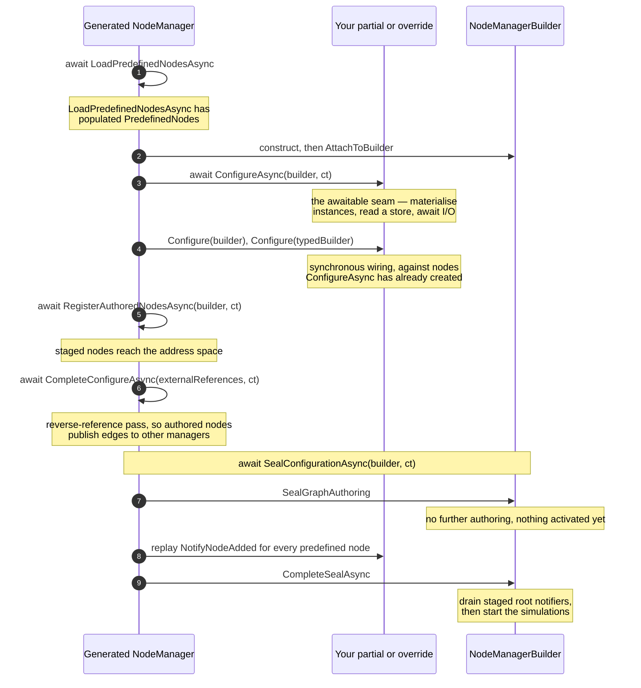

# Node Managers

A node manager exposes part of a server's address space: variables, methods,
events, and their behavior. Start with the [overview](#overview) and
[first model](#start-with-a-model), then use the architecture and lifecycle
sections when you need custom or dynamically loaded models. If you have not run
a server yet, start with [Getting started](GettingStarted.md).

## Table of contents

- [Overview](#overview)
- [Start with a model](#start-with-a-model)
  - [Single-file `Program.cs` — what it looks like](#single-file-programcs--what-it-looks-like)
- [Built-in node managers](#built-in-node-managers)
  - [Master node manager](#master-node-manager)
  - [Core node manager](#core-node-manager)
  - [Diagnostics and configuration node manager](#diagnostics-and-configuration-node-manager)
  - [Managers supplied by server features](#managers-supplied-by-server-features)
  - [Runtime lifecycle provider](#runtime-lifecycle-provider)
    - [Why the lifecycle provider exists](#why-the-lifecycle-provider-exists)
- [Core vs custom node managers](#core-vs-custom-node-managers)
  - [Storage and data structures](#storage-and-data-structures)
  - [Extensibility](#extensibility)
  - [Operational behaviour](#operational-behaviour)
    - [Reading & Writing](#reading--writing)
    - [Method Calls](#method-calls)
    - [Browsing and path translation](#browsing-and-path-translation)
    - [Runtime subtype replacement (`IPredefinedNodeSubtypeReplacer`)](#runtime-subtype-replacement-ipredefinednodesubtypereplacer)
  - [Monitoring and subscriptions](#monitoring-and-subscriptions)
    - [Sampling interval revision](#sampling-interval-revision)
    - [Final-value publication before node removal](#final-value-publication-before-node-removal)
  - [History](#history)
  - [Security](#security)
  - [Threading contract for nodes and browsers](#threading-contract-for-nodes-and-browsers)
  - [Delivery and callback lifecycle](#delivery-and-callback-lifecycle)
- [Registering node managers](#registering-node-managers)
  - [Startup registration](#startup-registration)
  - [Awaited readiness](#awaited-readiness)
    - [Concurrent operations, cancellation and failure](#concurrent-operations-cancellation-and-failure)
    - [Initializing managers in a custom host](#initializing-managers-in-a-custom-host)
  - [Registration generations](#registration-generations)
  - [Runtime registration](#runtime-registration)
  - [Node manager lifecycle impact on clients](#node-manager-lifecycle-impact-on-clients)
    - [Reload modes](#reload-modes)
    - [MonitoredItems](#monitoreditems)
    - [Continuation points](#continuation-points)
    - [Namespaces](#namespaces)
    - [DataTypes](#datatypes)
    - [Invocation publication units](#invocation-publication-units)
    - [Prepared Session and all-events bindings](#prepared-session-and-all-events-bindings)
    - [Prepared external references](#prepared-external-references)
    - [Change notifications](#change-notifications)
  - [How to make a node manager reloadable](#how-to-make-a-node-manager-reloadable)
  - [Related documentation](#related-documentation)
- [Server address-space metadata](#server-address-space-metadata)
  - [NamespaceMetadata for every namespace](#namespacemetadata-for-every-namespace)
    - [Node-manager authoring note](#node-manager-authoring-note)
  - [Historical-access reconciliation](#historical-access-reconciliation)
  - [See also](#see-also)
- [Source-generated node managers](#source-generated-node-managers)
  - [What the generator produces](#what-the-generator-produces)
    - [The generated activation pipeline](#the-generated-activation-pipeline)
  - [Opting in](#opting-in)
    - [Per-class opt-in via `[NodeManager]` (recommended)](#per-class-opt-in-via-nodemanager-recommended)
      - [Taking over the constructor and the namespace order](#taking-over-the-constructor-and-the-namespace-order)
      - [Binding to a model a referenced assembly supplies](#binding-to-a-model-a-referenced-assembly-supplies)
    - [Project-wide opt-in via MSBuild property (legacy)](#project-wide-opt-in-via-msbuild-property-legacy)
  - [Wiring callbacks: the `Configure` partial](#wiring-callbacks-the-configure-partial)
    - [Addressing modes](#addressing-modes)
    - [On-demand virtual node families](#on-demand-virtual-node-families)
    - [Monitored-item creation and lifecycle](#monitored-item-creation-and-lifecycle)
    - [Creating nodes under other managers' nodes (Objects folder)](#creating-nodes-under-other-managers-nodes-objects-folder)
    - [Creating nodes from scratch — the `Add*` surface](#creating-nodes-from-scratch--the-add-surface)
  - [Typed model-traversal — the `Configure(I{Manager}NodeManagerBuilder)` partial](#typed-model-traversal--the-configureimanagernodemanagerbuilder-partial)
    - [What the generator emits per model](#what-the-generator-emits-per-model)
    - [Methods with arguments — typed `OnCall` overloads](#methods-with-arguments--typed-oncall-overloads)
    - [Complete Method results and diagnostic forwarding](#complete-method-results-and-diagnostic-forwarding)
  - [Event sources — typed `Publish<TEvent>` on notifier wrappers](#event-sources--typed-publishtevent-on-notifier-wrappers)
    - [Where the typed overload appears](#where-the-typed-overload-appears)
    - [Two registration shapes](#two-registration-shapes)
    - [Tuning lifecycle with `EventPublishOptions`](#tuning-lifecycle-with-eventpublishoptions)
    - [Hand-written node managers](#hand-written-node-managers)
  - [Multi-namespace and manager-swap subclassing](#multi-namespace-and-manager-swap-subclassing)
  - [NativeAOT publishing](#nativeaot-publishing)
  - [Runtime NodeSet alternative](#runtime-nodeset-alternative)
  - [Building richer node managers — the fluent extension surface](#building-richer-node-managers--the-fluent-extension-surface)
    - [Engineering units & EU range](#engineering-units--eu-range)
    - [Bulk property initialisation](#bulk-property-initialisation)
    - [References & dynamic child objects](#references--dynamic-child-objects)
    - [Creating instances of model types](#creating-instances-of-model-types)
    - [Alarm setup (MVP)](#alarm-setup-mvp)
    - [Boolean supervision → alarm activation (NAMUR pattern)](#boolean-supervision--alarm-activation-namur-pattern)
    - [Simulation timers](#simulation-timers)
    - [Pushing runtime value changes to subscribers](#pushing-runtime-value-changes-to-subscribers)
    - [Subscription-gated sources](#subscription-gated-sources)
    - [Multi-model composition](#multi-model-composition)
    - [Mixing ModelDesign and NodeSet2 in one project](#mixing-modeldesign-and-nodeset2-in-one-project)
    - [Importing a NodeSet2 overlay at runtime — `builder.Import`](#importing-a-nodeset2-overlay-at-runtime--builderimport)
    - [NodeSet2 access-level bitmasks](#nodeset2-access-level-bitmasks)
  - [Materialising instances at runtime — NodeId assignment](#materialising-instances-at-runtime--nodeid-assignment)
    - [Custom node types and assignment control](#custom-node-types-and-assignment-control)
  - [Current limitations](#current-limitations)
  - [Sample](#sample)

## Overview

A node manager is the server-side component that owns a portion of the server address space and implements the service behavior for the nodes in that portion. In this stack a node manager is an `IAsyncNodeManager` (or the older synchronous `INodeManager` adapted to it) that can create nodes during address-space startup, return manager handles for `NodeId`s it owns, browse and translate references, read and write attributes, dispatch methods, validate monitored items, and participate in history, events, and node-management services.

`StandardServer` creates a `MasterNodeManager` while the server starts. The master node manager is the server's routing layer: OPC UA service implementations call it, and it dispatches each operation to the node manager that owns the requested node. Ownership is resolved primarily from the `NodeId.NamespaceIndex`, then confirmed by asking the candidate manager for a handle. This keeps application models, runtime NodeSets, diagnostics, configuration, and namespace 0 infrastructure independent while presenting one coherent address space to clients.

Developers need to care about node managers when they expose application data, methods, events, alarms, file-system objects, alias names, runtime NodeSets, or companion-spec models from a server. A node manager is also where model-specific behavior is attached: read and write callbacks, method callbacks, historian providers, event notifiers, permissions, model-change notifications, and cross-manager references to nodes owned elsewhere. For simple generated models, the source generator and fluent builder hide much of the plumbing; for dynamic or backed-by-service models, a custom manager is the boundary between the OPC UA services and the application's data source.

The server builds the initial set of node managers before accepting connections. Additional managers can be registered by hosting extensions such as `AddNodeManager` and `AddRuntimeNodeSet`, and the lifecycle API can add, reload, or remove lifecycle-managed managers while the server is running. Regardless of how a manager is supplied, it must cooperate with the master node manager's routing and reference-merging rules so clients can browse, monitor, and call nodes consistently across namespace and manager boundaries.

## Start with a model

For a first server, use the
[MinimalBoilerServer sample](../samples/MinimalApi/MinimalBoilerServer).
It supplies a model and a generated node-manager factory, so you can start
with variables and callbacks rather than implementing service dispatch.
To write a model of your own and use it from a client, follow the
[Your first information model](FirstModel.md) tutorial.

1. Follow [source-generated node managers](#source-generated-node-managers)
   to include your model and generate its factory.
2. Register the factory with `AddOpcUa().AddServer(...).AddNodeManager<TFactory>()`;
   the [single-file host example](#single-file-programcs--what-it-looks-like)
   shows the complete hosting shape.
3. Attach value and method handlers in the generated `Configure` partial, then
   connect a client and browse the model.

If models change independently of the binary, start with
[runtime NodeSets](RuntimeNodeSets.md#quick-start-examples) instead.
Both paths use the same routing, permissions, and lifecycle contracts below.

### Single-file `Program.cs` — what it looks like

The shipping `services.AddOpcUa().AddServer(...)` extension wires the
server into the .NET Generic Host: configuration, certificate check,
`ApplicationInstance` lifetime and Ctrl+C/SIGTERM handling are all owned
by the host. User code stays at ~12 lines.

```csharp
using Microsoft.Extensions.DependencyInjection;
using Microsoft.Extensions.Hosting;
using Microsoft.Extensions.Logging;

HostApplicationBuilder builder = Host.CreateApplicationBuilder(args);
builder.Logging.AddConsole();

builder.Services
    .AddOpcUa()
    .AddServer(o =>
    {
        o.ApplicationName = "MyServer";
        o.ApplicationUri  = "urn:localhost:MyServer";
        o.ProductUri      = "uri:opcfoundation.org:MyServer";
        o.AutoAcceptUntrustedCertificates = true;
        o.EndpointUrls.Add("opc.tcp://localhost:51210/MyServer");
    })
    .AddNodeManager<MyModel.MyModelNodeManagerFactory>();

await builder.Build().RunAsync();
```

`AddOpcUa()` registers a `ServiceProviderTelemetryContext` that adapts
the host's `ILoggerFactory` to `ITelemetryContext` — no separate logging
pipeline is required. `IOpcUaServerBuilder.AddNodeManager<T>()` registers
an `IAsyncNodeManagerFactory`; use `AddSyncNodeManager<T>()` for the
legacy `INodeManagerFactory`. For advanced configuration (custom security
policies, additional builder calls), set `OpcUaServerOptions.ConfigureBuilder`.

That's the whole server. The Boiler version is in
`samples/MinimalApi/MinimalBoilerServer/Program.cs`.

> `AutoAcceptUntrustedCertificates` is enabled here only for a local sample.
> Configure trusted certificates and disable automatic acceptance in production;
> see [Certificates](Certificates.md).

## Built-in node managers

Replicated application managers require a fixed
[replica NodeId identity configuration](ReplicaNodeIdentity.md). It runs before
their constructors, so namespace indexes and callback keys are already final.
The shared registration policy survives factory rebasing/replacement and runs
before predefined-node indexing, including during import and hydration. Shared
model namespaces must be declared up front; loading a new shared namespace at
runtime requires a coordinated layout revision. Built-in core, diagnostics and
configuration namespaces retain their replica-local role.

Every `StandardServer` creates a `MasterNodeManager` and asks the server's `IMainNodeManagerFactory` for the main managers that are always present. The default `MainNodeManagerFactory` creates one `ConfigurationNodeManager` and one `CoreNodeManager`; application-provided managers from `AddNodeManager` or derived-server overrides are appended after those built-ins.

### Master node manager

`MasterNodeManager` is not an address-space model in the same sense as an application manager. The server stores this coordinator as `IServerInternal.NodeManager` and exposes it through `IMasterNodeManager`. Service implementations route through it for reads, writes, browsing, TranslateBrowsePaths, method calls, node management, monitored-item setup, history, and event-related operations.

Internally, service-call dispatch and lifecycle coordination are separated. The session-service implementations live in the internal `NodeManagerServiceDispatcher`, which depends only on the lock-free routing-table snapshot and never acquires lifecycle semaphores; `MasterNodeManager` keeps the public service surface (every virtual entry point and protected helper delegates to the dispatcher, so derived classes are unaffected) together with NodeManager lifecycle coordination. The node-management services (AddNodes, DeleteNodes, AddReferences, DeleteReferences) sit between the two: they dispatch per item like other services but serialize address-space mutation with runtime NodeManager lifecycle operations.

`AddNodes` rejects colliding identifiers whether supplied by the client,
derived from a parent and browse name, or returned by a custom allocator.
Registration atomically admits the new root without replacing an existing
node. This add-only rule does not change the explicit runtime
replacement/re-registration APIs.

Variable admission also checks the supplied value against its datatype, rank
and array dimensions. Each nonzero `ArrayDimensions` entry is a maximum length:
shorter values are valid, while exceeding any dimension returns
`BadNodeAttributesInvalid` without registering the node. Zero denotes an
unknown maximum; null and empty arrays remain valid for compatible array types.

The master node manager builds a routing table keyed by namespace index. During construction it ensures the configured dynamic namespace URI is present, registers the configuration/diagnostics manager first, registers the core node manager second, and then registers application managers. For a service request, `GetManagerHandleAsync` uses the `NodeId.NamespaceIndex` to find the candidate manager list and asks each candidate for a handle until one claims the node. If no explicit route exists for the namespace, it falls back to the core node manager. This means a namespace route is a candidate list, not a single-owner map.

Multiple managers can serve the same namespace. `RegisterNamespaceManager(string namespaceUri, IAsyncNodeManager nodeManager)` appends a manager to the namespace route instead of replacing the existing route; the routing table also preserves manager order during lifecycle replacement. This is important for namespace 0 and for generated or runtime models that add nodes in namespaces already used by another manager.

An admitted request owns its routing view on `OperationContext`, before application admission callbacks run.
Dispatch and permission lookups use that explicit view; completing the request releases it. Independent
background work does not inherit the request's routes through `ExecutionContext`: contextless master lookups
read live routes, and internal subscriber contexts are not permanently pinned. Browse and history continuation
resumes validate the issuing generation and resolve later-page targets through the request's current view. Metadata lookups
use shared additive type and encodeable registrations, not request-selected metadata images.

Request tracking handles cancellation and deadlines independently of routing lifetime. Validation does not
register a separate lifecycle scope, and publication never snapshots or drains all executing requests.
Retirement waits only for the retired generation's view pins and admitted generation work.

Application-state providers implement `INodeManagerReadImageSource` for live reads. Request-aware consumers call
`source.GetReadImage(operationContext, owner)` explicitly. A pinned view with no state for the owner returns
`null`, even if a later publication has state; work without a request pin reads the provider's live image.
Application-state images remain request-specific even though metadata is shared.
Consumers that inspect immutable state on the owners themselves use
`master.GetNodeManagers(operationContext)` rather than enumerating live `AsyncNodeManagers`.
This preserves the captured owners across initial publication, replacement, and retirement.

Legacy `MasterNodeManager.GetManagerHandleAsync` overrides remain effective during dispatch. An owner registered
only in a newer routing view cannot replace the request's pinned owner. Owners outside both the pinned and live
managed routing tables are trusted as external proxy owners: the override must manage their lifetime and must
not return stale instances already retired through the lifecycle API.

Read and Write call `ReadAsync`/`WriteAsync` only on the managers that appear in the route of a requested namespace, in dispatch order, so a request does not pay for managers that cannot own any of its nodes. If any valid node is in a namespace without a route, every manager is called as before. A manager that processes nodes outside the namespaces it registers must register them with `RegisterNamespaceManager` to keep receiving those Reads and Writes.

The master node manager also merges references across managers. Each manager receives the shared `externalReferences` table while `CreateAddressSpaceAsync` runs. After all managers have created their nodes and historical-access advertisement has been reconciled, the master calls `AddReferencesAsync(externalReferences, ...)` on every manager. `MasterNodeManager.CreateExternalReference` is the helper most custom managers use to put a cross-manager reference in that table. The target manager then materialises the reference on the node it owns, so a node owned by one manager can be browseable from a parent, folder, metadata object, or notifier owned by another manager. Attaching a child only in the source manager is not enough when the source and target owners differ.

At runtime, the same reference handling is used for lifecycle-managed managers. A prepared manager builds its address space while hidden from client routing, the master adds its external references during commit, and rollback/removal removes the cross-manager references that were added for that generation.

### Core node manager

`CoreNodeManager` is the always-present manager for the core address-space infrastructure. The default master-node-manager constructor registers it for namespace index 0 and for the built-in server namespace route, and it also uses it as the fallback when a namespace has no explicit route. `CoreNodeManager` derives from `AsyncCustomNodeManager`, implements `ICoreNodeManager`, and uses sampling groups for monitored items.

The master identifies its core and configuration/diagnostics roles by their
system slots, not by positions in the manager enumeration. Its typed accessors
return the corresponding slot's current generation, or null when that slot is
withdrawn. Configuration and diagnostics share a slot; diagnostics retains
priority over core routing during initialization.

`AsyncCustomNodeManager.Dispose()` stops admission to gate-backed operations and
starts cleanup without blocking on outstanding work. `DisposeAsync()` also waits
for admitted operations and semaphore owners to finish before releasing the
address space, monitored-item manager and synchronization resources. Diagnostics
mutations participate in the same lifetime. `MasterNodeManager` and the server's
asynchronous teardown await this cleanup; prefer `await using` when directly
owning a manager. Subclasses release deferred resources in `DisposeAsyncCore`,
which runs after admitted operations drain, and await its base implementation.
Cleanup starts outside the admission lock, including when all operations have
already completed. Guarded helpers remain available within the active
`DisposeAsyncCore` async context, but new caller operations remain rejected.
Subclasses must await their teardown operations before the callback returns.
Operation lifetime extends through post-processing callbacks even after their
semaphore scope has ended.

`CustomNodeManager2` also closes admission before releasing its monitored-item
manager. Its synchronous service and lifecycle calls, and its optional
asynchronous method callbacks, retain operation leases until they return.
Cleanup waits for those leases without holding the node lock or the admission
lock, so a sampling worker can observe closed admission and finish. New calls
after admission closes throw `ObjectDisposedException`, except `Find` and both
`FindPredefinedNode` overloads, which return null. Nested calls belonging to an
operation that is still admitted can finish; a captured context cannot grant
access after that operation returns. `Dispose()` initiates
this shutdown; `DisposeAsync()` awaits the shared completion and propagates
cleanup failures even when a legacy `Dispose(bool)` override omits its base call.
`AsyncNodeManagerAdapter` invokes the wrapped asynchronous disposal directly,
without first invoking synchronous disposal, so
the master and server also await cleanup for adapted synchronous managers.
An admitted callback may initiate shutdown with `Dispose()`, but must return
before its caller awaits `DisposeAsync()`.

Before serializing address-space deletion or disposal, the master drains
configuration work that can call back into the server. Session-closing
notifications and the address space remain available until accepted user
deactivations and deferred configuration effects complete.

The core manager owns and imports built-in nodes that other server components need to expose as part of the standard server address space. It is also the target for nodes loaded by the diagnostics/configuration manager from generated model output: `DiagnosticsNodeManager.CreateAddressSpaceAsync` loads predefined diagnostics/configuration nodes and then imports them into the core manager with `ImportNodesAsync(..., isInternal: true)`. When application nodes are imported with `isInternal: false`, the core manager updates the diagnostics manager so diagnostics metadata stays in sync.

### Diagnostics and configuration node manager

The default configuration and diagnostics manager is a single object. `MainNodeManagerFactory.CreateConfigurationNodeManager` creates a `ConfigurationNodeManager`; `ConfigurationNodeManager` derives from `DiagnosticsNodeManager` and implements `IConfigurationNodeManager`. `ServerInternalData.SetNodeManager` assigns `DiagnosticsNodeManager`, `ConfigurationNodeManager`, and `CoreNodeManager` from the master node manager, and the master exposes both diagnostics and configuration properties from index 0 of its manager list. In the default server, therefore, `ServerInternal.DiagnosticsNodeManager` and `ServerInternal.ConfigurationNodeManager` refer to the same `ConfigurationNodeManager` instance through different interfaces.

As a diagnostics manager, it loads the standard diagnostics and server-support nodes generated for the stack, manages session and subscription diagnostics, diagnostics enable/disable state, aggregate functions, event notifier updates, and the well-known OPC UA Part 17 alias-name methods that dispatch through the server-wide alias-name registry. It registers namespace URIs for the OPC UA namespace and the diagnostics namespace.

As a configuration manager, the same instance exposes push certificate-management and server-configuration functionality from OPC UA Part 12. It owns the server-configuration methods and state that interact with trust lists, certificate groups, transaction coordination, pending regenerated keys, endpoint and listener registries, and post-`ApplyChanges` effects. The class is a partial split by concern (`ConfigurationNodeManager.PushMethods.cs`, `.PushValidation.cs`, `.CertificateSlots.cs`, `.ApplyChanges.cs`, `.TrustMaterial.cs`, `.CertificateAlarms.cs`, `.NamespaceMetadata.cs`) over one core file, and delegates namespace-metadata tracking and alarm scheduling to the internal `NamespaceMetadataRegistry` and `CertificateAlarmScheduler` collaborators.

### Managers supplied by server features

The default server does not create file-system, alias-name, or runtime-NodeSet managers unless the application opts in. Hosting extensions register their factories as normal startup node-manager factories: for example, file-system support uses `FileSystemNodeManagerFactory`, runtime NodeSet loading uses `RuntimeNodeSetNodeManagerFactory`, and alias-name support can use `AliasNameNodeManager`. Once registered, these managers are routed by the same master-node-manager table and follow the same cross-reference and lifecycle rules as hand-written or source-generated managers.

### Runtime lifecycle provider

`StandardServer` also creates a `NodeManagerLifecycle` provider. It is not itself a node manager; it is the host control-plane object behind `INodeManagerLifecycle`. Hosted servers expose it through dependency injection, and direct `StandardServer` users can access `StandardServer.NodeManagerLifecycle`. The lifecycle provider prepares, commits, reloads, removes, and drains lifecycle-managed managers through the master node manager.

#### Why the lifecycle provider exists

Without it, a node manager can only be added at startup. Changing the address space of a running
server would then require a restart, which drops every session and subscription. The provider
lets an application add, reload or remove a manager while the server runs, and it coordinates the
hand-over so that in-flight requests, MonitoredItems and Browse continuation points are neither
lost nor served by a half-disposed manager. If you do not need runtime changes, register the
manager as a normal startup factory and ignore the provider.

## Core vs custom node managers

`CoreNodeManager` is the built-in owner of core server nodes. It derives from
`AsyncCustomNodeManager` and therefore shares its NodeState-based service,
monitoring, and synchronization infrastructure. For application models, prefer
source-generated managers or an application-owned `AsyncCustomNodeManager`;
`CustomNodeManager2` remains the synchronous compatibility base.

### Storage and data structures

| Concern | CoreNodeManager / AsyncCustomNodeManager | CustomNodeManager2 |
| :--- | :--- | :--- |
| Nodes | `NodeState` instances indexed by `PredefinedNodes` | `NodeState` instances indexed by `PredefinedNodes` |
| Service handles | Validated `NodeHandle` objects | Validated `NodeHandle` objects |
| Namespace ownership | Core owns built-in routes; application managers declare their namespaces | Application managers declare their namespaces |
| Synchronization | Awaitable manager operations and privately synchronized node state | Synchronous manager operations and privately synchronized node state |

Neither design exposes a node's internal lock. Follow the
[threading contract](#threading-contract-for-nodes-and-browsers), not an external
`lock (node)`.

### Extensibility

Use the generated `Configure` partial and fluent callbacks for model behavior.
For specialized services, use `AsyncCustomNodeManager`'s asynchronous extension
points. The core manager is server infrastructure, not the preferred home for
application business logic. Its `ImportNodesAsync` adds predefined nodes and
updates diagnostics where required.

### Operational behaviour

#### Reading & Writing

The async manager validates ownership and delegates attribute access to
`NodeState.ReadAttributeAsync` / `WriteAttributeAsync`. Core inherits that path.
The synchronous compatibility manager uses the corresponding synchronous
attribute operations. Type/rank checks, access checks, audit reporting, and
semantic-change notifications remain part of the manager service path; directly
mutating a node value is not a replacement for a client Write service call.

For `OnWriteValueAsync` and `OnSimpleWriteValueAsync`, successful results normally
copy the requested value, status and source timestamp into the node cache.
An external committed-state publisher can opt out for that operation:

```csharp
return new AttributeWriteResult(result)
{
    SuppressCacheUpdate = true
};
```

This returns the handler's result without changing cached data or manufacturing
a value-change mask. Access, type and writable-metadata checks still run.
The external publisher owns observation updates and their notifications; for an
indexed write, the handler also owns applying the range to its authoritative data.
The default is `false`, so existing handlers and ordinary write-through variables
keep their current behavior. Suppression does not turn an uncommitted or failed
command into a successful write.

#### Method Calls

`CustomNodeManager2.Call` completes synchronously through its synchronous
`Call` override and `MethodState.Call`. It does not launch asynchronous
overrides or discard their results. An unhandled dispatch exception is
returned to the caller as an exception, while errors translated by
`MethodState` retain their normal `ServiceResult` status.

Use `CallAsync` and the asynchronous overrides for work that can suspend.
The awaitable path completes only after that work finishes. Both paths
share node ownership, method resolution, role-permission checks, and
argument-result handling.

#### Browsing and path translation

Both manager bases browse through `NodeState.CreateBrowser`, validate browse
permissions, and participate in cross-manager path resolution. The async manager
uses `INodeBrowser.NextAsync` for iteration; see the
[browser contract](#threading-contract-for-nodes-and-browsers).

Browse continuation ownership transfers explicitly between the dispatcher,
node manager, and session store. Permission rejection, metadata/fetch
failure, and cancellation release the claimed point. If a batch is
canceled, any earlier retained pages that were not returned to the client
are released too. Successful continuation pages remain owned by the
session until resumed, released, or expired.

#### Runtime subtype replacement (`IPredefinedNodeSubtypeReplacer`)

`AsyncCustomNodeManager` implements the `IPredefinedNodeSubtypeReplacer` capability interface. It swaps an already-registered predefined instance node for a **differently-typed instance** (typically a generated subtype) at runtime, while preserving the node's identity in the address space:

* the replacement inherits the existing node's `NodeId`, `BrowseName`, `SymbolicName`, `DisplayName` and `ReferenceTypeId`;
* children shared by both types (matched by `BrowseName` at any depth) keep the existing child's `NodeId` and value, so well-known instance NodeIds survive the swap;
* children that only exist on the replacement take their `NodeId` from a caller-supplied `BrowseName → NodeId` map, or a freshly minted one;
* the old subtree is removed and the new one registered in the manager's `PredefinedNodes` index, and a `ModelChange` is emitted (subject to `ModelChangeEmissionEnabled`) so live clients observe the new type definition and members.

**When to use it.** Reach for this capability when a well-known instance node's concrete type is a *runtime* decision — for example modelling `Server.ServerRedundancy` as `TransparentRedundancyType` vs `NonTransparentRedundancyType` from configuration, and changing that mode live (see `Opc.Ua.Redundancy.Server.ServerRedundancyController`). It is the right tool whenever you would otherwise mutate a node's `TypeDefinitionId` in place and hand-build the subtype-specific children.

**When not to use it.** If you only need to re-index an already-reparented replacement of the *same* type (e.g. promoting a passive nodeset node to a typed proxy), the lighter `ReplacePredefinedNode(nodeId, node)` index-only swap is sufficient — this is what `RoleStateBinding` and the `ConfigurationNodeManager` passive→typed promotion do today. If you are *creating* a new node subtree, use `AddNodeAsync` / `AddPredefinedNodeAsync` or the fluent `CreateInstance<TState>(...)` builder instead.

Create the replacement with the generated `CreateInstanceOf<Type>` factory, then hand it to the capability:

```csharp
// server.DiagnosticsNodeManager (or any AsyncCustomNodeManager) exposes the capability.
if (server.DiagnosticsNodeManager is IPredefinedNodeSubtypeReplacer replacer)
{
    ISystemContext context = server.DefaultSystemContext;
    ServerObjectState serverObject = server.ServerObject;
    var existing = serverObject.ServerRedundancy;

    // Build the target subtype instance (typed, generated).
    NonTransparentRedundancyState subtype = context.CreateInstanceOfNonTransparentRedundancyType();

    await replacer.ReplacePredefinedInstanceSubtypeAsync(
        context,
        existing,
        subtype,
        // well-known NodeIds for members that only exist on the subtype
        newChildNodeIds: new Dictionary<QualifiedName, NodeId>
        {
            [new QualifiedName(BrowseNames.ServerUriArray, 0)]
                = VariableIds.Server_ServerRedundancy_ServerUriArray
        },
        // keep the parent's typed backing slot in sync (setters don't reparent)
        onReplaced: node => serverObject.ServerRedundancy = (ServerRedundancyState)node,
        cancellationToken);
}
```

The operation is deliberately exposed as a capability interface method rather than a construction-time fluent builder: the fluent `INodeBuilder` surface models building a node *before* it is registered, whereas subtype replacement mutates a node that is already live in the address space. Callers that already hold a fluent builder can still create the replacement instance with `CreateInstance<TState>(...)` and then pass the built node to the capability.

### Monitoring and subscriptions

Core uses the async manager's `IMonitoredItemManager` infrastructure with
sampling groups enabled. Application `AsyncCustomNodeManager` instances can use
change-triggered monitoring or opt into sampling groups. Both manager bases
support filter validation, event subscriptions, condition refresh, and role checks.
See [monitoring selection](AsyncServerSupport.md#monitored-item-manager-selection)
for the tradeoff between periodic sampling and change notifications.

For terminal observations before deleting dynamic nodes, use the
[final-value publication barrier](#final-value-publication-before-node-removal),
not `ClearChangeMasksAsync` alone.

A sampling group checks the Read permission of an item through
`ValidateRolePermissionsAsync` when it starts sampling the item, and reuses the
verdict until one of its inputs changes: the Session or its effective identity
(ActivateSession with another user, or granted roles refreshed after a role
change), the item's node handle, the `RolePermissions` or `UserRolePermissions`
of any `NodeState`, or the default permissions of a namespace. A revoked
permission therefore yields `BadUserAccessDenied` within one or two sampling
cycles, as before. Each item
is also revalidated at least once per second, which bounds the delay for
permissions a node manager computes without such a change, for example through
`OnReadRolePermissions`.

For an asynchronous, caller-specific Value read policy, register
`AsyncCustomNodeManager.RegisterValueReadAuthorization(node, authorize)` and keep
its disposable registration for the binding's lifetime. The policy runs at
monitored-item admission and each subscriber delivery, independently of cached
role verdicts. It receives the subscriber's current identity and session context,
not the context that reported a change. Endpoint access restrictions are also
rechecked around awaited reads and authorization. An `OnReadValue` check alone
does not authorize a shared notification snapshot.

The default session retains its original endpoint contract separately from the
last successfully accepted channel's transport evidence. Reactivation cannot
reduce effective confidentiality merely by retaining the same UA security mode
and policy: an HTTPS-to-plaintext-TCP downgrade is rejected before rebinding,
protecting values already queued for Publish as well as future notifications.
Confidential HTTPS-to-HTTPS or HTTPS-to-WSS transitions retain their supported
behavior; this is not a blanket transport-profile equality rule.

Retiring the registration denies further reads with `BadShutdown`, including
work already awaiting the policy; a replacement registration can authorize new
work. Binding shutdown must cancel and drain its admitted asynchronous work
before releasing callback resources.

#### Sampling interval revision

When a client creates or modifies a monitored item the node manager revises the
requested `samplingInterval` before the server returns it in
`revisedSamplingInterval`. Three inputs take part:

| Input | Where it comes from |
| :--- | :--- |
| Requested sampling interval | `MonitoringParameters.SamplingInterval`; a negative value means "use the default sampling interval" (see below) |
| Node minimum | `BaseVariableState.MinimumSamplingInterval` of the monitored node, and only for the `Value` Attribute |
| Server minimum | `ServerConfiguration.MinSupportedSamplingInterval`, published in `Server.ServerCapabilities.MinSupportedSampleRate` |

The rule applied by `SubscriptionManager.CalculateRevisedSamplingInterval` is:

1. A requested interval below zero is resolved to the default sampling interval:
   the **publishing interval of the subscription** when the item is created, and
   the item's **current sampling interval** when it is modified. A
   `ModifyMonitoredItems` call that leaves the sampling interval unspecified
   therefore does not silently retune the item.
2. If the node declares `MinimumSamplingIntervals.Continuous` (`0`) for the
   `Value` Attribute, it reports by exception and **no** lower bound is applied —
   the requested interval is returned unchanged.
3. Otherwise the interval is raised to the larger of the node minimum and
   `MinSupportedSamplingInterval`. Attributes other than `Value`, nodes that
   declare `MinimumSamplingIntervals.Indeterminate` (`-1`), and nodes that are
   not Variables are only bound by `MinSupportedSamplingInterval`.
4. `double.MaxValue` is capped to one year.

Event monitored items do not sample and are not affected.

`MinSupportedSamplingInterval` defaults to `0`, which means the server does not
impose a server-wide lower bound. Configure it in XML:

```xml
<ServerConfiguration>
  <!-- ... -->
  <MaxNotificationsPerPublish>1000</MaxNotificationsPerPublish>
  <MinSupportedSamplingInterval>2000</MinSupportedSamplingInterval>
  <!-- ... -->
</ServerConfiguration>
```

or with the fluent configuration builder:

```csharp
application.Build(applicationUri, productUri)
    .AsServer([endpointUrl])
    .SetMinSupportedSamplingInterval(2000);
```

With `MinSupportedSamplingInterval` set to 2000 ms, a client that requests a
10 ms sampling interval on a node that declares a minimum of 100 ms is revised
to 2000 ms; a node that declares 5000 ms still wins and is revised to 5000 ms.

`CustomNodeManager2` and `AsyncCustomNodeManager` pick the configured value up
automatically through their `MinSupportedSamplingInterval` property. Node
managers that implement `INodeManager` directly can call
`SubscriptionManager.CalculateRevisedSamplingInterval` to apply the same rule.

#### Final-value publication before node removal

`AsyncCustomNodeManager` implements `INodeValuePublication` for terminal
observations such as a completed production job. Stop the subtree's producers,
keep its values unchanged, and await the owning manager's barrier before deletion:

```csharp
await manager.WaitForValuePublicationAsync(
    [job], TimeSpan.FromSeconds(10), cancellationToken);
cancellationToken.ThrowIfCancellationRequested();
await manager.DeleteNodeAsync(manager.SystemContext, job.NodeId, cancellationToken);
```

Completion means final Value notifications entered **responses to real Publish
requests**, not merely a queue, transport delivery or client acknowledgment.
Only the terminal queue entry counts; an earlier equal-valued notification
cannot satisfy the barrier.
The barrier makes permission-checked final reads, preserves index ranges and
protects pending terminal samples from overwrite. Ordinary refreshes should
continue using `ClearChangeMasksAsync` without waiting for Publish requests.

Membership is a snapshot of reporting Value items with live sessions;
descendants are included. New subscriptions, event/non-Value items and
detached durable subscriptions are outside it. Losing a captured subscriber
releases its obligation; disabling publishing does not. There is no atomic
subscription-admission/deletion transaction.

The default deadline is 30 seconds; explicit deadlines must be positive and
finite. Timeout, cancellation, read/permission failure, transfer or unsupported
aggregate/custom items fail rather than imply delivery. **Retain the nodes on
failure.** Never await the barrier while holding a gate its callbacks need.

### History

Core inherits the async manager's history dispatch rather than maintaining a
separate `ILocalNode` history path. Advertising history access does not itself
provide storage: configure the appropriate historian provider and node handlers.
See [Historical Access](HistoricalAccess.md) for provider contracts, read/update
operations, and capability advertisement.

### Security

Both manager bases participate in access-level, attribute-write, and role-permission
checks. Core uses the async base's implementation. Application callbacks must
preserve those service checks and enforce any additional data-source permissions.
See [role-based user management](RoleBasedUserManagement.md).

### Threading contract for nodes and browsers

A `NodeState` synchronizes itself. Its attributes, children, notifiers and references each sit
behind a private lock inside the node, and `NodeState.CreateBrowser` holds a browse lock while it
assembles the browser. **No caller — inside or outside the stack — may take a lock on a node
instance.** A `lock (node)` is a lock on a monitor that guards nothing: every path that touches the
node's data takes the node's own locks instead, so the two never interlock. This is enforced by
convention rather than by the compiler, so the rule is: if you feel the need to lock a node, the
operation you want is missing from `NodeState` — add it there.

| You want | Use |
| --- | --- |
| A consistent read of one attribute | `ReadAttribute` / `ReadAttributeAsync` — already guarded |
| A consistent read of several attributes | `ReadAttributes` — each attribute is guarded; there is deliberately no cross-attribute transaction |
| A consistent snapshot of the references | `GetReferences`, `GetChildren` — already guarded |
| Add a reference only if it is absent | `AddReferenceIfMissing` — the check and the insert are one critical section |
| Everything browsable, without locking the node | `CreateBrowser` — the node guards the build |

**What `CreateBrowser` does and does not promise.** Browser construction on a node is
serialized, so two concurrent browses do not interleave their `PopulateBrowser` /
`OnPopulateBrowser` work — a handler that mutates the node during population depends on that.
The browser is a point-in-time copy: later changes to the node do not appear in it. It is **not**
an atomic snapshot across the node's children, notifiers and references. Writers take those
collections' own locks, not the browse lock, so a browser built while a writer runs can pair
children from before a change with references from after it. Each collection is read
consistently; the combination is not a transaction. Making it one would mean funnelling every
child, notifier and reference write through the browse lock, which is a far larger contract than
browsing needs.

An **`INodeBrowser` is single-consumer.** It performs no synchronization of its own and belongs
to whoever created it. Where a browser outlives a single service call — the instance parked in a
continuation point for `BrowseNext` — its owner serializes access to it: `AsyncCustomNodeManager`
does so through the continuation point's `BrowserContext`, `CustomNodeManager2` with a lock
around the iteration. A derived browser must not add locking of its own; `NodeBrowser` no longer
exposes one to inherit (see [migration](migrate/2.0.x/node-states.md)).

An **`INodeBrowser` is iterated through `NextAsync`** by the async server paths. `Next()` and
`NextAsync(CancellationToken)` drain the same sequence, and the default `NextAsync` simply wraps
`Next()`, so a browser that only overrides `Next()` works unchanged. `AsyncCustomNodeManager`
drives both `BrowseAsync` and `TranslateBrowsePathAsync` through `NextAsync`, which gives a
browser whose references come from I/O — an aggregating server that browses another server, a
device, a file system — a place to `await` instead of holding a request worker on a blocking
call. Creation stays synchronous: `OnCreateBrowser` and `CreateBrowser` build the browser under
the node's browse lock, so the fetch happens lazily on the first `NextAsync`, not in the
constructor.

```csharp
public sealed class RemoteBrowser : NodeBrowser
{
    public override async ValueTask<IReference?> NextAsync(CancellationToken cancellationToken)
    {
        // In-memory references first, exactly as the base class hands them out.
        IReference? reference = base.Next();
        if (reference != null)
        {
            return reference;
        }

        m_remote ??= await m_session.BrowseAsync(..., cancellationToken).ConfigureAwait(false);
        return m_remote.Count > 0 ? m_remote.Dequeue() : null;
    }

    // Synchronous consumers still exist (the nodeset exporter, CustomNodeManager2);
    // bridge them rather than duplicating the fetch.
    public override IReference? Next()
    {
        return NextAsync(CancellationToken.None).AsTask().GetAwaiter().GetResult();
    }
}
```

Three rules follow for node types that customise browsing:

* An override of `PopulateBrowser` runs with the node's browse lock held. Keep it to in-memory
  work — the lock is held for its duration, so blocking on I/O there stalls every other browse of
  that node. A browser that has to reach an underlying system does that lazily in its own
  `NextAsync`, outside every node lock, as `DirectoryBrowser` does for the file-system provider.
* A browser that overrides `NextAsync` also overrides `Next()`, because the base `Next()` only
  sees the in-memory references. Bridging `Next()` to `NextAsync` is the usual shape; the async
  server never calls it, so the blocking only ever happens on a synchronous caller's own thread.
* An override of `CreateBrowser` that builds its own browser instead of delegating to
  `base.CreateBrowser` must fill it through `PopulateBrowserSynchronized`. Calling
  `PopulateBrowser` directly leaves construction unserialized against other browses of the same
  node and skips `OnPopulateBrowser` altogether.

### Delivery and callback lifecycle

Composed asynchronous session resources use
`AsyncCustomNodeManager.RegisterSessionClosingHandler` and retain its
registration lease. The existing session-close pipeline awaits each handler
outside manager gates and attempts the remaining handlers after a failure.
Disposing the lease unregisters future calls; manager disposal drains admitted
calls. Overrides of `SessionClosingAsync` must await their base implementation.
A handler must not await disposal of its own manager. The synchronous
`SessionManager.SessionClosing` event remains suitable only for nonblocking
cleanup.

`FluentNodeManagerBase.RegisterNodeResource` attaches one composite resource
to an exact indexed node. Actual node removal and manager disposal await its
cleanup, including disposal-only startup aborts. The resource must join
concurrent disposal calls; Machinery's per-machine resource group supplies
that behavior. This registration does not use value change-mask callbacks,
which can run on an unrelated publisher's execution path.

Event delivery for a node follows enqueue order. The Server node and
nodes opting into parallel event consumers deliver each event concurrently
to independent monitored items, then complete that event before advancing
the shared queue. A slow permission check cannot let a later event overtake
an earlier one; the bounded queue still applies backpressure.

Background event and value delivery use the subscriber's current effective
identity and accepted channel, not the identity that reported a change.
Role invalidation is reconciled before authorization; an asynchronous check
cannot enqueue a result after its captured authorization context changes.

Changes to semantic properties such as `EURange` resample the exact monitored
source under each subscriber's read permissions and channel restrictions.
The semantic-property writer's permission does not authorize reading the
parent value. Both monitored-node and sampling-group consumers own this work
for their lifetime and recheck authorization before queuing the result.
Namespace defaults and registered value-read authorizers apply to these reads
as they do to ordinary monitored delivery.

Monitored-item deletion and mode changes isolate failures by owner.
Already completed results are retained, remaining items for a failed
owner receive an explicit error, and other owners still run. Event
unsubscribe failures likewise do not skip later owners or monitored items.
Request cancellation continues to stop the operation rather than being
converted into an ordinary per-item failure.

Fluent node builders reject new handler registration once graph authoring
is sealed, including callbacks wired directly to node slots. History,
removal, condition-refresh, and monitored-item callbacks on ad-hoc child
and instance builders use the same dispatcher as regular node builders.
A manager without that dispatcher rejects those registrations explicitly.

Monitored-source lifecycle ownership is rechecked after a worker stops.
A superseded deactivate/reactivate cycle keeps its live source rather than
reacquiring it and releasing the replacement. Callback invocation is
coordinated without holding a gate across its asynchronous completion, so
first-subscriber callbacks can still reenter monitoring operations.
Virtual monitored sources register the same shutdown behavior as concrete
sources; every live materialized instance is released at teardown.

## Registering node managers

A NodeManager owns a part of the server address space. This section explains the three points at
which a NodeManager can be registered with a server, and what the server guarantees when
registrations change while the server is running.

For how to author a NodeManager, see [source-generated NodeManagers](#source-generated-node-managers),
[runtime NodeSets](RuntimeNodeSets.md), and
[CoreNodeManager vs CustomNodeManager2](#core-vs-custom-node-managers).

There are several ways a NodeManager originates and is added to a server, shown in the following
table.

| Registration point | API | When the address space is built |
| --- | --- | --- |
| Compile time | A source-generated or hand-written `AsyncCustomNodeManager` / `CustomNodeManager2` type | When the server creates its address space |
| Startup | `IOpcUaServerBuilder.AddNodeManager(...)`, `IOpcUaServerBuilder.AddRuntimeNodeSet(...)` | During `CreateAddressSpaceAsync`, before the server accepts connections |
| Runtime | `INodeManagerLifecycle.PrepareAsync` followed by the prepared owner's `CommitAsync` | While the server is running and serving Clients |

Compile-time and startup registration are the normal path. Use runtime registration only when the
set of models has to change without restarting the server.

### Startup registration

`AddNodeManager` and `AddRuntimeNodeSet` register a factory on `IOpcUaServerBuilder`; the server
builds its address space from all factories while it starts. Each application NodeManager then
appears as a [generation-1 entry](#registration-generations) in `INodeManagerLifecycle.Registrations`.

`StandardServer` installs and initializes the system managers before invoking application
factories. Application factories and `CreateAddressSpaceAsync` receive private staged metadata;
their candidates are not routable during preparation. The initial additions use the same
transaction pipeline as runtime additions. The initial view is published before runtime
subsystems finish initialization; binding and readiness wait until sessions, subscriptions and
events are available. Public lifecycle operations remain unavailable until the server is Running.

The protected system roles participate in the initial batch's binding and awaited readiness,
including when no application factories are registered. They retain their stable slot identities
but are not included in the public application `Registrations` or `Slots` collections.

A `CreateMasterNodeManager` or `CreateMasterNodeManagerAsync` override composes registered
factories with `GetInitialNodeManagerFactories()` and passes the result to the
`MasterNodeManager` constructor. Collect factories without invoking them. The server
owns their creation, publication and readiness; the override must not initialize them again.
The reference server uses this path for its reference model, optional file system and
registered application models.

Construct the master with
`new MasterNodeManager(server, configuration, dynamicNamespaceUri, initialFactories)`.
Its read-only `InitialFactories` exposes the same configured factory list.
Before constructing system managers, cold bootstrap reserves the URI strings declared by those
factories' `NamespacesUris` in configuration order. Repeated declarations reuse their indexes.
These reservations preserve application namespace order independently of manager construction;
they do not install application managers, routes, nodes, types or encodeable registrations.
A failed initial factory leaves its configured URI reservations, but constructor-discovered
namespaces and other candidate contributions remain private and are discarded on abort.
Restarting with the same declarations reproduces their order. Runtime additions reserve nothing
in the serving namespace table until publication, including their declared namespace strings.

Preconstructed-manager constructors are obsolete and remain
available only for standalone dispatch. Hosted startup rejects preconstructed applications:
their construction cannot be retroactively isolated from the serving metadata.

```csharp
services.AddOpcUa()
    .AddServer(o => { /* … */ })
    .AddNodeManager(sp => new MyNodeManager(sp.GetRequiredService<ITelemetryContext>()));
```

For a one-shot fluent node manager, the callback creates and places the
complete contributed graph. The hosting API does not add an implicit root:

```csharp
const string namespaceUri = "urn:example:line";

services.AddOpcUa()
    .AddServer(o => { /* … */ })
    .AddNodeManager(namespaceUri, builder =>
    {
        ushort namespaceIndex =
            (ushort)builder.Context.NamespaceUris.GetIndex(namespaceUri);
        builder.CreateInstance(
                new QualifiedName("Line", namespaceIndex),
                parent => new FolderState(parent))
            .Configure(node => node.UnderObjectsFolder());
    });
```

### Awaited readiness

Implement `INodeManagerReadinessNotification` when your manager needs initialized
server subsystems or registers dependent runtime NodeManagers:

```csharp
public interface INodeManagerReadinessNotification
{
    ValueTask OnServerReadyAsync(CancellationToken cancellationToken = default);
}
```

Create the manager's own address space in `CreateAddressSpaceAsync` and register dependent runtime
managers in `OnServerReadyAsync`, when the server can process lifecycle operations. The async and
sync adapters forward the callback. Readiness runs:

- **At startup**, after the initial address spaces are built; startup awaits every initial manager.
- **After a runtime transaction adds or replaces a manager**, once the new generation is visible;
  `CommitAsync` awaits readiness before returning the result.

A manager added by a readiness callback gets its own callback through its transaction, not a second one
as an initial manager.

Historian builders, provider registrations, and alias-name contributors belong in readiness rather
than private preparation. A staged candidate cannot access those serving registries. The reference
model loads its nodes privately, then registers and seeds its historian during its awaited readiness
callback and refreshes the server capability rollup. GDS alias aggregation likewise starts after
publication. Its source reads and periodic worker are canceled and joined before address-space
removal releases their registry contribution, cancellation source, or semaphore.
The reference sample seeds its tag aliases after the application namespace is published and awaits
their materialization before accepting clients, so discovery by browsing sees the complete snapshot.

#### Concurrent operations, cancellation and failure

- Unrelated registrations, including dependent addition transactions, stay available while readiness
  runs. Removing or reloading the initializing registration throws `InvalidOperationException`;
  retry afterwards, and never do it from inside its own readiness callback.
- Cancellation can abort preparation or the durable decision. After publication, runtime readiness
  receives a noncancelable token and runs to completion; it cannot undo the published transaction.
  A participant that independently throws cancellation reports a committed reconciliation failure.
- A readiness failure after publication leaves the registration live and is reported in the committed
  result's `CleanupFailure`. Its `Registrations`, `Revision`, and `Slots` remain authoritative;
  do not retry an addition as a new registration. A startup failure is reported after
  `StandardServer` shuts everything down.
- Keep the handle of every dependency you add and remove them in `DeleteAddressSpaceAsync`, which
  the host runs outside the lifecycle operation, so it can await those removals during runtime
  deletion. Check `IsShuttingDown` before requesting dependent removal: shutdown already withdraws
  dependencies and rejects new lifecycle operations. Dispose injected registries or stores only
  if you own them.
- Shutdown rejects new lifecycle operations and waits for active readiness work. After an orderly
  `StopAsync` the same server can be started again.

Successfully reactivating a live session with a new effective identity refreshes each generation's binding
through `SessionActivatedAsync`, without invoking `SessionClosingAsync`. Session-scoped state,
including staged PushManagement transactions, survives reactivation. Closing, replacing, or
retiring a session binding releases it through `SessionClosingAsync`. A failed activation
compensates partial state through the closing callback before retry.

Shutdown first stops accepted producers while their serving generations still admit final
callbacks, then closes subscriptions and sessions. A bound session receives `SessionClosing`
before its generation retires. Application slots are withdrawn through a removal transaction
and their retirement is awaited before a second removal transaction withdraws the protected
system roles. This dependency ordering is not a single atomic remove-all swap: application
cleanup keeps the live system services it needs. No new lifecycle mutation is admitted between
the two transactions.

A failed producer, subscription, or session shutdown stage leaves its serving
generations and server internals intact for retry; physical retirement cannot
run ahead of an unfinished consumer shutdown.
A failed retirement retains unfinished cleanup and the server internals for retry. `StopAsync`
and `DisposeAsync` report the failure; retry the failed operation to finish remaining stages.
Successful deletion and disposal callbacks are not repeated. An explicit call to hosted
`MasterNodeManager.ShutdownAsync` defensively joins the same stop attempt as `ServerBase.StopAsync`,
including transport closure and failure propagation. Ordinary server stop drives the lifecycle
directly; it does not route through this master entry point.
The hosted master is borrowed from its owning server: stop and dispose the server
rather than disposing the master directly. Direct master disposal is rejected while serving or
retired generations still own resources. A standalone master retains its own cleanup because
it has no hosting lifetime owner.

#### Initializing managers in a custom host

A host that does not use `StandardServer` must initialize the address spaces and server
subsystems, enable runtime lifecycle operations, then await readiness for a snapshot of the
initial managers taken beforehand:

```csharp
ArrayOf<IAsyncNodeManager> initialManagers = [.. master.AsyncNodeManagers];

// Initialize server subsystems and enable runtime lifecycle operations here.
for (int ii = 0; ii < initialManagers.Count; ii++)
{
    if (initialManagers[ii] is INodeManagerReadinessNotification participant)
    {
        await participant.OnServerReadyAsync(cancellationToken).ConfigureAwait(false);
    }
}
```

Your host handles startup failure and shuts down initialized managers. Runtime additions and
reloads through `INodeManagerLifecycle` already await readiness; do not call it again.

### Registration generations

A **generation** identifies one published NodeManager instance within a logical registration.
`NodeManagerRegistration.Id` stays the same across reloads; `Generation` counts the instances:
initial and runtime additions create generation 1 and each committed [replacement](#reload-modes)
creates the next. Generation is independent of the information model's version and namespace
index. After a replacement, use the committed result's handle; the previous one is stale even while
an admitted request finishes on its old view. A new registration starts at generation 1 with a new `Id`.

### Runtime registration

A running server exposes `INodeManagerLifecycle`. Resolve it from dependency injection in a hosted
server, or use `StandardServer.NodeManagerLifecycle` when constructing the server directly.

```csharp
public sealed class ModelLoader(INodeManagerLifecycle lifecycle)
{
    public async ValueTask LoadAsync(IAsyncNodeManagerFactory factory, CancellationToken ct)
    {
        await using IPreparedNodeManagerBatch prepared = await lifecycle.PrepareAsync(
            [NodeManagerBatchChange.Add(factory)], ct);
        NodeManagerBatchResult result = await prepared.CommitAsync(static _ => default, ct);
        m_registration = result.Registrations[0];
        // This is authoritative even when post-publication readiness or binding failed.
        if (result.CleanupFailure is { } failure)
        {
            throw new NodeManagerAddCommittedException(
                m_registration, result, "The model is live but reconciliation failed.", failure);
        }
    }

    public async ValueTask ReloadAsync(IAsyncNodeManagerFactory replacement, CancellationToken ct)
    {
        await using IPreparedNodeManagerBatch prepared = await lifecycle.PrepareAsync(
            [NodeManagerBatchChange.Replace(m_registration!, replacement,
                NodeManagerMonitoredItemTransitionMode.Migrate)], ct);
        NodeManagerBatchResult result = await prepared.CommitAsync(static _ => default, ct);
        m_registration = result.Registrations[0];
        if (result.CleanupFailure is { } failure)
        {
            throw new NodeManagerReloadCommittedException(
                m_registration, result, "The replacement is live but reconciliation failed.", failure);
        }
    }

    public async ValueTask RemoveAsync(CancellationToken ct)
    {
        NodeManagerRegistration current = m_registration!;
        await using IPreparedNodeManagerBatch prepared = await lifecycle.PrepareAsync(
            [NodeManagerBatchChange.Remove(current)], ct);
        NodeManagerBatchResult result = await prepared.CommitAsync(static _ => default, ct);
        m_registration = null;
        if (result.CleanupFailure is { } failure)
        {
            throw new NodeManagerRemovalCommittedException(current, result, failure);
        }
        // Await result.Retirement here only if this caller needs generation cleanup to finish.
    }

    private NodeManagerRegistration? m_registration;
}
```

Each committed addition returns an immutable `NodeManagerRegistration`; replacement returns the next generation and
invalidates the previous handle. `Registrations` also lists application NodeManagers composed
before startup (not the protected diagnostics, configuration and core managers), so a control plane
can remove them or, if they implement `INodeManagerReloadParticipant`, reload them.

Use the server's `NodeManagerLifecycle` provider. Additional `NodeManagerLifecycle(server)`
handles forward to that same owner; they do not create independent registration collections.
Disposing an additional handle rejects new operations through it without disposing the server's
writer or its generations. The server remains responsible for completing retirement.

`registration.Slot` is the stable handle shared by every generation of that logical registration.
Use `TryGetCurrent` to capture the current manager and generation together; it returns `false` after
the registration is removed. A captured snapshot continues to identify that exact manager even if a
later reload publishes another generation:

```csharp
NodeManagerSlot slot = registration.Slot;
if (slot.TryGetCurrent(out NodeManagerSlotSnapshot current))
{
    IAsyncNodeManager manager = current.NodeManager;
    long generation = current.Generation;
}
```

`INodeManagerLifecycle` is a host control-plane API. Lifecycle mutations publish without waiting
for requests that pinned a retired generation. `CommitAsync` returns after publication and reconciliation,
without waiting for in-flight generation admissions to drain.
Use the batch API's `NodeManagerBatchResult.Retirement` task when the caller needs explicit retirement
completion. A post-commit `CleanupFailure` does not undo a removal: its registration is already
unpublished, and `Retirement` carries the eventual retirement outcome. Do not await retirement from
the callback or request whose own view or generation admission must drain.

Service, Method, event-source, session, and hosted-service callbacks use the same context-free
transaction members and ordinary factories; no callback opt-in or request exclusion is needed.
No explicit `OperationContext` is passed to lifecycle preparation or publication admission.
Nested lifecycle mutations from the durable decision callback are rejected.

A lifecycle operation validates the replacement address space before its client-visible commit and
rolls back on preparation failure. Failures after publication, including readiness, can leave a live
registration, so do not treat them as pre-commit rollback.

### Node manager lifecycle impact on clients

#### Reload modes

All reload modes build and validate the replacement generation before Clients can see it, then
switch new requests to it atomically. Namespace indexes are append-only, so reloads can add
namespace URIs but never renumber existing ones. Requests that captured the retired generation
complete on it before it is disposed. Choose the mode by what should happen to existing
subscriptions:

| Mode | Existing MonitoredItems | Choose it when |
| --- | --- | --- |
| `NodeManagerBatchChange.Replace(..., Migrate)` | Compatible items move to the replacement and keep their ids; removed or incompatible items get one `BadNodeIdUnknown`. | A compatible model update where Clients should keep their subscriptions. The default. |
| `NodeManagerBatchChange.Replace(..., Invalidate)` | Every old item gets `BadNodeIdUnknown`; none are migrated. | Destructive or security-sensitive changes where Clients must resubscribe. |

Neither transition retains a generation for existing items or future continuation requests.
Requests already pinned to the old routing view may finish under ordinary request lifetime
management; continuation points from a retired generation are invalid when its gate closes (see
[Continuation points](#continuation-points)).

#### MonitoredItems

On a `Migrate` reload a compatible NodeId keeps the same MonitoredItem and Subscription without a
transient bad status. After publication, each compatible item completes its handoff before the next
item is released from the old manager. A failed committed handoff does not restore the old generation;
its errors are reported on the committed result. A removed or incompatible NodeId is detached and publishes one
`BadNodeIdUnknown` data-change notification (Part 4 §5.8.4.1); adding a compatible Node with that
NodeId in the same slot later reattaches the item automatically. Event MonitoredItems recover their source binding
without a data-change status.

An unresolved item has no bound manager or node handle: `IMonitoredItem.NodeManager` and
`IMonitoredItem.ManagerHandle` are nullable. Its subscription owns its identity and queues,
and its original stable slot owns recovery; the Core manager is not a parking owner.
Stack service dispatch handles unresolved modification, monitoring-mode changes and deletion
locally rather than manufacturing a source binding.
Unresolved modification uses the server configuration's sampling and queue limits and the
item's retained type/range metadata. Source-specific validation hooks resume only after adoption;
Core-manager overrides do not supply policy for an item without a source.

Client deletion disposes an item's queues immediately, without waiting for an in-flight handoff.
Removing the item from its subscription permanently forbids adoption even before queue disposal;
it cannot reclaim subscription or generation ownership.
Disposed items reject rebinding and source notifications, including already-admitted deliveries.
If deletion wins during a replacement callback, reconciliation removes its late native registration;
cleanup failures remain visible on the committed result.

Native registration and the item's binding are released together, before awaiting provider
unsubscribe callbacks. If provider cleanup cannot finish or restore native ownership, the source
generation retains the remaining work independently of subscription membership. Client deletion
does not discard that work. Adoption retries finish that generation's pending provider release
before installing another native source. Retries preserve completed cleanup stages, and retirement completes
pending provider releases before disposing retired consumers or destroying the address space.

Each adoption carries its own source incarnation through native registration and rollback.
Failed handoff or slot-local recovery reports a lost node only after that incarnation is unbound.
A newer binding is never cleared or made terminal by an earlier attempt's finalization, including
when both attempts use the same generation.
Native release and adoption require the caller's captured incarnation; neither operation
refreshes it after waiting for another operation. An older release cannot consume a newer
registration. Subscription identity, queues and unresolved policy remain outside native ownership.
Local subtree deletion and its failure restoration keep the released incarnation as well;
neither can invalidate or readopt a source installed by a newer generation during callbacks.

A post-native adoption callback failure releases that attempt's native source before
reporting the failure. This compensation ignores caller cancellation and cannot release
a newer incarnation. Failed provider cleanup remains on the source generation for retry;
the original callback failure is preserved, with cleanup failures aggregated after it.
An idempotent adoption that leaves its native registration unchanged does not repeat
the provider callback or acquire compensation rights over the existing source.
Legacy synchronous managers also invoke event-provider adoption and compensation outside
their native mutation gate; source ownership is revalidated after the provider returns.
Event providers reconcile against the monitored node's current membership, not paired callback
counts. Unsubscribe must be idempotent: when release overlaps a pending subscribe callback,
cleanup may unsubscribe again after that old callback finishes. Cleanup retries follow the
same rule and cannot release a newer source registered in the same manager.

Source availability is derived from the item's generation binding, not an independently
mutable detached flag. Persistence retains the `IsDetached` compatibility field; restoring
it preserves the original slot and queues without installing a manager or node handle.
Native restoration must commit a real source binding before the item can receive new samples.
Monitoring-mode changes and transfers while a compatible handoff is temporarily unbound
do not declare its node lost. They reschedule `BadNodeIdUnknown` only after reconciliation
has established actual node loss. Only native release clears a live source; client deletion
or failed handoff finalization cannot discard ownership whose cleanup still needs to run.

Native reads, sampling groups and report-by-exception value deliveries carry an explicit
source-generation admission through their final enqueue. Already-admitted work can finish after
the source stops accepting new work, but cannot deliver a stale value into a replacement binding.
Physical retirement waits for those admissions to drain. A retired monitored-node consumer
remains usable by already-admitted reads and queued notifications until the same generation
gate drains; reclamation then disposes it before destroying the address space. Notification
fences order logical item finalization without acquiring a separate lifetime retention.
Consumer disposal failures fault the retirement task and remain owned for cleanup retry.

For runtime edits to a legacy `CustomNodeManager2`, await
`((ILocalAddressSpaceSource)manager).CreateLocalAddressSpace().AddOrUpdateNodeAsync(node, ct)`.
The complete subtree is indexed before its unresolved items in that manager's stable slot are
checked for recovery; other unresolved nodes are not retried. Use `CreateNodeAsync` when creating
an instance under a parent with child-id assignment and model-change emission. The synchronous
`AddPredefinedNode` helper and obsolete `CreateNode` only initialize/index nodes; they do not force
asynchronous recovery to complete synchronously.

Root event reporting propagates the exact source through its system context, not ambient
execution state. The Server notifier's queued deliveries keep their own admissions to that
source, including when retirement starts during reporting. Forward the supplied context when
implementing an event-reporting sink. Its source provenance expires when the root reporting
call returns or fails; keeping a copy of the context does not authorize later emissions.

Condition-refresh callbacks receive invocation-scoped `IEventMonitoredItem` targets. Use their
interface properties and `QueueEvent` methods rather than casting or comparing object identity with
stored subscription items. The targets preserve item ids, handles, filters, authorization and the
original item's virtual queue behavior. They carry the admitted source across asynchronous callback
work, including retirement, and expire as soon as that manager's callback returns, fails or is
canceled. Retaining a target does not authorize later queue calls.

`Invalidate` and manager removal make old items terminal. Adding the same NodeId later does not
reactivate them; clients must create new MonitoredItems. Durable subscription restoration preserves
the terminal state.

That notification is queued in its natural position (Part 4 §5.13.1.5) and is never discarded: on
a full queue an incoming value is dropped instead. At the default `queueSize` of 1 there is no
queue, so the notification simply becomes the served value and a later sample replaces it. Only one
such notification is pending at a time, and it is not preserved across a durable subscription
restart. Issue [#4102](https://github.com/OPCFoundation/UA-.NETStandard/issues/4102) records the
specification ambiguity behind this.

`CustomNodeManager2` and `AsyncCustomNodeManager` provide these transitions through the built-in
monitored-item managers. The lifecycle capabilities are internal, not application extension contracts.
An implementation the server cannot migrate safely fails with
`NotSupportedException` before any routing changes.

#### Continuation points

A continuation point carries a weak identity for the generation that issued it; it does not keep
that generation, its NodeManager, or its routing view alive. `BrowseNext` and `HistoryRead` resume
only while the issuing generation's gate is open. After retirement closes that gate, the server
returns `BadContinuationPointInvalid` and disposes the saved cursor. An already-admitted request
may finish on its pinned immutable view, but a later page resolves target nodes through that
request's current view. The Session's current permissions are checked on every page, and another
Session cannot consume its token.

Retirement waits for request-view epochs and generation-gated background work, not saved
continuation points. Releasing a point, cache eviction, cancellation, or Session close still
disposes its cursor state. Paged Browse does not require pre-enumerating targets or declaring
dependencies; the file-system `DirectoryBrowser` continues to use ordinary cursor pagination.
History providers likewise need not capture or declare NodeManager dependencies; pages from a
retired generation are rejected rather than preserving access to its provider. See
[historian pagination](HistoricalAccess.md#read-pagination--historianresumetoken-and-historianpaget).

A replicated history record lets a standby clean up the original Session's state but cannot resume
the read; the Client gets `BadContinuationPointInvalid` and starts a new read.

#### Namespaces

Namespace indexes are append-only for the lifetime of a running server. Removing a model removes its
Nodes and routing but leaves its namespace URI in `NamespaceArray`, and a later reload or add reuses
the same index. When a live add appends a URI, the server updates `NamespaceArray` and `UrisVersion`.

A Client with [model change tracking](ModelChangeTracking.md) enabled re-reads its namespace table
when it observes the resulting model-change notification, so NodeIds from the newly added namespace
resolve without any application code. See
[Namespace table refresh](ModelChangeTracking.md#namespace-table-refresh). A Client that does not
track model changes keeps the namespace table it fetched while the Session was opened and has to
call `ISession.FetchNamespaceTablesAsync` itself.

#### DataTypes

Runtime DataType registrations are additive. Reload accepts an existing DataType only when its
definition is structurally compatible, rejects incompatible changes, and retains removed stand-in
encodeables so existing Sessions and in-flight values remain decodable.

`INodeManagerLifecycle` stages several lifecycle changes (and their type, reference-type,
encoding and encodeable-factory registrations) in one explicit staging context. Factories receive a
server facade with private namespace tables, a type overlay and an encodeable builder. Use that
supplied server (including contexts copied from it), not a previously captured serving server, when
registering candidate metadata. Staging never changes the serving namespace indexes or registrations.
Prepared transactions, publication capture, and validation are part of this canonical lifecycle
contract. `INodeManagerBatchLifecycle` and `INodeManagerPublicationLifecycle` remain compatibility
markers; callers do not need to downcast the lifecycle to discover those operations.

Use typed service-provider interfaces on the supplied server rather than casting it to
`ServerInternalData`. For example, `IConformanceUnitsManagerProvider` exposes the shared
conformance catalog after publication and initialization. Its catalog is unavailable while the
generation is private or detached, so candidate construction and retirement cannot republish
the serving capabilities. The server retains ownership of the catalog.

Publication merges compatible additions into the shared metadata tables and rebinds the candidate's
cached handles to their canonical storage. Those handles also observe subsequent compatible additions.
Metadata is not pinned per request; application-value images and routing generations still are.
Writes to the reserved serving metadata fail with `InvalidOperationException` during the decision callback.
Retiring or aborting a staged manager first detaches its metadata handles, so its deletion callbacks
cannot remove another generation's registrations. Published metadata remains additive for the lifetime
of the server; removing a manager does not reclaim its type or encodeable identifiers.

Batch metadata publication is additive and compatibility-checked before the durable decision.
It preserves serving type relationships, reference names, encoding ownership and activators.
A replacement must not reparent a serving type, reuse a reference name or encoding for another
type, or change a registered CLR type, XML name or data type definition. Such changes fail before
the decision callback; use new type and encoding identifiers for incompatible definitions.
Preparation also requires the same serving identity and revision at commit: even an unrelated
concurrent metadata addition makes the batch stale and requires preparation again.

Preparation captures its serving view and private metadata under the lifecycle writer, then
releases the writer before invoking factories, address-space creation, reload participants or
NodeId policy preparation. A generation admission protects a current participant while these
callbacks run. Unrelated changes may publish concurrently. Commit rejects a changed serving
view with `InvalidOperationException` before the durable decision; it does not silently rerun
factories or rebase private namespace indexes. The obsolete convenience extensions expose the
same conflict rather than retrying application callbacks.

Commit also releases the writer while discovering monitored-item transitions. The current
generation remains admitted until discovery ends and the writer revalidates the captured view.
A concurrent publication makes the transaction stale before its durable decision is invoked.
Reference-owner discovery also runs outside the writer and host publication semaphores.
It pins the captured view and admits each existing owner callback through that generation's
gate. Reference edits capture each source's version before later owner callbacks run;
publication revalidates the view, contribution map, and source versions before deciding.

```csharp
await using IPreparedNodeManagerBatch batch = await batchLifecycle.PrepareAsync(
    [NodeManagerBatchChange.Add(factory)], ct);
NodeManagerBatchResult result = await batch.CommitAsync(
    async token => await store.SaveDecisionAsync(token), ct);
```

Preparation and publication admission are context-free. Request lifetime is discovered by the
lifecycle implementation, so publication does not wait for its own request-view pin.
The hosted lifecycle adapter forwards the exact prepared owner, capture, and cancellation token;
it does not implement a second convenience-operation pipeline. For a runtime NodeSet, put a
`RuntimeNodeSetNodeManagerFactory` in the same addition or replacement change records.

- A completed commit releases the batch; `DisposeAsync` afterwards is optional and does not undo
  publication. An unpublished batch, including one after a failed commit, must be disposed to
  discard its candidates.
- `CommitAsync` returns after publication and reconciliation without waiting for physical deletion,
  disposal, or requests pinned to a retired generation. This also applies when the retired generation
  is already quiescent. Preparing another transaction never joins a retirement callback.
  `result.Retirement` completes when all generations retired by
  that batch have been cleaned up, or faults if asynchronous cleanup fails; use it when the caller
  must await teardown. `result.Retired` counts generations already cleaned up when the result was
  created. `result.Revision` identifies the published routing view, and `result.Slots` contains the
  stable application slots in that view. `INodeManagerLifecycle.Revision` and `Slots` expose the
  corresponding information for the current view. A nested lifecycle change during reconciliation
  or readiness can advance the current view without changing the original result's revision or slot set.
- Before the durable decision callback runs, the batch reserves the serving routing revision. All
  routing writers fail with `InvalidOperationException` while it is held; readers are unaffected.
  Retry after it releases. A noncommit or cancellation releases only that batch's reservation.
- Prepared batches need the default `EncodeableFactory`. Because startup uses the same transaction,
  `StandardServer` rejects an unsupported custom factory before creating its NodeManagers.

#### Retrying committed reconciliation

`NodeManagerBatchResult.Issues` reports the current failed reconciliation stages. Retry the
committed result, not the prepared transaction or durable decision:

```csharp
NodeManagerBatchResult result = await prepared.CommitAsync(
    PersistDecisionAsync, PublishPreparedApplicationState, ct);
if (result.Issues.Count != 0)
{
    await result.RetryReconciliationAsync(ct);
}
foreach (NodeManagerReconciliationIssue issue in result.Issues)
{
    // InitialFailure preserves the first exception; CurrentFailure describes the latest attempt.
    // IsSuperseded means the original generation/view is gone and this work cannot be retried.
}
```

Retries never decide again, replace a view, change `Revision` or `Slots`, or replace the
`Retirement` task. `CleanupFailure` retains the original commit's failure even after a successful
retry; inspect `Issues` for current status. Concurrent retry callers join one attempt. Canceling a
caller's token cancels its wait only; already admitted work runs with an uncancelable token.

The server-owned reconciler checkpoints application publication, reference callbacks, bindings,
monitored-item recovery, readiness, identity policy, namespace notifications, and model/semantic
events separately. Successful stages and reference observers are not replayed. Retry callbacks
acquire a fresh lifecycle operation and only their exact generation gates; they do not hold the
mutation writer. A newer removal or reload makes unfinished work explicitly superseded instead
of invoking a disposed manager. Result status does not retain callback ownership or an admission.
Retirement remains independently owned by the reclaimer.
Application state publication additionally requires its original routing revision: any newer committed
unit supersedes an unfinished application callback, even if its original managers remain live.
`IsRetryable` distinguishes callbacks this result can retry from cleanup owned elsewhere.
Legacy monitored-item handoff failures remain explicit issues, but are not replayed against a retiring
source. Retirement failures fault `Retirement` and are logged by the reclaimer; they are not folded into
the returned reconciliation snapshot. A later preparation schedules retryable quiescent cleanup without
waiting for it. Shutdown joins any remaining cleanup.

A throwing application publication callback may already have applied part of its prepared
in-memory state. It **must be idempotent** if retried, must not repeat durable I/O, and must not
overwrite a newer application's durable recovery decision. A callback or event sink that performs
an effect and then throws has an ambiguous outcome: retries provide at-least-once attempts for
that failed callback, not transactional exactly-once delivery to an external sink.

The fallback `AddReferencesAsync` broadcast is checkpointed **per receiving owner**, not per
reference inside a custom owner. A throwing owner may already have applied a prefix of its additions.
Retry sends that same owner's additions again, without rolling back the committed routes or replaying
successful owners. External owners and overrides must therefore implement idempotent/set-style
reference insertion; arbitrary callback side effects receive at-least-once attempts, not exactly-once
delivery. The stack's asynchronous custom manager uses `AddReferenceIfMissing`, its synchronous
counterpart checks `ReferenceExists`, and runtime NodeSet reference tracking deduplicates reference
keys. These storage guarantees do not imply that an arbitrary custom override or external sink is
transactional.

#### Invocation publication units

`INodeManagerLifecycle.CapturePublication` records the serving revisions; `BeginAsync(ct)`
reserves the invocation, and `IsCurrent` reports whether the revisions still match. A stale
invocation must be disposed and recaptured. Units are prepared with
`INodeManagerPublication.PrepareAsync` and follow the same decision and cleanup contracts.
`SupportsPreparedPublication` and `SupportsPublicationIsolation` report whether the attached host
supports the corresponding transaction operations.

Admission stays held across every unit. Other lifecycle mutations fail `BadServerTooBusy` before
effects and can retry after disposal, so callback code should defer conflicting lifecycle work
instead of awaiting a nested mutation. Disposal aborts remaining units, reports cleanup failures and
releases admission; shutdown waits for it.

#### Prepared Session and all-events bindings

Preparing a batch does not activate Sessions or subscribe event sources on its candidates. After
the decision is accepted, the host publishes the new routing and binds the candidates to the live
Sessions and all-events MonitoredItems. New activations and MonitoredItem create, modify and delete
operations reconcile against the published routes through per-generation binding records. Reconciliation
joins an in-flight bind or reuses a completed binding without repeating its initial callback. A
MonitoredItem modification still dispatches its updated subscription to the owner. Unrelated item and
Session callbacks are not serialized by a global binding semaphore. Lifecycle calls from a callback do
not require an operation context to suspend or resume binding admission. The lifecycle writer is released
while binding callbacks run; a generation admission keeps their owner alive until reconciliation finishes.

Retirement seals record admission before enumerating the generation's bindings, so no new binding can
escape cleanup. Deleting an all-events MonitoredItem during its subscribe callback marks the binding
for release without waiting for that callback; the subscribing operation releases it when the callback
finishes. If that release fails, the pending removal remains recorded for retirement to retry and cannot
be treated as a new subscription. `BadNotSupported` from an all-events owner does not abort publication.
Deletion removes the item from the server's event registry before invoking unsubscribe callbacks, so
a lifecycle operation started inside a callback cannot bind the deleted item to a new generation.

The generation reclaimer owns retirement independently of the lifecycle writer. Each retired generation
waits for its own view epochs and admitted callbacks; a blocked drain or deletion does not delay unrelated
generations. Successful cleanup stages are retained across retries. A failure faults the retirement task
and is logged, even when a later operation or shutdown successfully retries the remaining stages.
Shutdown joins admitted cleanup; canceling its wait does not cancel an already running cleanup callback.

Closed Sessions and deleted MonitoredItems are not restored. Exceptions and bad subscription
results after publication are reported in `NodeManagerBatchResult.CleanupFailure`; they do not turn
a committed decision into an abort or block readiness and retirement.

#### Prepared external references

Prepared batches precompute external reference edits for surviving and candidate NodeManagers.
References use ordinary node-owned storage, not request-selected snapshots. Publication removes
dropped references before switching routes and installs additions after their target owners are
visible. Reference observers run afterward, outside publication; abort leaves serving references
unchanged. Candidate metadata handles are resolved before the durable decision. Once routes are
published, prepared reference additions complete even if the post-commit application-state callback
fails; that failure cannot restore the prior routing view. This path supports the in-memory `NodeState`
ownership model of `AsyncCustomNodeManager` and adapted `CustomNodeManager2`; a custom external
reference store is rejected before the decision.

#### Change notifications

Every committed lifecycle transaction emits one compressed model-change notification. Reload also
emits a semantic-change notification when values of Properties marked with the `SemanticChange`
access-level bit changed.

### How to make a node manager reloadable

A NodeManager can be added and removed through the lifecycle provider without extra work. Reload
needs more, because the references other NodeManagers hold into the retired address space have to be
carried over to the replacement. A NodeManager can only be reloaded when it implements
`INodeManagerReloadParticipant`; reloading one that does not fails with `NotSupportedException`
before anything changes.

The contract is a single method:

```csharp
public interface INodeManagerReloadParticipant
{
    ValueTask<ArrayOf<LocalReference>> PrepareReloadAsync(
        IAsyncNodeManager replacement,
        CancellationToken ct = default);
}
```

The server calls it on the outgoing generation, with the already-built replacement, before any
routing changes. It has two jobs: re-add the references your manager contributed to Nodes it does
not own (such as an `Organizes` reference from the ns=0 `Objects` folder to your root) so the foreign
Nodes point at the new generation, and return, as `LocalReference` counterpart edges
`(sourceId, referenceTypeId, isInverse, targetId)` with source and target swapped and `isInverse`
negated, every inbound reference whose target the replacement no longer contains.

A minimal implementation looks like this:

```csharp
public async ValueTask<ArrayOf<LocalReference>> PrepareReloadAsync(
    IAsyncNodeManager replacement,
    CancellationToken ct = default)
{
    if (replacement is not MyNodeManager target)
    {
        throw new NotSupportedException(
            "This NodeManager can only be reloaded with another instance of the same type.");
    }

    // 1. hand the references we added to foreign Nodes to the replacement.
    Dictionary<NodeId, IList<IReference>> addedReferences = GetAddedReferences();
    await target.AddReferencesAsync(addedReferences, ct).ConfigureAwait(false);

    // 2. report the counterparts whose target the replacement no longer has.
    var dropped = new List<LocalReference>();
    foreach (KeyValuePair<NodeId, IList<IReference>> entry in addedReferences)
    {
        if (target.ContainsNode(entry.Key))
        {
            continue;
        }

        foreach (IReference reference in entry.Value)
        {
            if (!reference.TargetId.IsAbsolute)
            {
                dropped.Add(new LocalReference(
                    (NodeId)reference.TargetId,
                    reference.ReferenceTypeId,
                    !reference.IsInverse,
                    entry.Key));
            }
        }
    }

    return new ArrayOf<LocalReference>(dropped.ToArray());
}
```

Practical guidance:

* Keep a record of the cross-manager references you create (for example the `externalReferences`
  dictionary handed to `CreateAddressSpaceAsync`) so `PrepareReloadAsync` can replay it; the base
  classes do not track them.
* Throw `NotSupportedException` for an incompatible replacement rather than skipping the transfer.
* Do not mutate your own Nodes: the replacement already owns the address space.
* Reload is transactional: if you throw, Clients never see a partially applied model.

`RuntimeNodeSetNodeManager` is the only built-in implementation (see
`src/Opc.Ua.Server/RuntimeNodeSet/RuntimeNodeSetNodeManager.cs`), so runtime NodeSets reload out of
the box. A `CustomNodeManager2` or `AsyncCustomNodeManager` can be added and removed live and
becomes reloadable once it implements the interface.

### Related documentation

* [Runtime NodeSets](RuntimeNodeSets.md) — loading NodeSet2 XML without source generation.
* [Source-generated NodeManagers](#source-generated-node-managers) — compile-time models.
* [Dependency Injection](DependencyInjection.md) — the `services.AddOpcUa()` hosting surface.
* [Model Change Tracking](ModelChangeTracking.md) — how Clients observe address-space changes.

## Server address-space metadata

This guide covers two server-startup behaviours that keep the published
address space consistent with what the server can actually serve:

- namespace metadata objects under `Server/Namespaces`;
- historical-access advertisement on variables.

### NamespaceMetadata for every namespace

OPC UA Part 5 requires the `Server/Namespaces` object to describe the
namespaces exposed by a server. Companion specifications repeat the
same requirement in their namespace-metadata clauses so clients can
compare `NamespaceVersion` and `NamespacePublicationDate` against cached
models.

`StandardServer` calls the overridable
`PublishNamespaceMetadataAsync(IServerInternal, CancellationToken)` seam
during startup, after conformance units are published and before the
server accepts sessions. The default implementation uses
`NamespaceMetadataPublisher` to walk `NamespaceArray` and ensure every
namespace URI has a `NamespaceMetadataType` object under
`Server/Namespaces`.

For source-generated models, the publisher fills
`NamespaceVersion` and `NamespacePublicationDate` from the
`ModelDependencyAttribute` stamped on model assemblies. Existing
metadata objects and already-populated values are preserved.

#### Node-manager authoring note

Attaching a child to an object owned by another node manager is not
enough to make it browseable through the master node manager. This is
common for namespace metadata because `Server/Namespaces` is a namespace
0 object owned by the configuration node manager, while the metadata
object may be created by another manager. Register the link as a
cross-manager reference with `AddReferencesAsync` when the owner differs.
`NamespaceMetadataPublisher` does this check automatically for metadata
objects it creates.

Servers that publish namespace metadata themselves can override
`StandardServer.PublishNamespaceMetadataAsync` and either add custom
metadata or return without doing work.

### Historical-access reconciliation

Official companion NodeSets often declare `Historizing="true"` or set
`AccessLevel` bits such as `HistoryRead` on variables whose type is
capable of history. A concrete server still needs a historian provider
before it can serve `HistoryRead` or `HistoryUpdate` for those variables.

During master-node-manager startup, every `AsyncCustomNodeManager`
reconciles this advertisement before external references are applied.
For each variable that advertises historical access, the server checks
whether an `IHistorianProvider` resolves through:

1. the node manager's `GetHistorianProvider(NodeState)` override;
2. the server-wide historian registry (`RegisterForNode`,
   `RegisterForNamespace`, then `RegisterDefault`).

If no provider resolves, the server clears `Historizing` and masks
`HistoryRead` / `HistoryWrite` from `AccessLevel`,
`UserAccessLevel`, and the corresponding attribute read callbacks. This
keeps direct reads of the attributes consistent with the values stored
on the node.

Variables with a historian keep their NodeSet-declared history surface.
Use `builder.UseHistorian()` and `.Historize()` from the fluent server
API, or override `GetHistorianProvider`, when a NodeSet variable should
continue advertising historical access.

### See also

- [Historical Access](HistoricalAccess.md) — historian provider model
  and fluent `.Historize()` wiring.
- [Source-generated NodeManagers](#source-generated-node-managers) —
  NodeSet2 import, fluent node creation, and runtime instance NodeId
  assignment.

## Source-generated node managers

This guide explains how to use the OPC UA stack source generator to emit a
ready-to-host `AsyncCustomNodeManager` for an information model design XML, and
how to wire callbacks (read/write/method/lifecycle) using the fluent
`INodeManagerBuilder` API. The combination is designed for **single-file,
NativeAOT-friendly** servers — see
`samples/MinimalApi/MinimalBoilerServer` for the canonical sample.

### What the generator produces

The base source generator already emits, for each model design:

- `Add{Ns}(NodeStateCollection, ISystemContext)` — populates a node
  collection.
- `Add{Ns}(INodeStateFactoryBuilder)` — registers strongly-typed activators.
- `Add{Ns}DataTypes(IEncodeableFactoryBuilder)` — registers encodeables.

When `ModelSourceGeneratorGenerateNodeManager=true` is set **or** a
class is annotated with `[Opc.Ua.Server.Fluent.NodeManagerAttribute]`,
the generator **additionally** emits, in either the `{ModelNamespace}`
namespace (legacy MSBuild mode) or the user class's namespace
(attribute mode):

- `public partial class {Ns}NodeManager : AsyncCustomNodeManager` (legacy)
  or `public partial class {UserClass} : AsyncCustomNodeManager` (attribute)
  - Constructor `(IServerInternal, ApplicationConfiguration)`.
  - Pre-registers the model namespace URI.
  - `LoadPredefinedNodesAsync` returns
    `new NodeStateCollection().Add{Ns}(context)` wrapped in a
    `ValueTask<NodeStateCollection>`.
  - `CreateAddressSpaceAsync` `await`s `LoadPredefinedNodesAsync`,
    then builds a fluent `INodeManagerBuilder`, `await`s
    `ConfigureAsync(builder, ct)` (the awaitable wiring seam — see
    below), invokes `Configure(builder)`, `await`s
    `CompleteConfigureAsync` (re-running the reverse-reference pass so
    nodes created inside `Configure` publish their references to nodes
    owned by other managers — e.g. an inverse `Organizes` to the ns=0
    `Objects` folder — into the `externalReferences` dictionary), and
    `await`s `SealConfigurationAsync(builder, ct)` — which seals the
    builder, replays `NotifyNodeAdded` for every predefined node so
    per-node lifecycle hooks fire deterministically, and only then
    completes the registrations `Configure` could not await and starts
    the simulations.
  - `AddPredefinedNodeAsync` / `RemovePredefinedNodeAsync` overrides
    forward to base and then dispatch the lifecycle notification.
  - `OnMonitoredItemCreated` (still synchronous on the base) dispatches
    the per-node hook.
  - Declares `partial void Configure(INodeManagerBuilder builder);` for
    synchronous user wiring, and inherits
    `protected virtual ValueTask ConfigureAsync(INodeManagerBuilder builder, CancellationToken cancellationToken)`
    from `FluentNodeManagerBase` for wiring that has to `await`
    (materialising instances, reading a store). `ConfigureAsync` runs
    first, so the nodes it creates exist by the time `Configure` wires
    callbacks against them. The hook is a `virtual` method rather than a
    second `partial` because a partial method can be optional
    (`partial void`) or awaitable (extended partial, must be
    implemented) — not both. Use either or both.
  - Implements `INodeSetImportFactoryProvider` by delegating to the
    model's generated `{Ns}NodeSetImportFactoryProvider`, so a NodeSet2
    document imported through `builder.Import` materialises this model's
    nodes as their generated `*State` subclasses. A
    `partial void AddNodeSetImportFactories(List<INodeSetImportFactory>)`
    hook lets a dependency model contribute its own factories. See
    [Importing a NodeSet2 overlay at runtime](#importing-a-nodeset2-overlay-at-runtime--builderimport).
- `public sealed class {Ns}NodeSetImportFactoryProvider`
  - One `INodeSetImportFactory` per model type/declaration, each calling
    a concrete constructor for an empty state.
- `public class {Ns}NodeManagerFactory : IAsyncNodeManagerFactory`
  - Returns the namespace URI in `NamespacesUris`.
  - `CreateAsync(IServerInternal, ApplicationConfiguration, CancellationToken)`
    returns a `ValueTask<IAsyncNodeManager>` containing a new manager
    instance.
  - Both members are `virtual` so consumers can subclass to add a second
    namespace or swap in a manager subclass.

`AddNodeManager` on `StandardServer` has overloads for both
`INodeManagerFactory` and `IAsyncNodeManagerFactory`; the generated
async factory binds to the latter automatically.

#### The generated activation pipeline

The order the generated `CreateAddressSpaceAsync` runs in is part of the
contract — the ordering test in `NodeManagerGeneratorTests` pins it — so
it is worth seeing whole:



Both ends of the seal matter. Sealing before the replay stops an
`OnNodeAdded` handler from authoring nodes nothing would register any
more; activating after it keeps a simulated value change from preceding
the `OnNodeAdded` handler of its own node.

### Opting in

Reference the `OPCFoundation.NetStandard.Opc.Ua.SourceGeneration` NuGet package.
NuGet imports the package's build props automatically; no explicit import is needed.
Only the in-repository `ProjectReference` setup requires an explicit import of
`OPCFoundation.Opc.Ua.SourceGeneration.props`; see
[Project Reference (internal development)](SourceGeneratedDataTypes.md#project-reference-internal-development).

Then choose **one** of the two opt-in modes:

#### Per-class opt-in via `[NodeManager]` (recommended)

Annotate the user-authored partial class that should host the generated
manager:

```csharp
using Opc.Ua.Server.Fluent;

namespace MyCompany.MyServer;

[NodeManager]
public partial class MyDeviceNodeManager
{
    partial void Configure(INodeManagerBuilder builder)
    {
        // wire your callbacks here
    }
}
```

The generator emits a sibling `partial class MyDeviceNodeManager :
AsyncCustomNodeManager` and a `MyDeviceNodeManagerFactory` (implementing
`IAsyncNodeManagerFactory`) in the same namespace as the user class. No
MSBuild flag is required.

When a project carries multiple model designs, disambiguate which
design the attribute targets via either:

```csharp
[NodeManager(NamespaceUri = "http://opcfoundation.org/UA/Boiler/")]
```

or by file stem:

```csharp
[NodeManager(Design = "BoilerDesign")]
```

Set `GenerateFactory = false` to suppress factory emission when you want
to ship a hand-written `IAsyncNodeManagerFactory`.

When the manager also owns namespaces beyond the model's own — most
commonly a separate *instance* namespace for nodes created at runtime —
declare them on the attribute:

```csharp
[NodeManager(
    NamespaceUri = "http://opcfoundation.org/UA/Boiler/",
    AdditionalNamespaceUris = new[]
    {
        "http://opcfoundation.org/UA/Boiler/Instance"
    })]
```

The generated constructor passes them to the base manager together with
the model namespace and the generated factory advertises them in
`NamespacesUris`, so the master node manager routes requests for those
namespaces to this manager from the moment it is built. Calling
`SetNamespaces` later is not sufficient — the master builds its
namespace routing from what the manager reported when it was
constructed.

The URI expressions must be available to Roslyn before this generator
runs: use string literals, `const` values declared in ordinary source,
or constants from a referenced assembly. A constant emitted by another
generator in the **same compilation** is not available. Such an
expression reports `MODELGEN035` at the offending argument instead of
silently dropping the namespace from the generated manager and factory.

##### Taking over the constructor and the namespace order

The generator emits two constructors:

```csharp
public MyDeviceNodeManager(IServerInternal server, ApplicationConfiguration configuration)
    : this(server, configuration, null) { }

protected MyDeviceNodeManager(
    IServerInternal server,
    ApplicationConfiguration configuration,
    string[]? namespaceUris)
    : base(server, configuration, namespaceUris ?? DefaultNamespaceUris()) { … }
```

Chain to the protected one from a constructor of your own when the
manager needs collaborators the generated signature does not carry, or
when it owns a different set of namespaces. `DefaultNamespaceUris()`
returns the attribute's set, model namespace first.

The order decides which namespace becomes `NamespaceIndexes[0]` and
therefore the manager's own `NamespaceIndex` — the one a browse path
without an explicit `ns=` prefix resolves in, and the one
`CreateFluentBuilder` defaults to. It does **not** decide where runtime
NodeIds are minted: that is the NodeId factory's
`DefaultNamespaceIndex`, so a manager whose instances belong in a
namespace of its own points the factory at that namespace and leaves the
order alone. See
[Which namespace](NodeIdAssignment.md#which-namespace).

```csharp
[NodeManager(
    NamespaceUri = Namespaces.MyModel,
    AdditionalNamespaceUris = ["urn:my:instances"],
    GenerateDefaultConstructor = false,
    GenerateFactory = false)]
public partial class MyDeviceNodeManager
{
    private readonly IMyDatabase m_database;

    public MyDeviceNodeManager(
        IServerInternal server,
        ApplicationConfiguration configuration,
        IMyDatabase database)
        // null adopts DefaultNamespaceUris(): the model namespace first
        : this(server, configuration, null)
    {
        m_database = database;

        // the records this manager creates are its own instances, so they
        // are minted next to the model rather than into it
        NodeIdFactory = NodeIdFactory.WithDefaultNamespaceIndex(
            (ushort)server.NamespaceUris.GetIndex("urn:my:instances"));
    }
}
```

`GenerateDefaultConstructor = false` suppresses the public two-argument
form so callers cannot build the manager without its collaborators. The
generated factory constructs the manager through exactly that form, so a
manager that suppresses it — and does not declare a replacement with the
same signature — must set `GenerateFactory = false` too.

##### Binding to a model a referenced assembly supplies

A `[NodeManager]` normally lives in the project that emits the model.
That is impossible when the model belongs to a package which cannot
reference `Opc.Ua.Server` — a model-only assembly shared with clients,
for example. Point the attribute at the model anyway: add its design as
`AdditionalFiles` in the server-side project, and the generator emits
the manager and its fluent surface there while the model types keep
coming from the reference.

```xml
<!-- MyServer.csproj — the model itself lives in MyModel.csproj -->
<ItemGroup>
  <ProjectReference Include="..\MyModel\MyModel.csproj" />
  <AdditionalFiles Include="..\MyModel\Design\MyModel.xml" />
  <AdditionalFiles Include="..\MyModel\Design\MyModel.csv" />
</ItemGroup>
```

Nothing else is needed — no `ModelSourceGeneratorFluentAccessorsOnly`.
Without a binding, a design that a reference already supplies stays
skipped, exactly as before, so this cannot start duplicating types by
accident.

Two conditions apply, both reported as `MODELGEN014` when unmet: the
referenced assembly must publish the model under the same C# prefix, and
it must not already contain generated fluent accessors (a model-only
assembly built with `ModelSourceGeneratorOmitFluentApi` does not). The
project-wide `ModelSourceGeneratorGenerateNodeManager` switch is not a
substitute here and is still rejected in accessors-only builds: it would
emit conventionally named managers into the referenced model's own C#
namespace for every design in the project.

#### Project-wide opt-in via MSBuild property (legacy)

If you prefer a generator-derived class identity (`{Prefix}NodeManager` /
`{Prefix}NodeManagerFactory`) without authoring a stub partial, set the
opt-in property:

```xml
<PropertyGroup>
  <ModelSourceGeneratorGenerateNodeManager>true</ModelSourceGeneratorGenerateNodeManager>
</PropertyGroup>

<ItemGroup>
  <AdditionalFiles Include="Generated\MyModelDesign.xml" />
  <AdditionalFiles Include="Generated\MyModelDesign.csv" />
</ItemGroup>
```

This emits `{Prefix}NodeManager` + `{Prefix}NodeManagerFactory` for
every design in the project. Wire callbacks by adding a sibling
`partial class {Prefix}NodeManager` that implements `Configure`.

Without either opt-in, only the existing `Add{Ns}*` extensions are
emitted — hand-written `AsyncCustomNodeManager` (or legacy
`CustomNodeManager2`) subclasses keep working unchanged.

### Wiring callbacks: the `Configure` partial

Author a sibling partial that fills in `Configure`:

```csharp
namespace MyModel;

public partial class MyModelNodeManager
{
    // The source-generated constructor retains the exact startup
    // configuration on FluentNodeManagerBase. Use the protected property
    // from any user-authored partial; no custom factory is required.
    private MyModelConfiguration? Settings =>
        Configuration?.ParseExtension<MyModelConfiguration>();

    partial void Configure(INodeManagerBuilder builder)
    {
        builder
            .Node("Boilers/Boiler #1/Drum1001/LevelIndicator/Output")
            .OnRead(MyReadHandler);

        // Resolve a singleton instance by its TypeDefinitionId — stable
        // across deployments and independent of where the instance sits
        // in the tree. Ideal for well-known types like
        // HistoryServerCapabilities or a single BoilerType instance.
        builder
            .NodeFromTypeId(ExpandedNodeId.ToNodeId(
                MyModel.ObjectTypeIds.BoilerType, Server.NamespaceUris))
            .OnNodeAdded((ctx, node) => /* ... */);

        // For multi-instance types, disambiguate with a BrowseName:
        builder
            .NodeFromTypeId(
                ExpandedNodeId.ToNodeId(MyModel.ObjectTypeIds.BoilerType, Server.NamespaceUris),
                new QualifiedName("Boiler #2", nsIndex))
            .OnRead(MyReadHandler);
    }
}
```

Path syntax is `/`-separated **BrowseNames**, rooted at the model
namespace's predefined nodes. Optional `ns=N;` prefix lets you target a
different namespace.

#### Addressing modes

| Method | Resolves by | Use when |
|--------|-------------|----------|
| `Node(string path)` | BrowseName path | Deterministic tree layout, multiple siblings |
| `Node(NodeId id)` / `Node<TState>(NodeId id)` | Absolute NodeId | You own the id (e.g. generated `Variables.*`) |
| `NodeFromTypeId(NodeId typeId)` / `NodeFromTypeId<TState>(NodeId typeId)` | `BaseInstanceState.TypeDefinitionId` | Singleton instance of a well-known type |
| `NodeFromTypeId(NodeId typeId, QualifiedName browseName)` | TypeDefinitionId + BrowseName | Multi-instance types — pick one |
| `Node<TState>(TState node)` | Nothing — takes the node as given | You already hold the `NodeState` (see below) |

`NodeFromTypeId` walks every predefined node owned by this manager
(and their sub-trees) at Configure-time. Error matrix:

* `BadNodeIdInvalid` — `typeId` is null or `IsNull`.
* `BadNodeIdUnknown` — no instance carries that `TypeDefinitionId`, or
  the optional `browseName` disambiguator finds no match.
* `BadBrowseNameDuplicated` — more than one candidate and no
  disambiguator was supplied (or multiple candidates share the same
  `browseName`).
* `BadTypeMismatch` — typed overload's `TState` cast fails.

`Node<TState>(TState node)` is the one addressing mode that does not
consult the predefined-node graph. Use it for nodes that appear *after*
`Configure` has run — a service object a host contributes at runtime, a
subtree replaced in `AddBehaviourToPredefinedNodeAsync`, a device
discovered while the server is up — so the same fluent wiring recipe
applies to statically declared and runtime-created nodes alike:

```csharp
private async Task ConfigureServiceAsync(MyServiceState service)
{
    NodeManagerBuilder builder = CreateFluentBuilder(namespaceIndex);
    builder.Node(service.DoSomething!)
           .OnReadRolePermissions(GrantSelfAdmin);
    await builder.SealAsync().ConfigureAwait(false);
}
```

The builder exposes:

| Method | Wires |
|--------|-------|
| `OnRead` / `OnReadAsync` | `BaseVariableState.OnReadValue` |
| `OnWrite` / `OnWriteAsync` | `BaseVariableState.OnWriteValue` |
| `OnCall` / `OnCallAsync` | `MethodState.OnCallMethod*` |
| `OnCallWithResult` | `MethodState.OnCallMethodWithResultAsync` — ordered outputs and resolved operation/input diagnostics |
| `OnReadRolePermissions` / `OnReadUserRolePermissions` | `NodeState.OnRead*RolePermissions` — compute the permission set per request (e.g. grant a caller a role on its own record) |
| `OnNodeAdded` / `OnNodeRemoved` | Lifecycle dispatch from `NotifyNodeAdded` |
| `OnEvent`, `OnConditionRefresh`, `OnHistoryRead`, `OnHistoryUpdate` | Node or manager-level dispatch keyed by `NodeId` |
| `OnCreateMonitoredItem`, `OnMonitoredItemCreated`, `OnMonitoredItemModified`, `OnMonitoredItemDeleted`, `OnMonitoringModeChanged` | Data-change monitored-item creation and lifecycle |

`INodeManagerBuilder.NodeManager` is typed as `IAsyncNodeManager`. Use
`builder.NodeManager.SyncNodeManager` to obtain the synchronous
`INodeManager` facade for legacy interop, or cast it to your concrete
manager type if you need direct access.

Ordinary `Node(...)` / `Variable(...)` resolution happens **once**
during `CreateAddressSpaceAsync`, against the in-memory predefined-node
tree. Virtual node families are registered during the same phase but
materialize individual nodes per service operation as described below.
There is no reflection, no `Activator.CreateInstance`, no
`Expression.Compile` — the whole pipeline is NativeAOT-safe.

For methods that need an operation result and per-input diagnostics together,
see [complete method invocation results](#complete-method-results-and-diagnostic-forwarding). This
asynchronous handler is exclusive with ordinary method handlers and also works
on virtual method families.

#### On-demand virtual node families

Use `ResolveNodes` when the manager owns a potentially large or external
address space that must not be copied into `PredefinedNodes`. The first
delegate is a cheap ownership test and must not perform I/O. The second
delegate materializes the requested `NodeState` asynchronously:

```csharp
partial void Configure(INodeManagerBuilder builder)
{
    builder.ResolveNodes(
            nodeId => TryParseRegisterId(nodeId, out _),
            async (context, nodeId, ct) =>
            {
                RegisterAddress address = ParseRegisterId(nodeId);
                RegisterMetadata? metadata =
                    await m_device.DescribeAsync(address, ct);
                if (metadata is null)
                {
                    return null;
                }

                return new BaseDataVariableState(parent: null)
                {
                    NodeId = nodeId,
                    BrowseName = new QualifiedName(metadata.Name, nodeId.NamespaceIndex),
                    DisplayName = metadata.Name,
                    DataType = metadata.DataType,
                    ValueRank = ValueRanks.Scalar
                };
            })
        .OnRead(ReadRegister)
        .OnWrite(WriteRegister)
        .OnCreateBrowser(CreateRegisterBrowser)
        .OnMonitoredItemCreated(StartPushSource);
}
```

Predefined nodes always win. On a predefined-node miss,
`FluentNodeManagerBase` selects exactly one matching virtual family,
creates an unvalidated `NodeHandle`, and invokes the resolver during
normal node validation. Overlapping predicates fail with
`BadConfigurationError` rather than depending on registration order.

The resolver may return `null` for a syntactically valid id whose backing
object does not exist. A returned node with `NodeId.Null` receives the
requested id; a conflicting non-null id is rejected with `BadNodeIdInvalid`.
Resolver `ServiceResultException` failures and callback-template validation
errors retain their exact status and are not cached as missing nodes.
Batched operations report these errors only for the affected item and
continue processing other items. During stored monitored-item restoration,
a validation failure is logged and that item is skipped without aborting
the remaining items. Request cancellation still stops the operation.

Browse and TranslateBrowsePaths isolate resolver failures per target reference:
the failed reference is logged and skipped without discarding healthy siblings,
including branches in a multi-element path. A failure resolving the starting
node still fails that browse or path.

The stack caches results only in its existing per-operation and monitored-component caches:
virtual nodes are never inserted into `PredefinedNodes`.

The returned `IVirtualNodeBuilder` applies one callback template to every
materialized member of the family. It supports read/write/call,
condition/event, history, browser, monitored-item creation, and
monitored-item lifecycle hooks. `OnCreateBrowser` uses the ordinary
`NodeState.CreateBrowser` contract, so custom browsers still participate
in browse filtering, continuation points, and translate-path handling.

#### Monitored-item creation and lifecycle

`OnCreateMonitoredItem` runs before the default sampled item is
allocated. It can keep the default path, reject the request with an exact
status, or supply a factory for a custom
`ISampledDataChangeMonitoredItem`:

```csharp
builder.Node("Buffers/UInt32")
    .OnCreateMonitoredItem((request, ct) =>
    {
        if (!request.Request.RequestedParameters.Filter.IsNull)
        {
            return new ValueTask<MonitoredItemCreateDecision>(
                MonitoredItemCreateDecision.Refuse(
                    StatusCodes.BadFilterNotAllowed));
        }

        if (!request.Request.ItemToMonitor.ParsedIndexRange.IsNull)
        {
            return new ValueTask<MonitoredItemCreateDecision>(
                MonitoredItemCreateDecision.Refuse(
                    StatusCodes.BadIndexRangeInvalid));
        }

        return new ValueTask<MonitoredItemCreateDecision>(
            MonitoredItemCreateDecision.Use(
                factory => new BufferMonitoredItem(factory)));
    })
    .OnMonitoredItemCreated(OnCreated)
    .OnMonitoredItemModified(OnModifiedAsync)
    .OnMonitoringModeChanged(OnModeChangedAsync)
    .OnMonitoredItemDeleted(OnDeletedAsync);
```

The stack allocates the id and owns registration for a custom item. It
supplies the validated filter/range, revised sampling interval and queue
size, manager handle, subscription information, and durability setting
through `MonitoredItemFactoryContext`. The returned item must preserve
that identity and ownership. Both built-in monitored-item managers then
handle modify, monitoring-mode, delete, and manager-lifecycle operations
normally. `Use(factory, queueInitialValue: true)` additionally performs
the standard initial attribute read; push-style items omit it by default.

For a source that owns every value notification, use the standard push-item
factory rather than only skipping the initial read:

```csharp
builder.Node("Buffers/UInt32")
    .OnCreateMonitoredItem((request, ct) =>
        new ValueTask<MonitoredItemCreateDecision>(
            request.Request.ItemToMonitor.AttributeId == Attributes.Value
                ? MonitoredItemCreateDecision.Use(
                    factory => factory.CreatePushMonitoredItem())
                : MonitoredItemCreateDecision.UseDefault()));
```

`CreatePushMonitoredItem` retains the normal queue, filtering and lifecycle, but
node-change callbacks, re-enabling and compatible lifecycle attachment do not
read the Node on its behalf. The
source supplies initial and resumed values and must enforce the subscriber's
Read permissions before queueing them. Combining this factory with
`queueInitialValue: true` is a configuration error: creation is rolled back and
the allocated item and queue are disposed under either built-in item manager.

Migrated monitored items use `OnMonitoredItemAttached` and
`OnMonitoredItemDetached` during handoff, not the creation/deletion callbacks.
Register these hooks when maintaining source membership across compatible
`ReloadAsync` operations. They run before first/last-subscriber reconciliation
and also support typed-variable and virtual builders. Multiple handoff handlers
run in registration order. The legacy `ShadowReloadAsync` alias now uses the same
`Migrate` behavior and does not keep existing subscribers on the old manager.

The acquisition mode is retained in `MonitoredItemTypeMask.ExternalValueSource`
and the existing persisted `IStoredMonitoredItem.TypeMask`. Stores must preserve
all type bits. Test the `DataChange` or `Events` bit rather than comparing the
entire mask for equality. After restart, the node manager must register the
source lifecycle again; the persisted bit prevents restoration from silently
switching to Node reads. Source-managed items also stop accepting values when
disposed or detached, while preserving the Core missing-Node notification.

An initial read that rejects the attribute or data encoding removes the
unaccepted monitored item from registration, sampling, and any newly
acquired component-cache entry. Existing items on that node remain valid.
Recoverable bad data values do not prevent creating the monitored item.

`AsyncCustomNodeManager` acquires current values through
`NodeState.ReadAttributeAsync`, including initial creation, aggregate-filter
validation and current-value fallbacks, lifecycle compatibility checks,
reattachment/recovery, and re-enabling monitoring. Async `OnReadValueAsync`
bindings therefore supply the first sample rather than the node's stored
placeholder (OPC UA Part 4 [5.13.1.3](https://reference.opcfoundation.org/Core/Part4/v105/docs/5.13.1.3)).
Provider awaits run outside the monitored-item registry semaphore; registration
and cleanup remain serialized, and the operation lifetime prevents disposal
from releasing owned resources before the read completes. Request cancellation
removes unaccepted registrations instead of publishing a cancelled read as a
successful initial sample. Override `ReadInitialValueAsync` for custom initial
acquisition.

Manager-level asynchronous batch hooks receive only successful items and
run after the monitored-item manager has applied its changes:

```csharp
builder
    .OnMonitoredItemsCreated(SubscribeRegisterSlicesAsync)
    .OnMonitoredItemsDeleted(UnsubscribeRegisterSlicesAsync);
```

The existing synchronous `OnCreateMonitoredItemsComplete` override remains
supported and runs before the new async create-complete hook.

#### Creating nodes under other managers' nodes (Objects folder)

Anything a NodeSet can declare, `Configure` can declare identically —
including references whose target is owned by **another** node manager,
such as the ns=0 `Objects` folder managed by the `CoreNodeManager`.
Write the inverse reference on your node; after the `Configure`
partials return, the manager re-runs its reverse-reference pass
(`FluentNodeManagerBase.CompleteConfigureAsync`) and publishes the
matching forward edge into the `externalReferences` dictionary that the
master node manager distributes once every manager's address space is
built.

Two helpers make the common placement declarative, and a manager-level
`CreateInstance<TState>` creates root-level (parentless) instances,
materializing the subtree from the type model and minting NodeIds
through the manager's `INodeIdFactory`:

```csharp
partial void Configure(INodeManagerBuilder builder)
{
    // Instantiate a second boiler at runtime and place it under the
    // ns=0 Objects folder — no LoadPredefinedNodesAsync override, no
    // manual externalReferences bookkeeping.
    builder.CreateInstance(
            new QualifiedName("Boiler #2", NamespaceIndexes[1]),
            p => new BoilerState(p))
        .Configure(n => n.UnderObjectsFolder());

    // Arbitrary parents work the same way:
    //   n.OrganizedBy(parentNodeId)
    // adds the inverse Organizes reference; the forward edge reaches
    // the owning manager automatically.
}
```

Inverse `HasNotifier` references to external notifiers get root-notifier
registration through the same pass. This covers **startup-time**
configuration only — for nodes created after startup use
`IMasterNodeManager.AddReferencesAsync`, which dispatches to the live
owning manager.

#### Creating nodes from scratch — the `Add*` surface

`Configure` can also *create* nodes, not just wire callbacks on nodes a
NodeSet or ModelDesign already declared. `INodeManagerBuilder` carries a
small creation surface for filling a namespace when there is no model to
generate from:

| Member | Creates |
| --- | --- |
| `AddFolder(name, parentId)` | a `FolderState` (`Organizes`) |
| `AddObject(name, parentId, typeDefinitionId)` | a `BaseObjectState` |
| `AddVariable<TValue>(name, parentId)` | a `BaseDataVariableState` whose `DataType`/`ValueRank` come from `TValue` |
| `AddMethod(name, parentId)` | an executable `MethodState` |
| `Add<TState>(node, parentId)` | an already-constructed state of any `NodeState` subclass |
| `Add<TState>(factory, parentId)` | a state built by a factory that receives the resolved parent |
| `AddRoot<TState>(node)` | a root, with its existing references left alone |
| `TryGetNode(nodeId, out node)` | lookup across created-but-not-yet-registered nodes and predefined nodes |

Each `Add*` takes the browse name as a `string` — qualified with the
manager's default namespace — or as a `QualifiedName` carrying an
explicit nonzero namespace index. `parentId` defaults to the ns=0
`Objects` folder.

```csharp
partial void Configure(INodeManagerBuilder builder)
{
    INodeBuilder<FolderState> machines = builder.AddFolder("Machines");

    builder.AddVariable<double>("Pressure", machines.Node.NodeId)
        .OnRead(() => m_sensor.Pressure);

    builder.AddMethod("Reset", machines.Node.NodeId)
        .OnCall(ResetAsync);
}
```

Three properties make this usable straight from `Configure`:

- **NodeIds are final before the builder comes back.** Every `Add*`
  runs the node — and its whole subtree — through the manager's
  `INodeIdFactory` before returning, so `OnRead`/`OnWrite`
  registrations, which key off `NodeState.NodeId`, stay valid once the
  node is registered. `machines.Node.NodeId` above is the id clients
  will browse. This includes a subtree materialised from a type model
  with `NodeState.Create(…, assignNodeIds: false)`, whose children still
  carry their declaration ids: those are rebased at `Add` time rather
  than at registration, so they too are final when the builder returns.
- **Creation is staged, not immediate.** Created nodes are held until
  the manager calls `RegisterAuthoredNodesAsync`, which the generated
  `CreateAddressSpaceAsync` emits after the `Configure` partials and
  before `CompleteConfigureAsync`. That ordering lets a node
  name a sibling created moments earlier and gets references to
  externally owned nodes (the `Objects` folder above) mirrored into
  `externalReferences` by the same reverse-reference pass described in
  [Creating nodes under other managers' nodes](#creating-nodes-under-other-managers-nodes-objects-folder).
- **Custom state types stay typed.** `Add<TState>` returns
  `INodeBuilder<TState>`, so a hand-written `NodeState` subclass keeps
  its type through the fluent chain. The factory overload exists for
  the case where a custom `INodeIdFactory` derives a child id from its
  parent: it resolves the parent first and hands it to the factory,
  substituting an identity-only proxy when the parent belongs to
  another node manager.

Creation is rejected outside that window. Calling an `Add*` after the
builder is sealed, or after the staged graph has been registered, throws
`BadInvalidState`. A NodeId in a namespace the manager does not own
throws `BadNodeIdInvalid`, and a parent in one of the manager's *own*
namespaces that was never created throws `BadNodeIdUnknown`.

A hand-written manager deriving from `FluentNodeManagerBase` gets the
whole pipeline without writing it: the base `CreateAddressSpaceAsync`
loads the predefined nodes, builds a builder for the manager's
`NamespaceIndex`, awaits `ConfigureAsync(builder, ct)`, registers the
authored nodes, runs `CompleteConfigureAsync` and seals the builder. The
manager only overrides `ConfigureAsync`:

```csharp
public sealed class MyNodeManager : FluentNodeManagerBase
{
    public MyNodeManager(IServerInternal server, ApplicationConfiguration configuration)
        : base(server, configuration, "urn:my:namespace")
    {
    }

    protected override ValueTask ConfigureAsync(
        INodeManagerBuilder builder,
        CancellationToken cancellationToken)
    {
        FolderState devices = builder.AddFolder("Devices").Node;
        builder.AddVariable<int>("Speed", devices.NodeId).Writable();
        return default;
    }
}
```

Hand-written managers that need a different order (for example work
between completing and sealing, as `DiNodeManager` does) override
`CreateAddressSpaceAsync` *without* calling the base implementation,
load their predefined nodes through `LoadPredefinedNodesAsync`, drive
`CreateFluentBuilder` themselves and get the same surface by calling
`FluentNodeManagerBase.RegisterAuthoredNodesAsync(builder)` in the same
position — after the configuration delegate, before
`CompleteConfigureAsync`. A builder that created nothing registers
nothing, so the call is safe to make unconditionally.

### Typed model-traversal — the `Configure(I{Manager}NodeManagerBuilder)` partial

Alongside the string/NodeId/TypeId addressing surface above, the
generator emits a **second** `Configure` partial whose builder parameter
exposes one IntelliSense-aware accessor per predefined instance, child,
variable and method in the model. Every wiring site becomes a chain of
properties — typos are compile-time errors, not startup-time
`ServiceResultException`s.

```csharp
public partial class BoilerNodeManager
{
    // Untyped Configure remains available for nodes outside the model
    // (e.g. dynamic instances, foreign-namespace nodes, or just to keep
    // hand-written wiring side-by-side with typed wiring).
    partial void Configure(INodeManagerBuilder builder)
    {
        builder
            .Node("Boilers/Boiler #1/DrumX001/LIX001/Output")
            .OnRead(GenerateDrumLevel);
    }

    // Typed Configure: every accessor below is a generated property
    // resolved against the model. The compiler enforces both the path
    // shape AND the value type of every leaf.
    partial void Configure(IBoilerNodeManagerBuilder builder)
    {
        // Variable: typed Func<double> handler — the generator removed
        // the ref-Variant boilerplate.
        builder.Boilers.Boiler__1.LCX001.Measurement
            .OnRead(GenerateLevelMeasurement);

        // Variable, async: routes through BaseVariableState.ReadAttributeAsync
        // outside the lock so the lambda may freely await.
        builder.Boilers.Boiler__1.PipeX002.FTX002.Output
            .OnRead(GenerateOutputFlowAsync);

        // Method, async: typed OnCall(Func<CancellationToken,ValueTask>)
        // overload. Bind sync Action variants the same way.
        builder.Boilers.Boiler__1.Simulation.Halt
            .OnCall(HaltSimulationAsync);
    }
}
```

Both partials are optional and both run; wiring the same node from
both is illegal and throws at startup. Choose whichever shape best fits
each call site — typed for everything declared in the model, untyped
for everything else.

#### What the generator emits per model

For a model with `N` ObjectTypes and `M` predefined instances/children
the generator emits, into a single `{Manager}.FluentBuilders.g.cs`:

- `internal interface I{Manager}NodeManagerBuilder : INodeManagerBuilder`
  — one accessor per top-level predefined instance.
- `internal sealed class {Manager}NodeManagerTypedBuilder` — proxy that
  forwards `INodeManagerBuilder` members to the runtime builder while
  surfacing the typed accessors.
- One `internal sealed class` per instance node — whose properties map
  to typed `IVariableBuilder<TValue>`, child wrapper instances, and
  method wrappers.
- One `internal sealed class` per method — exposing typed
  `OnCall(...)` overloads bound to the method's declared arguments
  (the generator handles `Variant.TryGetValue` unpacking and
  `Variant.From<T>` boxing — see [Methods with arguments](#methods-with-arguments--typed-oncall-overloads)).
  A method with inputs but no output binds to `OnCall(Action<TIn…>)`;
  a method with neither inputs nor outputs keeps the argument-less
  `OnCall(Action)` / `OnCall(Func<CancellationToken, ValueTask>)`
  overloads.

All emitted types are `internal sealed` because `Configure` is a
private partial — the surface never escapes the assembly. Child
accessors resolve namespace indices lazily through
`ISystemContext.NamespaceUris.GetIndexOrAppend(...)` so the wrappers
work regardless of the namespace-table order at runtime. Object wrappers
use the generated concrete `*State` type when the model declares one,
and manager-level extensions such as `Simulation(...)` work through the
typed proxy just as they do through the untyped builder.

#### Methods with arguments — typed `OnCall` overloads

When a model method declares input or output arguments the generator
emits **typed `OnCall` overloads** that bind directly to the user
handler's parameters and return value. Inputs are unboxed via
`Variant.TryGetValue<T>(out T)`, the boxed result is written back
through `Variant.From<T>(value)`, and `BadInvalidArgument` /
`BadArgumentsMissing` is returned when the wire shape does not match
the declared signature — none of which the user has to spell out.

Two overloads are emitted per method, shaped by the declared arguments:

- **Inputs and outputs** →
  `OnCall(Func<TIn1, …, TResult> handler)` (synchronous dispatch through
  `MethodState.OnCallMethod2`) and
  `OnCall(Func<TIn1, …, CancellationToken, ValueTask<TResult>> handler)`
  (async dispatch through `MethodState.OnCallMethod2Async`, awaited inside
  `AsyncCustomNodeManager.CallAsync` so the lambda may freely `await`).
- **Inputs but no output** (a `void`-returning action) →
  `OnCall(Action<TIn1, …> handler)` and
  `OnCall(Func<TIn1, …, CancellationToken, ValueTask> handler)`. The inputs
  are still unpacked via `Variant.TryGetValue<T>`, so
  `builder.X.SetOutputVal.OnCall((float v) => …)` binds directly to the
  argument.
- **No inputs and no output** → the argument-less `OnCall(Action)` /
  `OnCall(Func<CancellationToken, ValueTask>)` overloads.

Methods with multiple output arguments are bound to a `ValueTuple`
return — slot `i` is written from `__r.Item{i+1}`.

The declared arguments are resolved from the method itself and, when the
method carries none of its own, from its method declaration / method type.
This means **instance methods imported from a NodeSet2** (whose
`InputArguments`/`OutputArguments` live on the referenced declaration) get
the same typed `OnCall` overloads as methods authored in a ModelDesign.

A typed `{Name}MethodState` class is generated only for a method type, such
as `AddMethodType` in the calculator sample's model. A ModelDesign method that
declares its arguments directly, without a method type, is a plain
`MethodState` node: its `InputArguments` and `OutputArguments` properties and
its typed `OnCall` overloads are generated in the same way.

```csharp
[NodeManager(NamespaceUri = "http://opcfoundation.org/UA/Calc/")]
public partial class CalcNodeManager
{
    partial void Configure(ICalcNodeManagerBuilder builder)
    {
        // Sync int+int → int. The generator unpacks each Variant
        // through Variant.TryGetValue<int> and boxes the result back
        // through Variant.From<int>.
        builder.Calculator.Add
            .OnCall((int a, int b) => a + b);

        // Async double+double → double. The CancellationToken is
        // forwarded by AsyncCustomNodeManager.CallAsync so the
        // handler may freely await and honour cancellation.
        builder.Calculator.Multiply
            .OnCall(async (double x, double y, CancellationToken ct) =>
            {
                await Task.Yield();
                ct.ThrowIfCancellationRequested();
                return x * y;
            });

        // Sync string+string → string. Reference-typed inputs and
        // return values use the same Variant.TryGetValue / Variant.From
        // path; the handler can null-coalesce safely because a missing
        // input is reported as BadInvalidArgument before the lambda
        // ever runs.
        builder.Calculator.Concat
            .OnCall((string left, string right) =>
                (left ?? string.Empty) + (right ?? string.Empty));
    }
}
```

The end-to-end sample lives in
`samples/MinimalApi/MinimalCalcServer/` (model in `Model/Calc.xml`, wiring
in `CalcNodeManager.Configure.cs`). The companion AOT round-trip tests
in `tests/Opc.Ua.Aot.Tests/CalculatorNodeManagerAotTests.cs` exercise
each shape over a real `Session.CallAsync(...)`.

#### Complete Method results and diagnostic forwarding

Use `OnCallWithResult` when a Method handler must return operation diagnostics
and ordered input-argument results as well as output values. The ordinary
`OnCall` handlers remain available for methods that only need an operation result
and output values.

Configure a predefined method through the fluent node-manager builder:

```csharp
builder.Node<MethodState>(methodId)
    .OnCallWithResult(async (context, method, objectId, inputs, ct) =>
    {
        MethodInvocationResult result =
            await device.InvokeAsync(objectId, inputs, ct).ConfigureAwait(false);
        return result;
    });
```

The hook also works on the `IVirtualNodeBuilder` returned by `ResolveNodes`.
Its handler is applied to each materialized method without replacing an existing
handler. Typed method builders retain their concrete `INodeBuilder<TState>` type
when chaining the extension. For direct configuration, assign the same delegate
to `MethodState.OnCallMethodWithResultAsync`.

Fluent registration rejects duplicate complete-result handlers and mixing
complete-result and ordinary handlers with `BadConfigurationError`, in either
registration order. A synchronous call returns `BadNotSupported` rather than
blocking on a complete-result handler.

`MethodState.CallAsync` validates executability, access, input count, and input
types before invoking the handler. The handler receives the actual receiver
`objectId`, supplied inputs, and the caller's cancellation token.

- `OperationResult` must be non-null. Its status and diagnostic text are retained.
- `OutputArguments` use declaration order. A Good or Uncertain operation result
  must include every declared output. Bad results do not expose outputs.
- `InputArgumentResults` may be omitted. When present, it must include one
  non-null `ServiceResult` for every supplied input, including Good positions.
  The stack does not fabricate input results omitted by the handler.
- The result snapshots both argument arrays during construction.

A null callback result, an incomplete input-result array, or an incorrect output
count for a Good or Uncertain result produces `BadUnexpectedError` without
copying partial outputs.

Store diagnostic strings in `ServiceResult`, not indexes from another response's
string table. When forwarding a decoded diagnostic, construct a `ServiceResult`
with the source response's string table; it resolves namespace URIs, symbolic
IDs, locale, and localized text before the server encodes them into its own
response table.

Nested diagnostic text is retained even when the inner status is Good.
Encoding respects `DiagnosticInfo.MaxInnerDepth`, counting the outer diagnostic
as one level.

For `BadInvalidArgument`, `AsyncCustomNodeManager` and `CustomNodeManager2`
retain every supplied input result, including useful diagnostics on Good
positions, and preserve the original operation diagnostics. They encode input
diagnostics into the receiving response's string table only when requested.
Additional information also requires the receiving session's authorization.
The client cannot supply the internal permission flag: request admission clears
it before pre-session or session-less returns and before session validation can
fail. An admitted session grants it only after the SecurityAdmin or ConfigureAdmin
role check; pre-session and session-less requests do not inherit that privilege.
Final Call assembly retains requested operation text on Good results and
inner-status-only diagnostics even when no strings are added to the response
table. Ordinary callbacks retain their null-`ServiceResult` success convention;
a null complete `MethodInvocationResult` remains invalid.

`CustomNodeManager2` subclasses must explicitly implement `ICallAsyncNodeManager`
to enable asynchronous dispatch through `AsyncNodeManagerAdapter`. Without that
opt-in, a complete-result handler returns `BadNotSupported` on the legacy
synchronous path; the adapter never blocks on the asynchronous handler.

These contracts complement the OPC UA Part 4 Call service's ordered argument
results and diagnostics; they do not add remote execution or change node
ownership.

### Event sources — typed `Publish<TEvent>` on notifier wrappers

Beyond reads, writes and method calls, the fluent API lets callers
register an `IAsyncEnumerable<TEvent>` against any notifier object so
events flow into the standard `NodeState.ReportEvent` path
automatically. The runtime owns the entire lifecycle: it starts the
iterator the first time a client subscribes to events on the notifier
(or any ancestor that walks via inverse `HasNotifier` /
`HasEventSource` references), cancels it when the last interested
monitored item disappears, and disposes it on manager teardown.

Generated managers derive from `Opc.Ua.Server.Fluent.FluentNodeManagerBase`
out of the box, so wiring is one call:

```csharp
partial void Configure(IBoilerNodeManagerBuilder builder)
{
    // The DrumX001 wrapper exposes Publish<TEvent> because the model
    // declares EventNotifier=SubscribeToEvents on the node. Lazy by
    // default — the iterator only runs while a client is monitoring.
    builder.Boilers.Boiler__1.DrumX001
        .Publish<BaseEventState>(GenerateDrumHeartbeatAsync);
}

private async IAsyncEnumerable<BaseEventState> GenerateDrumHeartbeatAsync(
    BaseObjectState notifier,
    ISystemContext context,
    [EnumeratorCancellation] CancellationToken cancellationToken)
{
    while (!cancellationToken.IsCancellationRequested)
    {
        try
        {
            await Task.Delay(TimeSpan.FromMilliseconds(500), cancellationToken)
                .ConfigureAwait(false);
        }
        catch (OperationCanceledException) { yield break; }

        var ev = new BaseEventState(parent: notifier);
        ev.Severity = PropertyState<ushort>.With<VariantBuilder>(
            ev, (ushort)EventSeverity.Medium);
        ev.Message = PropertyState<LocalizedText>.With<VariantBuilder>(
            ev, new LocalizedText("Drum heartbeat"));
        yield return ev;
    }
}
```

The runtime auto-populates `EventId`, `EventType`, `SourceNode`,
`SourceName` (browse name of the notifier), `Time`, `ReceiveTime`,
`Severity` (Medium when 0) and `Message` (empty `LocalizedText` when
unset) on the way out, so the iterator only sets the user-meaningful
fields.

#### Where the typed overload appears

The generator emits `Publish<TEvent>` on a wrapper **only** when the
underlying node qualifies as an event source:

- `ObjectDesign.SupportsEvents == true` (i.e. the model declares
  `EventNotifier=SubscribeToEvents`, `HasNotifier`, or
  `HasEventSource`), or
- The node has a forward `GeneratesEvent` / `AlwaysGeneratesEvent`
  reference.

`TEvent` is constrained to `BaseEventState` — pass any subtype that
fits the model's event hierarchy. For nodes outside the model, or
hand-written managers, the same `Publish<TNotifier, TEvent>` extension
is available directly on `INodeBuilder<TNotifier>` where
`TNotifier : BaseObjectState`.

#### Two registration shapes

```csharp
// Direct stream — registry uses the same instance for every activation.
builder.Boilers.Boiler__1.DrumX001
    .Publish<BaseEventState>(channel.Reader.ReadAllAsync(default));

// Factory — registry calls the factory each time a client subscribes,
// so the iterator can capture the live notifier / context / token.
builder.Boilers.Boiler__1.DrumX001
    .Publish<BaseEventState>(
        (notifier, context, ct) => GenerateAsync(notifier, context, ct));
```

#### Tuning lifecycle with `EventPublishOptions`

```csharp
builder.Boilers.Boiler__1.DrumX001
    .Publish<BaseEventState>(GenerateDrumHeartbeatAsync,
        new EventPublishOptions
        {
            // Keep iterator running even with no monitored items.
            AlwaysOn               = false,

            // Skip default population of EventId / EventType / Time /
            // ReceiveTime / SourceNode / SourceName / Severity / Message.
            SkipDefaultPopulation  = false,

            // Register the notifier as a server-wide root notifier so
            // clients can monitor events on the Server object itself.
            RegisterAsRootNotifier = true,

            // Bound how long the registry waits for the iterator to
            // honour cancellation on deactivation.
            CancellationTimeout    = TimeSpan.FromSeconds(5),

            // Optional fault-handler invoked when the iterator throws.
            OnError = (notifier, exception, context) => { /* log */ }
        });
```

#### Hand-written node managers

The `Server` Object (`i=2253`) is the aggregate event subscription point
(OPC UA Part 5 [8.3.2](https://reference.opcfoundation.org/Core/Part5/v105/docs/8.3.2)).
Server-wide fan-out treats an individual root or manager's `BadNotSupported` as
non-participation, not as a failure of every other source. Root registration
does not silently set `EventNotifier.SubscribeToEvents`; declare the capability
on actual notifiers as required by Part 3
[7.18](https://reference.opcfoundation.org/Core/Part3/v105/docs/7.18).
A direct subscription to an unsupported root still fails with `BadNotSupported`.
Legacy `null` success results are normalized to `Good` before per-root or
per-manager status inspection.
Other startup errors fail the item and roll back attempted registrations.
Unsubscription continues across independent roots and managers while reporting
genuine cleanup errors; unsupported participants do not turn successful deletion
into an error.

An event stream that connects an asynchronous upstream producer can also
implement `IEventSourceReadiness`. The registry enumerates the stream while
awaiting `WaitUntilReadyAsync`; creation of a corresponding event monitored
item completes only after the producer can deliver notifications. Readiness
must not wait for the first event. Failures are returned to the subscribing
client, reported through `OnError`, and stop that activation. For reactivatable
producers, return a new readiness-aware stream from the `Publish` factory on
each activation.

Lifecycle attachment, recovery and compensating reattachment await the same
readiness contract without holding admission for unrelated monitored-item
services. Callback failure compensates only that operation's binding and
notifier count, preserving a newer binding. Cleanup remains available after
request cancellation, and compensation errors are reported with the original
failure. Compensation uses a fresh five-second deadline on the server's injected
clock, even when ordinary source readiness has an infinite timeout.

Readiness belongs to each activation: completion of the previous iterator's
drain does not make its replacement ready. A producer's readiness signal is
independent of iterator entry and the first event.

Failed factories, iterators, and readiness checks are reported to the caller
and `OnError`. While a source is still wanted, retries use an exponential delay
from one second up to thirty seconds rather than an immediate restart loop.
Only the current activation can request a retry; a late failure from a cancelled
activation cannot retire its replacement. A failed event subscription rolls back
its monitored-node registration and notifier count before returning the error.

Managers that don't use the source generator can opt in by deriving
from `Opc.Ua.Server.Fluent.FluentNodeManagerBase` and calling
`AttachToBuilder(builder)` from inside their address-space-build
callback. Once attached, all `Publish` extensions resolve against the
manager's registry exactly as for generated managers.

The end-to-end sample lives in
`samples/MinimalApi/MinimalBoilerServer/BoilerNodeManager.Configure.cs`
(wiring `GenerateDrumHeartbeatAsync` on the drum). The companion AOT
round-trip test in
`tests/Opc.Ua.Aot.Tests/PublishedEventsAotTests.cs` subscribes a
real client `MonitoredItem` with an `EventFilter` and asserts the
heartbeats arrive end-to-end under NativeAOT constraints (no JIT, no
reflection).

### Multi-namespace and manager-swap subclassing

Because the generated factory members are `virtual`, you can extend
without forking:

```csharp
public sealed class MyExtendedFactory : MyModel.MyModelNodeManagerFactory
{
    public override ArrayOf<string> NamespacesUris
    {
        get
        {
            var ns = base.NamespacesUris;
            ns.Add("urn:my:second:namespace");
            return ns;
        }
    }

    public override ValueTask<IAsyncNodeManager> CreateAsync(
        IServerInternal server,
        ApplicationConfiguration cfg,
        CancellationToken cancellationToken = default)
        => new(new MyExtendedNodeManager(server, cfg));
}
```

The `tests/Opc.Ua.Server.Tests/Fluent/GeneratedManagerHybridTests.cs`
suite verifies these subclassing scenarios.

### NativeAOT publishing

The project that hosts the generated manager only needs the standard AOT
settings:

```xml
<PropertyGroup>
  <PublishAot>true</PublishAot>
  <InvariantGlobalization>true</InvariantGlobalization>
  <TargetFramework>net10.0</TargetFramework>
</PropertyGroup>
```

Use `Microsoft.Extensions.Logging.Console` for AOT-friendly logging
(Serilog providers vary in AOT compatibility). Validate with:

```cmd
dotnet publish -c Release -r win-x64
```

`samples/MinimalApi/MinimalBoilerServer` publishes as a Native AOT
self-contained executable. Check diagnostics and executable size for your target runtime.

### Runtime NodeSet alternative

When you want to host a NodeSet2 document without any source generation — for example a companion-spec XML received from a vendor, or a model that changes more frequently than you rebuild — use [AddRuntimeNodeSet](RuntimeNodeSets.md) instead. The runtime path loads a file or stream, imports nodes in topological dependency order, and exposes them through the same untyped `INodeManagerBuilder` surface as the `Configure` partial above. Use `AddRuntimeNodeSet` for startup registration or `INodeManagerLifecycle` to add, reload, and remove a model while the server runs. See [RuntimeNodeSets.md](RuntimeNodeSets.md) for a side-by-side comparison of the two paths.

### Building richer node managers — the fluent extension surface

The Configure callback wires read/write/method/event hooks against
already-loaded predefined nodes, but real-world servers also need to
materialise dynamic instances, attach engineering units to measurements,
build alarms, run simulation loops, populate identification properties,
and compose multiple companion-spec models into a single address space.
The extensions below cover those workflows. All are AOT/trim safe and
follow the same return-the-same-builder chaining contract as the core
`INodeBuilder` API.

#### Engineering units & EU range

`IVariableBuilder<TValue>.WithEngineeringUnits` and `.WithEURange`
attach the standard `EngineeringUnits` and `EURange` property children
on a `BaseAnalogState` variable. The extensions create the property
child on demand (matching the runtime's `AddEngineeringUnits` /
`AddEURange` helpers) and then set the Value attribute.

```csharp
builder.Variable<double>("Pumps/Pump_1/Operational/Measurements/FluidTemperature")
       .OnRead(SimulateTemperature)
       .WithEngineeringUnits(
           new EUInformation("K", "Kelvin",
               "http://www.opcfoundation.org/UA/units/un/cefact"))
       .WithEURange(min: 263.15, max: 393.15);

// Convenience: set both at once.
builder.Variable<double>("Pumps/Pump_1/Operational/Measurements/DifferentialPressure")
       .OnRead(SimulatePressure)
       .WithUnits(EUInformations.Pascal, min: 0, max: 400_000);
```

Fail-fast behaviour: calling these on a non-`BaseAnalogState` variable
throws `ServiceResultException` with
`StatusCodes.BadTypeMismatch` — analog-only properties don't apply to
plain `BaseDataVariableState` nodes.

#### Bulk property initialisation

`INodeBuilder.WithProperty` writes the Value attribute of a property
child, **creating the property first when it does not already exist**.
Typed overloads exist for every built-in OPC UA scalar (`string`,
`int`, `uint`, `double`, `bool`, `DateTimeUtc`, `NodeId`,
`LocalizedText`, `QualifiedName`, etc.) plus a generic `Variant` escape
hatch.

```csharp
builder.Node("Pumps/Pump_1/Identification")
       .WithProperty("Manufacturer", new LocalizedText("SimPump Corp"))
       .WithProperty("Model", new LocalizedText("PumpX-2000"))
       .WithProperty("SerialNumber", "SN-001")
       .WithProperty("DeviceClass", "Pump")
       .WithProperty("ProductInstanceUri",
           "urn:simdevice:SimPump:PumpX-2000:SN-001");
```

Pass the CLR type the model declares for the property — `LocalizedText`
for `Manufacturer` / `Model` / `ComponentName`, `ushort` for
`YearOfConstruction`, `byte` for `MonthOfConstruction`, and so on. The
typed overloads make the choice explicit at the call site.

Reference resolution is by browse-name only (case-sensitive,
namespace-agnostic), matching the AOT-safe constraint of the rest of
the fluent surface. When the child exists it is updated; when it exists
but isn't a variable the call throws `BadTypeMismatch`.

When the child is **missing**, `WithProperty` materialises a new
read-only `PropertyState` (data type inferred from the value) under the
current node and registers it with the owning node manager. This makes
the helper usable on freshly built nodes such as custom DI functional
groups — not just on properties that come from a loaded model:

```csharp
// "Diagnostics" is a custom functional group with no model-defined
// properties; WithProperty creates each one on the fly.
node.WithProperty("LastError", string.Empty)
    .WithProperty("ErrorCount", 0)
    .WithProperty("LastSelfTest", (DateTimeUtc)DateTime.UtcNow);
```

Auto-created properties are read-only by default. Grant write access
with the fluent `Writable()` helper — either standalone on a resolved
variable, or inline via the `WithProperty(name, value, configure)`
overload that positions a builder on the new property:

```csharp
node.WithProperty("LastError", Variant.From(string.Empty), p => p.Writable())
    .WithProperty("ErrorCount", 0);

// or, on an existing variable:
builder.Node("Pumps/Pump #1/Operational/SetPoint").Writable();
```

#### References & dynamic child objects

`INodeBuilder.Organizes`, `.HasComponent`, `.HasProperty` and the
generic `.AddReference(typeId, isInverse, target)` add forward /
inverse references on the current node. They're the foundation for
OPC UA Device Integration (DI)'s FunctionalGroup pattern — group
unrelated variables under a shared object via `Organizes`.

```csharp
// Wire existing measurement variables into a custom FunctionalGroup.
builder.Node("Pumps/Pump #1/Operational/MyGroup")
       .Organizes(temperatureNodeId)
       .Organizes(pressureNodeId)
       .HasProperty(metadataNodeId);
```

`INodeBuilder.OrganizedBy(parentId)` and `.UnderObjectsFolder()` add
the *inverse* `Organizes` reference, placing the current node below an
organizing parent. The parent may be owned by another node manager
(e.g. the ns=0 `Objects` folder) — the forward edge is published
automatically when `Configure` completes; see
[Creating nodes under other managers' nodes](#creating-nodes-under-other-managers-nodes-objects-folder).

`INodeBuilder.AddObject(browseName, typeDefinitionId)` synthesises a
new `BaseObjectState` child under the current node and returns a typed
builder for the new object. NodeIds follow the
owning NodeManager's assignment policy. See [NodeId assignment](NodeIdAssignment.md) for the available
modes and custom-factory behavior. The helper registers the created node with the owning
`AsyncCustomNodeManager`, so the object is immediately browseable and
addressable by NodeId.

```csharp
// Create a custom FunctionalGroup, then attach measurements.
builder.Node("Pumps/Pump #1")
       .AddObject(new QualifiedName("CustomMetrics", pumpsNs))
       .Organizes(t1).Organizes(t2);
```

Newly created objects are reachable through navigation from the parent
and through direct NodeId lookup immediately. Callers do not need to
index nodes created by `AddObject` themselves.

#### Creating instances of model types

`INodeBuilder.CreateInstance<TState>(name, factory)` materialises a
new `BaseInstanceState` subtype using a user-supplied factory delegate
— typically a generated `Create<TypeName>` method from the source
generator output. The returned `IInstanceBuilder<TState>` exposes
`.Configure(builder => …)` for inline child wiring, `.AsNode()` for a
typed `INodeBuilder<TState>` view, and `.Done()` to return to the
parent builder.

```csharp
builder.Node("Pumps")
       .CreateInstance(
           new QualifiedName("Pump #2", pumpsNs),
           pumpTypeId,
           parent => context.CreatePumpType(parent))
       .Configure(p2 =>
           p2.AsNode()
             .WithProperty("Manufacturer", "Vendor B")
             .WithProperty("SerialNumber", "SN-002"));
```

The factory pattern keeps the API reflection-free and AOT safe — the
generator already emits the per-type `Create<Type>` extension methods
that the factory delegate calls into.

Like `AddObject`, `CreateInstance<TState>` registers the materialised
subtree with the owning node manager. The same registration behaviour
is used by the fluent state-machine creators, so generated instances
created from a builder can be browsed, read, and monitored without a
separate `AddPredefinedNodeAsync` call.

For **root-level** instances (no parent node in this manager),
`INodeManagerBuilder.CreateInstance<TState>(name, factory)` accepts a
plain constructor-style factory (`p => new BoilerState(p)`, invoked
with a `null` parent), fully materialises the instance from its type
model, and mints per-instance NodeIds for the whole subtree through
the manager's `INodeIdFactory`. Combine with `.UnderObjectsFolder()`
(or `.OrganizedBy(parentId)`) to place the instance below a node owned
by another manager:

```csharp
builder.CreateInstance(
        new QualifiedName("Boiler #2", NamespaceIndexes[1]),
        p => new BoilerState(p))
    .Configure(n => n.UnderObjectsFolder());
```

#### Alarm setup (MVP)

`INodeBuilder.CreateLimitAlarm`, `.CreateExclusiveLimitAlarm` and
`.CreateOffNormalAlarm` attach a fresh alarm condition under the
current node and return an `IAlarmBuilder<TState>` for further
configuration. The helpers register the condition, add the
`HasCondition` reference, initialise `SourceNode`, `SourceName`, and
`ConditionName` from the source object, and promote the source object and its
ancestors with `EventNotifiers.SubscribeToEvents`. The source is also
registered as a root notifier so clients subscribing to the `Server`
object receive condition events. `.MonitorVariable(variable)` sets the
alarm's `SourceNode`, `SourceName` and `InputNode` to the variable and makes
it the condition source: the variable gets a `HasCondition` reference to the
alarm and the object gets a `HasEventSource` reference to the variable:

```csharp
builder.Node("Pumps/Pump #1/Events")
       .CreateLimitAlarm(new QualifiedName("OverTempAlarm", pumpsNs))
       .WithLimits(highHigh: 380, high: 370, low: 273, lowLow: 263)
       .MonitorVariable(temperatureNode)
       .OnAcknowledge((ctx, condition, eventId, comment) => ServiceResult.Good)
       .OnConfirm((ctx, condition, eventId, comment) => ServiceResult.Good);
```

For full state access (severity tables, retain flag, branches), use
the `.ConfigureAlarm(Action<TState>)` escape hatch:

```csharp
builder.Node("Events")
       .CreateLimitAlarm(new QualifiedName("Custom", ns))
       .WithLimits(high: 100)
       .ConfigureAlarm(alarm =>
       {
           alarm.Retain!.Value = true;
           // any state-class mutation goes here
       });
```

For any other condition type, such as an alarm type of a companion
specification or a server-specific subtype, `.CreateAlarm<TState>` takes a
factory for the uninitialized state. The alarm is attached, enabled and
released on teardown exactly like the alarms of the dedicated helpers:

```csharp
builder.Node("Pumps/Pump #1/Events")
       .CreateAlarm(
           new QualifiedName("ValveDiscrepancy", pumpsNs),
           parent => new DiscrepancyAlarmState(parent))
       .OnAcknowledge((ctx, condition, eventId, comment) => ServiceResult.Good);
```

#### Boolean supervision → alarm activation (NAMUR pattern)

`IVariableBuilder<bool>.OnRisingEdge` / `.OnFallingEdge` register
callbacks that fire when the variable's value transitions. The
`.ActivatesAlarm(alarmBuilder)` extension wires the bool variable to
an `AlarmConditionState`'s ActiveState so it flips in lockstep with
the supervision flag, updates `Retain`, adjusts severity, and reports a
condition event — exactly the OPC UA DI / NAMUR NE 107 pattern.

```csharp
IAlarmBuilder<NonExclusiveLimitAlarmState> cavitationAlarm =
    builder.Node("Events").CreateLimitAlarm(name)
        .ConfigureAlarm(a => a.Severity!.Value = (ushort)EventSeverity.Medium);

builder.Variable<bool>("Pump #1/Events/Supervision/ProcessFluid/Cavitation")
       .ActivatesAlarm(cavitationAlarm);
```

Detection is value-change based: transitions only fire when something
else (an `OnWrite` handler, a simulation tick, a client write) actually
mutates the variable.

#### Simulation timers

`INodeManagerBuilder.Simulation(interval).OnTick(...)` registers a
periodic background loop owned by the `FluentNodeManagerBase`. Each
tick fires on a `PeriodicTimer` and is cancelled when the manager is
disposed; exceptions inside handlers are logged and do not kill the
loop.

```csharp
partial void Configure(INodeManagerBuilder builder)
{
    builder.Simulation(TimeSpan.FromMilliseconds(250))
        .OnTick((ctx, elapsed) =>
        {
            m_temperature = 313.15 + 5 * Math.Sin(m_t * 0.01);
            m_pressure = 200000 + 50000 * Math.Sin(m_t * 0.03);
            m_t++;
        });
}
```

Async tick handlers receive a `CancellationToken` honouring manager
disposal — use it for any awaitable work inside the loop. Multiple
`.OnTick` calls on the same `Simulation()` builder all fire on every
tick.

The simulation registry **requires** the manager to derive from
`FluentNodeManagerBase` (the source generator-emitted manager already
does); calling `.Simulation()` on a plain `CustomNodeManager2` throws
`StatusCodes.BadConfigurationError`.

#### Pushing runtime value changes to subscribers

`OnRead` getters are invoked on the **Attribute (Read) service**, but a
value that only lives behind a getter — or in a backing field mutated by
an `OnCall` handler — will **not** reach subscribed MonitoredItems on its
own. In previous implementations the fix was to mutate `Node.Value` and call
`Node.ClearChangeMasks(...)`, but that node handle is deliberately unavailable
through the fluent surface once `Configure` returns (the builder is sealed).

Two fluent mechanisms close that gap.

**1. `Bind(out IValueUpdater<TValue>)` — explicit push.** Capture a runtime
handle during `Configure` and store it on the manager; the handle survives
sealing. `SetValue` assigns the value, timestamp and status and flushes the
change mask in one serialized call, so both reads *and* subscriptions see
the update:

```csharp
private IValueUpdater<float> m_ao01 = null!;

partial void Configure(IMyNodeManagerBuilder builder)
{
    builder.MyEquipment03.AO01.Builder.AsVariable<float>()
           .Bind(out m_ao01);

    builder.MyEquipment03.SetOutputVal
           .OnCall((float value) => m_ao01.SetValue(value));
}
```

`IValueUpdater<TValue>` also exposes `SetValue(value, statusCode)`,
`SetValue(value, statusCode, sourceTimestamp)`, and `NotifyChange()` (flush
a notification after an in-place mutation without changing the value).

**2. `PollEvery(interval, getter)` — opt-in auto-sampling.** Register a
periodic loop that reads the getter and pushes a change only when the value
actually differs, so subscriptions update automatically with no
change-notification code. An initial sample is applied immediately:

```csharp
builder.MyEquipment03.AO01
       .PollEvery(TimeSpan.FromMilliseconds(250), () => m_ao01Value);
```

Like `Simulation`, `PollEvery` reuses the manager-owned loop
infrastructure and therefore **requires** the manager to derive from
`FluentNodeManagerBase`; calling it on a plain `CustomNodeManager2` throws
`StatusCodes.BadConfigurationError`.

#### Subscription-gated sources

Use `PollWhileMonitored` when sampling an external source should consume
resources only while a client is interested. A disabled monitored item
does not keep the source active; `Sampling` and `Reporting` items do:

```csharp
builder.Variable<double>("Dynamic/Temperature")
    .OnFirstSubscriber((context, node, ct) =>
        m_device.StartMonitoringAsync(node.NodeId, ct))
    .OnLastSubscriber((context, node, ct) =>
        m_device.StopMonitoringAsync(node.NodeId, ct))
    .PollWhileMonitored(
        TimeSpan.FromMilliseconds(100),
        (context, ct) => m_device.ReadTemperatureAsync(ct));
```

The zero-to-one transition invokes `OnFirstSubscriber`, samples
immediately, and starts the worker. The one-to-zero transition cancels
the worker and invokes `OnLastSubscriber`. While active, the effective
period is the fastest revised sampling interval among active items,
bounded by the minimum period passed to `PollWhileMonitored`. Create,
modify, mode-change, and delete operations reconcile that period without
overlapping samples. The worker uses the server `TimeProvider`, pushes
only changed values through `IValueUpdater<TValue>`, and is cancelled when
the manager is disposed.

The same `OnFirstSubscriber`, `OnLastSubscriber`, and
`PollWhileMonitored` extensions are available on an
`IVirtualNodeBuilder`; the current materialized node is retained only for
the monitored-item lifetime.

The lifecycle overloads accepting an attribute id restrict the count to that
attribute. For a value-only source, use the same filter on both callbacks:

```csharp
builder.Variable<double>("Dynamic/Temperature")
    .OnFirstSubscriber(Attributes.Value, (context, node, ct) =>
        m_device.StartMonitoringAsync(node.NodeId, ct))
    .OnLastSubscriber(Attributes.Value, (context, node, ct) =>
        m_device.StopMonitoringAsync(node.NodeId, ct));
```

A DisplayName subscriber then neither starts that source nor keeps it alive
after the last Value subscriber leaves. The filter also applies to virtual
instances. Unknown attribute ids or different filters on the first and last
callbacks are configuration errors. The original overloads continue to count
all data-change attributes.

#### Multi-model composition

The only supported mode for combining models is **source-generated
library references**. Each companion spec is built once into its
own model library (a `src/Opc.Ua.{Spec}/` project that
consumes the ModelDesign XML and emits an `AddOpcUa{Spec}`
extension method); the consumer adds project references and calls
the generated extensions directly in dependency order:

```csharp
protected override ValueTask<NodeStateCollection> LoadPredefinedNodesAsync(
    ISystemContext context, CancellationToken ct = default)
{
    var nodes = new NodeStateCollection();
    nodes.AddOpcUaDi(context);
    nodes.AddOpcUaMachinery(context);
    nodes.AddOpcUaPumps(context);
    return new ValueTask<NodeStateCollection>(nodes);
}
```

Source-generated models are AOT-friendly, deterministic, and
produce typed `*State` / `*Client` proxies. **Every application-
owned model must ship as source-generated content** — companion
specs ship as project references; locally-owned NodeSet2 XMLs are
wired through `<AdditionalFiles>` so the source generator emits
the same typed surface inside the consuming assembly. Each
`AddOpcUa{Spec}(context)` extension is idempotent and re-entrant,
so direct chaining in dependency order is the recommended pattern.

#### Mixing ModelDesign and NodeSet2 in one project

A `ModelDesign` XML and a `NodeSet2` XML can be combined in the same
project, and a node in one may reference a type defined in the other.
A common split is to author the reusable **object types** as a
NodeSet2 (e.g. exported from a modelling tool such as SiOME) and the
concrete **instances** as a ModelDesign whose `TypeDefinition`
points at those NodeSet2 types:

```xml
<!-- Instances.ModelDesign.xml -->
<opc:ModelDesign
  xmlns:opc="http://opcfoundation.org/UA/ModelDesign.xsd"
  xmlns:et="http://example.org/EquipmentTypes"
  xmlns="http://example.org/EquipmentInstances"
  TargetNamespace="http://example.org/EquipmentInstances">
  <opc:Namespaces>
    <opc:Namespace Name="EquipmentInstances"
      >http://example.org/EquipmentInstances</opc:Namespace>
    <!-- Bind the same URI to the "et" XML prefix used below. -->
    <opc:Namespace Name="EquipmentTypes" XmlPrefix="et"
      >http://example.org/EquipmentTypes</opc:Namespace>
  </opc:Namespaces>
  <!-- "et:" resolves to the NodeSet2 namespace declared via xmlns:et. -->
  <opc:Object SymbolicName="Equipment01" TypeDefinition="et:SimpleEquipmentType" />
</opc:ModelDesign>
```

```xml
<Project>
  <ItemGroup>
    <AdditionalFiles Include="Model\EquipmentTypes.NodeSet2.xml">
      <ModelSourceGeneratorModelUri>http://example.org/EquipmentTypes</ModelSourceGeneratorModelUri>
    </AdditionalFiles>
    <!-- A ModelDesign declares its own model URI (TargetNamespace). -->
    <AdditionalFiles Include="Model\Instances.ModelDesign.xml" />
  </ItemGroup>
</Project>
```

The generator resolves the cross-model reference automatically — every
input is supplied to the others as a resolution dependency (both
`ModelDesign → NodeSet2` and `ModelDesign → ModelDesign`).

> **Binding a `[NodeManager]` in a mixed project.** A `[NodeManager]`
> may target the namespace of *either* input — the NodeSet2 type model
> or the ModelDesign instance model — by setting its `NamespaceUri` to
> that model's URI. Binding is resolved across both the NodeSet2 and the
> ModelDesign generation passes, so a manager bound to the NodeSet2 types
> is **not** reported as unmatched (`MODELGEN010`) just because the
> project also contains a ModelDesign — and vice-versa. The generated
> node-manager class name and namespace come from the annotated partial
> class itself, **not** from `ModelSourceGeneratorPrefix`/`Name` (those
> control the generated `*State`/type class names — see the note below).

> **C# namespace of a NodeSet2 model.** The generated C# namespace for
> a NodeSet2 input is derived from its `ModelUri` unless you set
> `ModelSourceGeneratorPrefix` (C# namespace / prefix) and
> `ModelSourceGeneratorName` (the `Namespaces` class identifier) on that
> `AdditionalFiles` entry. A `Prefix`/`Name` declared *inside* a
> referencing ModelDesign's `<opc:Namespaces>` does **not** rename the
> NodeSet2's generated types — set the per-file MSBuild metadata on the
> NodeSet2 entry to control it.

NodeSet2 `ParentNodeId` identifies a node's ownership relationship, not every
hierarchical reference to it. The generator preserves additional hierarchical
links, such as `HasComponent`, `HasOrderedComponent`, or `HasAddIn` to a node
owned by another parent, without moving that node. Only the exact reference
represented by the parent/child relationship is implicit. Address-space
registration completes reverse references, and generation deduplicates links
by their resolved reference type, direction, and target NodeId. Rebuild the
consuming project to regenerate its address-space code.

#### Importing a NodeSet2 overlay at runtime — `builder.Import`

The models above are compiled into the assembly. A NodeSet2 document
that is only known at runtime — an overlay shipped by an integrator, a
document downloaded from a device — can be imported into the *same*
manager from inside `Configure`:

```csharp
partial void Configure(INodeManagerBuilder builder)
{
    using var stream = File.OpenRead("overlay.NodeSet2.xml");
    builder.Import(UANodeSet.Read(stream));

    // Imported nodes resolve immediately, so they can be wired in the
    // same pass.
    builder.Node(new NodeId(3300u, NamespaceIndex))
           .As<BaseDataVariableState>()
           .OnSimpleRead(ReadOverlayValue);
}
```

What the import guarantees:

- **One batch per `Configure` pass.** Every document imported during
  one pass is linked exactly once, after the pass returns. A node may
  therefore declare a `ParentNodeId` that lives in another document of
  the same batch, or a node the manager already owns — which is how an
  overlay extends the generated model.
- **Typed states without reflection.** The generated node manager
  implements `INodeSetImportFactoryProvider`. Its factories are matched
  by TypeDefinition (Object, Variable), by MethodDeclaration (Method)
  and by NodeId (declarations), so an imported node of a generated type
  materialises as its generated `*State` subclass. Each factory calls a
  concrete constructor — nothing is looked up at runtime, which keeps
  the path NativeAOT-safe. Pass an
  `INodeSetImportFactoryProvider` to `Import` to supply factories from
  somewhere else, or implement
  `partial void AddNodeSetImportFactories(List<INodeSetImportFactory>)`
  on the manager to add the factories of a dependency model.
- **Empty typed states.** A factory returns a state without children:
  the document, not the model, decides which children the imported node
  has.
- **Placeholder replacement.** When an imported child lands in a slot
  that the generated parent declares (same BrowseName), it replaces the
  generated placeholder, and the displaced node and every descendant it
  does not carry over are removed from the address space. References to
  the displaced node are retargeted at the replacement. Wiring a node in
  `Configure` *before* an import displaces it is rejected with
  `BadInvalidState` rather than silently dropping the wiring — import
  first, then wire.

The three contracts (`INodeSetImportFactoryProvider`,
`INodeSetImportFactory`, `NodeSetImportDiscriminator`) live in
`Opc.Ua.Server.Nodes`. For a manager built entirely from NodeSet2
documents with no compiled model at all, see
[Runtime NodeSets](RuntimeNodeSets.md).

#### NodeSet2 access-level bitmasks

NodeSet2 imports preserve the verbatim `AccessLevel` bitmask. This
matters for values such as `AccessLevel="5"` (`CurrentRead |
HistoryRead`): the legacy ModelDesign enum can describe the individual
named values but is not a `[Flags]` enum. The importer stores the raw
mask on `VariableDesign.RawAccessLevel`, and code generation emits the
corresponding `Opc.Ua.AccessLevels` constants instead of collapsing the
value to `Read`. `UserAccessLevel` intentionally mirrors
`AccessLevel`, matching the runtime NodeSet2 importer.

### Materialising instances at runtime — NodeId assignment

Every model gets three families of instance helpers. They differ only in
**who owns the NodeIds** of the nodes they produce:

| Helper | Produces | NodeIds |
| --- | --- | --- |
| `context.CreateInstanceOf<Type>(parent, browseName)` | A full typed subtree | Rebased onto per-instance NodeIds minted by `ISystemContext.NodeIdFactory` whenever a `browseName` is supplied |
| `owner.Add<Child>(context, nodeId = default)` | One optional child (+ its declared subtree) | Per-instance NodeIds, or the explicit `nodeId` you pass |
| `owner.CreateOrReplace<Child>(context, replacement)` | One child slot — also the plumbing behind `NodeState.CreateChild` / `ReplaceChild` | Per-instance NodeIds for a child that carries no NodeId yet or still carries the type-level one |

```csharp
// Two instances of the same type never collide: the factory rebases the
// mandatory children, and every subsequent child materialisation mints
// its own NodeId from the parent chain.
PumpState pump = SystemContext.CreateInstanceOfPumpType(deviceSet, pumpBrowseName);
deviceSet.AddChild(pump);

pump.AddOperational(SystemContext);                     // optional child
pump.CreateChild(SystemContext, someBrowseName);        // CreateOrReplace<Child>

await AddPredefinedNodeAsync(SystemContext, pump, cancellationToken);
```

The generated factory intentionally returns a graph whose create lifecycle
has not completed. Node manager registration completes
`OnBeforeCreate`/`OnAfterCreate` and clears change masks before the graph is
indexed. Asynchronous predefined-node registration repairs typed instance
subtrees which still carry null, foreign-namespace, or
type-declaration-colliding NodeIds first, so lifecycle callbacks see the
identifiers which enter the address space. NodeIds explicitly assigned in a
namespace owned by the manager are preserved. Synchronous registration keeps
the caller's identifiers; fluent helpers which materialise typed subtrees,
such as the state-machine creators, assign their instance child NodeIds before
registration. The behavior hook then receives a created node.
`NodeState.IsCreated` reports whether an individual node has completed that
lifecycle.

Most callers should configure the graph and then register it as shown above.
If code must read state established by `OnAfterCreate`, or write state or
handlers which an `OnAfterCreate` override would replace, call
`CreateAsPredefinedNode` after assembling the subtree and before that
ordering-sensitive code. The call is idempotent per node and still completes
children added since an earlier call. It does not re-run `OnAfterCreate` on
ancestors which were already created; assemble parent-wired children before
the parent's first completion, or wire those late children explicitly.

Explicit references to `MandatoryPlaceholder` or `OptionalPlaceholder`
declarations remain on generated type templates, not runtime instances.
Instance factories omit these references whether the model resolves their
targets by identifier or by a hierarchy path, including direct children of
object and variable types. Ordinary references are preserved in both contexts.

Notes:

* An explicit `browseName` marks a *dynamically materialised
  instance*. `CreateInstanceOf<Type>()` without one (as used by the
  generated `NodeStateActivator`s and when replacing a well-known
  singleton) keeps the declaration NodeIds.
* A NodeId **you** assigned is never overwritten — pass a fully
  configured child as the `replacement`, or use `Add<Child>(context,
  nodeId)`, to keep control.
* The generated type factories opt out through
  `assignInstanceNodeIds: false`: they build declaration subtrees whose
  NodeIds `CreateInstanceOf<Type>` rebases in a single pass afterwards.
  The same parameter is available to you if you need that behaviour.
* `CreateInstanceOf<Type>` assigns identity but does not call
  `CreateAsPredefinedNode`. `AddPredefinedNodeAsync`, `AddNodeAsync`, and the
  synchronous predefined-node registration paths complete the lifecycle
  automatically.
* Assignment only happens when the context carries an
  `ISystemContext.NodeIdFactory`. `AsyncCustomNodeManager` supplies one
  that allocates null IDs in the manager's default namespace. Registration
  selectively retries descendants when an asynchronously registered,
  manager-owned instance subtree still carries foreign declaration IDs, while
  preserving explicitly assigned IDs in an owned namespace and well-known
  namespace-zero roots. Synchronous creators must assign typed child IDs before
  registration. Override `New` only when the address space needs a different
  stable naming strategy, such as deriving IDs from the parent chain.
* **A node copy never assigns.** `NodeState.Create(context, source)`
  initialises each child from its source right after creating it, which
  overwrites any NodeId minted along the way — so minting one would only
  consume identifiers, and leak them for factories that track outstanding
  allocations. The copy therefore calls
  `CreateChild(context, browseName, assignInstanceNodeIds: false)`.

#### Custom node types and assignment control

`NodeState.FindChild` and `NodeState.CreateChild` carry
`assignInstanceNodeIds` as their last parameter. It defaults to `true`, so
callers that state no intent keep materialising children with per-instance
NodeIds. A type that declares children overrides `FindChild`, resolves the
ones it declares, and passes the request on — both to its
`CreateOrReplace<Child>` helpers and to the base:

```csharp
protected override BaseInstanceState? FindChild(
    ISystemContext context,
    QualifiedName browseName,
    bool createOrReplace,
    BaseInstanceState? replacement,
    bool assignInstanceNodeIds = true)
{
    if (browseName.Name == BrowseNames.EnumStrings)
    {
        return !createOrReplace
            ? EnumStrings
            : CreateOrReplaceEnumStrings(context, replacement, assignInstanceNodeIds);
    }

    return base.FindChild(
        context, browseName, createOrReplace, replacement, assignInstanceNodeIds);
}
```

Source generated types emit exactly this shape. Because the request is an
argument, every type — generated or hand-written — sees the real
`ISystemContext` during a copy; nothing wraps the context to hide the
`NodeIdFactory`.

`NodeState.FindChild` takes the request as an argument and `CreateChild` takes
the state NodeId; migrating an override written against 1.5.378 is covered by the
[migration guide](migrate/2.0.x/node-states.md#nodestate-findchild-and-createchild-state-nodeid-assignment).

### Current limitations

- **Browse-path wildcards** (`*`, `**`) are not supported. Wire each
  path explicitly or resolve by NodeId / TypeDefinitionId.
- **Historical access advertisement.** Servers reconcile
  `Historizing` and `HistoryRead` / `HistoryWrite` access-level bits at
  startup. Variables that do not resolve to an `IHistorianProvider`
  have those bits masked before the server accepts clients; variables
  wired with `Historize()` or another historian keep their history
  surface. See [Server address-space metadata](#server-address-space-metadata)
  and [Historical Access](HistoricalAccess.md).
- **Reserved child names.** A component/property whose BrowseName
  matches a built-in `NodeState` attribute member (for example
  `Description` or `DisplayName`) shadows that member on the generated
  `*State` class and produces code that does not compile. Rename such
  children (the OPC UA `Description`/`DisplayName` *attributes* are
  always available without a dedicated child).

### Sample

- `samples/MinimalApi/MinimalBoilerServer/` — a fully self-contained,
  NativeAOT single-file Boiler server. Read it top-to-bottom in
  under 200 lines.
- `samples/MinimalApi/MinimalCalcServer/` — a calculator server that
  exercises the typed
  [methods-with-arguments OnCall overloads](#methods-with-arguments--typed-oncall-overloads)
  end-to-end (sync `int+int → int`, async `double+double → double`,
  sync `string+string → string`).
- `samples/Di/PumpDeviceIntegrationServer/` — the full OPC 40223
  Pumps companion server. Exercises every fluent extension above
  (engineering units, identification properties, FunctionalGroup
  wiring, instance creation, limit alarm with NAMUR-style boolean
  supervision, periodic simulation tick, and multi-model loader for
  DI + Machinery + Pumps), and additionally attaches the OPC
  10000-100 software-update facet to a second declarative pump
  device.
