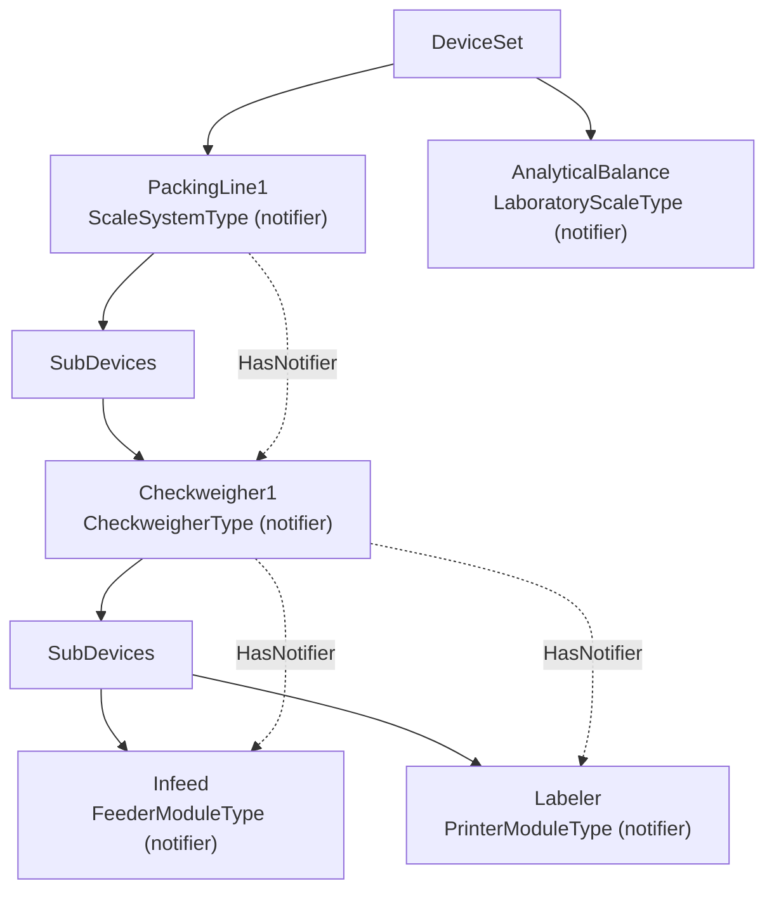

# OPC UA for Weighing Technology (OPC 40200)

The `Opc.Ua.Scales*` packages implement
[OPC 40200](https://reference.opcfoundation.org/specs/OPC-40200/full)
Weighing Technology 2.00, the companion specification for scales and scale
systems. It builds on OPC 40001-1 Machinery, OPC 10000-100 Device
Integration and OPC 30050 PackML.

- **Server side:** fluent builders publish scales with a working runtime.
  That runtime covers weighing arithmetic, zero and tare, product handling,
  statistics, the type-specific methods, recipes, PackML state machines,
  events and alarms.
- **Client side:** a client discovers the scales, reads them into typed
  snapshots, drives their methods and streams weights and notifications.

## Contents

- [Library layout](#library-layout)
- [The model](#the-model)
- [Where a scale lives](#where-a-scale-lives)
- [Quick start — server](#quick-start--server)
- [Quick start — client](#quick-start--client)
- [Server hosting](#server-hosting)
  - [`AddScales` and `ConfigureScales`](#addscales-and-configurescales)
  - [Composing with Machinery and other companions](#composing-with-machinery-and-other-companions)
  - [Direct composition and lifetime](#direct-composition-and-lifetime)
  - [Options](#options)
  - [Creating scales](#creating-scales)
- [Builder reference](#builder-reference)
  - [`IScaleBuilder`](#iscalebuilder)
  - [`IProductionPresetBuilder`](#iproductionpresetbuilder)
  - [`IScaleSystemBuilder` and `IScaleModuleBuilder`](#iscalesystembuilder-and-iscalemodulebuilder)
- [Runtime reference](#runtime-reference)
  - [`ScaleHandle`](#scalehandle)
  - [`ScaleNotifications`](#scalenotifications)
  - [`ScaleProductionPreset`](#scaleproductionpreset)
  - [`ScaleStatistics`](#scalestatistics)
  - [Type controllers](#type-controllers)
  - [Recipes](#recipes)
  - [PackML](#packml)
- [Client reference](#client-reference)
  - [Creating the client](#creating-the-client)
  - [Discovery](#discovery)
  - [Weighing](#weighing)
  - [Products, PackML, type methods and recipes](#products-packml-type-methods-and-recipes)
  - [Notifications and snapshots](#notifications-and-snapshots)
- [Contracts reference](#contracts-reference)
- [Conformance matrix](#conformance-matrix)
  - [Facets](#facets)
  - [Cross-cutting conformance units and behaviour](#cross-cutting-conformance-units-and-behaviour)
  - [Clause map](#clause-map)
- [Samples](#samples)
- [Testing](#testing)
- [Troubleshooting](#troubleshooting)
- [Known limitations](#known-limitations)
- [Model provenance](#model-provenance)
- [Where the specification and the NodeSet disagree](#where-the-specification-and-the-nodeset-disagree)
- [See also](#see-also)

## Library layout

| Package | Contents |
| --- | --- |
| `Opc.Ua.PackML` | The source-generated OPC 30050 PackML model. It also has `PackMLStateMachineController`, which drives the nested base / machine / execute state machines with their transition events |
| `Opc.Ua.Scales` | The source-generated OPC 40200 model. `ScalesModel` maps the 14 scale kinds, their product types and the Annex C notifications. `ScalesProfiles` holds the 21 facet URIs. The package also has the contracts both sides share |
| `Opc.Ua.Scales.Server` | `ScalesNodeManager`, the shared `ScalesRuntime`, scale/system/module/preset builders, runtime handles and controllers, and standalone or additive Machinery hosting |
| `Opc.Ua.Scales.Client` | `ScalesClient` for discovery, weighing, products, PackML, the type methods, recipes, snapshots and streaming. Also `AddScalesClient()` |

The contracts (`ScaleIdentification`, `WeighingRangeDefinition`,
`ScaleReading`, `ScaleSnapshot`, …) live in the model package. The server
fills them from its process and the client reads them back, and neither side
references the other.

All four packages target the stack's library frameworks. They are marked
NativeAOT-compatible on `net10.0`, and so are both samples.

## The model

| Model URI | C# namespace | Model loader |
| --- | --- | --- |
| `http://opcfoundation.org/UA/Scales/V2/` | `Opc.Ua.Scales` | `AddOpcUaScales` |
| `http://opcfoundation.org/UA/PackML/` | `Opc.Ua.PackML` | `AddOpcUaPackML` |

A Scales server must also expose the DI, IA, Machinery and PackML namespaces
(§13.1, Table 186). `ScalesNodeManager` loads all five into one node manager.

`ScaleDeviceType` is abstract. Every scale is one of 14 concrete subtypes,
and `ScaleKind` names them:

| `ScaleKind` | ObjectType | Product type | Facet | Runtime controller |
| --- | --- | --- | --- | --- |
| `Simple` | `SimpleScaleType` | `SimpleProductType` | Simple Scale | — |
| `Laboratory` | `LaboratoryScaleType` | `SimpleProductType` | Laboratory Scale | `LaboratoryController` |
| `Hopper` | `HopperScaleType` | `SimpleProductType` | Hopper Scale | `HopperController` |
| `WeighingModule` | `WeighingModuleType` | `SimpleProductType` | Weighing Bridge | — |
| `AutomaticFilling` | `AutomaticFillingScaleType` | `AutomaticFillingProductType` | AutomaticFillingScale | `AutomaticFillingController` |
| `Catchweigher` | `CatchweigherType` | `CatchweigherProductType` | Catchweigher | opt-in `CatchweigherController` |
| `Checkweigher` | `CheckweigherType` | `CheckweigherProductType` | Checkweigher | checkweigher statistics |
| `AutomaticWeightPriceLabeler` | `AutomaticWeightPriceLabelerType` | `AutomaticWeightPriceLabelerProductType` | AutomaticWeightPriceLabeler | opt-in `CatchweigherController` with equipment prices or an injected pricing policy |
| `Continuous` | `ContinuousScaleType` | `ContinuousProductType` | Continuous Scale | `ContinuousController` |
| `LossInWeight` | `LossInWeightScaleType` | `ContinuousProductType` | LossInWeight Scale | `LossInWeightController` |
| `PieceCounting` | `PieceCountingScaleType` | `PieceCountingProductType` | PieceCountingScale | `PieceCountingController` |
| `Recipe` | `RecipeScaleType` | `RecipeProductType` | RecipeScale | `RecipeController` |
| `TotalizingHopper` | `TotalizingHopperScaleType` | `TotalizingHopperProductType` | Totalizing Hopper Scale | opt-in `TotalizingHopperController` |
| `Vehicle` | `VehicleScaleType` | `VehicleProductType` | Vehicle Scale | `VehicleController` |

- `ScalesModel.ObjectTypeOf`, `KindOf`, `ProductTypeOf` and `AllKinds` map
  between the kinds and the type NodeIds.
- `ScalesProfiles.FacetOf(kind)` returns the facet URI of a kind.
- `ScaleSystemType` groups several scales. `FeederModuleType` and
  `PrinterModuleType` are sub-devices of a scale.

The weight itself is a `WeightItemType` variable (§9.3) with a `WeightType`
value of `Gross`, `Net` and `Tare`. Properties such as `Overload`,
`Underload`, `TareMode`, `WeightStable`, `InsideZero` and `CurrentRangeId`
qualify it. Every scale has `CurrentWeight`; `RegisteredWeight` holds the last
value `RegisterWeight` recorded.

## Where a scale lives

A scale is both a DI device and a Machinery machine, so a conforming server
publishes the top-level node in two places:

- as a child of the DI `DeviceSet`, and
- through an `Organizes` reference from the Machinery `Machines` folder.
  The Scales specification never mentions this folder. It is still required
  transitively, because the mandatory *Machinery Machine Identification*
  facet includes the CU *Machinery Find Machines*.

`ScalesRuntime`, shared by standalone and composed hosts, does both by default
(`ScalesServerOptions.OrganizeIntoMachinesFolder`). With the option turned
off, the server no longer advertises the facets that include *Machinery
Machine Identification*: Base Scale and every kind facet, Scale System,
Feeder Module and Printer Module. The production preset and SI unit facets
do not include it and stay advertised.

Everything below a top-level node follows the DI modular-device pattern
(§6.3):



- **SupportedTypes.** The NodeSet's `SupportedTypes` folders carry no
  `Organizes` references. The builders add them per instance.
- **Event notifiers.** Every event source is a notifier: scale systems,
  scales, weighing modules, and feeder and printer modules. A nested source is
  linked from its nearest notifier ancestor by `HasNotifier`. A client can
  therefore subscribe to a nested scale directly, or to the system and
  receive the events of everything below it.

## Quick start — server

```csharp
builder.Services
    .AddOpcUa()
    .AddServer(options => { /* application name, endpoints, … */ })
    .AddScales()
    .ConfigureScales(async context =>
    {
        ScalesNodeManager manager = context.Manager;
        ScaleHandle scale = await manager.CreateScaleAsync(
            new QualifiedName("AnalyticalBalance", manager.InstanceNamespaceIndex),
            ScaleKind.Laboratory,
            b => b
                .WithIdentification(new ScaleIdentification
                {
                    Manufacturer = new LocalizedText("Contoso Lab"),
                    SerialNumber = "AB-220",
                    ProductInstanceUri = "urn:contoso:weighing:AB-220"
                })
                .WithWeighingRange(new WeighingRangeDefinition(0, 0.22, 0.0000001, 0.000001))
                .WithUnit(ScaleUnits.Kilogram)
                .WithAllowedEngineeringUnits(ScaleUnits.Kilogram, ScaleUnits.Gram)
                .WithWeightDetails()
                .WithZeroAndTare()
                .WithRegisterWeight()
                .WithTypeFeatures(),
            context.CancellationToken);

        // Keep the handle; the process publishes loads through it.
        scale.PublishLoad(0.1);
    });
```

`WithIdentification` and at least one `WithWeighingRange` are required,
because `Identification` and `<ListOfWeighingRanges>` are mandatory (§7.4.2).
Every other member is materialised only when a builder call asks for it, and
the runtime binds exactly what was materialised. For example, a scale built
without `WithZeroAndTare` has no `SetZero` method, not one that fails.

## Quick start — client

```csharp
ScalesClient scales = session.Scales(telemetry);   // registers the OPC 40200 structures
if (!scales.IsSupported)
{
    return;
}

await foreach (ScaleEntry entry in scales.EnumerateScalesAsync(ct))
{
    ScaleSnapshot snapshot = await scales.ReadSnapshotAsync(entry, ct);
    Console.WriteLine($"{entry.DisplayName.Text}: {snapshot.CurrentWeight.Gross}");
}

await scales.SetTareAsync(scaleId, ct);
ScaleReading? registered = await scales.RegisterWeightAsync(scaleId, ct);

await foreach (ScaleReading reading in scales.ObserveWeightAsync(scaleId, cancellationToken: ct))
{
    Console.WriteLine(reading.Net);
}
```

Create the client through `session.Scales(...)`. It registers the OPC 40200
encodeable types, so `WeightType` and the recipe structures decode into their
generated classes. Without it they arrive as `ExtensionObject`.

## Server hosting

### `AddScales` and `ConfigureScales`

- **`AddScales(configure)`** registers `ScalesNodeManager` and validates the
  options. It also claims the Device Integration address space, because the
  node manager loads DI itself.
- **`ConfigureScales(...)`** registers a delegate that runs once the address
  space exists. It comes in sync and async overloads.
  - Delegates run in registration order.
  - An exception aborts server startup.
  - The delegate receives an `IScalesSetupContext` with the `Manager`, the
    `CancellationToken` and `GetRequiredService<T>()`.

A second DI owner, such as `AddOpcUaDi`, is rejected with an
`InvalidOperationException` at registration time.

### Composing with Machinery and other companions

Use `AddScalesToMachinery()` after `AddMachinery()` instead of registering a
second owner with `AddScales()`. The Machinery options must include
`MachineryParts.BuildingBlocks`.

```csharp
using Microsoft.Extensions.DependencyInjection;
using Opc.Ua;
using Opc.Ua.Machinery.Server;
using Opc.Ua.Scales;
using Opc.Ua.Scales.Server;
using Opc.Ua.Scales.Server.Runtime;
using Opc.Ua.Server;

services.AddOpcUa()
    .AddServer<StandardServer>(ConfigureServer)
    .AddMachinery(options =>
    {
        options.Parts = MachineryParts.BuildingBlocks;
        options.InstanceNamespaceUri = "urn:acme:plant:instances";
    })
    .AddScalesToMachinery(options => options.RequireSiUnits = true)
    .ConfigureScalesFor<MachineryNodeManager>(async (context, ct) =>
    {
        ScalesRuntime scales = context.Runtime;
        ScaleHandle scale = await scales.CreateScaleAsync(
            new QualifiedName("BaggingScale", scales.InstanceNamespaceIndex),
            ScaleKind.AutomaticFilling,
            builder => builder
                .WithIdentification(new ScaleIdentification
                {
                    Manufacturer = new LocalizedText("Acme"),
                    SerialNumber = "S-1",
                    ProductInstanceUri = "urn:acme:scale:S-1"
                })
                .WithWeighingRange(new WeighingRangeDefinition(0, 30, 0.005, 0.01))
                .WithZeroAndTare()
                .WithRegisterWeight()
                .WithPackMLState()
                .WithTypeFeatures(),
            ct);
        scale.PublishLoad(12.5);
    });
```

`ScalesMachineryModelProvider` uses the existing `IMachineryModelProvider`
pipeline. DI, IA and Machinery load first; PackML loads before Scales and is
not loaded again when another provider already supplied it. The server package
references `Opc.Ua.Machinery.Server` for this composition infrastructure;
standalone servers still load the same dependency models as before.

`ConfigureScalesFor<TNodeManager>` accepts
`Func<IScalesBuildContext, CancellationToken, ValueTask>`. Successive callbacks
share one `ScalesRuntime`, and run before the Machinery builder is sealed.
`context.Manager` is the existing owner, not a `ScalesNodeManager` created behind
the scenes. `GetRequiredService<T>()` provides injectable application services.
The standalone manager's methods delegate to that same runtime implementation.

Composition covers all fourteen `ScaleKind` values, `CreateScaleSystemAsync`,
weighing subdevices, feeder/printer modules, product methods and DI locking,
PackML state, recipe/report files, and scale events and alarms. It does not add
new kind-specific behavior beyond the existing runtime; the
[known limitations](#known-limitations) apply equally to both hosting paths.
Scales conformance contributions are aggregated by the shared owner.

Add [`AddPumpsToMachinery()`](Pumps.md#coexisting-with-a-server-that-already-owns-di)
to host pumps alongside these scales. Both runtimes mint instances in
`MachineryServerOptions.InstanceNamespaceUri` and preserve their native type
definitions and browse-name namespaces. Additional model namespaces belong in
`AdditionalNamespaceUris`; do not repeat the owner's instance URI there.

For [AMB](AMB.md), also register `AddAssetManagement()` and use the existing
owner inside the Scales configurator:

```csharp
await context.GetRequiredService<Opc.Ua.AMB.Server.Assets.IAssetManagement>()
    .RegisterAssetAsync(
        context.Manager.Device(scale.Scale).Node,
        asset => asset.WithConfigurableAssetId("S-1"),
        ct);
```

AMB is a sidecar: the scale and all asset additions remain in the Machinery
owner. Nested scale/module events remain linked through `HasNotifier`, so clients
may subscribe to the subdevice, its scale system, or the server.

### Direct composition and lifetime

Without dependency injection, supply `new ScalesMachineryModelProvider()` and
`new MachineryModelProvider(MachineryParts.BuildingBlocks)` to a
`MachineryNodeManager`. After its address space has initialized, obtain
`ScalesRuntime scales = owner.CreateScalesRuntime(options)` and call
`CreateScaleAsync` or `CreateScaleSystemAsync` exactly as in the hosted callback.
The first call selects the runtime options; subsequent calls return the same
runtime. On a standalone `ScalesNodeManager`, this returns its existing `Runtime`.

The stock Machinery manager owns the composed runtime's lifetime. Shutdown
cancels queued publications, drains active constructions, closes recipe/report file
handles and content buffers, and detaches the product lock service from session
notifications. Repeated and concurrent asynchronous disposal share the same
completion and receive the same shutdown error, if any. An application-owned
DI manager also releases the registered runtime automatically; it does not need
a Machinery-specific disposal override.

Equipment pricing providers receive the runtime cancellation signal. If a
provider's cancellation callback throws, shutdown still drains admitted
constructions and attempts every owned cleanup before returning the error.
When cancellation and cleanup both fail, the returned `AggregateException`
retains both failures. The shared controller services also retain their drain
completion after synchronous disposal, so a later asynchronous caller still
waits for running callbacks and receives any cleanup error. Resource cleanup
failures are logged at Error level with event ID 8240
(`ScalesServerEventIds.ScaleRuntimeServices`), including when only synchronous
disposal was requested.

Shared services stop every controller before awaiting any resource's
asynchronous drain. An overlapping synchronous `Dispose` also stops every
controller before returning, even if the first caller has not yet reached it.
These stops run outside service synchronization and can repeat; they do not
wait for subscriber callbacks. Asynchronous callers still share one drain
completion.

### Options

| `ScalesServerOptions` | Default | Meaning |
| --- | --- | --- |
| `OrganizeIntoMachinesFolder` | `true` | Add top-level scales and systems to the Machinery `Machines` folder; required for every facet that includes *Machinery Machine Identification* |
| `RequireSiUnits` | `false` | Accept only SI mass units as method inputs and advertise the *International System of Units* facet |
| `PackMLInitialState` | `Idle` | The state a PackML state machine starts in (`Aborted`, `Stopped` or `Idle`) |
| `ZeroSettingRange` | `0.04` | The zero band as a fraction of the capacity, for `SetZero`, `InsideZero` and underload |
| `AdditionalNamespaceUris` | `[]` | Extra namespaces for vendor extensions |

### Creating scales

| `ScalesNodeManager` / `ScalesRuntime` member | Purpose |
| --- | --- |
| `CreateScaleAsync(name, kind, configure[, parent])` | A scale below the `DeviceSet`, or below an explicit parent |
| `CreateScaleSystemAsync(name, configure)` | A scale system with its scales |
| `Scales`, `ScaleSystems`, `FindScale(nodeId)` | The handles of everything created, weighing modules and system scales included |
| `LockService` | The DI `ILockService` behind product locking |
| `NamespaceIndices` | The runtime indices of the Scales, DI, Machinery, PackML and IA namespaces |
| `ServerProfiles`, `ConformanceUnits` | What the server advertises, derived from what was built |

## Builder reference

### `IScaleBuilder`

The item, completed-fill, vehicle-total, piece-count and recipe-configuration
extension methods require the optional `IScaleRuntimeBuilder` capability,
implemented by the stock builder. Existing implementations of `IScaleBuilder`
do not need additional members; requesting these capabilities from a builder
that does not implement them throws `NotSupportedException`.
`WithRecipeReleaseCheck` composes `ConfigureRecipes` rather than adding another
required interface member.

| Call | Materialises |
| --- | --- |
| `WithIdentification(identification)` | The mandatory Machinery `Identification` add-in, mirrored onto the DI nameplate. Manufacturer, SerialNumber and ProductInstanceUri are required |
| `WithWeighingRange(range)` | One `WeighingRangeElementType`. Call it once per range of a multi-range scale; ranges are ordered by capacity |
| `WithUnit(unit)` | The engineering unit of every weight (default kilogram) |
| `WithAllowedEngineeringUnits(units)` | `AllowedEngineeringUnits`, which `SetPresetTare` checks against (§7.4.3). Published automatically with the scale unit when a method takes a unit |
| `WithMinimalWeight(weight)` | `MinimalWeight` |
| `WithLegalForTrade()` | `LegalForTrade`. Weights round to the verification interval `e` instead of `d` |
| `WithWeightDetails()` | The optional `WeightItemType` properties: `WeightStable`, `InsideZero`, `CenterOfZero`, `GrossNegative`, `CurrentRangeId`, `WeightId`, `HighResolutionValue`, `PrintableValue` |
| `WithZeroAndTare(presetTare)` | `SetZero`, `SetTare`, `ClearTare` and, unless `presetTare` is false, `SetPresetTare` |
| `WithRegisterWeight()` | `RegisterWeight` and `RegisteredWeight` |
| `WithProductionPreset(configure)` | `ProductionPreset` with products; see below |
| `WithProductionOutput()` | Generic scale `ProductionOutput` statistics. On a checkweigher, also initializes each product's separate `CheckweigherStatisticType` nodes for explicit disposition reports |
| `WithPackMLState()` | The PackML `State` machine, driven by `PackMLStateMachineController` |
| `WithMachineryBuildingBlocks()` | `MachineryItemState`, `MachineryOperationMode` and the `MachineryBuildingBlocks` folder, wired as add-ins |
| `WithProcessState(id, message)` | `ProcessStateId` and `ProcessStateMessage` |
| `WithTypeFeatures()` | Every optional member of the kind, for example the laboratory draft shields, the vehicle weighing methods, recipe management, or the continuous-scale figures and master totalizer |
| `WithVehicleTotals(aggregation)` | Materializes vehicle totals and selects signed or absolute aggregation by `VehicleId`, or product id when no vehicle id is set |
| `WithItemProcessing(calculator)` | Registered catchweigher or price-labeler item reports, product/output statistics and typed `LastItem`; an optional injected `IScalePriceCalculator` calculates labeler prices |
| `WithCompletedFills()` | Completed-fill reports and the selected totalizing-hopper product's `TipCounter` |
| `WithPieceCountingTotals()` | `RegisterWeight` and per-product totalized item counts and weights |
| `ConfigureRecipes(configure)` | Post-construction recipe runtime configuration, shared by standalone, DI and composed hosting |
| `WithRecipeReleaseCheck(check)` | Application-owned enabled/released precondition for recipe scales without PackML |
| `WithRecipeFiles()` | A `RecipeFile` on every recipe of a recipe scale (*FileRecipeManagement*) |
| `AddTotalizer(name)` | A `<Totalizer>` on a continuous or loss-in-weight scale |
| `AddFeederModule(name, configure)` / `AddPrinterModule(name, configure)` | Sub-devices below `SubDevices` |
| `AddWeighingModule(name, configure)` | A `WeighingModuleType` sub-device. It is a scale of its own with its own builder and handle |
| `With<TState>(configure)` | Direct access to the typed node for anything not covered above |

### `IProductionPresetBuilder`

| Call | Effect |
| --- | --- |
| `AllowSelection()` | `SelectProduct`, `DeselectProduct`, `SwitchProduct` and `CurrentProducts` (*SelectProduct*) |
| `AllowManagement()` | `AddProduct` and `RemoveProduct` (*ManageProduct*, *DynamicProductAddressSpace*) |
| `WithLocking()` | A DI `Lock` on every product. A held lock excludes other sessions from remote product mutation (§7.8.3) |
| `AddProduct(id, name, configure)` | A product of the kind's product type. `configure` gets the typed node, for example to set a checkweigher's `NominalWeight` |
| `Select(id)` | Puts the product into processing |

A preset without `AllowManagement` is a *StaticProductAddressSpace*. It needs
at least one product, because `<Product>` is a mandatory placeholder.

### `IScaleSystemBuilder` and `IScaleModuleBuilder`

A system takes `WithIdentification`, `WithProcessState`,
`WithProductionPreset`, `WithProductionOutput`, `WithPackMLState` (its
`SystemState`) and `WithMachineryBuildingBlocks`. `AddScale(name, kind,
configure)` adds each scale. §7.3.3 says the scales of one system must be of
different types. The builder does not enforce this.

A module takes `WithIdentification`, whose identification node is a
`MachineryComponentIdentificationType` because the declared
`MachineryItemIdentificationType` is abstract, and
`WithMachineryBuildingBlocks`. A feeder also takes `WithFeederSpeed(min, max,
unit, initial)`. A printer takes `WithLabel(labelTypeId, length, width,
unit)`.

## Runtime reference

### `ScaleHandle`

The application publishes the raw load. The handle does the rest.

| Member | Purpose |
| --- | --- |
| `PublishLoad(rawLoad, stable)` | Evaluates the load and publishes `CurrentWeight` with every property |
| `SetZero()`, `SetTare()`, `ClearTare()`, `SetPresetTare(value, unit)`, `RegisterWeight()`, `RegisterWeightAsync(ct)` | The same operations the methods run, for local operator panels; asynchronous registration awaits write admission |
| `CurrentReading`, `RegisteredReading` | The last published values as `ScaleReading` |
| `WeightRegistered` | Raised on every registration, whether by method or locally |
| `CommandInterceptor` | A `Func<ScaleCommand, ServiceResult>` that can veto any method before it runs, for example while the machine is interlocked |
| `Notifications` | Events and alarms, see below |
| `PackML`, `ProductionPreset`, `ProductionOutput` | The PackML controller, the product runtime and the statistics |
| `Continuous`, `LossInWeight`, `PieceCounting`, `Laboratory`, `Hopper`, `Vehicle`, `Recipes`, `AutomaticFilling` | The kind-specific controller, or null |
| `Modules`, `WeighingModules` | Feeder/printer handles and weighing-module scale handles |
| `SetItemState`, `SetOperationMode`, `SetProcessState` | The Machinery states and the process state |
| `Update(action)` | Runs application code that writes several values of the scale (for example typed nodes reached through `With<TState>`) as one step |

**Threading.** The runtime members of a scale, of its type controller and of
its feeder and printer modules take the scale's lock, so they are safe to call
from any thread. A client method call and an equipment-side report such as
`SetActivity` or `CompleteCalibration` therefore never interleave: a method
that checks a flag sees either the whole report or none of it. The lock is
re-entrant, so code inside `Update` may call these members.

The recipe controller, the production preset, the statistics, the
notifications, the PackML controller and a continuous scale's totalizers
synchronise on locks of their own. They are thread-safe as well, but `Update`
does not keep their calls out. The `Update` delegate runs under the scale's
lock and holds up every method call on the scale meanwhile, so keep it short
and synchronous: no I/O, no waiting and no calls into other locks.

- **Operator commands** (`SetZero`, `SetReferencePieceWeight`,
  `InboundWeighing`, …) pass the `CommandInterceptor`, like the methods.
- **Equipment reports** (`PublishLoad`, `PublishHopper`, `SetActivity`,
  `CompleteCalibration`, `PublishFeeder`, …) take the lock but skip the
  interceptor: the equipment reports what happened, it does not ask.
- **Native OPC UA Value-write paths** retain runtime admission through
  validation, callback dispatch and the correlated value/status/timestamp cache
  commit. A synchronous write that overlaps awaited acquisition publication
  returns `BadInvalidState` without invoking its callback or changing the value.
  An asynchronous write waits for admission and can be cancelled while waiting.
  Custom implementations use the protected async core hook described below.
- **Direct node-property assignments** do not join runtime admission; the
  application must serialize them, including writes inside its own callbacks.

**Weighing arithmetic (§9.3):**

- **Gross and net.** Gross is the load minus the zero offset `SetZero`
  established. Net is gross minus the tare.
- **Weighing range.** The range is the first one whose upper limit is not
  exceeded.
- **Rounding.** Values round to the range's `d`, or to `e` when the scale is
  legal for trade, and snap to that interval's decimal places. The
  high-resolution value keeps full precision.
- **Overload** is gross above the largest capacity.
- **Underload** is gross below zero by more than the zero band. A scale
  resting slightly below zero needs a zero, not an underload alarm.
- **Unstable weights.** `SetZero`, `SetTare` and `RegisterWeight` refuse an
  unstable weight. `SetZero` also refuses a weight outside the zero band.
- **Registration** refuses an overload or underload.

### `ScaleNotifications`

- `RaiseEvent(id, message, severity, auxParameters)` raises a
  `ScaleEventType` with the Annex C `NotificationId` and its category.
- `RaiseVendorEvent` does the same for vendor ids, which must be above 5000.
- `SetAlarm(id, active, message)` drives one `ScaleAlarmType` condition per
  notification id. The condition is created on first use and carries a
  `HasCondition` reference from its source.
- The overloads that accept `ArrayOf<string>` publish `AuxParameters`,
  `HelpSource`, and `VendorNotificationId` as optional notification metadata
  (OPC 40200 v2.00 §8.1.3 and §8.2.3). `RaiseVendorEvent` uses its `name`
  argument as the vendor identifier. The publisher copies auxiliary parameters;
  changing the caller's array after publication does not change the event or alarm.
- Alarm metadata changes with the active-state transition. Repeating the same
  active state returns `false` without changing metadata. A transition that
  omits metadata clears the previous optional values; an explicitly empty
  auxiliary array remains distinguishable from an absent array.
- The runtime raises some notifications by itself:
  - `OVERLOAD_FAULT` and `UNDERLOAD_FAULT` alarms follow the weight.
  - A failed zero or tare raises `ZERO_SETTING_FAULT` or
    `TARE_SETTING_FAULT`.

### `ScaleProductionPreset`

The methods and the local API share the same rules.

- **Products.** `AddProduct`, `RemoveAsync`, `Select`, `Deselect` and
  `Switch`. `Switch` fails with `BadInvalidState` when more than one product
  is in processing (§7.7.8).
- **Locking.** On a preset built `WithLocking`, a held DI product lock rejects
  other sessions' mutations with `BadUserAccessDenied`, including direct Value
  writes, nested or later-created descendants and scale-level methods that
  change the product. The creating/owning session is distinct even when another
  session has the same username. Unlocked products retain ordinary access
  checks, and trusted equipment updates remain available through the local API.
  Stock writable variables use a native async cache-write policy with these
  same access checks. Custom synchronous-only write handlers are not called by
  the async path; provide a native async implementation for those handlers.
- **Catchweigher zones.** Zones come from `AddZone`.
- **Vehicle information.** `VehicleInformationProvider` answers
  `GetVehicleInformation` from the application's vehicle database.

### `ScaleStatistics`

- `Record`, `RecordAccepted` and `RecordRejected(weight, reason)` maintain
  counts, sum, min, max, mean and standard deviation, and `LastItem`.
- `Reset` clears them.
- On a checkweigher, each `CheckweigherRejectReason` counts into its own
  `PackagesRejectedBy…` counter.
- `PercentageLowerToleranceLimit` divides the accepted item count in the
  TU1-TU2 band by the total accepted item count (§7.19.3). Rejected items do not
  enter the denominator. These counts are maintained even when the optional
  accepted-total or band-counter nodes are absent. `Reset` clears both counts;
  with no accepted items the percentage is zero.
- Optional counter `PercentageOfTotal` divides each counter's item count by
  the overall package count (§7.20.3). Every report refreshes counters whose
  own count did not change. The denominator remains available without the
  optional `TotalPackages` node. An accepted unweighed item does not increment
  `TotalPackagesWeighed`.

`WithProductionOutput(ScaleStatisticsObservationMode.Sample)` selects the sample
standard-deviation equation; `FullCheck` selects the equation for a 100% check.
The selected mode also applies to product-local acquisition statistics.
The default is `Sample`; parameterless calls preserve a previously selected mode.
Direct recorders accept the mode in the `ScaleStatistics` constructor. The
runtime uses Welford's weight moments with divisor `n - 1` for samples and `n`
for a full check. Empty statistics and one-item samples publish a numeric
placeholder of zero with `BadNoData`, not a computed deviation. A one-item full
check publishes zero with Good quality. Reset restores `BadNoData` until enough
weighed observations exist for the selected equation. These status choices are
runtime policy; the specification defines the equations but not their no-data
status behavior.

An unweighed item still increments `ItemCount`, but its missing weight makes the
weight aggregates incomplete. `SumWeight`, min, max, mean and a defined deviation
retain the measured-subset result with `UncertainSubNormal`; no weighed
observations produce `BadNoData`. An empty sum is zero with Good quality, while
empty min, max and mean use zero placeholders with `BadNoData`. A later weighed
item does not restore complete quality for a period that contains an unweighed
item. Reset starts a new period and restores quality as new measurements arrive.
An overflowing aggregate retains its last finite value with `BadOutOfRange`.
Direct `Record`, `RecordAccepted` and `RecordRejected` calls reject positive and
negative infinity with `ArgumentOutOfRangeException` before changing counters.

OPC 40200 [§7.20.1](https://reference.opcfoundation.org/specs/OPC-40200/7.20.1)
and [§7.20.3](https://reference.opcfoundation.org/specs/OPC-40200/7.20.3)
define `Weighed` as a category's participation in `TotalPackagesWeighed`.
[§7.19.3](https://reference.opcfoundation.org/specs/OPC-40200/7.19.3) also
allows rejected packages from processes before or after weighing. The recorder
accepts measured and unmeasured reports within the same category, including
rejection categories. When a category counter exposes `Weighed`, it is true
only when every item has a measurement. Mixed categories report false with
`UncertainSubNormal`; categories with only unmeasured items report false with
Good quality. `TotalPackages` always reports `Weighed=false` because it counts
every item. `TotalPackagesWeighed` counts every measured item, even within a
mixed category; unmeasured items do not increase it.

The dynamic `Weighed` value describes measurement completeness, not fixed
category participation. It cannot identify which items in a mixed category
contribute to `TotalPackagesWeighed`. The support rating remains Partial pending
clarification of how OPC 40200 represents mixed-category participation.
Implementing fixed category membership would require rejecting reports that
differ from a category's measurement policy or introducing separate measured
and unmeasured categories. Existing applications are not required to adopt
either behavior.

Recorder reset includes zone counters previously recorded through that same
recorder, even though those counters are outside the statistic's child nodes.
`CatchweigherController.ResetProductStatisticsAsync` resets the selected
product through its retained acquisition recorder, including those zone
counters. The reset retains the product reservation and write admission
through asynchronous notification delivery. Other products and scale-wide
totals retain their periods, and the acquisition sequence high-water mark
does not change: a period reset does not permit replaying a previously accepted
report. `StartTime` and `ResetCondition` describe the new period; this
application-facing operation does not add a UA Reset method.

A reset callback cannot start another same-scale write before the remaining
counters have been reset. Reports, period resets, scalar registration, and
native Value writes invoked from that active reset flow return
`BadInvalidState` instead of waiting for the reset that invoked them.
Other asynchronous operations through the same admission path raise
`ServiceResultException` with that status. Unrelated asynchronous writers
remain queued and run after reset delivery completes. This restriction
belongs to the new correlated reset operation; it does not change the
separate enum-notification nested-write contract.

On a checkweigher, `GiveAway` is `(acceptedMean - currentNominalWeight) *
acceptedCount` (§7.19.3), including negative results. The accepted-weight
accumulator does not depend on the optional `TotalPackagesAccepted` node.
The calculation reads the current product `NominalWeight` on each accepted or
rejected-item report, rather than accumulating deviations against historical
nominal weights. A direct recorder may instead receive an explicit nominal
weight. Reset and a period with no accepted items publish zero. Missing nominal
data or an accepted item without measured weight preserves the last value with
`BadNoData`; a nonfinite result preserves it with `BadOutOfRange`. A bad nominal
status is propagated without changing the last value; uncertain nominal data
can produce a value with the same uncertain status.
After the product recorder is initialized, a supported native or OPC UA Value
write to `NominalWeight` recomputes `GiveAway` before releasing cache-write
admission. The derived notification follows after writer ownership is released,
while notification admission keeps unrelated asynchronous writers queued.
An asynchronous callback may await another same-scale write. Synchronous
observers run inline before asynchronous observers, and exceptions from either
kind propagate to the caller. Recalculation
does not depend on clearing the nominal node's change masks or on the manager's
monitored-item implementation. Assigning `WrappedValue` directly bypasses this
write path; the next accepted or rejected report then refreshes the result.

The packing-line sample selects `FullCheck` for its checkweigher because the
simulation reports every package.

### `CheckweigherController`

`scale.Checkweigher.RecordAcceptedAsync` and `RecordRejectedAsync` update both
the generic scale totals and the selected product's separate acceptance,
rejection, percentage, and giveaway statistics. The equipment supplies the
disposition and rejection reason; the controller does not infer acceptance from
weight or from a generic registered-item report.

`WithProductionOutput` initializes the checkweigher product statistics before
registration, including products added later through the preset. Each product
retains its own recorder and the scale's observation mode. Switching products
does not reset a period. A report holds the active-product reservation
until both targets' notifications complete. It commits
both statistic caches before atomically transferring writer admission to
notification admission; same-flow asynchronous callbacks can therefore reenter.
`ResetAsync` resets the selected product and scale totals; other products'
periods remain unchanged. Its callbacks use the same correlated-publication
restriction as catchweigher product-period reset: nested reports, resets,
scalar registration, and native Value writes return `BadInvalidState`, while
external asynchronous writers wait.

Accepted reports require a finite measured weight. Rejected reports accept
`NaN` for an unweighed package, which increments the package and rejection
counts but not the weighed count. Missing selected-product statistics returns
`BadInvalidState` before recording. The existing direct `ScaleStatistics`
methods update only the statistic passed to that recorder; generic scale
`ProductionOutput` is not a checkweigher product statistic.

A recorder whose initialization callback throws is not cached; a later report
retries initialization before counting its item. Initialization observers run
before the recorder is cached or the first item is counted. Same-flow writes
return `BadInvalidState` during initialization rather than waiting for their
own publisher. Synchronous observers still precede asynchronous observers.
After report-cache commit, a notification exception propagates without undoing
either product or scale
counts. Remaining notifications do not run. A repeated call is a new report,
not a retry identified by `itemId`: this controller does not provide duplicate
suppression. Successful product removal explicitly retires its recorder and
nominal-value associations; rejected removal of an active product preserves them.
The associations also use weak keys, so they do not independently retain a
removed statistic and its parent subtree. Re-adding the same product id creates
an independent period.

Both deviation equations and the giveaway equation are verified in the
[VDMA 40200:2025-04 co-publication](https://www.vdma.eu/en/catalog-detail/-/catalog/14137),
which identifies itself as identical to OPC 40200 Release 2.00: §7.19.3 on
page 72 and §7.20.3 on page 74. The runtime implements both observation modes,
current-nominal GiveAway refresh, optional counters, and quality propagation.
OPC 40200 support remains **Partial** because mixed-category `Weighed`
does not represent fixed category participation, and ordinary notification
reentry does not isolate writes originating in overlapping callbacks.

### Type controllers

| Controller | Behaviour |
| --- | --- |
| `ContinuousController` | `PublishFlow`, `Totalize`, `ResetTotalizer` (method and local) |
| `LossInWeightController` | `DischargeStart/Stop`, `RefillStart/Stop` reflected in `Discharging`/`Refilling`; `PublishHopper` |
| `PieceCountingController` | `SetReferencePieceWeight`, `SetNumberOfReferencePieces`, `StartReference` (method and local; the local `SetReferencePieceWeight(weight, unit)` takes the real weight, the method a UInt32); derives `CurrentPieceCount` from net weight and updates the product's `RegisteredPieceCount` on registration; with `WithPieceCountingTotals`, it also updates configured totals |
| `LaboratoryController` | Draft shields, leveling, calibration and ionisator with their `*Running` flags. `CompleteImmediately` or `CompleteLeveling` / `CompleteCalibration` end the running operations |
| `HopperController` | `PublishLevels` for the limit switches and levels |
| `AutomaticFillingController` | `EvaluateFilling` sets `Deviation` and `ToleranceState` against the product target |
| `VehicleController` | Native asynchronous and local weighing methods; signed `DeltaWeight`, per-vehicle signed/absolute totals and asynchronous total reset |
| `RecipeController` | Recipe management and processing, see below |
| `CatchweigherController` | `ReportAsync` publishes a registered item, its dimensions, zone and optional price |
| `TotalizingHopperController` | `ReportCompletedFillAsync` increments the selected product's `TipCounter` once per completed acquisition |

#### Vehicle transaction totals

`WithVehicleTotals` adds `TotalWeight` and `TotalWeightResetDate` to existing
and subsequently added vehicle products. The application supplies the
aggregation rule for each vehicle; this is a runtime policy, not an OPC 40200
requirement about the sign of a vehicle total:

```csharp
scale.WithVehicleTotals(vehicleId => vehicleId == "DELIVERY"
    ? VehicleWeightAggregation.Absolute
    : VehicleWeightAggregation.Signed);
```

`Signed` adds the transaction's signed net weight. `Absolute` adds its magnitude,
so both loading and unloading increase the total. Neither mode changes
`DeltaWeight`: an inbound/outbound transaction remains inbound minus outbound;
a one-pass weighing or outbound weighing without a pending inbound remains
outbound minus the vehicle's preset tare. A successful outbound or one-pass
weighing completes a transaction. An inbound weighing and intervening live
readings do not change the total.

Use `SetTotalWeightAggregationAsync(vehicleId, mode)` to configure one vehicle
directly or override its fluent policy without clearing accumulated weight.
`ResetTotalWeightAsync(vehicleId)` clears that vehicle's total and updates
`TotalWeightResetDate`; it retains the aggregation rule and any unfinished
inbound weighing. An explicitly materialized total without a configured policy
uses signed aggregation. Invalid policies and nonfinite totals reject completion
before consuming the pending inbound measurement.

`InboundWeighingAsync`, `OutboundWeighingAsync` and `OnePassWeighingAsync`, and
the corresponding OPC UA methods, hold scale write admission through their
asynchronous state notifications. Cancellation while awaiting admission leaves
the transaction and total unchanged. The client exposes
`ReadVehicleWeightsAsync(productNodeId)` with separate presence, status and
source-time fields for the measurements, total and reset date. The sample
weighbridge selects absolute aggregation; its choice does not assert that a
physical vehicle or weighing instrument is ready.

#### Piece-count registration totals

Each piece-counting product has `RegisteredPieceCount`, which records the
calculated count from its last successful runtime registration.
`WithPieceCountingTotals()` materializes
`TotalizedItemCount` and `TotalizedWeight` on each product, and adds
`RegisterWeight` and `RegisteredWeight` if they were not already configured.
A successful `RegisterWeightAsync` or OPC UA `RegisterWeight` adds the current net weight to
the configured weight total. When the selected product has a valid reference
piece weight, the same registration adds the calculated count to both
`RegisteredPieceCount` and `TotalizedItemCount`. If the reference is missing or
invalid, registration still records the weight; the registered count is marked
`BadNoData`, and the item-count total is left unchanged.

Selecting a product clears that product's configured totals, so a product
selected again starts a new accumulation. Applications can also reset one
product explicitly:

```csharp
scale.PieceCounting!.SetReferencePieceWeight(0.0005);
ServiceResult result = await scale.RegisterWeightAsync(cancellationToken);
if (ServiceResult.IsGood(result))
{
    await scale.PieceCounting.ResetTotalsAsync("M4-SCREW", cancellationToken);
}
```

The client reads the registered count and both optional totals with independent
quality and source-time fields through `ReadPieceCountingTotalsAsync(product)`.
The Scales sample configures a reference weight, registers simulated loads and
reads the resulting totals. This feature records scale registrations; it does
not infer piece counts from unrelated production reports.

#### Registered items and completed fills

Use `WithItemProcessing()` on a catchweigher or price labeler and
`WithCompletedFills()` on a totalizing hopper. Both require a production preset
with a single product in processing. They add the product statistics and
observation members before publication; products created later through
`AddProduct` receive the same members and write guards.

A report reserves the product in processing through publication. While that
reservation is held, `Select`, `Deselect` and `SwitchProduct` calls that would
change the product in processing return `BadInvalidState` and change nothing;
retry them after publication finishes. A report for a product that has left
processing returns `BadInvalidState` and publishes nothing.

An equipment report contains a nonzero, increasing acquisition `Sequence`, the
selected `ProductId`, an `ItemId` and a registered `ScaleReading`:

```csharp
ServiceResult result = await scale.Catchweigher!.ReportAsync(new ScaleItemReport
{
    Sequence = acquisitionSequence,
    ProductId = "CHEESE",
    ItemId = itemId,
    Weight = new ScaleReading
    {
        Gross = 550,
        Net = 500,
        Tare = 50,
        EngineeringUnits = ScaleUnits.Gram,
        Timestamp = sourceTimestamp,
        StatusCode = StatusCodes.Good
    }
}, ct);
```

The controller converts known mass units to the scale unit, checks the
gross/net/tare relationship and rejects bad, overloaded or underloaded registered
weights before changing counters. Each optional dimension carries its own unit,
source timestamp and status. An omitted dimension becomes `BadNoData`; the
previous item's dimension does not remain valid. Measured dimensions do not
overwrite `PresetHeight`, `PresetLength` or `PresetWidth`, which belong to
configuration before measurement (§7.12.3).

The item updates `RegisteredWeight`, product `LastItem` and product/output
statistics. Do not call scalar `RegisterWeight` for the same acquisition:
equipment already supplied its registered weight. Zone classification converts
both limits to the scale unit and rejects overlapping or incompatible ranges.
At a shared boundary the zone whose lower limit equals the weight takes
precedence (§7.12.4). Classification reports the configured zone; it does not
command a physical sorter.

Acquisition unit and currency copies also detach nested `LocalizedText`
formatting arguments and translation dictionaries, preserving the selected
locale, multilingual representation, and translation fallback. Unsupported
formatting argument types, dictionary implementations, or comparers throw
`ServiceResultException` with `BadNotSupported` before publication starts;
the sequence remains retryable and counters remain unchanged. `LocalizedText.Copy`
accepts scalar formatting arguments: null, strings, primitive numeric types,
Boolean, character, decimal, date/time types, time spans, and GUIDs.
Caller-owned translations must use an exact `Dictionary<string, string>`
with the default, ordinal, or ordinal-ignore-case comparer. Providers must
prevent concurrent mutation while metadata is copied. The public registered
reading has a separate unit copy, so changing its metadata during a setter
callback does not change the pending acquisition's registered-node or
statistic publication. Scalar registration retains its existing behavior.

Publication awaits each live-node notification before the next setter.
A catchweigher publishes the product item, registered weight, output statistics,
product statistics and zone counter in that order. A completed hopper fill
publishes `TipCounter` before the registered weight and statistics. The sequence
is consumed before the first output-statistic counter changes, or before the
first product-statistic counter when no output statistic exists. A hopper
consumes it before changing `TipCounter`. `WeightRegistered` runs only after
publication completes and the product reservation is released.

A notification exception stops publication at that point. Already-written
values remain and `WeightRegistered` does not run; this is not a rollback of the
acquisition. A catchweigher failure before counting, including an early
`LastItem` observer exception, leaves the sequence available for retry. Once
counting has started, the same sequence returns `BadEntryExists` even if later
notifications fail. A failed hopper `TipCounter` notification likewise consumes
the sequence before any registered-weight or statistic publication. Partial
state remains visible and requires application reconciliation; retrying does
not replay the counters. Cancellation is checked before
publication begins and does not interrupt the individual notifications once
publication has started.

Runtime entrypoints and native OPC UA Value-write paths share admission with the
awaited publisher. A synchronous runtime call that returns `ServiceResult` rejects with
`BadInvalidState`; a void equipment/reporting call throws
`ServiceResultException` with that status. Neither executes its write when
rejected. Ordinary synchronous operations retain their existing synchronization
when no asynchronous operation is active.

Executor-bound asynchronous Value writes never invoke the synchronous write
implementation. Stock writable Scales variables receive a native async
cache-write policy: `BaseVariableState` performs access, type, status/timestamp
and index validation, then commits the correlated cache fields inside admission.
Existing custom async handlers remain in place. A synchronous-only custom
handler requires a native async implementation; the policy returns
`BadNotSupported` rather than bypassing or calling it. Rejection leaves the
value, status and timestamp unchanged. The synchronous `WriteAttribute`
entrypoint remains supported through its own admission, including synchronous
callbacks and their ordinary reentry.

Automatic cache policy installation uses exact runtime types:
`BaseDataVariableState`, `PropertyState`, `DataItemState`, `AnalogItemState`,
`AnalogUnitRangeState`, `TwoStateDiscreteState`, `TargetItemState`,
`MeasuredItemState` and `WeightItemState`, plus the exact generic
`Implementation<TBuilder>` classes for all except `TwoStateDiscreteState` and
`WeightItemState`. It requires `CurrentWrite` and no existing write hooks.
Derived and unknown types do not receive the policy.

Exact stock `MultiStateValueDiscreteState` notification settings use a separate
native async policy. It validates sparse `EnumValues`, commits the numeric value
through the native cache path and updates `ValueAsText` before admission is
released. Service notification delivery still uses the existing awaited
`ClearChangeMasksAsync` traversal; it is not part of this cache-write admission.
The native path checks access and value type before enum membership, unlike the
synchronous path's enum-first ordering. A `UInt64` value above `Int64.MaxValue`
returns `BadOutOfRange` before the application hook or either cache value changes.
The legacy synchronous writer retains its ordinary-cache fallback for this
overflow case. Native async writes use the rejection recommended, rather than
required, by [OPC UA Part 8 section 5.3.3.4](https://reference.opcfoundation.org/specs/OPC-10000-8/v1.05.07/5.3.3.4).
[EnumValueType.Value](https://reference.opcfoundation.org/specs/OPC-10000-3/v1.05.06/8.39)
is represented as `Int64`. Accepted-sample validation also rejects an
overflowing cached value and leaves `ValueAsText` unchanged; it does not roll
back a cache mutation made after commit. The internal post-commit hook is not
part of the public provider contract, and providers cannot return a replacement
`Variant` through `AttributeWriteResult`.

Bound enum nodes and their descendants require admission for every asynchronous
notification traversal throughout their lifetime. `ClearChangeMasksAsync`
retains notification admission throughout the traversal, including overlapping clears that initially
find no pending masks. A state-change sink may await a native asynchronous Value
write to the same node or another node on the same scale. When callbacks overlap,
an asynchronous write originating in any active notification flow may enter even
while another callback remains active. The runtime does not exclude that write
from the other callback's observation of scale state. External asynchronous writers
still wait, and synchronous writes return `BadInvalidState` until every
notification scope ends. This overlapping-callback limitation remains part of the
Partial support rating.
Completed clears do not remove this dispatch policy.

Synchronous `ClearChangeMasks` retains its existing inline callback and exception
behavior. It does not establish the asynchronous notification scope.
`AddProduct` and product-selection methods commit their mutations under scale
admission, then transfer that admission to a notification scope and run their
collected notifications inline after releasing the preset lock. The transfer
has no interval in which unrelated writers can enter. Synchronous writes reject
throughout delivery; nested asynchronous writers in any active callback flow
can enter, including while another callback is active. The collection retains the product traversal
order, with `CurrentProducts` notified before the product subtrees and
`CurrentProductsChanged` raised last. Callbacks can await same-scale writes or
read the preset from another thread without waiting for a lock retained by the
caller. A callback exception propagates to the synchronous caller, restores the
failed node's change masks, and prevents subsequent notifications from running;
it does not undo the completed preset mutation. Direct `UpdateEnumValue` calls
also retain inline notification delivery and exception propagation.

This retains the NodeSet `CurrentWrite` behavior of `NotificationCategory`
(`i=328`, `i=325`) and `NotificationId` (`i=353`, `i=134`).
`SelectionListState`, `MultiStateDiscreteState`, custom subclasses and
synchronous-only custom handlers still require explicit native async behavior;
neither stock policy invokes their synchronous write semantics.
If the dependent-state update throws after the numeric cache commit, the write
reports `BadUnexpectedError` without rolling back that commit. The two nodes
are not an atomic read snapshot.

On other executor-bound nodes, configure `OnWriteValueAsync` or
`OnSimpleWriteValueAsync`, or implement a native asynchronous
`WriteAttributeCoreAsync` override. Without one, the write returns
`BadNotSupported`, including variables with no write handlers.

This rule applies to nodes bound to the Scales executor. Unbound nodes retain
their existing synchronous fallback, and non-Value attributes retain their
existing dispatch without Value-write admission. A thread or system-context
identity does not grant write admission; the active asynchronous notification
flow is the explicit exception described above.

Acquisition publication retains its admission through each awaited notification.
Writes or acquisitions invoked by its own notification flow return
`BadInvalidState` rather than waiting for their publisher. External asynchronous
writers remain queued until publication finishes or throws. This restriction
does not apply to the separate enum notification dispatch after Value-write
admission ends.

Direct assignments to mutable node properties, including `Value`,
`WrappedValue`, `StatusCode` and `Timestamp`, require application serialization.
The runtime cannot infer whether such an assignment belongs to an acquisition
or to an independent application operation. Assigning properties directly does
not join admission.

The native `NodeState.WriteAttribute` and `NodeState.WriteAttributeAsync`
paths execute the complete Value write through an internal operation executor.
The synchronous path preserves protected `WriteValueAttribute` overrides.

Custom asynchronous writes use the protected virtual `WriteAttributeCoreAsync`
hook. The native public entrypoint takes admission before invoking that hook,
so validation, custom behavior and the cache commit remain in the admitted
operation. Move the body of an existing public `WriteAttributeAsync` override
to the core hook, keep its parameters, and call
`base.WriteAttributeCoreAsync(...)` wherever the old override called
`base.WriteAttributeAsync(...)`.

The public method is non-virtual so custom implementations cannot bypass
admission. This breaks existing public overrides: migrate them to the protected
core hook before recompiling. See the
[migration example](MigrationGuide.md#migrating-custom-node-write-overrides).

A core override must not call the public `WriteAttributeAsync` on the same
node. That call waits behind the admission already held by its caller; it does
not identify itself as part of the outer operation. Cancellation can unwind
the wait and release admission, but is not a substitute for calling the
protected base hook.

For a price labeler, equipment-supplied `ScaleItemPrice` takes precedence over
calculation. Alternatively pass an `IScalePriceCalculator` to
`WithItemProcessing`; resolve an application implementation through
`context.GetRequiredService<IScalePriceCalculator>()` in the hosting callback,
or pass one directly without DI. `RoundedScalePriceCalculator(decimalPlaces,
rounding)` multiplies normalized net mass by the product's `UnitPrice` with an
explicit rounding rule. Configure `UnitPrice` per scale mass unit and supply its
mandatory `CurrencyUnit`. A conflicting currency rejects the acquisition;
an unavailable price publishes `BadNoData`, not a zero price. Publishing a price
does not report that a label was printed.

For a totalizing hopper, send the same report to
`scale.TotalizingHopper.ReportCompletedFillAsync`. Submit only completed
downpours, not starts, interrupted fills or retries. `TipCounter` is a `UInt64`
counter under the model's `UInteger` declaration and rejects overflow. Its
ordinary authorized Value write controls reset ownership; resetting that counter
does not reset duplicate detection.

`VolumeTargetValue` is optional in
[§7.43.2, Table 112](https://reference.opcfoundation.org/specs/OPC-40200/v2.00/7.43.2).
[§7.43.3](https://reference.opcfoundation.org/specs/OPC-40200/v2.00/7.43.3)
calls it `TargetValue` and describes the preset volume to be processed; the
implementation uses the table's browse name. Its
[`TargetItemType` definition (§9.1)](https://reference.opcfoundation.org/specs/OPC-40200/v2.00/9.1)
defines target metadata, tolerances and allowed units, not a control algorithm.
Neither those clauses nor the
[totalizing-hopper facet (§12.2.2.17)](https://reference.opcfoundation.org/specs/OPC-40200/v2.00/12.2.2.17)
requires stopping automatically at the target or deriving volume from mass.
The application configures the target and owns volume measurement or conversion
and equipment control; the runtime accepts completed-fill reports and updates
`TipCounter`. The separate
[`DeselectProduct` behavior (§7.7.6)](https://reference.opcfoundation.org/specs/OPC-40200/v2.00/7.7.6)
changes which product is in processing; it does not define a volume-target stop.

The acquisition sequence belongs to the scale runtime, independently of products
and statistics periods. Repeated or older sequences are rejected even after a
product switch or counter reset. The application must preserve acquisition
identity across its own reconnect/restart policy; the in-memory controller does
not persist a sequence across server restarts. A product switch during an
asynchronous price calculation rejects the pending report rather than assigning
it to the replacement product.

### Recipes

A recipe is a directed acyclic graph of elements linked by
`NextRecipeElement`. The graph can fork and join (Annex B). The start
element's predecessor is the recipe node itself.

**Building and running recipes.**
- `AddRecipe` and `AddRecipeElement` build the graph. An element can only
  be linked from existing elements, so the graph cannot become cyclic.
- `StartRecipe`, `StopRecipe` (pause), `ContinueRecipe`,
  `SkipCurrentRecipeElement` and `AbortRecipe` walk the graph.
- The application executes the elements:
  1. It listens to `ElementStarted`.
  2. It reports each finished element with `CompleteElement`.
- An element whose predecessors are all complete starts next.
- When the graph finishes, `RecipeCompleted` is raised. The report goes to the
  product's `Report` and, if present, its `ReportFile`.
- `ElementStarted` and `RecipeCompleted` are raised after the controller's
  lock is released, and for a method call after the call's processing. A
  handler may therefore call back into the controller, for example complete
  an element that takes no time straight from its `ElementStarted` handler.

**Enabled/released precondition.** OPC 40200 §7.29.4 requires the scale to be
enabled/released before `StartRecipe`. When PackML is configured, the runtime
accepts the Idle and Execute states and does not invoke an application check.
A recipe scale without PackML can use `WithRecipeReleaseCheck` when building
the scale, or `SetApplicationReleaseCheck` on its controller, to supply an
application-owned state check:

```csharp
builder.WithRecipeReleaseCheck(() => equipment.IsEnabled && equipment.IsReleased);
```

Without a callback, the controller starts unreleased. The application can grant
or revoke permission for subsequent starts through
`await controller.SetApplicationReleaseAsync(released, ct)`. This operation waits
for scale-write admission. Revoking permission does not stop an already running
recipe; use the recipe processing methods for that operation.
`ApplicationReleased` reports the explicit application permission, not the
physical equipment's readiness. A configured callback takes precedence over
that permission, and PackML takes precedence over both.

For dependency injection, resolve the application service in the Scales setup
callback and pass its check to the builder. The callback may coordinate with
other threads reading the scale or recipe controller. Returning `false` rejects the start with
`BadInvalidState`. Before committing a start, the runtime verifies that the
release configuration has not changed; changing the explicit release state or
replacing the callback rejects the start with
`BadInvalidState`, even if the original delegate is subsequently restored.
The Boolean result is a point-in-time observation. Equipment state can change
after the check returns and before the start commits; the configuration revision
detects changes to the callback, not changes to the equipment state it reads.
The runtime does not reserve the application's enabled/released state. Any
equipment coordination needed to keep that state valid through the start remains
application-owned. §7.29.4 states the precondition but does not specify an atomic
state-observation protocol.
If neither PackML nor an allowing callback nor explicit application release is
present, the runtime rejects `StartRecipe` with `BadInvalidState`.

For a remote start, the current product selection remains unchanged until
the request completes, including when no product or multiple products are
selected. Selection changes during the check return `BadInvalidState`;
after a successful, rejected or throwing check, subsequent selection changes
are permitted again. The start command passes the interceptor once.

**Recipe files.** `WithRecipeFiles()` gives every recipe a `RecipeFile`. The
file format is vendor-specific; the specification does not define one.

- An upload is handed to `RecipeController.RecipeFileHandler`, which parses
  the file and returns a `ServiceResult`. A bad result rejects the upload.
- `ReadRecipeFile` returns the last accepted content.
- Once a recipe came from a file, `AddRecipeElement` and
  `RemoveRecipeElement` on it return `BadInvalidState`. This keeps the file
  and the address space from diverging (§7.31).

**Opt-in condition waits.** Manual execution remains the default. Call
`ConfigureRecipes` on the builder, or configure `scale.Recipes` directly, to
enable local source observations:

```csharp
builder.ConfigureRecipes(recipes =>
{
    recipes.EnableConditionWaits(TimeSpan.FromSeconds(2));
    recipes.RegisterConditionSource(
        7, localMassNodeId, new LocalizedText("Hopper mass"),
        BuiltInType.Double, ScaleUnits.Kilogram);
});

var observation = new DataValue(
    new Variant(netMass), StatusCodes.Good, (DateTimeUtc)sourceTimestamp);
scale.Recipes!.ObserveConditionSource(7, observation);
```

Registration publishes `SupportedThresholdValues`. An element resolves only
these allowed sources, by the invariant decimal `ThresholdValueId` (`"7"` in
this example) or by its registered `ThresholdValueNodeId`. If both are supplied,
they must identify the same source. The controller does not browse arbitrary
nodes or establish remote connections. Applications feed local observations
from their existing equipment/provider path.

Stock condition settings remain client-writable through the native async
cache-write policy. This preserves the `CurrentWrite` access declared in the
Scales NodeSet for `ThresholdValueId`, `ThresholdValueNodeId`,
`TargetThresholdValue` and `ConditionMode`.
OPC 40200 [§7.35](https://reference.opcfoundation.org/specs/OPC-40200/7.35),
[§7.36](https://reference.opcfoundation.org/specs/OPC-40200/7.36) and
[§7.37](https://reference.opcfoundation.org/specs/OPC-40200/7.37) define these
recipe settings. Product targets and tolerances use the same policy; see
[§9.1](https://reference.opcfoundation.org/specs/OPC-40200/9.1).

On activation, the controller captures the source, target, units, operator and
timeout. Analog waits support all six `EqualityAndRelationalOperator` values,
finite scalar numeric values and identical engineering units. Numeric types may
differ; comparisons preserve 64-bit integer precision. Edge waits require a
Boolean source and the configured rising or falling transition. An initial true
value is not a rising edge.

Bad or uncertain quality, overflow, missing timestamps, future/stale values,
out-of-order observations and explicit `hasGap` invalidate edge history.
The next good observation establishes a baseline. A transition after that
baseline may satisfy the wait; an unobserved transition across a pause cannot.
Concurrent branches keep independent activation snapshots and join through the
existing DAG scheduler.

With automatic waits enabled, the product selected at recipe start owns that
run's reports, including later timer notifications. Switching products does not
redirect the report. Remote commands check that owning product's lock. Manual
execution retains its existing product-selection behavior.

`Timeout` is in milliseconds and includes time spent paused. Expiry leaves the
element current, adds it to `ConditionWaitsRequiringIntervention`, writes the
recipe report and raises the
existing process-fault notification. It never completes the step. The application
or operator must explicitly complete, skip or abort it. Timers stop at completion,
abort and runtime shutdown; `TimeProvider` injection supports deterministic tests.
Non-condition elements still use `ElementStarted` / `CompleteElement`, and recipe
file parsing remains vendor-specific.

The controller raises recipe notifications such as `ElementStarted`,
`RecipeCompleted` and the process-fault event outside its lock, in the order the
operation queued them. A subscriber that throws does not stop delivery. The
remaining notifications still run, and the caller of `Start`, `CompleteElement`
or another synchronous method receives the exception afterwards, as an
`AggregateException` when several subscribers failed. The condition timer has no
caller to receive it, so the controller logs a failed timer-driven evaluation at
Error level with event ID 8230 (`ScalesServerEventIds.ScaleRecipes`) and the
process keeps running.

`Dispose` stops the controller. It discards queued notifications and stops the
timer, so no condition is evaluated and no queued notification is admitted after
it returns. It does not wait: a drain already delivering a batch on another
thread may still start the one notification it admitted before it saw the stop,
and a running subscriber callback keeps running. `DisposeAsync` stops the
controller the same way and completes once the timer has been disposed and every
callback running at the stop has returned. Every caller awaits the same
completion, including a `DisposeAsync` that follows an earlier `Dispose` or a
second concurrent `DisposeAsync`. The Scales runtime uses it when the node
manager shuts down. A subscriber may call `DisposeAsync` from its own callback,
but it must await the returned task instead of blocking on it, because the task
completes only after that callback returns. If stopping the timer fails, the
controller logs the failure at Error level with event ID 8231 even when only
`Dispose` was called. It still waits for admitted subscriber callbacks to return
before every `DisposeAsync` caller receives the exception, including callers
disposing the shared runtime services.
The runtime's asynchronous shutdown still releases the remaining scale resources
before it rethrows.

### PackML

`PackMLStateMachineController` from `Opc.Ua.PackML` drives the three nested
machines: base (Aborted … Cleared), machine (Stopped … Running) and execute
(Idle … Complete).

- **Commands.** Methods on an inactive sub-machine return
  `BadStateNotActive`. A command that is not valid in the current state
  returns `BadNotExecutable`.
- **Events.** Every change raises the standard transition event, as §5.3
  requires.
- **Acting states** (Starting, Stopping, …) complete automatically unless
  `AutoCompleteActingStates` is false. The equipment then calls
  `CompleteActingState()`.
- **Guards.** `CommandGuard` can veto a command.

## Client reference

### Creating the client

`session.Scales(telemetry)` or `ScalesClientFactory`. `AddScalesClient()`
registers the factory with a hosted client. `IsSupported` tells whether the
server publishes the Scales namespace.

### Discovery

| Method | Returns |
| --- | --- |
| `DiscoverScalesAsync` | Every top-level scale and system from `DeviceSet` and `Machines`, de-duplicated |
| `EnumerateScalesAsync`, `EnumerateScalesUnderAsync(root)` | The same as a stream, or below any node |
| `EnumerateSystemScalesAsync(system)` | The scales of a scale system |
| `GetKindAsync(typeDefinition)` | The `ScaleKind` of a type, vendor subtypes included |

Each `ScaleEntry` carries the `NodeId`, names, type definition, `Kind` and
`IsScaleSystem`.

### Weighing

`ReadCurrentWeightAsync`, `ReadRegisteredWeightAsync`,
`ReadIdentificationAsync`, `ReadWeighingRangesAsync`,
`ReadAllowedEngineeringUnitsAsync`, `SetZeroAsync`, `SetTareAsync`,
`ClearTareAsync`, `SetPresetTareAsync`, `RegisterWeightAsync` (returns the
registered weight) and `ObserveWeightAsync`.

A streamed reading carries gross, net and tare only. Read the units and
properties once with `ReadCurrentWeightAsync`.

`ReadCurrentWeightAsync` throws `Bad_NotFound` for a node without
`CurrentWeight`, such as a scale system or a module.
`TryReadCurrentWeightAsync` returns null instead, the contract
`ReadRegisteredWeightAsync` has for a node without `RegisteredWeight`. A
published but never-written value comes back as NaN gross, net and tare.

### Products, PackML, type methods and recipes

| Area | Methods |
| --- | --- |
| Products | `ReadProductsAsync`, `ReadCurrentProductsAsync`, `AddProductAsync`, `RemoveProductAsync`, `SelectProductAsync`, `DeselectProductAsync`, `SwitchProductAsync` |
| PackML | `ReadPackMLStateAsync` (the innermost active state number), `ExecutePackMLCommandAsync(owner, PackMLCommand)` |
| Type methods | `AddZoneAsync`, `RemoveZoneAsync`, `SetReferencePieceWeightAsync`, `SetNumberOfReferencePiecesAsync`, `StartReferenceAsync`, `SetDraftShieldsAsync`, `WeighVehicleAsync`, `SetFeederSpeedAsync`, and `InvokeAsync(target, method)` for any method without arguments |
| Recipes | `AddRecipeAsync`, `RemoveRecipeAsync`, `AddRecipeElementAsync`, `RemoveRecipeElementAsync`, `ProcessRecipeAsync(scale, method, recipe)` |

`ReadLastItemAsync(product)` reads the registered item, dimensions, engineering
units, zone, price and currency. `ReadTipCounterAsync(product)` retains the
hopper counter's full unsigned 64-bit range. `ReadRecipeStatusAsync(product)`
reads `RecipeNodeId` and typed report entries; `ObserveRecipeReportsAsync(product)`
streams those entries through the existing subscription infrastructure.
`ReadPieceCountingTotalsAsync(product)` reads the registered piece count and
the opt-in totalized item count and weight.

These methods take a product node, not a scale node. Each `ScaleField<T>` carries
`HasValue`, `StatusCode` and the source `Timestamp`. Check those before using
`Value`: missing prices and dimensions remain missing, and uncertain measurements
retain their original quality. A malformed value with Good status is reported
as `BadTypeMismatch`; service failures propagate.

```csharp
ScaleLastItemSnapshot item = await scales.ReadLastItemAsync(productNodeId, ct);
if (item.ItemPrice.HasValue && item.ItemPriceCurrencyUnit.HasValue)
{
    Console.WriteLine($"{item.ItemPrice.Value} {item.ItemPriceCurrencyUnit.Value.AlphabeticCode}");
}

await foreach (ScaleField<ArrayOf<RecipeReportElementType>> report in
    scales.ObserveRecipeReportsAsync(recipeProductNodeId, cancellationToken: ct))
{
    Console.WriteLine($"{report.StatusCode}; {report.Timestamp:O}");
    if (report.HasValue)
    {
        Console.WriteLine($"{report.Value.Count} entries");
    }
}
```

### Notifications and snapshots

- **Notifications.**
  - `ObserveNotificationsAsync(source)` streams the scale events and alarms
    of a scale, module or system as `ScaleNotificationInfo`.
  - `CreateNotificationFilter()` and `Decode(fields)` expose the same
    filter for your own subscriptions.
  - `HelpSource` contains the event or alarm's additional help reference.
    The filter appends this optional field; decoding older field arrays leaves
    it null without changing the existing event and alarm fields.
  - `DefinedId` maps the numeric id back to `ScaleNotificationId`.
- **Snapshots.** `ReadSnapshotAsync(entry)` reads a whole scale in one pass:
  identification, both weights, ranges, units, products and PackML state.

## Contracts reference

| Contract | Holds |
| --- | --- |
| `ScaleIdentification` | Manufacturer, SerialNumber, ProductInstanceUri and the optional Machinery identification fields |
| `WeighingRangeDefinition(Low, High, d, e)` | One weighing range; `Validate()` checks the limits and intervals |
| `ScaleReading` | Gross, net, tare, tare mode, overload, underload, stability, zero, range, weight id, unit, timestamp, status |
| `ScaleEntry`, `ScaleProductInfo`, `ScaleNotificationInfo`, `ScaleSnapshot` | The client's discovery, product, notification and snapshot results |
| `ScaleField<T>`, `ScaleLastItemSnapshot`, `ScaleVehicleWeightSnapshot`, `ScalePieceCountingSnapshot`, `ScaleRecipeStatus` | Per-field presence, quality and source time for registered items, prices, counters, vehicle weights, piece-count totals and recipe reports |
| `ScaleKind`, `ScaleNotificationId`, `ScaleNotificationCategory` | The kinds and the Annex C tables |

## Conformance matrix

Coverage key: ✅ real-session test path · 🧪 in-process test path · 🔧 implementation
path · ❌ not shipped.

The tables identify implementation paths and their tests, not certification.
Test names identify the cases associated with each behavior; names alone do not
establish that the cases have passed. OPC 40200 support remains Partial because
mixed-category `Weighed` does not represent fixed category participation,
and ordinary notification reentry permits writes from overlapping callbacks. A scale
without PackML requires explicit application release or an allowing release
callback before starting a recipe.

OPC 40200 defines server facets only; there are no client facets or client
conformance units (§12). The server advertises the facets and CUs of what
it actually built through `ServerProfiles` and `ConformanceUnits`
(`ServerAdvertisesTheFacetsOfWhatItBuiltAsync`). A facet is advertised only
with the facets it includes: the *Machinery Machine Identification* facet
and its units come with Base Scale, and the kind facets without a controller
are left out (`ScaleFacetsBringTheMachineIdentificationTheyIncludeAsync`,
`ScaleFacetsAreNotClaimedOutsideTheMachinesFolderAsync`,
`KindFacetsWithoutAControllerAreNotClaimedAsync`).

### Facets

| Facet (§12.2.2) | Status | Tests |
| --- | --- | --- |
| Base Scale | ✅ | `EveryKindIsPublishedWithItsMandatoryMembersAsync`; `ClientReadsIdentificationRangesAndUnitsAsync` |
| Scale System | ✅ | `ScaleSystemHostsScalesAndResetsGlobalStatisticsAsync`; `ClientDiscoversEveryScaleOnceWithItsKindAsync` |
| Feeder Module | ✅ | `FeederAndPrinterModulesAsync`; `ClientCallsTheTypeSpecificMethodsAsync` |
| Printer Module | 🧪 | `FeederAndPrinterModulesAsync` |
| Minimal Production Preset | 🧪 | `StaticPresetWithoutProductsIsRejectedAsync`; `ProductionPresetSelectsDeselectsAndSwitchesProductsAsync` |
| Full Production Preset | ✅ | `ProductionPresetAddsAndRemovesProductsAsync`; `LockedProductsRejectOtherClientsAsync`; `ClientManagesAndSelectsProductsAsync` |
| International System of Units | 🧪 | `PresetTareChecksAndConvertsTheUnitAsync`; `SiMassUnitsAreRecognised` |
| Simple, Laboratory, Hopper, Weighing Bridge | ✅ / 🧪 | `LaboratoryShieldsLevelingCalibrationAndIonisatorAsync`; `HopperPublishesLevelsAsync`; `WeighingModulesAreScalesOfTheirOwnAsync`; E2E for Simple, Laboratory and Hopper |
| AutomaticFillingScale | 🧪 | `AutomaticFillingEvaluatesAgainstTheTargetAsync` |
| Catchweigher, AutomaticWeightPriceLabeler | ✅ | `CatchweigherClassifiesBoundariesAndPreservesRegisteredItemAsync`; `PricesUseEquipmentOrExplicitRoundingAndPublishMandatoryCurrencyAsync`; `KindFacetsRequireTheirConfiguredRuntimeAsync`; `ClientReadsRegisteredItemsPricesAndCompletedFillsWithSourceMetadataAsync` (advertised only with `WithItemProcessing`) |
| Checkweigher | ✅ | `CheckweigherStatisticsCountAcceptedAndRejectedAsync`; `ClientSubscribesToANestedScaleThroughTheNotifierHierarchyAsync` |
| Continuous Scale, LossInWeight Scale | ✅ | `ContinuousScaleTotalizesAndResetsAsync`; `LossInWeightDischargesAndRefillsAsync`; `ClientStreamsWeightsEventsAndAlarmsAsync` |
| PieceCountingScale | ✅ | `PieceCountingReferencesAndCountsAsync`; `PieceCountingTotalsTrackSuccessfulRegistrationsAndResetOnProductChangeAsync`; `PieceCountingTotalsIgnoreFailedAndCancelledRegistrationsAsync`; `PieceCountingRegistrationWithoutReferenceStillAddsWeightOnlyAsync`; `PieceCountingProductTargetsCanBeSetAsync`; `ClientCallsTheTypeSpecificMethodsAsync` |
| RecipeScale | ✅ | `RecipesAreManagedAndProcessedAlongTheirGraphAsync`; `RecipeProcessingGuardsAsync`; `RecipeFilesAreUploadedParsedAndReportedAsync`; `ClientBuildsAndProcessesARecipeAsync` |
| Totalizing Hopper Scale | ✅ | `CompletedHopperFillsRespectDuplicatesResetsProductsAndOverflowAsync`; `KindFacetsRequireTheirConfiguredRuntimeAsync`; `ClientReadsRegisteredItemsPricesAndCompletedFillsWithSourceMetadataAsync` (advertised only with `WithCompletedFills`) |
| Vehicle Scale | ✅ | `VehicleWeighingComputesTheDeltaAsync`; `CompletedTransactionsTotalizeSignedOrAbsoluteAsync`; `ResetClearsOnlyTheVehicleTotalAndPreservesIncompleteJourneyAsync`; `ClientVehicleTotalsPreserveSignedDeltaAndSourceQualityAsync` |

### Cross-cutting conformance units and behaviour

| Area | Status | Tests |
| --- | --- | --- |
| *Scales ScaleDeviceType*: zero, tare, preset tare, register | ✅ | `ZeroTareAndRegisterMethodsDriveTheWeightAsync`; `ClientZeroesTaresAndRegistersWeightsAsync` |
| `WeightItemType` semantics: rounding, ranges, overload, underload, zero band | 🧪 | `WeightIsRoundedToTheIntervalOfItsRange`; `LegalForTradeRoundsToTheVerificationInterval`; `OverloadAndUnderloadFollowCapacityAndZeroBand`; `PublishedLoadReachesEveryWeightPropertyAsync` |
| *Scales DataChange* | ✅ | `ClientStreamsWeightsEventsAndAlarmsAsync` |
| `ScaleEventType` / `ScaleAlarmType` with Annex C ids, vendor ids > 5000 | ✅ | `EventsAndVendorEventsCanBeRaisedAsync`; `FailedZeroOrTareRaisesAFaultAndOverloadAnAlarmAsync`; `ClientStreamsWeightsEventsAndAlarmsAsync` |
| Optional notification parameters, help source, and vendor identifier | 🧪 | `NotificationMetadataEventsRetainParametersAndHelp`; `NotificationMetadataAlarmTransitionsCopyAndClearFields`; client filters and decoding include all three optional fields. |
| Checkweigher accepted-item percentage and statistical equations | 🧪 | `CheckweigherTolerancePercentageUsesAcceptedMeasurements`; `StatisticDeviationUsesConfiguredObservationModeAsync`; `CheckweigherGiveAwayUsesCurrentNominalWeight`; `StatisticRecorderValidatesModeAndExplicitNominalWeight`; `FluentStatisticsObservationModeReachesScaleAndSystemAsync`; `NominalWeightServiceWritesImmediatelyRefreshGiveAwayAsync`. Mixed-category `Weighed` representation remains unresolved. |
| Checkweigher equipment-disposition reporting | 🧪 | `FluentCheckweigherReportsUpdateSelectedProductStatisticsAsync` covers separate generic/product runtime types, registered nodes, explicit async dispositions, both deviation modes, product switching, current nominal weight, and reset. |
| Initialization, reset, and acquisition callback writes; acquisition retry boundaries | 🧪 | `CheckweigherInitializationRejectsNestedReportsWithoutDeadlockAsync`; `CheckweigherResetRejectsNestedMutationsWithoutDeadlockAsync`; `AcquisitionObserversRejectNestedMutationsWithoutDeadlockAsync`; `AcquisitionLateNotificationFailureDoesNotCountRetryTwiceAsync`; `HopperTipNotificationFailureConsumesSequenceBeforeRetryAsync`; `CatchweigherNotificationFailureLeavesSequenceRetryableAsync`. Correlated callback writes reject without waiting; late acquisition failure retains partial state and consumes the sequence, while early `LastItem` failure permits retry. Ordinary enum notification reentry remains separate. |
| Notifier hierarchy with `HasNotifier`, nested sources subscribable | ✅ | `ClientSubscribesToANestedScaleThroughTheNotifierHierarchyAsync` |
| PackML state information with transition events | ✅ | `PackMLMethodsWalkTheStateMachineAsync`; `PackMLActingStatesCanBeCompletedByTheEquipmentAsync`; `ClientDrivesThePackMLStateMachineAsync`; advertised as *PackML State Information*: `PackMLStateInformationIsClaimedWithAPackMLStateMachineAsync` |
| Machinery Machine Identification, Find Machines | ✅ | `IdentificationWithoutMandatoryFieldsIsRejectedAsync`; `ClientDiscoversEveryScaleOnceWithItsKindAsync` |
| Machinery building blocks, MachineryItemState, OperationMode | 🧪 | `StateSettersPublishTheMachineryStatesAndProcessStateAsync` |
| *RecipeManagment*, *DynamicRecipeManagement*, *FileRecipeManagement* | ✅ | as RecipeScale above |
| §7.29.4 enabled/released precondition | 🔧 | `ApplicationReleaseDefaultsToWithheldAndCanBeGrantedAndRevokedAsync`; `CancelledApplicationReleaseDoesNotChangePermissionAsync`; `ApplicationReleaseCheckRejectsStartWhenNotReleased`; `ApplicationReleaseCheckAllowsStartWhenReleased`; `LocalStartRejectsReleaseCheckReplacedBeforeCommitAsync`; `FluentRecipeReleaseCheckRejectsStartWhenNotReleased`; `PackMLStartUsesPackMLStateInsteadOfApplicationReleaseCheck`; `ClientRecipeStartRequiresExplicitReleaseOrAllowingCallbackAsync`; `ClientReleaseCheckRunsOutsideBothLocksAndRejectsReplacementAsync` |
| StartRecipe callback coordination and replacement | 🔧 | `ClientReleaseCheckRunsOutsideBothLocksAndRejectsReplacementAsync` contains assertions for both `ScaleHandle.CurrentReading` and `RecipeController.CurrentElements`, then replaces the callback before allowing it to return |
| StartRecipe product-selection snapshot and release-check failures | 🔧 | `ClientRecipeStartRetainsSelectionAndReleasesReservationAsync` contains cases for absent and multiple-product selections, concurrent selection changes, allowing/rejecting/throwing checks, reservation release and one interceptor invocation |
| Opt-in analog and edge recipe condition waits | ✅ / 🧪 | Real-session tests: `ClientRecipeWaitsForAnalogSourceBeforeProgressingAsync`; `ClientRecipeWaitsForBooleanEdgeBeforeProgressingAsync`. They configure settings through native async service writes before observing progression. In-process tests: `AnalogOperatorsObserveEqualityAndAdjacentBoundaries`; `BooleanEdgesRequireTransitionAfterActivation`; `TimeoutLatchesInterventionInsteadOfAutomaticSuccess`; `DisabledConditionWaitsRetainManualExecution` |
| Method veto through `CommandInterceptor` | 🧪 | `CommandInterceptorCanVetoACommandAsync`; `PieceCountingLocalCallsMatchTheMethodsAsync` |
| Runtime members thread-safe against method calls | 🧪 | `EquipmentReportsAreAtomicAgainstTheScaleLockAsync`; `CalibrationReportsAreAtomicAgainstTheScaleLockAsync` |
| Awaited acquisition publication and runtime/OPC UA Value-write admission | 🔧 | `CatchweigherNotificationRejectsOverlappingSynchronousWritersAsync`; `CatchweigherReportsSerializeAndWaitingCancellationReleasesAdmissionAsync`; `CatchweigherNotificationFailureLeavesSequenceRetryableAsync`; `HopperNotificationRejectsOverlapAfterTipCounterSetterAsync`; `ProductValueWritesPreserveConcurrentSynchronousAdmissionAsync`; `ProductValueWriteAsyncWaitsForAcquisitionAndRejectsSyncOverlapAsync`; `BoundWriteExecutorPreservesSynchronousArrayAndTimestampSemanticsAsync`; `WriteAttributeAsyncIsNonVirtualAndGuardsCoreOverrideThroughCacheCommitAsync`; `WriteAttributeAsyncGuardsCoreOverrideWithoutBaseCallAsync`; `CoreOverrideSameNodePublicWriteCancellationReleasesAdmissionAsync`. Direct property assignments require application serialization. |
| Native notification enum writes and dependent text | ✅ / 🧪 | `ClientWritesGeneratedNotificationEnumsAndRejectsSparseGapsAsync`; `RegisteredNotificationFieldsUseNativeEnumerationPolicyAsync`; `NativeEnumerationPolicyPreservesSparseAndMissingTablesAsync`; `NativeEnumerationPolicyPreservesValidationPrecedenceAsync`; `NativeEnumerationTextFlushAllowsSameNodeNestedScaleWriteAsync`; `NativeEnumerationSynchronousTraversalsPreserveInlineNotificationsAsync`; `OrdinaryCachePostCommitHonorsCommitBoundaryAsync`. |
| Local operator calls for piece counting and vehicle weighing | 🧪 | `PieceCountingLocalCallsMatchTheMethodsAsync`; `VehicleLocalCallsMatchTheMethodsAsync` |
| Recipe events raised outside the lock | 🧪 | `HandlersMayCompleteElementsSynchronouslyAsync`; `LongChainOfSatisfiedConditionsCompletesWithoutRecursion` |
| Recipe subscriber failures and controller shutdown | 🧪 | `TimerDrivenSubscriberFailuresAreLoggedAfterEveryNotification`; `SynchronousCallersStillObserveSubscriberFailures`; `DisposeStopsDeliveryWithoutWaitingForARunningCallbackAsync`; `DisposeAsyncWaitsForARunningCallbackAsync`; `DisposeAsyncFromACallbackCompletesAfterTheCallbackReturnsAsync`; `DisposeAsyncAfterDisposeWaitsForTheRunningCallbackAsync`; `DisposeAsyncAfterDisposeWaitsForTheTimerAsync`; `DisposeAsyncAfterDisposeWaitsForARunningTimerCallbackAsync`; `TimerDisposalFailureIsLoggedAndPropagatedAsync` |
| Equipment cancellation and shared resource shutdown | 🧪 | `ThrowingProviderCancellationStillDrainsCreationsAndReleasesResourcesAsync`; `RuntimeServicesShareTimerDrainAndFailureAcrossShutdownCallersAsync` |
| Overlapping resource stops | 🧪 | `ConcurrentServicesDisposeStopsEveryControllerBeforeReturningAsync` |
| Timer failure with an admitted subscriber | 🧪 | `FailingTimerStillDrainsAdmittedSubscriberBeforeFaultingAsync` |
| Rejecting a second DI owner | 🧪 | `ServerHostingRefusesASecondDiOwner` |
| Client hosting `AddScalesClient` | 🧪 | `ClientHostingRegistersTheFactory` |

### Clause map

This map uses the published
[OPC 40200 v2.00 clauses](https://reference.opcfoundation.org/specs/OPC-40200/v2.00)
for the catchweigher, automatic weight-price labeler, totalizing hopper and
recipe work in scope.
The preceding tables remain the complete inventory of published Scales facets
and cross-cutting conformance units. The server advertises a kind facet only
when its required runtime members have been materialized; optional members
omitted from an instance remain unavailable.

The implementation descriptions below state the behavior provided by the code.
The test references identify associated cases, not execution results; validated
coverage is recorded separately in the status tables above.

| OPC 40200 clause | Requirement and implementation | Associated tests |
| --- | --- | --- |
| §12.1 Table 162 | The server advertises the Base Scale and configured kind facets from the built address space. `ScalesProfiles` preserves the published facet URIs; client helpers do not add separate client conformance units. | `ServerAdvertisesTheFacetsOfWhatItBuiltAsync`; `ScaleFacetsBringTheMachineIdentificationTheyIncludeAsync` |
| §12.2.2.2 and kind-facet tables | Facet inclusion and required units are reported from the built model. Catchweigher and price-labeler facets require `WithItemProcessing`; Totalizing Hopper Scale requires `WithCompletedFills`. | `ServerAdvertisesTheFacetsOfWhatItBuiltAsync`; `KindFacetsRequireTheirConfiguredRuntimeAsync` |
| §7.11, `CatchweigherType` | The catchweigher is a `ScaleDeviceType` subtype, defines no additional method or property, and requires catchweigher products in its inherited `Products` folder. The configured runtime publishes item-processing behavior for the supported catchweigher product. | `KindFacetsRequireTheirConfiguredRuntimeAsync`; `CatchweigherClassifiesBoundariesAndPreservesRegisteredItemAsync` |
| §§7.12.2–7.12.3, `CatchweigherProductType` | The product model includes optional zones, `LastItem`, preset dimensions and target throughput. Registered reports carry measured weight and available dimensions and associate the selected zone; the runtime does not infer a measurement from a preset. | `CatchweigherClassifiesBoundariesAndPreservesRegisteredItemAsync`; `OmittedMeasurementsClearLastItemWithoutChangingPresetsAsync`; `ClientReadsRegisteredItemsPricesAndCompletedFillsWithSourceMetadataAsync` |
| §7.12.4, `AddZone` | The method creates a zone with one engineering unit for both limits. Adjacent ranges assign a shared boundary to the zone whose lower limit matches it. The typed client exposes `AddZoneAsync`; this does not command a sorter. | `CatchweigherClassifiesBoundariesAndPreservesRegisteredItemAsync`; `ClientAddsAndRemovesCatchweigherZonesAsync` |
| §7.12.5, `RemoveZone` | The method removes a zone by node id, and the typed client exposes `RemoveZoneAsync`. | `ClientAddsAndRemovesCatchweigherZonesAsync` |
| §7.13, `WeighingItemType` | `MeasuredWeight` is required; item id, dimensions, volume and zone name are optional. The publisher preserves supplied values, source quality and timestamps. The caller supplies `ItemId`; this implementation does not retain historical identifiers or reject reuse, so uniqueness across items remains the assigning system's responsibility. | `CatchweigherClassifiesBoundariesAndPreservesRegisteredItemAsync`; `ClientReadsRegisteredItemsPricesAndCompletedFillsWithSourceMetadataAsync` |
| §7.14, `AutomaticWeightPriceLabelerType` | The labeler inherits from `CatchweigherType`, and its product instance is a price-labeler product or subtype. Price computation is supplied by the equipment or injected `IScalePriceCalculator`; physical label printing is outside this implementation. | `PricesUseEquipmentOrExplicitRoundingAndPublishMandatoryCurrencyAsync`; `KindFacetsRequireTheirConfiguredRuntimeAsync` |
| §7.15, `AutomaticWeightPriceLabelerProductType` | The product adds an optional unit price with a mandatory currency unit when present. The configured calculator applies the documented rounding rule to net mass and unit price; conflicting currencies reject the report. | `PricesUseEquipmentOrExplicitRoundingAndPublishMandatoryCurrencyAsync`; `ClientReadsRegisteredItemsPricesAndCompletedFillsWithSourceMetadataAsync` |
| §7.16, `PriceItemType` | A price item extends the weighing item with an optional item price and its required currency unit. The client reads price fields without collapsing missing values or source quality. | `PricesUseEquipmentOrExplicitRoundingAndPublishMandatoryCurrencyAsync`; `ClientReadsRegisteredItemsPricesAndCompletedFillsWithSourceMetadataAsync` |
| §7.29, `RecipeScaleType` | The recipe scale exposes optional recipe management, supported targets and thresholds, and start, stop, continue, skip and abort methods. The runtime processes the selected recipe graph; the typed client invokes each processing method. | `RecipesAreManagedAndProcessedAlongTheirGraphAsync`; `ClientBuildsAndProcessesARecipeAsync` |
| §7.29.4, `StartRecipe` precondition | With PackML, the runtime accepts Idle or Execute and bypasses application permission. Without PackML, a configured callback must allow the start; otherwise explicit application release is required and defaults to false. Release configuration changes reject the pending start, but external equipment-state changes are not tracked or reserved. | `ApplicationReleaseDefaultsToWithheldAndCanBeGrantedAndRevokedAsync`; `ApplicationReleaseCheckRejectsStartWhenNotReleased`; `ApplicationReleaseCheckAllowsStartWhenReleased`; `FluentRecipeReleaseCheckRejectsStartWhenNotReleased`; `PackMLStartUsesPackMLStateInsteadOfApplicationReleaseCheck`; `DisabledConditionWaitsRetainManualExecution`; `ClientRecipeStartRequiresExplicitReleaseOrAllowingCallbackAsync` |
| §7.30, `RecipeProductType` | The recipe product exposes its recipe node id and report; file-report support is optional. The client decodes report entries with source metadata, and the file tests cover recipe file upload and reporting. | `RecipeReadsDecodeTypedReportsAndKeepTheirSourceMetadataAsync`; `RecipeFilesAreUploadedParsedAndReportedAsync`; `ClientBuildsAndProcessesARecipeAsync` |
| §7.31, `RecipeType` | Recipes carry their id and name and may manage graph elements through `AddRecipeElement` and `RemoveRecipeElement`. The client exposes both operations. File-loaded recipes reject graph edits so the address space cannot diverge from the uploaded file. | `RecipesAreManagedAndProcessedAlongTheirGraphAsync`; `RecipeProcessingGuardsAsync`; `RecipeFilesAreUploadedParsedAndReportedAsync`; `ClientRemovesRecipeElementsAndRecipesAsync` |
| §7.32, `RecipeManagementType` | The recipe folder supports adding and removing recipes. The typed client exposes both operations; removal of an active recipe is rejected by the server. | `RecipesAreManagedAndProcessedAlongTheirGraphAsync`; `RecipeProcessingGuardsAsync`; `ClientRemovesRecipeElementsAndRecipesAsync` |
| §7.33, `RecipeElementType` | Recipe elements are the abstract base for recipe steps and support both recipe-management and dynamic-recipe-management conformance. The runtime progresses the recipe graph through element links. | `RecipesAreManagedAndProcessedAlongTheirGraphAsync`; `HandlersMayCompleteElementsSynchronouslyAsync` |
| §7.34, `ActivationType` | The model exposes the target value and aggregate identifier, with an optional target node id. Applying the target to equipment remains an application responsibility; this runtime does not perform that physical operation. | `RecipesAreManagedAndProcessedAlongTheirGraphAsync` |
| §7.35, `ConditionSleepType` | A condition wait identifies a supported threshold, target value and optional node id and timeout. When a timeout expires, the recipe requires operator intervention rather than reporting success. | `TimeoutLatchesInterventionInsteadOfAutomaticSuccess`; `DisabledConditionWaitsRetainManualExecution`; `ClientRecipeWaitsForAnalogSourceBeforeProgressingAsync`; `ClientRecipeWaitsForBooleanEdgeBeforeProgressingAsync` |
| §7.36, `AnalogConditionSleepType` | The analog condition supports equality and relational operators. Registered local-source observations are compared to the target using the selected operator; waits remain disabled unless configured. | `AnalogOperatorsObserveEqualityAndAdjacentBoundaries`; `DisabledConditionWaitsRetainManualExecution`; `ClientRecipeWaitsForAnalogSourceBeforeProgressingAsync` |
| §7.37, `EdgeTriggeredSleepType` | The Boolean condition supports rising and falling transitions. An already-true or already-false level does not satisfy an edge wait; a transition after activation does. | `BooleanEdgesRequireTransitionAfterActivation`; `ClientRecipeWaitsForBooleanEdgeBeforeProgressingAsync` |
| §7.42, `TotalizingHopperScaleType` | The hopper scale is a `ScaleDeviceType` subtype with totalizing-hopper products in its inherited `Products` folder. Its facet is advertised only when completed-fill runtime support is configured. | `KindFacetsRequireTheirConfiguredRuntimeAsync`; `CompletedHopperFillsRespectDuplicatesResetsProductsAndOverflowAsync` |
| §7.43, `TotalizingHopperProductType` | `TipCounter` is a mandatory `UInteger`; `VolumeTargetValue` is optional and remains an application-configured volume preset. This clause and `TargetItemType` (§9.1) do not require an automatic target stop or mass-to-volume derivation. Completed-fill reports increment the selected product's counter; duplicate acquisitions and overflow are rejected. The client preserves the counter's unsigned range. | `CompletedHopperFillsRespectDuplicatesResetsProductsAndOverflowAsync`; `ClientReadsRegisteredItemsPricesAndCompletedFillsWithSourceMetadataAsync`; `TipCounterPreservesConcreteUnsignedRepresentationsAndQualityAsync` |

The OPC 40200 profile defines server facets, not client facets. Client methods
are convenience APIs over those address-space nodes; they do not add another
conformance unit. Physical sorter, label printer and hopper actuation remain
outside this implementation scope. Their absence does not change the model
support represented above.

The Scales samples exercise these paths without claiming physical equipment
control: `PackingLine.cs` configures the catchweigher, price labeler, totalizing
hopper and both manual and condition-wait recipe scales; `ScaleSimulation.cs`
submits example reports; `ScalesClient/Program.cs` reads item and hopper results.

## Samples

| Sample | Shows |
| --- | --- |
| [ScalesServer](../samples/Scales/ScalesServer) | A packing line (scale system with a checkweigher, infeed feeder and labeler) plus a laboratory balance, a counting scale with registered piece and weight totals, a weighbridge, a catchweigher, an EUR price labeler, a totalizing hopper and two recipe batching scales, one manual and one with condition waits. The simulation rejects packages and runs the labeler out of labels |
| [ScalesClient](../samples/Scales/ScalesClient) | Discovery, snapshots, tare/register/switch product on the nested checkweigher, the last registered item with price, piece-count totals, the hopper `TipCounter`, recipe status, and streaming of weights, events and alarms |

See [the samples README](../samples/Scales/README.md) for how to run them.

`ScalesServer` accepts `--host`, `--port`, an absolute `--pki-root`,
`--autoaccept true|false`, and an optional `--run-seconds` from 1 through 3600.
Without a runtime limit, the server runs until stopped interactively.

UaLens launches its owned simulator with private PKI, certificate auto-accept disabled
and an explicit finite runtime. Weighing tasks require a separate per-run opt-in
and fresh confirmation; see [UaLens Weighing](UaLens.md#weighing).

## Testing

```bash
dotnet test tests/Opc.Ua.Scales.Tests
```

| Fixture | Covers |
| --- | --- |
| `ScalesUnitTests` | The weighing engine, units and the model tables, with no server |
| `ScalesNodeManagerTests` | Every kind, the methods, PackML, presets, zones, facets, in-process |
| `ScaleTypeControllerTests` | The type controllers, modules, recipes, recipe files and systems |
| `ScalesCompositionTests` | Every scale kind on the stock Machinery owner, provider ordering, instance ownership, cancellation, and standalone/composed file-resource disposal |
| `ScalesClientServerE2eTests` | Standalone and shared Machinery/Pumps/Scales hosts over real sessions, including AMB aliases, file methods, PackML, weight subscriptions, nested events, catchweigher zone methods, recipe removal methods, release-check lock/replacement behavior, no-check recipe starts, and analog/edge recipe condition waits |

The end-to-end fixture is the one that matters for anything a client sees.
Two defects this work found passed every in-process assertion:

- Alarm conditions without an event type never reached a subscribed client.
- A nested scale was not a notifier, so a subscription on it failed.

## Troubleshooting

| Symptom | Cause | Fix |
| --- | --- | --- |
| `CS0104: 'BrowseNames' is ambiguous` | `Opc.Ua` and `Opc.Ua.Scales` both define `BrowseNames` | Qualify as `Opc.Ua.BrowseNames` or alias it |
| `ArgumentException` from `CreateScaleAsync` | `WithIdentification` or `WithWeighingRange` missing, or an identification without Manufacturer / SerialNumber / ProductInstanceUri | Add them; both are mandatory |
| `InvalidOperationException`: DI address space already owned | `AddScales` combined with `AddOpcUaDi` or another DI owner | Use only `AddScales`; it loads DI |
| `SetZero` returns `BadOutOfRange` | The gross weight is outside the zero band | Unload the scale, or widen `ZeroSettingRange` |
| `SetZero`/`SetTare`/`RegisterWeight` return `BadInvalidState` | The weight is unstable, overloaded or underloaded | Publish a stable load inside the range |
| `SetPresetTare` returns `BadInvalidArgument` | The unit is not in `AllowedEngineeringUnits` (or not SI with `RequireSiUnits`) | Pass an allowed unit |
| A product change returns `BadUserAccessDenied` | The preset is built `WithLocking` and the client holds no lock | Call the product's `Lock/InitLock` first |
| A service Value write returns `BadNotSupported` | A bound custom node lacks a native async handler/core, or its cache policy encounters a synchronous-only custom handler | Supply a native `OnWriteValueAsync`, `OnSimpleWriteValueAsync` or core implementation; do not wrap the synchronous write |
| `SwitchProduct` returns `BadInvalidState` | More than one product is in processing | Deselect down to one product |
| PackML method returns `BadNotExecutable` / `BadStateNotActive` | Command not valid in the current state / sub-machine not active | Read `ReadPackMLStateAsync` first |
| Weights arrive as `ExtensionObject` | Client not created through `session.Scales(...)` | Use the extension |
| A streamed reading has no unit | Streams carry the value only | Read the unit once with `ReadCurrentWeightAsync` |

## Known limitations

- **Equipment integration.** Catchweigher/price-labeler and totalizing-hopper
  kind facets require `WithItemProcessing` and `WithCompletedFills`, respectively.
  The controllers accept equipment observations; they do not operate physical
  sorters, printers, motors or hopper actuators, or establish legal metrology
  certification. Existing configurations without these options retain their
  application-managed data and omit those kind facets.
- **Recipe execution.** Only explicitly enabled analog/edge waits evaluate
  registered local sources. Other elements remain application-executed through
  `ElementStarted` / `CompleteElement`; no physical execution provider is implied.
- **Recipe file format.** It is vendor-specific. Parsing is up to
  `RecipeFileHandler`.
- **Machinery building block.** The Machinery `Notifications` building block
  is not used. Events are raised on the scale nodes directly.
- **Method status codes.** OPC 40200 defines no method-specific status codes.
  The runtime uses the generic Part 4 codes listed in
  [Troubleshooting](#troubleshooting).

## Model provenance

- **Scales NodeSet.** `src/Opc.Ua.Scales/Model/Opc.Ua.Scales.NodeSet2.xml` is
  the unmodified OPC Foundation publication from
  [`UA-Nodeset/latest/Scales`](https://github.com/OPCFoundation/UA-Nodeset/tree/latest/Scales):
  - model version 2.00, published 2025-03-01;
  - requiring UA 1.05.03, DI 1.04.0, IA 1.01.2, Machinery 1.03.0 and
    PackML 1.01.
- **PackML NodeSet.** `src/Opc.Ua.PackML/Model/Opc.Ua.PackML.NodeSet2.xml` is
  version 1.01 from `UA-Nodeset/latest/PackML`.
- **Identifier tables.** The sibling `*.NodeIds.csv` identifier tables pin the
  symbol-to-NodeId mapping. The generator fails the build (MODELGEN025) when
  they disagree.
- **`RequiredModel` versions** are a lower bound. The repository's newer DI,
  IA and Machinery models satisfy them.
- **Generator fix.** PackML exposed a source-generator bug:
  - It declares seven method `InputArguments` ahead of their methods.
  - The generator derived symbolic ids in the same pass that normalised a
    missing `ParentNodeId`, so those children were named from the bare parent
    name.
  - `NodeSetToModelDesign` now normalises every parent first.
  - No existing generated symbol changed.

## Where the specification and the NodeSet disagree

The implementation follows the NodeSet wherever the text and the NodeSet
differ:

- **CU spellings.** The CU is spelled *Scales RecipeManagment* in Table 162
  and on `RecipeManagementType`, but *RecipeManagement* elsewhere. The server
  advertises the Table 162 spelling.
- **Facet URIs.** Some facet URIs contain spaces (`…/Scales_LossInWeight
  Scale`) or lack `/Server/`. `ScalesProfiles` reproduces them verbatim.
- **State machine browse names.** §7.4.3 calls the state machine
  "ScaleStateMachine", but its browse name is `State`, and `SystemState` on a
  scale system.
- **Method argument types.** `SetReferencePieceWeight` takes a `UInt32`
  weight, and `SetFeederSpeed` takes a `Float`.
- **Browse names that differ from the text.**
  - The totalizing hopper target is `VolumeTargetValue`.
  - The checkweigher percentage is `PercentageLowerToleranceLimit`.
- **Abstract identification type.** Feeder and printer `Identification` are
  declared with the abstract `MachineryItemIdentificationType`. Instances use
  `MachineryComponentIdentificationType`.
- **No `GeneratesEvent` or `HasNotifier`.** The NodeSet has neither, so the
  notifier wiring described in
  [Where a scale lives](#where-a-scale-lives) is the server's own.

## See also

- [Machinery developer guide](Machinery.md): the `Machines` folder and the
  OPC 40001-1 building blocks
- [State machines](StateMachines.md): the finite-state-machine support
  PackML builds on
- [OPC 40200 on the OPC Foundation reference site](https://reference.opcfoundation.org/specs/OPC-40200/full)
