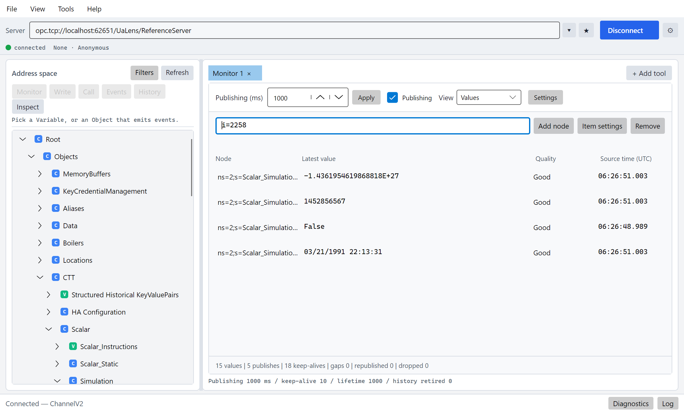
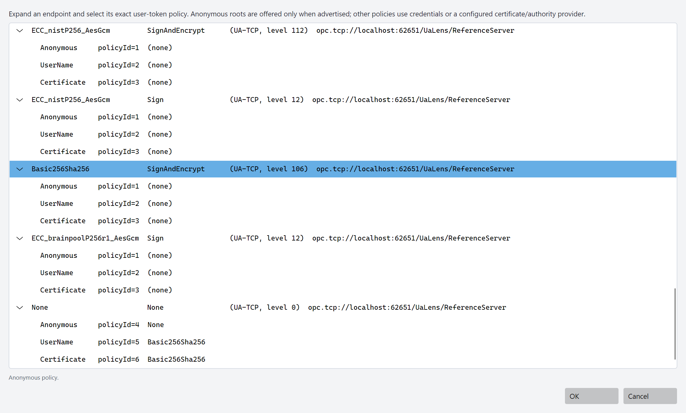
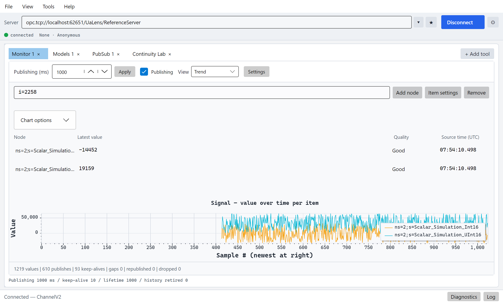
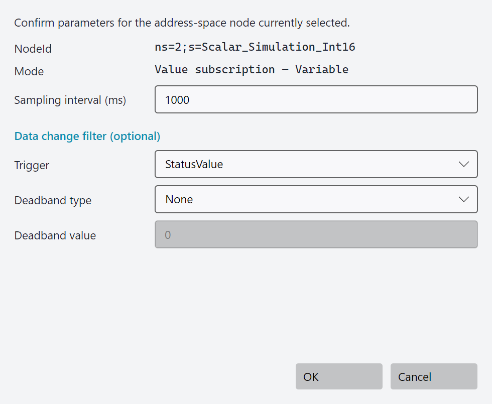
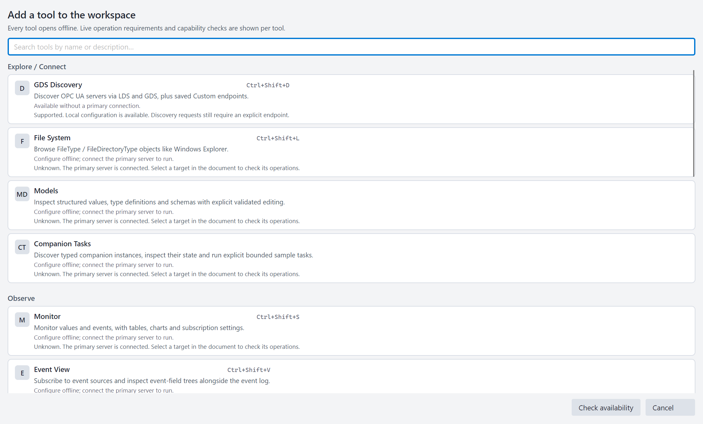
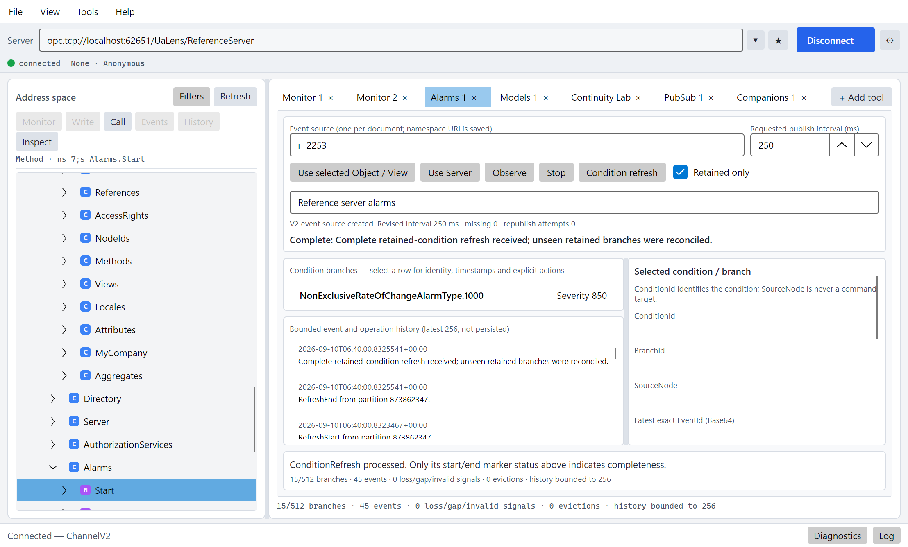
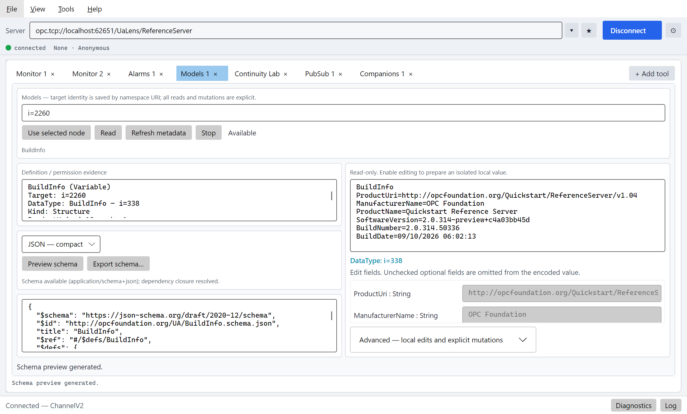
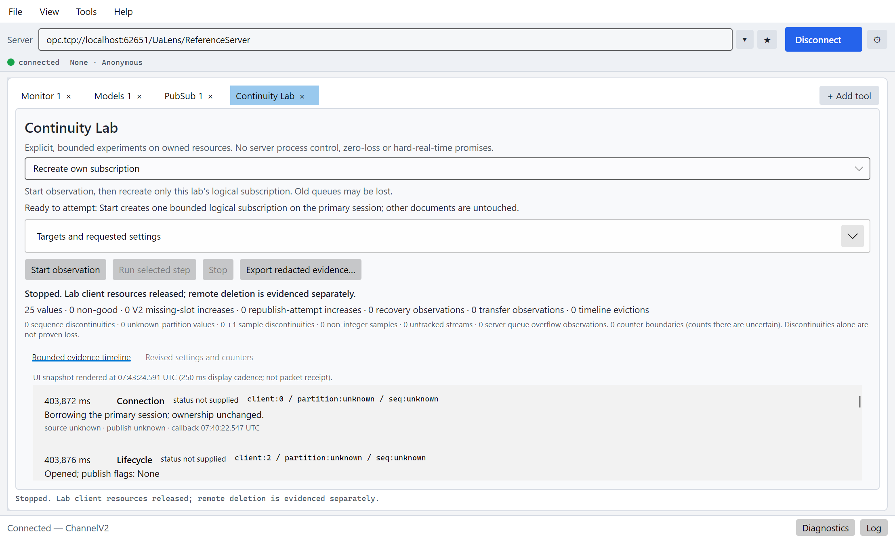
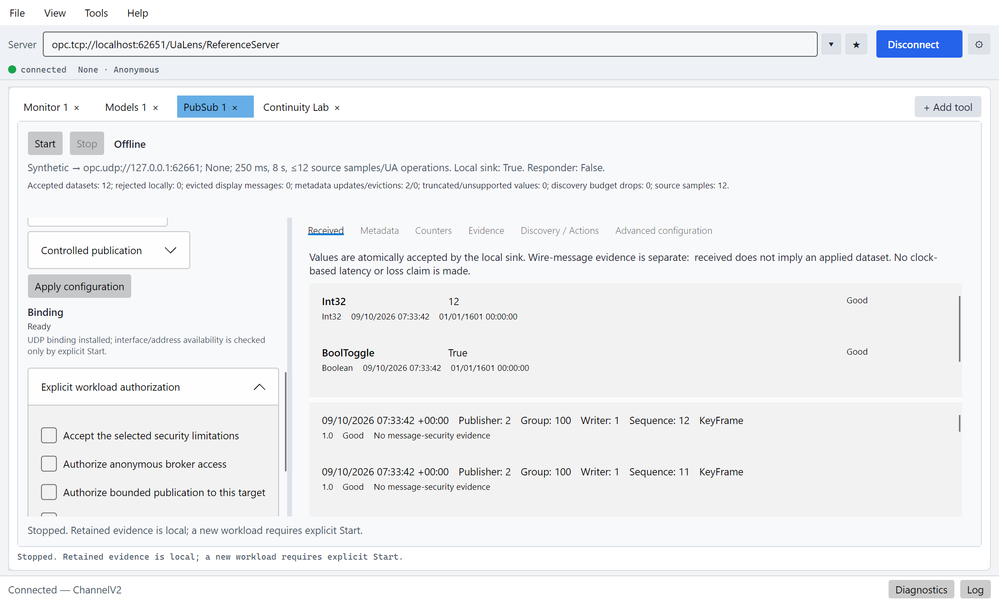

# UaLens

UaLens is an Avalonia desktop application for exploring OPC UA address spaces,
monitoring values and events, editing data, and administering servers. It uses
one primary connection shared by its document tabs. GDS tools can also use
separate connections.

## Contents

- [Getting started](#getting-started)
- [Workspace](#workspace)
- [Connection and trust](#connection-and-trust)
  - [Automatic connection](#automatic-connection)
  - [User identities](#user-identities)
  - [Configured token authorization](#configured-token-authorization)
  - [User-certificate enrollment](#user-certificate-enrollment)
  - [Hardware-backed keys](#hardware-backed-keys)
  - [Reverse connect](#reverse-connect)
- [Local repository samples](#local-repository-samples)
- [Monitoring](#monitoring)
- [Tools](#tools)
- [Alarms](#alarms)
- [Models and structured values](#models-and-structured-values)
- [Performance comparisons](#performance-comparisons)
- [Continuity Lab](#continuity-lab)
- [Packet capture and offline replay](#packet-capture-and-offline-replay)
- [PubSub](#pubsub)
- [Opening NodeSet2 files](#opening-nodeset2-files)
  - [Missing dependencies](#missing-dependencies)
  - [Import errors and cancellation](#import-errors-and-cancellation)
  - [Exploring the imported graph](#exploring-the-imported-graph)
  - [Returning to a server](#returning-to-a-server)
- [Companion specification tasks](#companion-specification-tasks)
  - [Asset Management](#asset-management)
  - [Machinery](#machinery)
  - [Pumps](#pumps)
  - [Weighing](#weighing)
  - [PackML](#packml)
  - [Positioning](#positioning)
  - [Device Integration](#device-integration)
  - [ISA-95](#isa-95)
  - [WoT and xRegistry](#wot-and-xregistry)
  - [Robotics](#robotics)
  - [Vision](#vision)
  - [AI](#ai)
  - [OpenUSD](#openusd)
- [Saved workspaces](#saved-workspaces)
- [Tool availability and prerequisites](#tool-availability-and-prerequisites)

## Getting started

From a repository checkout:

```powershell
$env:CustomTestTarget = 'net10.0'
dotnet run --project tools\Opc.Ua.Lens\Opc.Ua.Lens.csproj -c Release -f net10.0
```

The application supports .NET 8, .NET 9 and .NET 10. For managed tool installation
and supported package platforms, see the
[package README](../tools/Opc.Ua.Lens/NugetREADME.md#install).
Contributor setup, the optional Aspire AppHost, packaging and artifact
qualification are covered in the [development README](../tools/Opc.Ua.Lens/README.md).

Enter a server address in the connection bar, select **Connect**, and choose an
advertised endpoint and identity. Review the security policy and certificate
before connecting. To work offline, choose **File > Open NodeSet2 files...**.

The screenshots use a local Console Reference Server. Select security and
identity settings appropriate to your own server.

## Workspace

Use **Add Tool** or the **Tools** menu to open a document. **Add Tool** opens a
searchable tool catalog grouped into Explore / Connect, Observe, Administer,
and Diagnose. Address-space actions open tools for the selected node.

The explorer and attributes/references inspector are resizable. The available
node actions include Monitor, Write, Call, Events, History, and Inspect.
Disconnected documents keep their configuration for the next connection.
Local certificate management and discovery are available without a connection.



Use the **Namespace** dropdown to highlight nodes from one namespace. The
background, left marker and bold label identify matching nodes, including
children opened later. **None (no highlighting)** clears the selection.
Highlighting leaves other nodes visible and does not change tree selection.

The default appearance follows the operating system. Choose Light, DarkStandard
or DarkNavy for an explicit appearance. Charts keep each item's palette slot
when the theme changes. Use item names and separate views to distinguish traces
whose colors are similar.

| Shortcut | Action |
| --- | --- |
| F2 | Rename the selected document |
| Enter / Escape while renaming | Save / cancel the title edit |
| Ctrl+Tab / Ctrl+Shift+Tab | Select the next / previous document |
| Ctrl+S / Ctrl+O | Save / open a workspace |
| Ctrl+C / Ctrl+Shift+C in the attributes inspector | Copy the value / `Name: Value` |

On macOS, the attribute-copy commands use Cmd. The tab and attribute context
menus expose the same actions. Escape closes the tool catalog without adding a
document.

Write reads the variable's type before enabling editing. If the type metadata is
readable but the current value is not, the editor shows the read status and leaves
the scalar text box blank. Scalar String and LocalizedText input retains its
leading and trailing whitespace.

The metadata read and write use the same captured session binding. A session or
namespace-mapping change rejects the pending write; reopen Write to load fresh
metadata. Custom sessions must implement `ISessionBindingProvider` and return an
`ISessionBinding`.

After sending a value, Write displays the result until **Acknowledge and close**.
**Cancel wait** cancels the local wait; the server may already have applied the
write. Read the variable again if the outcome is unknown.

Closing UaLens waits for owned operations, documents and connection cleanup.
Shutdown progress and cleanup errors appear in the status and log.

## Connection and trust

The endpoint picker shows advertised security modes, policies and user identities.
UA-TCP, HTTPS and OpenAPI WebSocket endpoints use the same browsing and tool
workflows. For the OpenAPI service mapping, enter an `https://`, `opc.https://`,
`ws://`, `wss://`, or `opc.wss://` discovery URL and select the advertised
**HTTPS OpenAPI** or **WSS OpenAPI** endpoint. Plain `ws://` is intended for trusted
local networks; WebSocket bearer authentication requires `wss://`.
TLS trust remains fail-closed. OPC UA user identity selection is separate from
optional HTTP or WebSocket transport authentication.



For an untrusted certificate, choose **Reject**, **Accept Once**, or **Trust
Permanently**. Accept Once applies only to the selected endpoint and certificate;
disconnecting or changing the target clears it. Permanent trust is written to
the certificate store. Invalid or revoked certificates cannot be accepted through
the untrusted-certificate prompt.

### Automatic connection

Set `UALENS_ENDPOINT_URL` to connect when the desktop opens. The remaining
variables pin the discovered server and prevent fallback to another security or
identity profile:

| Variable | Meaning | Default |
| --- | --- | --- |
| `UALENS_ENDPOINT_URL` | OPC UA discovery/endpoint URL; enables automatic connection | none |
| `UALENS_APPLICATION_URI` | Expected server ApplicationUri | any |
| `UALENS_SECURITY_MODE` | `None`, `Sign`, or `SignAndEncrypt` | `None` |
| `UALENS_SECURITY_POLICY` | SHA-2-or-higher policy name such as `Basic256Sha256`, `None`, or its full URI | `None` |
| `UALENS_USERNAME` | Username identity; omit for Anonymous | none |
| `UALENS_PASSWORD` | Password required when a username is supplied | none |

Secure endpoints remain fail-closed. Their server certificate must already be
trusted or accepted through the existing trust dialog; environment startup does
not add a blanket certificate-trust bypass.

### User identities

Choose Anonymous, UserName, an X.509 user certificate, or a configured issued-token
provider supported by the server's policy. Changing the user replaces the session
and rebinds documents. Reconnecting preserves the selected security and identity
profile. Saved workspaces do not contain passwords, private keys or bearer tokens.

An X.509 user certificate must have an accessible private key and a compatible
server token policy. It is separate from the application's channel certificate.

### Configured token authorization

If the selected provider supports interactive authorization, choose **Authorize
configured token provider...** and complete its prompts. Then choose **Use
identity** and connect. Authorization can be cancelled and has a five-minute
limit. Provider and authority configuration must already be available.

### User-certificate enrollment

When offered by the configured certificate source, select **Enroll / renew
configured user certificate...**. Use **Prepare signing request**, review the
application/group/type and authority shown, then confirm **Request certificate**.
Review the result and separately confirm **Add reviewed certificate**.

Closing cancels pending local work. It does not undo a request already submitted
or a certificate already added. The existing certificate stays in the store.
The available enrollment source determines certificate and authority requirements.
The GDS adapter requires a matching registered ApplicationUri and certificate
group, strict Users trust validation, and a private-key-capable destination. It
neither provisions an authority nor replaces application-instance or hardware
key management.

### Hardware-backed keys

Select a certificate from a configured hardware-backed provider and supply its
PIN when requested. Keys remain in the provider. Install and configure the device,
provider and certificate before using them in UaLens.

### Reverse connect

In connection settings, choose a registered listener and the expected server
identity. Select **Start listener**, then **Wait / discover**, and choose the
endpoint, security and identity for the connection. **Use setup** saves these
settings without starting a listener or connection.

The expected server, certificate trust, listener address and firewall access
must be configured. Stop and cancellation are available during startup and
waiting. Disconnect the primary reverse session before releasing its listener.

The expected endpoint must match the server's ReverseHello URL, including its
host name. A `localhost` discovery alias is not interchangeable with the server's
advertised DNS name. Use that canonical endpoint when configuring a local sample.

See [Identity Providers](IdentityProviders.md), [Crypto Provider](CryptoProvider.md),
[Reverse Connect](ReverseConnect.md) and [Transports](Transports.md) for configuration.

## Local repository samples

Open **Connection settings > Repository samples...** to run the Console Reference
Server, DI pump software-update simulator,
[Vision inspection cell](../samples/Vision/VisualInspectionCell/README.md),
Pumps inspection simulator, Weighing and PackML simulator, Asset Management simulator,
Robot positioning simulator, or Machinery simulator.

Select a trusted local checkout and an existing Debug/Release build, framework
and layout. Confirm trust in the selected build and choose **Check setup**.
Build missing samples separately. The Vision cell requires .NET 10 and its
three checked-in PNG fixtures.

Choose a runtime from 1 to 300 seconds, confirm the run, and select **Start
sample**. The window shows process state, output and cleanup results.
**Use advertised endpoint** fills the connection address; connect and review
certificate trust separately.

For supported simulators, the separate **Allow separately confirmed domain
operations** checkbox opts that run into supported tasks. It is off by default,
does not grant certificate trust, and is consumed when the run starts. Each
task still needs preparation and fresh confirmation in its domain document.
Authorization uses the live run's exact endpoint, application identity and
public certificate, has a fixed deadline, and is revoked when the run stops.

**Stop / retry cleanup**, closing the sample window, and quitting UaLens stop the
owned run. Stop waits for the sample's configured shutdown deadline before using
its bounded termination fallback. If cleanup fails, retry it before starting
another sample.

## Monitoring

A Monitor document displays values, quality and source timestamps. Its **View**
selector offers Values, Trend, Timing: dots, Timing: bars, Timing: lines, Histogram,
and Heatmap.



In **Timing: lines**, select **Lane item** and **Line style** to choose
Interpolated, Wave or Zigzag. Clicking a lane label cycles the same styles.
Changing a view or line style does not change publishing or recorded samples.



| Setting | Purpose |
| --- | --- |
| Sampling interval | Requested server sampling: `-1` inherits publishing, `0` requests fastest, or enter a positive interval up to 3,600,000 ms |
| Publishing interval | Requested subscription publishing interval; the revised value is shown separately |
| Monitoring mode | Disabled, Sampling or Reporting |
| Publishing enabled | Enable or disable subscription notification delivery |
| Deadband | Data-change filter; percent deadband accepts 0 through 100 |
| Display pause | Pause presentation without changing the server subscription |

Numbers use the current locale's decimal separator. Invalid settings remain
visible with a field-specific explanation.

Publish-worker/request limits are connection settings shared by its subscriptions.
If the engine rejects a change, UaLens restores the previous live limits and
keeps the saved settings. A restoration failure is reported explicitly; reconnect
before changing the pipeline again.

Item settings and identities survive disconnects and engine changes. CSV and JSON
exports include each sample's recorded name, NodeId and timestamps, including data
from removed items.

Counters distinguish client queue drops, retired history, server overflow,
publish-sequence gaps and republish activity. Inspect these alongside server
quality and timestamps when diagnosing missing data.

## Tools

**Add Tool** opens the searchable tool catalog:

| Tool | Use it for |
| --- | --- |
| Monitor | Values, quality, timestamps, charts, item settings and export |
| Event View | Event sources, filters, selected fields, details and a bounded log |
| Alarms | Retained conditions, refresh, acknowledgement, confirmation and comments |
| Models | Type definitions, schemas, structured editing, Read, Write and Call |
| Continuity Lab | Recovery, transfer, recreation and configured durable/redundant scenarios |
| PubSub | Dataset observation, publishing, metadata, Actions and configured adapters |
| Companion specification tasks | Inspect industry-model instances and perform their offered tasks |
| Asset Management | Asset aliases, identity, current health/maintenance, links and authorized metadata edits |
| Machinery | One machine/section at a time, source evidence, selected-item tasks and bounded result downloads |
| Pumps | Pump identification and read-only engineering sections, source monitoring and display export |
| Weighing | Scale/system weights, products, recipes and explicitly authorized simulation tasks |
| PackML | Active state-machine hierarchy, source monitoring and explicitly authorized standard commands |
| Positioning | Relative frames, declared units, WGS84 positions and read-only local-point previews |
| Historian | Raw, processed, at-time and modified reads, export and authorized updates/deletion |
| Subscription Bench | Variable pools, scaling sliders, rates and resource counts |
| Performance | Write/Call workloads and comparison of recorded runs |
| File System | Browse, transfer, create, rename and delete files/directories |
| Certificate Manager | Local application, trusted, issuer and rejected stores |
| GDS Discovery | Server discovery and favorites |
| GDS Management / Push | Application registration, issuance, trust lists and certificate changes |
| User / Role Management | Accounts, passwords, roles and identity/application/endpoint mappings |



Subscription Bench responds to its scaling sliders. Shrinking, **Stop** and
closing the document release its resources. PubSub and Continuity Lab have
separate **Start** and **Stop** controls.

Administration commands require server permissions. Certificate **ApplyChanges**
may terminate a connection. Loading a workspace does not execute writes, calls,
deletions or administration commands.

## Alarms

Select an event notifier with condition support. Start observation and use
**Condition refresh** to load retained conditions. UaLens displays condition
branches, refresh progress and bounded event history.



Select the current event before acknowledging, confirming or adding a comment.
Permission failures and unsupported operations are displayed. Reconnecting or
opening a workspace does not repeat an operator command.
See [Alarms and Conditions](AlarmsAndConditions.md) for server requirements.

## Models and structured values

Open Models for a variable, DataType or method. Read its value or definition,
inspect fields, and preview or export a schema. The same editors are available
from Write and Call.



Edits are local until explicitly submitted. Editors support nested structures,
optional fields, unions, OptionSets, arrays and matrices. OptionSets display named
bits and preserve unnamed bits.

For a matrix, enter comma-separated dimensions and choose **Apply shape / create
matrix**. Enable **Allow resizing / discarding trailing elements** when changing
the element count. The limit is 32 dimensions and 65,536 elements, subject to the
server's lower limits.

Metadata refresh or a connection change invalidates a pending edit. Missing type
definitions are reported; opaque values are read-only.
See [Complex Types](ComplexTypes.md) and [Schema Generation](SchemaGeneration.md).

## Performance comparisons

Choose a Write or Call target, configure rate or concurrency and duration, then
select **Run**. Call targets show their typed argument signature before acceptance.
**Stop** stops scheduling and waits for issued operations to finish.

In **Compare runs**, choose **Use as baseline**, then select another result.
The comparison shows throughput, operations, errors, elapsed time and latency,
along with target, workload and security differences. Latency percentiles are
estimates from the recorded buckets.

**Save results** exports JSON with configuration and distribution data, or
aggregate-only CSV. **Load results** imports history without starting work.
The document keeps the latest 64 runs; **Highlight latest 3** is a display option.

## Continuity Lab

Select a scenario and start observation. The timeline distinguishes reconnection,
transfer, recreation, missing messages and republish activity.



Scenarios include observing a manually managed outage, recreating the lab's
subscription, restoring its snapshot, and configured durable or redundant
operation. For a restart scenario, follow the displayed save/close steps, restart
the selected server yourself, then request restore.

Durability and failover require compatible server configuration. See
[Transfer](TransferSubscription.md), [Durable Subscriptions](DurableSubscription.md)
and [High Availability](HighAvailability.md). Exported diagnostic evidence omits
credentials; server counters may require additional permissions.

Custom desktop compositions can register `IContinuitySessionFactory` to supply
explicitly authorized auxiliary sessions, or `IContinuityBackendFactory` to replace
the lab backend. Register them before building the service provider. The standard
document factory honors either registration; opening or restoring a document does
not acquire a session or start a run. An auxiliary connection preserves the selected
identity and security rather than copying interactive credentials or accept-once trust.

The normal repository-sample launcher removes its private files when stopped; it
is not a persistent-store restart mechanism. A graceful durable trial must keep
the same configured store and PKI through the restart. The Quickstarts provider
does not promise persistence after an abrupt process kill.

A configured cold peer can recreate a subscription when transfer is rejected.
The lab reports that outcome as **recreation**, not a completed transfer or recovery
of queued data. It also reports retained source resources whose deletion is
unconfirmed; matching numeric subscription IDs on different servers are not
deletion evidence. Stopping the lab closes its target session, not the borrowed
primary workspace session.

## Packet capture and offline replay

Open the diagnostics panel and select **Capture...**. Opening the window does not
record anything. Choose the workspace UA-TCP client tap or an active UDP/UADP
PubSub runtime, set the limits, enable packet-data consent, then select **Start
capture**. Start a standalone receiver before its publisher when you need to
capture a short PubSub workload.

Live capture accepts complete payloads only: 1-60 seconds, up to 2,048 frames and
8 MiB of payload. It stops before copying a frame that would exceed the byte or
frame budget. Synthetic PCAP framing has a separate 12-MiB file allowance.
**Stop** and closing the window detach and drain the observer. Primary-session
replacement stops client capture; stopping a PubSub runtime removes its capture
target and drains its active recording. Capture never owns those connections.
Caller-supplied client bindings are not replaced to force capture support.

**Open PCAP...** copies an explicitly selected file into bounded private storage
and replays its packet metadata locally. It never sends captured traffic.
Finalized files require complete headers and record boundaries; malformed or
oversized inputs remain failures and can be discarded with **Clear**.
Record timestamps, lengths and SHA-256 digests connect the live recording, raw
export and offline replay without displaying application values.

Packet bytes can contain sensitive information. No decryption keys are collected,
and encrypted payloads remain opaque. **Export PCAP...** needs separate raw-data
consent and a new local destination; it does not overwrite an existing file or
bundle key logs. Ordinary diagnostics **Export** remains an allowlist of metadata
and includes only capture identity, state, counts and the artifact digest.

Private recordings are removed by **Clear**, replacement with another recording,
or application shutdown. Exported destinations belong to the user and are not
deleted. In-process PCAP addresses and ports can be synthetic, and capture clocks
are not synchronized with server clocks. NIC, broker/TLS wire capture, pcapng
import and key-assisted dissection require separately configured tooling; they
are not implied by this window. See [Diagnostics](Diagnostics.md#4-packet-capture-dissection-and-replay).

## PubSub

Configure the transport, address/interface or broker, publisher/writer/reader
identifiers, encoding and security, then select **Start**. The document displays
metadata, decoded fields, state and diagnostics. **Stop** releases its runtime.



Use **Dataset / adapters** for typed fields, identifiers, metadata versions,
UA mappings and content masks. Rank -1 is scalar, rank 1 is an array and ranks
2-8 are matrices. Dimensions are comma-separated maxima; at most 1,024 elements
and 16 KiB of encoded data are retained per field. Select **Validate draft**, then **Apply
configuration**. Changes require renewed Start authorization.
**Import configuration** and **Export applied configuration** exchange local JSON
files without starting traffic.

Adopted metadata retains field IDs, concrete ranks, dimensions, namespace URIs
and supported structure definitions. Adoption clears UA mappings and disables
publication, write-back and responders. Custom fields require their reviewed
structure definition; ordinary structures, optional-field structures and unions
use the shared NativeAOT-safe adapters. Recursive graphs, missing dependencies,
promoted fields, enum/alias descriptions and unsupported metadata remain explicit
prerequisites rather than being flattened into scalar fields.

**Edit local sample...** opens the existing typed value editor, including nested
structures and matrices. An accepted sample is configuration data and will be
included in exported JSON; do not enter secrets. Received values are never
automatically saved as samples. Primitive synthetic fields may generate sequences;
other types require an explicit sample. Samples carry a schema fingerprint and
must be edited again after type, shape or metadata-version changes. Stop/Close
cancels the editor without starting a workload or retaining a canceled edit.

Array, structure and namespace-bearing workloads require metadata-version headers. The decoder
rejects data whose current schema differs from the reviewed configuration.
Source/write-back adapters also recheck the actual node type, rank, dimensions,
structure definitions and server namespace table. Adapters for structures,
NodeIds, ExpandedNodeIds or QualifiedNames must supply their actual message
context; scalar, array and nested identities are remapped by namespace URI, not
by copying namespace indices. Missing namespaces and nonzero ExpandedNodeId
server indexes are rejected; this configuration does not define a server-index
table. A model or namespace change requires explicit reconfiguration.
These checks do not make multi-node UA writes an atomic server transaction.
Action request fields remain explicitly bounded scalar inputs; dataset structure
definitions do not authorize or redefine a remote method's arguments.
Null collections stay distinct from empty collections; a null matrix's rank
comes from the reviewed field schema, since its null wire payload has no shape.

For local source-to-target exercises, start a separately configured receiver
before the publisher. Reaching the publisher's sample limit stops its document;
the send count is not an acknowledgement of a UA target write. Inspect the
receiver's accepted-data and write-back evidence or read the target explicitly.

Observation displays datasets locally. Publishing, Actions and server write-back
require their own configuration and confirmation. A secured profile requires its
configured key provider or SKS group. The UADP message-security profile uses
AES-256-CTR with 32-byte signing/encryption keys and a 4-byte key nonce. Every
publication rechecks the current token's group, material and active lifetime;
expired/future tokens and provider failures cannot fall back to cached or
unsecured publication. A configured provider must supply the next valid key.
Receive lookups preserve the provider's retained previous/next keys rather
than applying the publication-expiry rule. The stack's existing signature and
replay checks still apply.

Stop cancels and drains key/adapter calls before releasing their owners, including
late acquisition results; it does not destroy a borrowed provider's keys. Rotation
notifications are detached when the document closes. Supply brokers, network
interfaces and other external prerequisites before starting.

For a sample publisher, use the
[Console Reference PubSub Client](../samples/PubSub/ConsoleReferencePubSubClient/README.md).
See [PubSub](PubSub.md) for transport and security configuration.

## Opening NodeSet2 files

Choose **File > Open NodeSet2 files...** or the same action in the welcome area.
Select one or more XML files to explore a combined read-only address space.
The bundled OPC UA core model is available without internet access.

### Missing dependencies

UaLens matches dependencies by model URI and revision. Files selected together
can reference one another despite different namespace-table orders. UaLens also
looks for XML files beside the selected files.

For each missing dependency, choose **Browse local file**, or **Search and
download** to permit a lookup in
[OPCFoundation/UA-Nodeset](https://github.com/OPCFoundation/UA-Nodeset).
Local model contents are not uploaded. If the repository has no match, or a
download fails, select a local file instead.

The selected file must satisfy the required `ModelVersion` and `PublicationDate`.
The human-readable `Version` is a label. Complementary files for the same model
revision are supported; conflicting revisions and duplicate NodeIds are rejected.
Dependencies may require further files.

An import supports up to 128 documents, 500,000 nodes, 64 dependency levels and
256 MiB of content, with at most 64 MiB per document. Downloads stay in memory
and do not overwrite local files.

### Import errors and cancellation

The current address space stays available until the complete import succeeds.
Cancelling or encountering an invalid file leaves it unchanged. A successful
import closes the primary live connection; existing documents keep their settings,
but session-bound actions are unavailable offline.

Import errors appear in the banner and **Log** panel. Correct the file and reopen
it. Standard names used as NodeIds need entries in that document's `<Aliases>`
table, for example:

```xml
<Aliases>
  <Alias Alias="HasProperty">i=46</Alias>
</Aliases>
```

Alternatively, use the NodeId directly:
`<Reference ReferenceType="i=46">ns=1;i=2</Reference>`.
UaLens does not infer undeclared aliases.

### Exploring the imported graph

The offline banner shows document, node and unresolved-reference counts.
Its tooltip lists source documents and model URIs. Displayed namespace indexes
belong to the combined graph.

Use **View** to browse Objects, ObjectTypes, VariableTypes, DataTypes,
ReferenceTypes or Views. **AllNodes** groups every imported node by namespace,
including nodes not reachable from Root. Type views include their members.

Offline search covers display names, browse names and NodeIds throughout the
imported graph. **Enter** starts a search; **F3** advances to the next match.
Double-click a reference target to inspect a locally resolved node.
The references panel shows forward and inverse links and identifies unresolved
targets.

**Find by path...** accepts relative paths with the combined namespace indexes,
such as `/2:Machine/3:Reading`. **View NodeState... > NodeSet2 XML** shows the
authored node definition, including values, data-type fields and extensions,
using the source file's namespace table and aliases.

Imported values and access flags are static metadata. Write, Call, Monitor,
Events and History are unavailable, and remote-server targets cannot be followed.

### Returning to a server

Choose **Close models** to clear the offline graph, or connect successfully to a
server to replace it. A cancelled or failed connection leaves the graph available.
Model files and downloads are not saved in a workspace; reopen them after restart.
For the XML format, see [OPC UA Part 6, Annex F](https://reference.opcfoundation.org/Core/Part6/v105/docs/F).

## Companion specification tasks

Open the industry-model task tool from **Add Tool**, choose a model, and select
**Discover**. Select a returned instance and choose **Inspect** to see its
published values and available tasks.

Choose a task, enter its typed inputs, and select **Prepare selected task**.
Review the target and effect, supply the required confirmation, then choose
**Run selected task**. Changing the target, input or connection requires fresh
preparation. Preparations expire after five minutes and can be used once.

Deployment mutations require an authorized identity, a signed and encrypted
connection, and a configured deployment policy. Sample tasks require confirmation
of the selected loopback sample. File operations ask for a local source or
destination. Reconnecting does not replay tasks.

When an inspected value includes a source NodeId, select it and use **Monitor
selected value** or **History...**. These open the existing tools for that
variable; closing the inspection document does not stop a separate Monitor.
History opens with the variable selected but does not start a historical read.
For an event-emitting instance, **Conditions...** selects it in Alarms. Select
**Observe** there to follow health/maintenance events; no acknowledgement is
sent by opening the document.

**Export displayed values...** writes a new local JSON file containing the
displayed values, quality and available source metadata. It is a display
snapshot, not an importable protocol payload or saved authorization. Exports are
limited to 1 MiB and individual text fields to 4096 characters. Existing files
are not overwritten. Displayed engineering data can be sensitive; review the
file before sharing it.

### Asset Management

Choose **Add Tool > Asset Management** to discover manageable assets through
their AMB alias categories. Inspect identity, health, current and future
maintenance, documentation links, locations, classifications, requirements,
capabilities and sub-asset relationships. Multiple aliases of the same local
asset appear once. Remote references are displayed, not followed.

The tool distinguishes missing optional fields from bad, denied and
incorrectly typed reads. It does not fetch link contents or claim a historical
maintenance database. When a condition folder is absent, explicit condition
inspection is unavailable; use Alarms for event observation.

An opted-in owned Asset Management simulator allows supported AssetId and
documentation-link edits. Removing a link requires its current user-created
marker. Preparation pins both alias versions, the exact asset/link and the old
metadata; another edit invalidates it. These checks are not atomic
compare-and-swap.

Acknowledgement pins the current condition, source asset, branch and EventId.
A changed event requires fresh preparation. Maintenance acknowledgement is
limited to finished activities. Unknown outcomes are not retried.

### Machinery

Choose **Add Tool > Machinery**, then **Discover**. The first view is a compact
Overview with identity, health, item state, operation mode and available counters.
Changing the **Section** selects Process values, Jobs, Energy or Results; it does
not start subscriptions or load the other sections. Lists are paged in groups of
32. Default-named JobManagement and ResultManagement objects exposed directly
under Objects appear as **Direct management objects**, without a machine parent.

Select an item and choose **Inspect selected** for its current evidence and
details. Energy and result lists initially load identities only; inspection reads
the chosen meter or result. **Back to list** keeps the machine and section.
Missing optional data, denied reads and malformed values remain distinct.

In **Selected item actions...**, select a source field for Monitor or History.
An absolute local destination is required for display-snapshot export or result
download; existing files are never overwritten. Result downloads use the exact
inspected ResultId, are capped at 1 MiB during transfer, and reject changed or
stale selection before local publication. Empty Good-null result slots have no
ResultId and cannot be downloaded. Result URIs are not fetched.

**Review available process task...** offers only a currently exposed and
executable ZeroPointAdjustment method on an explicitly opted-in owned Machinery
simulator. Its signal may declare Number, an integer type or floating-point
precision; UaLens does not reinterpret a sample value to authorize the method.
Preparation, fixed-deadline authorization and confirmation are separate steps.
Acceptance is not evidence of physical calibration.

**Open ISA-95 job tasks...** reuses the existing typed Job Control workflow in a
transient task window. It carries selected job context, not consent or a prepared
command. Opening the window never starts a job. Closing it, changing context or
stopping the parent invalidates task evidence; refresh explicitly before another
action. Machinery item state and operation mode remain read-only because those
models define no cause methods.

### Pumps

Choose **Add Tool > Pumps**, then **Discover** to find OPC 40223 pump instances.
A pump listed under both DeviceSet and Machines appears once. **Inspect** reads
identification; choose a read-only section to inspect configuration,
measurements, signals, control/actuation state, supervision, maintenance, ports
or documentation links. Only the requested section is read.

Values retain their reported quality, source identity, timestamps, units and
ranges. An absent optional section is labeled **Not exposed**; denied reads and
invalid responses are errors, not empty successful results. Documentation links
are displayed without fetching their contents.

This tool does not start, stop or otherwise command a pump. OPC 40223 defines no
pump-specific methods. The **Pumps inspection simulator** in **Repository
samples** uses an explicitly selected local build, private PKI and a finite
lifetime; endpoint readiness does not grant certificate trust.

### Weighing

Choose **Add Tool > Weighing** to discover OPC 40200 scales and scale systems.
Inspect reported weights, quality, source timestamps, units, process state,
products, recipes and statistics. Source values can be opened in Monitor or
Historian, or exported as a display snapshot. UaLens uses the server's weighing
results; it does not calculate a replacement weight or claim legal-for-trade
certification.

The selected kind, current state and permissions determine which tasks are
available. Supported tasks include zero/tare, weight registration, product and
recipe management, and statistics reset. Invalid or unstable weights, invalid
units and unavailable permissions prevent preparation rather than becoming
default values.

Mutations require the explicitly opted-in, currently owned ScalesServer run
described under [Local repository samples](#local-repository-samples), a signed
and encrypted connection, and fresh task confirmation. A matching display name
or loopback address is not authorization. Changing the target, identity,
metadata or authorization deadline invalidates preparation. Physical calibration
and arbitrary method calls are not offered.

Use **PackML...** to open the selected scale or system's state machine in the
generic PackML tool. Only its source configuration is transferred; select
**Discover** there to load it. No state command is sent during navigation.

### PackML

Choose **Add Tool > PackML** to discover actual base, machine and execute state
machines, including instances whose owner is not a scale. Inspection follows
only active nested machines and preserves the source state identifiers and
quality. Inactive state is explicit rather than interpreted as a successful
zero state.

Supported commands are offered only with current instance-method metadata,
permissions and owned-simulation authorization. **Start** accepts up to 32
unique typed descriptors with finite numeric values and explicit units; an
empty array starts without parameters. Preparation pins the active hierarchy,
method, identity, peer and authorization deadline.

A successful command means the server accepted it. It does not prove that
Starting, Stopping or another acting state has completed. Read fresh state or
use Monitor; UaLens never completes an equipment-owned state itself and does
not replay an uncertain command.

### Positioning

Choose **Add Tool > Positioning** to discover RSL spatial objects, their
associated global-position variables, and GPOS zones. Global variables attached
to a spatial object's owner are included. A GPOS entry point can be inspected
without an exposed RelativeSpatialLocations folder; denied or uncertain reads
are not treated as an absent folder.

**Inspect** shows raw frame coordinates and declared length/angular units, or
global coordinates and their reported source, quality and time. World-frame
resolution is explicit: choose degrees or radians, matching the declared
angular units throughout the chain. Missing units, mixed length units, cycles
and chains over 64 frames prevent resolution. UaLens does not silently convert
units. Spatial-list NodeVersions are checked around reads when exposed; this
does not make multiple telemetry reads an atomic snapshot.

Global-coordinate inspection supports WGS84 / EPSG:4326. ECEF coordinates are
shown only when elevation is encoded. Other CRS identifiers require a different
transformer and are rejected by this tool rather than implicitly projected.

A zone shows its rigid-fit dimension, rank, residuals and invertibility.
**Preview local point in the zone** accepts finite X/Y/Z coordinates within
plus or minus ten million local units and 3-128 ground control points. A 2D
calibration requires Z = 0; no height is inferred. A 3D preview retains
its calibrated elevation. Preparation pins the calibration and connection for
up to five minutes, is single-use, and is invalidated by changes or cancellation.
No position is written, map loaded, geocoder contacted or renderer started.

Use source-value Monitor/History actions and display-snapshot export as for
other domain tools. The **Robot positioning simulator** supplies a private,
finite owned example without enabling robot actuation. See
[Positioning](Positioning.md#ualens-positioning-tool) for the client interfaces
and sample launch options.

### Device Integration

Inspect device identity and software-update state. Select a package file and
supply its SHA-256 to prepare an upload. Upload, installation, confirmation and
offered recovery methods are separate tasks. The
[pump simulator](../samples/Di/PumpDeviceIntegrationServer/README.md#software-update-simulator)
provides a local software-update target.

All update mutations, including Prepare, require a signed and encrypted channel,
an explicitly authorized target and fresh per-task confirmation. For the owned
simulator, enable its operation opt-in before starting it in **Repository samples**.
A loopback address or the older sample-confirmation checkbox is not authorization.
Stop, expiry, a changed peer or a new run invalidates the grant.

Preparation pins the reviewed package bytes and digest. Dispatch consumes the
prepared task even if upload, commit or post-call readback fails. A returned
completion-state-machine identifier means completion still needs observation;
accepted installation is not proof of the resulting state. Inspect again after
an ambiguous result rather than replaying it. Cancellation closes only the
upload's owned handle and does not imply rollback of an accepted update.

### ISA-95

Inspect jobs, resources, responses and available state. The selected V1/V2
model determines which Store, Start, Update, Cancel and Clear tasks are offered;
V2 may also offer Pause, Resume and Abort. Review the resulting job/state after
each command.

Machinery JobManagement exposes only JobOrderControl and JobOrderResults. UaLens
uses that exact typed two-facet association for ISA-95 preparation, typed input and
state readback. It does not add a response receiver.
Mutating this two-facet target requires the matching opted-in owned Machinery
simulator and fresh confirmation. Ordinary ISA-95 deployments retain their
configured deployment-rule policy.

### WoT and xRegistry

Inspect assets, groups, resources and versions. Tasks include creation, immutable
version upload, enabled/default selection, deletion and refresh of one existing
WoT version. Review deletion scope carefully: deleting a resource includes its
versions, and deleting a group includes its children. Changed content or epochs
require new preparation.

### Robotics

The published **Robotics** provider inspects device systems, controllers, axes,
telemetry and program state. Individual system-operation and task-control targets
offer only methods whose live types, state, signature and permissions match the
prepared operation. The normal `MinimalRobotServer` sample has no program or
operation handlers, so those targets are read-only.

**Robot Intent** is a separate **draft** provider. Its local preview is not server
admission, path planning or a safety guarantee. Submission is limited to positive,
finite, non-blocking buffered waits and flat wait-only missions of 1–8 steps,
with at most 10,000 ms total wait time. Physical motion is not offered.

Request and release command authority explicitly. Authority is session-scoped
arbitration, not authorization and not a timed lease. The provider does not
automatically acquire, release or restore it. Admission is reported separately
from observed completion; cancellation targets only the selected supported wait
or mission. An unknown outcome consumes the preparation and must be inspected,
not replayed.

Real-time channel tasks only open or close a finite broker lease, with a requested
duration of 100–10,000 ms. Returned endpoints and descriptors are not connected,
published on or automatically renewed. The draft model's `LeaseExpiry` is optional;
when absent, the server's explicit close result is authoritative. For a sample
that exposes both authored and runtime channel rows, close the row whose
`LeaseHolder` identifies the current session.

Mutation requires a username or certificate identity and an explicitly opted-in
owned run, with the exact secure peer, certificate digest, sample and grant
deadline rechecked before dispatch. A loopback address, anonymous Operator demo
role or generic deployment rule is not sufficient. Anonymous access remains
observational, never an authentication fallback. Operation/mission snapshot reads
use V2 streaming or an explicitly supplied compatible transport; discovery and
rebinding do not silently switch subscription engines or acquire authority.

### Vision

Inspect sensors, media descriptors, calibration and results. For an authorized
simulated sensor, offered tasks include clip acquisition, stream leases,
inference, a bounded continuous run and typed feedback. Continuous runs last
1-15 seconds. Use **Omit optional structure** when an optional frame is absent.

Select a detection result to export a new local SVG with boxes and labels.
The SVG contains overlay geometry and provenance, not image pixels. Physical and
Hybrid sensors are not accepted by the simulation tasks.

For local OpenUSD-rendered evidence, start a verified viewport, choose
**Discover simulated cameras**, select a sensor, then choose **Render simulated
Vision**. The sensor's camera is mapped into the selected retained stage; its
advertised stage URI is never opened. This produces local simulation pixels, not
a server media acquisition or inference result. Camera identity is revalidated
before and after capture, and only one displayed frame is retained.

### AI

Inspect configured inference deployments, jobs, datasets and evaluation results.
Offered tasks include authorized inference, job observation, bounded request/
response transfers and learning operations. External destinations need a matching
egress policy. Review the selected deployment, input and destination before Run.

### OpenUSD

Inspect representations, assets and bindings, or capture live/history values.
Bounded value-capture windows last 1-15 seconds; history selects a UTC range up to
24 hours. Configured peers need their own authorized connections.

Export to a new directory to create `values.usda` and `evidence.json`, including
the sampled data and provenance. Existing paths are not overwritten.

After inspecting a representation, choose **Start viewport** to render its verified
asset closure inside the document. Opening or restoring a document starts no GPU
workload or subscription. The retained stage displays read-only live telemetry;
clicking selects a USD prim and never invokes a method, writes a value or executes
a command prim. Camera and size changes reuse the same stage. Stale picks during
live motion remain explicit and can be retried.

The bounded preview supports canonical USDA and 8-bit RGB/RGBA PNG. Binary or
procedural scenes, variants, clips, inherited scenes, remote/dynamic components,
topology-changing telemetry and executable shaders remain unsupported. Vector
transforms require the existing connector contract: one active
`xformOp:transform` matrix, optionally preceded by a reset-stack marker; missing
or inactive targets are rejected.

| Resource | Preview bound |
| --- | --- |
| Captured closures | Four live or retained closures; crash leftovers count toward the limit |
| Assets per closure | 32 assets, at most 8 MiB each and 32 MiB total |
| Presentation | 2,048 pixels per dimension; 16 MiB raw capture |
| Native frames | Two or three per ring, at most two resize generations |
| Retained mesh geometry | 64 MiB conservative bound |

Only application-bundled core/imaging plugin manifests are registered. Server
plugin paths and environment overrides are not used. Captures reuse the retained
renderer and reject missing geometry, malformed readbacks and uniform blank frames
rather than reporting a successful image.

**Stop viewport**, selection changes, rebind, restore and close cancel and drain
telemetry and in-flight readbacks before releasing native resources and cached
assets. The primary connection remains borrowed. Custom desktop compositions can
share `IOpenUsdViewportAssetCache` and replace `OpenUsdViewportFactory` or
`IRenderedVisionCameraSource` through DI. The configured OpenUSD provider remains
the source; an inspection-only override is not bypassed by a default provider.

D3D12, Vulkan and Metal use typed native composition APIs. Windows runtime and
NativeAOT evidence do not qualify Linux/macOS graphics, physical displays or
accessibility. These remain separate release gates.

On Linux hosts intentionally using Mesa llvmpipe, `ualens --allow-software-gl`
permits that software OpenGL driver instead of Avalonia's default blacklist.
This opt-in does not enable other blacklisted drivers, change normal startup
defaults, or promise hardware acceleration. Vulkan rendering requires a working
Vulkan device. OpenUSD 0.16.6-alpha prefers shared GPU surfaces; when Avalonia cannot
import external images or semaphores, it reads completed Vulkan frames into host
memory and presents them through an Avalonia bitmap. This adds a frame copy,
not a replacement renderer or a placeholder surface.
`ualens --x11-vulkan` instead explicitly selects Avalonia's Vulkan compositor
on X11, avoiding a Vulkan-to-OpenGL image import. The compositor selection remains
explicit; host-memory presentation handles missing external-resource interop.

Both presentation paths must pass the same rendering and cleanup checks. See
[artifact qualification](../tools/Opc.Ua.Lens/README.md#native-renderer-artifact-check)
for their scope and evidence requirements.

Matching servers are listed in [Sample Applications](samples.md).

## Saved workspaces

**File > Save workspace** stores document settings, tab order and selection,
layout, safe connection choices and connection-level publishing limits.
Opening a workspace restores documents offline. It does not restore live jobs,
server handles, captured history or credentials.

Legacy `.subex`/version-1 files import as disconnected monitor configurations.
They do not contain enough security information to authorize an automatic
connection. Unsupported or malformed files produce an error.

Appearance and favorites are stored per user. NodeSet2 selections and downloaded
models are not included in workspace files.

## Tool availability and prerequisites

The **Add Tool** catalog shows **Supported**, **Unsupported**, **Unknown**,
**Requires configuration**, or **Denied** for the current target. A status
describes the available evidence; server permissions still govern each operation.
Tools can be opened for configuration while disconnected.

Missing certificates, token providers, broker/key configuration, reverse listeners
or compatible server models appear as setup requirements. Connection changes and
refresh update stale capability information. Model-specific entries identify their
published or draft specification/version.
