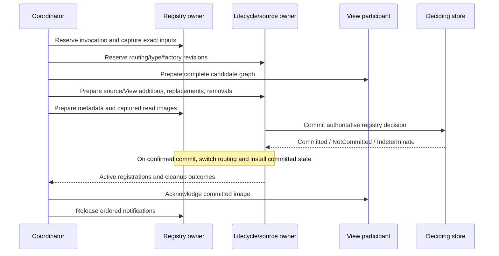

# WoT design and provider contracts

This page describes the registry's ownership, publication,
and recovery contracts. Start with [WoT Connectivity usage](WoTConnectivity.md)
for hosting/client examples and [bindings and conversion](WotBindings.md) for
document authoring and transports. These contracts do not establish Full-profile,
distributed HA, or full JSON Schema conformance.

## Contents

- [Ownership and publication](#ownership-and-publication)
- [Provider requirements](#provider-requirements)
- [Dependency capture and observations](#dependency-capture-and-observations)
- [Version leases](#version-leases)
- [Prepared registry store](#prepared-registry-store)
- [Canonical Views](#canonical-views)
- [Dry-run validation](#dry-run-validation)
- [Recovery](#recovery)
- [Bridge deletion and recovery](#bridge-deletion-and-recovery)

## Ownership and publication

`IWotRegistryService` owns an immutable `WotRegistrySnapshot`. Mutations publish
a new snapshot with an increasing Int64 store `Generation`.
The snapshot's UInt32 `RefreshGeneration` identifies committed materialization.
They are different counters: metadata-only observations can advance the store
generation without replacing runtime Nodes.

The stable registry NodeManager exposes metadata and files. Source NodeManagers
own the converted Nodes and generation-bound binding runtimes. Canonical View
NodeManagers own navigation Nodes/references, not copies of source affordances.
The coordinator combines these owners in one prepared publication unit.



Candidate preparation is private. A rejected candidate cannot add serving
references, replace read values, or dispose the old source. Confirmed noncommit
disposes candidates and leaves both registry/runtime images intact.
After a durable decision, caller cancellation cannot turn commitment into
rollback. Cleanup, observer, readiness, or retirement failures are explicit
committed warnings. An indeterminate store decision is neither success nor
noncommit: mutation stays blocked until authoritative recovery.

`IWotInvocationProjectionHost` captures routing/type/factory revisions before
input acquisition. `IWotInvocationRegistryPublicationService.BeginPublicationAsync`
reserves the existing registry owner across final checks and all units.
Both reservations remain through notifications and completion bookkeeping.
Own committed units update the checked generation without self-conflict.
Stale preparation is reacquired/rebuilt; a stale nonzero caller
`ExpectedGeneration` fails `BadInvalidState`.

Registry mutations wait for the invocation; conflicting lifecycle operations
fail `BadServerTooBusy` before effects. A callback must not synchronously wait
for a mutation excluded by its own invocation.
The notification FIFO orders registry reconciliation, exact-Version failures,
and completion. It does not supply atomicity or a second durable decision.
Canceling a caller's wait does not discard already accepted projection work.

### Publication units

| Requested atomicity | Initial unit boundary |
| --- | --- |
| PerResource | One selected activation Resource |
| PerGroup | Selected work in one group |
| PerClosure | One dependency closure |
| PerRegistry | All selected/required activation work |

Unrelated rows stay in the full registry snapshot but are not added to activation.
Legal semantic reference cycles can coactivate; inheritance/order cycles fail.
Dependency safety, shared declarations, grouping cycles, and affected old/new
closures can coarsen boundaries. The final plan reports the applied atomicity.
Disabled definition inputs do not become activation members.
Dependent units need successful or exact unchanged prerequisites, not merely
fetched bytes. Old source owners affected by merges/splits retire in the same
batch as their replacements. A participant's affected-Resource footprint must
stay within the planned unit.

Independent units advance the refresh generation separately; an earlier success
survives a later unit failure. Resource result rows describe the unit that
actually changed them, including removal-only units. Deleted rows report
Unloaded/no root/no nodes at the committed generation.
No-op/dry-run units do not advance it.

`LastRefreshPlan` is the final generated `WoTRefreshPlanDataType`: RequestId,
PreparationGeneration, RequestedAtomicity, AppliedAtomicity, and UnitCount.
It is published under admission before the first switch, not by read-only capture.
Empty unmatched work can have zero units. Last completion time/summary describes
an actual completed invocation, not an alternative generation guard.

## Provider requirements

The default lifecycle implements the optional `INodeManagerBatchLifecycle`.
`LifecycleWotProjectionHost` and `LifecycleWotViewProjectionHost` use the same
lifecycle. Hosted forwarding checks the attached lifecycle's actual capability.
Interface declarations alone do not supply it.

The default source host plus a file registry with genuine immutable-content
leases support the four modes. Refresh rejects unsupported owners/modes with
`BadNotSupported` before acquisition/publication. `InMemoryWotRegistryStore`
and immediate-only custom source/View hosts do not provide these guarantees.
Storage and read-only capture remain independently available.

The file provider's default immutable lease is supported for `LocalFileSystem`
on Windows, where kernel sharing protects bytes and key mappings against writes,
replacement, and deletion. POSIX advisory sharing and arbitrary `IFileSystem`
implementations are not equivalent advertised guarantees. Inject a provider with
genuine immutable version/key leases for another deployment.
Copying bytes into a buffer or forwarding an unrelated snapshot capability is
not an immutable backing-store lease.

For a custom source host, preparation binds the supplied registry read images
before the deciding store commits, or rejects the unit. Topology-free metadata
observations use `PrepareReadImagesAsync` without replacing source/View
registrations or emitting lifecycle model-change events.
Supported custom View owners implement `IWotCanonicalViewReadImage` so native
operations obtain digest/token facts from their captured routing image.

## Dependency capture and observations

Selection is resolved from metadata before body acquisition. Empty selectors
select enabled committed content; nonempty unmatched selectors do no work.
`Kind` and exact Resource/Version identity precede acquisition; reverse
dependencies are added only when requested. Conflicting exact Versions fail
before fetch when known.
Absolute document identities are not matched by arbitrary resource suffixes.
Portable native identifiers remain type/node lookups, not relative document URLs.

Acquisition errors remain attached to their intended Resource/closure rather
than aborting unrelated work. Contentless inputs remain unresolved with their
raw edges; no fabricated digest pin converts them into usable definitions.
Semantic strongly connected components and ordering constraints are distinct.

For direct capture:

```csharp
using WotMaterializationSnapshot inputs = await WotDependencyGraph.CaptureAsync(
    registry,
    [selector],
    includeDependents: false,
    maxJsonDepth: registry.Bounds.MaxJsonDepth,
    cancellationToken: ct);
foreach (WotSelectedResource selected in inputs.Selection)
{
    if (selected.Resource.Enabled && selected.Version is { HasContent: true } version)
    {
        ByteString bytes = inputs.GetContent(selected.Resource, version);
    }
}
```

`GetContent` checks the captured incarnation, epoch, and digest. It never reads a
new default or silently reacquires content. Snapshot disposal releases its
Version leases without changing the captured metadata/bytes.

`IWotRefreshCaptureProvider` resolves to the registered coordinator:

```csharp
using WotRefreshCapture capture = await captureProvider.CaptureAsync(request, ct);
WotCapturedRefreshRequest invocation = capture.Request;
ArrayOf<WotSelectedResource> selected = capture.Inputs.Selection;
```

It copies the request before yielding and performs no conversion, activation,
retirement, or metadata publication. Selectors/plan values are independent copies.
`GetRegistryInputDigest` covers captured registry inputs, not uncaptured external
artifacts. `CreateRefreshPlan` observes the publication owner's applied boundary;
it neither chooses units nor publishes `LastRefreshPlan`.
Final stale-input checks belong to the publication owner.

The default `IWotRegistryDependencySnapshotProvider` is the same registry service,
not a replacement selection owner. The coordinator additionally needs observation
and Version-lease capabilities. The hosted NodeManager supplies the authoritative
ApplicationUri, actual registry-root NodeId, and exact Version projection NodeIds.
A directly constructed coordinator needs an explicit verified/configured
`WotRegistryOrigin`. Unsupported/unconfigured native reads report `BadNotSupported`.

`WotDependencySnapshot` carries SourceVersionId, Generation, RequestId, ResolvedAt,
IsCommitted, EffectiveInputDigest, Edges, and Targets.
`DependencySnapshot` commits with successful source activation;
`LastDependencyAttempt` records a completed actual attempt. Failure/no-op does
not replace the committed graph; incomplete preparation has no complete effective
digest. Dry runs publish neither.
Raw authored targets coexist with exact target Version Xids, digest pins,
authoritative origins, and optional portable Version NodeIds.
Optional generated fields use their presence masks, not fabricated empty origins.

These identities do not specify an execution partition:
OriginRegistry is registry authority, RegistryNodeId is its root, VersionNodeId
is a registry Version, and DocumentUri is a document identity/location.
The capture has no source-model/root/partition selector. Do not infer a binding
owner from leaf count, namespace membership, or URI suffixes.

Dependency indexes live in Version manifest metadata. Old indexes are hydrated
from exact content; incomplete/unsupported current indexes fail.
Prepared-capable initialization persists derived indexes through full validation
before using them as a metadata baseline. It preserves content/epochs, pending
selections, canonical graph, and committed refresh generation.
The schema-6 shared graph representation is described in
[manifest schema](WoTConnectivity.md#persistence-and-manifest-schema).

Selected acquisition does not guarantee selected-only `CommitAsync` I/O.
Metadata scope obtains that guarantee from the actual prepared store/content
provider described below, not from `ProjectionOnly` notifications.

## Version leases

The default `WotRegistryService` implements `IWotRegistryVersionLeaseProvider`.
A lease protects an exact Version incarnation from automatic retention,
independently of active/default/desired pointers.
For a limit of two, leased v1 plus selected v2 leaves no room to commit v3.
Contentless allocation checks the eventual commit can fit but does not evict
committed content; dirty Close applies retention atomically.
Releasing the final lease makes an unselected Version eligible for normal
retention, not immediate deletion.

```csharp
using var registry = new WotRegistryService(store, bounds);
await registry.InitializeAsync(ct);
IWotRegistryVersionLeaseProvider leases = registry;
WotResource resource = registry.Current.FindResource(groupId, resourceId)
    ?? throw new InvalidOperationException("The Resource is absent.");
WotResourceVersion version = resource.FindVersion(versionId)
    ?? throw new InvalidOperationException("The Version is absent.");
using IWotRegistryVersionLease lease = await leases.AcquireVersionLeaseAsync(
    groupId, resourceId, version, ct);
ByteString document = await registry.ReadContentAsync(lease.Version, ct);
```

Acquisition is serialized by the same mutation owner as retention/publication.
`lease.Version` is the canonical owner snapshot. Deleted/stale incarnations fail
with `BadNodeIdUnknown`/`BadInvalidState`; reacquire a new snapshot deliberately,
not a silent VersionId retry.
Same-owner initialization and indeterminate-outcome reconciliation preserve
surviving incarnations. Delete/recreate does not reconnect an old lease, even
when identifiers and bytes match; its disposal cannot release replacement leases.

Native exact/logical read and write handles acquire independent leases.
Dirty Close retains protection through commit; failed Open, cancellation, and
Session abandonment release only their own reservations. In-flight reads keep
leases until drain. Logical handles retain their original Version/cursor/writer
reservation after default changes. Typed preserving-write allocation transfers
an owner-issued lease into the prepared file reservation.

`AddWotRegistryServer` aliases this capability to the same service singleton.
Custom owners must implement it themselves. Additive async projected-file
interfaces keep dispatch on the same provider; lease-aware low-level synchronous
Open reports `BadNotSupported` rather than blocking on async acquisition.
Normal generated clients use async dispatch.

Leases change no snapshot, epoch, timestamp, or mutation event and are not
persisted. They are not content-write reservations, explicit-deletion protection,
immutable-byte leases, or distributed leases between independent owners.
Writer exclusion remains the file manager's responsibility.

## Prepared registry store

`IWotRegistryPreparedStore` lets projection metadata commits retain verified
content evidence instead of rereading independent blobs. It does not alone
make a registry/runtime publication atomic.

Normal service integration discovers the capability on its injected store:

```csharp
using var store = new FileWotRegistryStore(registryPath);
using var registry = new WotRegistryService(store);
await registry.InitializeAsync(ct);
await registry.ApplyProjectionResultsAsync(projectionRecords, ct);
```

Initialization/full mutations establish validated generation/content evidence.
The service retains it through metadata generations and disposes it on shutdown.
Reload through `WotRegistryService.InitializeAsync`, not `LoadAsync` on its live
store. A live-store Load invalidates earlier captures. For inspection, use a
separate store observer with the same root/content provider; its snapshot does
not replace `registry.Current`.

| Interface/member | Responsibility |
| --- | --- |
| `SupportsPreparedCommits` | Reports the configured content provider's real immutable-lease support |
| `CaptureValidatedGenerationAsync` | Returns store-owned `IWotRegistryValidatedGeneration` retaining validated manifest/content |
| `PrepareCommitAsync` | Validates an intended snapshot against that capture without publishing it |
| `IWotRegistryPreparedCommit.CommitAsync` | Rechecks the manifest and makes one durable decision |

For direct store consumers:

```csharp
if (store is not IWotRegistryPreparedStore { SupportsPreparedCommits: true } preparedStore)
{
    throw new NotSupportedException("This store cannot publish isolated metadata.");
}
using IWotRegistryValidatedGeneration captured =
    await preparedStore.CaptureValidatedGenerationAsync(ct);
await using IWotRegistryPreparedCommit prepared = await preparedStore.PrepareCommitAsync(
    intendedSnapshot, captured, WotRegistryCommitScope.ProjectionMetadata, ct);
await prepared.CommitAsync(ct);
```

`ProjectionMetadata` preserves identities, Resource/Version membership, content,
labels, dependency-source metadata, and entity epochs. It permits projection/
validation observations, graph bytes, and committed refresh state.
Only `ApplyProjectionResultsAsync` chooses that scope; a `ProjectionOnly`
change notification is not sufficient. Other mutations use Full validation.

Foreign/disposed/reload-invalidated captures, stale generations, unknown scopes,
and changed manifest bytes (even at the same generation) fail before publication.
The owner is single-use. Disposal before decision aborts; after decision it does
not roll back. Direct consumers acquire the next validated generation before
disposing the successful prepared owner; the service performs that handoff.
Mutable validation payloads are defensively retained.

`IWotRegistryContentLeaseProvider` belongs to the actual resource-store owner.
Its `IWotRegistryContentLease` protects ResourceKey association and immutable bytes
and supplies ContentLength/ReadAsync. The store hashes the real protected bytes;
supplied digests, lengths, timestamps, or previously observed hashes alone do
not count. A decorator forwards only its wrapped owner's genuine capability.
Observe both ordinary and leased reads when instrumenting acquisition.
`WotBlobResourceStore` resolves its local root once so later working-directory
changes cannot alter the root/key association.

### Outcomes and notifications

| Outcome | Caller action |
| --- | --- |
| `WotRegistryCommitNotCommittedException` | Retain the old image; do not publish the candidate |
| `WotRegistryCommitDurabilityUncertainException` | Treat `CommittedSnapshot` as authoritative and surface the warning |
| `WotRegistryCommitIndeterminateException` | Do not guess/retry blindly; recover authoritative store state |

The service completes validated-generation handoff before `Changed` observers.
A failing observer cannot strand the old capture; the committed-warning exception
retains the callback error in `PersistenceFailure`, combined with a store warning
when needed. Exact-Version validation warnings retain `ValidatedVersionXid`;
default changes do not redirect them.
Pending validation notification intents survive reload and release once only
when the recovered decision proves commitment.

Cancellation before decision may abort; post-decision cleanup/publication does
not use the caller token to report noncommit. Recovery artifacts retain their
existing meaning. Read-only capture/preparation creates no new storage root.
Pristine rollback releases uncommitted leases before removing owned artifacts.

## Canonical Views

`WotCommittedPublicationState` pairs the registry snapshot with Views and active
binding plans. Constructing it does not publish it. Capability descriptors are
detached copies; caller mutation cannot change the committed image.

`IWotPreparedViewProjectionHost` extends the existing View host and reports
`SupportsPreparedPublication`. Its `PrepareAsync` accepts updates, removals,
and the expected committed image. It prepares the complete remaining graph:
child changes include affected ancestors and shared canonical children.
Immediate `ApplyAsync`/`RemoveAsync` plus later compensation is not equivalent.

The returned `IWotPreparedViewPublication` contributes:

- ordered `Changes` to the coordinator's lifecycle batch;
- `BindPreparedRegistrations`, returning complete graph bytes, View handles,
  and all `AffectedResourceXids`;
- `OnPublished`, non-failing bookkeeping without I/O, new mutation, cancellation,
  generation allocation, or another durable decision;
- async disposal, discarding unpublished private state rather than the old View.

DI resolves the prepared interface to the same registered View host. It does
not replace an immediate-only custom provider. Direct hosts pair source/View
hosts over the same lifecycle and retirement policy.
Factories check the actual server, logical-server/allocation authority,
predecessor registration, Node roles, allocations, and token history.
A predecessor cannot authorize Add or replacement of another registration.
Reload preserves inbound navigation only for surviving owned Nodes.

### Identity, membership, and context

Authored portable View identities must resolve in the supplied source-image
namespace table; View preparation does not register namespaces. Unauthored roots
use deterministic Resource-relative `/View` identities. A live View cannot be
reassigned to another Resource or replace a different Node owner/role.
Membership checks actual captured source partitions, not a prefix.
Event selection may use captured type/subtype/GeneratesEvent relationships to
reach a sibling EventType; it does not transfer ownership. Properties/Methods
still require actual source partition membership.

Views and organizational Objects own no binding runtime and have
`EventNotifier.None`. Counts exclude organized source Nodes.
Canonical roles/wrappers are one graph, not competing parent-local blobs.
Prepared source roots and Views publish their `HasWoTProjection` correlations
with matching registry references in the common batch.
Arbitrary programmatic cross-owner correlation repair is a separate boundary.

`ViewVersion` is a deterministic UInt32 membership token, not a counter:
deduplicate portable member ExpandedNodeIds, sort by Unicode code point, encode
each UTF-8 length, colon, identity, and newline, hash with SHA-256, and read
the first four bytes big-endian (map zero to one). Reordering/duplicate paths
do not change membership. Inequality proves change; equality is not collision-free
proof. The full membership digest is 32 bytes.

`CanonicalViewGraphState` is the immutable root `ByteString` carrier committed
with all affected Resource rows. Per-Resource metadata is not independent graph
authority. `WithPublicationState` preserves bytes for a default/null ByteString
and clears them for explicit `ByteString.Empty`; absent, empty, and serialized
inactive-history graphs have different meanings.
Token/allocation history remains even when no Views are live.

Native `ProjectionMembershipDigest`, ViewVersion, ActiveVersionId,
RefreshGeneration, MaterializedNodeCount, RootNodeId, LoadState, and
LastRefreshTime come from captured read images alongside routing. A Read started
before replacement retains its original values after stable Nodes reconcile.
`IWotCanonicalViewReadImage` and `IWotRegistryReadImageProjection` provide these
images; an inactive captured image reports waiting-for-initial-data rather than
falling through to a newer registry snapshot.

### Projection context and supporting definitions

Source locations, context prefixes/resets, payload schemas, and provenance
remain owned by the source; the projection retains its own ordered root context.
Host routing owns its forms/security/URI variables but not the selected data type.
Unknown/unacquired contexts cannot authorize guessed aliases or membership.
Local pointers address actual known schemas/definitions, not literal lookalikes.

Selected/supporting affordances, reusable schemas, DataTypes, URI variables,
and provider-created documents share bounded node/document/byte/depth budgets.
Definitions are carried once only when their expanded identities and contextual
facts agree. Recursive field references are legal; conflicting native identities,
definition facts, or inherited bases fail.
Literal `const`/`default`/`enum`/`examples` and opaque metadata retain received
representation and are not searched for apparent references.

Security schemes are qualified by exact UTF-8 source/scheme names:
`q:s:<B64u(sourceName)>:<B64u(schemeName)>` and host
`q:p:<B64u(schemeName)>`. Requirements/combos follow that mapping; source names
cannot impersonate host schemes. Required definitions must exist and combo
dependencies must be acyclic. Host forms cannot send host credentials to a
source origin. An active API-key URI placeholder comes from its security domain,
not a fabricated data URI variable.

`WotProjectionResolver.ResolveAsync` preserves origin/context; it does not alone
acquire every dependency required for an executable TD. External event/schema
resolution uses explicit configured modules and budgets as described in
[conversion entry points](WotBindings.md#conversion-entry-points).
An HTTP-shaped identifier is not permission to fetch.

## Dry-run validation

Dry runs use `IWotProjectionValidationPublication` and the lifecycle's private
`INodeManagerValidationPublication`. They prepare namespace/server mappings,
source/View candidates, full routing/type/reference checks, and registry read
images, then dispose every candidate without deciding.
Serving mappings and mutation versions stay unchanged.
Successful private prerequisites remain available to later units without becoming
live. A View failure rejects its source peers, not earlier independent predictions.
Rejected retirements retain serving metadata and report Activation failure.
Results collate one row per exact selector-resolved Resource/Version/digest.

No dry run changes observations, LastRefreshPlan, completion caches, committed
generation, View tokens, or management/model-change events. It does not resolve
an outstanding recovery as a side effect. Predicted roots in namespaces not yet
serving are `NodeId.Null`, with node-count predictions retained.
Custom hosts need private validation support or return a failed prediction.

## Recovery

### Cold recovery of a committed publication

Readiness calls `RecoverAsync` after loading the deciding store. A fresh registry
with no committed refresh generation uses ordinary startup materialization.
A committed publication, including an explicitly empty one, restores before
readiness returns regardless of `AutoRefresh`.

Recovery uses retained exact committed content, not newer defaults, desired
Versions, pending Enabled changes, or edits under the same VersionId.
Active owners retain their own committed input metadata/digests.
Resolution-only Versions remain flat retained input records, not activation
owners. Ordinary eviction/editing cannot replace the bytes that justified the
committed image. Missing/conflicting evidence fails rather than guessing.

Sources and Views prepare privately. `IWotRecoverableViewProjectionHost` restores
the persisted canonical graph through the common source batch.
The planner verifies logical server, roles, Node facts, full handle set,
Resource owners/counts, membership, and token history.
An active projection needs its real recorded graph; absent/empty/history-only
payloads cannot stand in for it. Runtime NodeIds can rebase to current namespace
indexes without changing durable identities, graph bytes, or generations.

`IWotRegistryRecoveryStore` retains store-issued validation through the runtime
switch; `IWotRegistryRecoveryPublication` prepares only the local representation.
Recovery writes no manifest, allocates no generation, and replays no registry/
materialization event intent. Concurrent store change fails final validation.
Successful repeated recovery is a no-op.
Direct hosts initialize the service then call `RecoverAsync`; ordinary Refresh
does not reinterpret every new coordinator as a cold server.

### Interrupted warm publication

`IWotRegistryRecoveryResolver` aliases the injected registry owner.
A healthy owner does not reload/invalidate evidence. An unresolved outcome uses
the store's recovery rules. Missing primary with staging/backup artifacts remains
an error: equal bytes do not let the coordinator elect an authoritative candidate.

Mutation remains fenced until runtime routes, read images, and hosted registry
projections match the authoritative decision. Recovery-only admission and read-only
capture remain available; recovery cannot decide a new publication.
`IWotRegistryRecoveryProjection.Publish`/`CompleteAsync` install/acknowledge
notification-silent native reconciliation before lifting the fence.
Callbacks run without holding the mutation semaphore, but nested mutation/reload
is rejected. A failed acknowledgment retains the fence and committed warning;
later recovery retries synchronization without replacing healthy owners.

If the old image committed, keep its owners. If the candidate committed, restore
that exact image. A first-publication noncommit invents no prior runtime image.
Post-validation cancellation does not abandon a committed runtime switch.
The coordinator retries recovery before later Refresh after its own unresolved
decision/warning, including metadata-only attempt warnings.
This is local recovery, not cross-replica consensus.

## Bridge deletion and recovery

The optional [WoT-Con 1.02 bridge](WoTConnectivity.md#mirroring-assets-into-the-registry)
retains the assigned logical Resource and registry instance. Backing deletion
precedes removal of the local provider, graph, handles, and persisted TD.
Reject/noncommit retains the asset. Committed warning returns
`GoodResultsMayBeIncomplete`; indeterminate outcome retains the asset until the
same backing registry recovers. A retry does not repeat a confirmed deletion.

For `Retire`, an already disabled/retired Resource with no active root/count is
unchanged. Local cleanup after commitment ignores caller cancellation. If it
fails, the retained asset entry supports cleanup retry without another backing
delete; replacement uploads remain blocked until completion.

With asset persistence enabled, bounded `.delete-pending` records retain the
assigned identity and last confirmed generation before decision.
They are intents, not proof of commitment. Interrupted startup restores a
management entry/TD bytes without reconnecting or remirroring.
Initialize/recover the same registry, then retry DeleteAsset.
An uninitialized empty snapshot is not proof of deletion; invalid recovery
records or missing backing registry fail startup.
Successful cleanup removes both TD and recovery record.
