# Recycling line simulation

This sample models a recycling line with **one durable coordinator and ten OPC UA process
servers**. The same executable starts either the coordinator or one selected process.
It targets **.NET 8, 9 and 10** and exposes typed process data, companion-specification
equipment and material genealogy over OPC UA. It is a synthetic software simulation,
not a controller for physical equipment.

The optional [.NET 10 operator console](#operator-console)
adds a local browser schematic and role-limited controls.

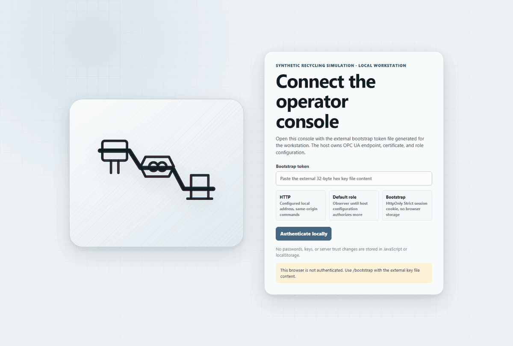

This 12-second animation loops through the console views and commands. Use the
[step-by-step walkthrough](#operator-console-walkthrough) for the full-size screenshots.

## Contents

- [How the sample fits together](#how-the-sample-fits-together)
  - [Material, time and faults](#material-time-and-faults)
  - [Holds and recovery](#holds-and-recovery)
- [What the servers expose](#what-the-servers-expose)
  - [Companion assets and process data](#companion-assets-and-process-data)
  - [Units, timestamps and quality](#units-timestamps-and-quality)
- [Run the sample](#run-the-sample)
  - [Secure identities](#secure-identities)
  - [One shared scenario](#one-shared-scenario)
  - [Build and start the roles](#build-and-start-the-roles)
- [Operator console](#operator-console)
  - [Build and configure](#build-and-configure)
- [Operator console walkthrough](#operator-console-walkthrough)
  - [Connect and read the plant](#connect-and-read-the-plant)
  - [Inspect equipment and companion readings](#inspect-equipment-and-companion-readings)
  - [Disable and enable a process](#disable-and-enable-a-process)
  - [Review and dispose quality holds](#review-and-dispose-quality-holds)
  - [Trace material and view trends](#trace-material-and-view-trends)
  - [Administer simulation time and persistence](#administer-simulation-time-and-persistence)
  - [Recognize idle, constrained and unavailable states](#recognize-idle-constrained-and-unavailable-states)
- [Observe and control the line](#observe-and-control-the-line)
- [Container images](#container-images)
- [Validation](#validation)
  - [Image contracts and live qualification](#image-contracts-and-live-qualification)
  - [Browser interaction profile](#browser-interaction-profile)
  - [NativeAOT publication](#nativeaot-publication)

## How the sample fits together

[`Program.cs`](RecyclingServer/Program.cs) loads the role, scenario and certificate mappings.
`RecyclingHost.Build` assembles the Generic Host, secure endpoint and dependency-injected
runtime. The coordinator alone owns `RecyclingEngine`, `MaterialLedger` and `RecyclingJournal`.
Each process server uses `CompanionProcessViewAdapter` to project committed snapshots onto its
equipment: it has no material clock, independent random signals or production counters.

The [shared sample model](Recycling.Client/Model/Recycling.xml) supplies generated structures, methods,
clients and DI-derived process types in `urn:opcfoundation.org:sample:recycling`. Native
companion instances and Machinery state AddIns share one DI/Machinery owner; AMB registers
the actual assets. The implementation is divided into:

| Directory | Responsibility |
| --- | --- |
| [Recycling.Client](Recycling.Client) | Shared generated model, immutable contracts, mapping and typed coordinator client; no server executable dependency. |
| [Coordination](RecyclingServer/Coordination) | Authenticated membership, serialized commands and committed snapshots. |
| [Simulation](RecyclingServer/Simulation) | Deterministic transformations, finite buffers, utilities, genealogy and holds. |
| [Persistence](RecyclingServer/Persistence) | Checksummed journal/checkpoint storage through the existing file-system provider. |
| [Hosting](RecyclingServer/Hosting) | Role startup, authorization, companion assembly and read-only equipment projections. |

### Material, time and faults

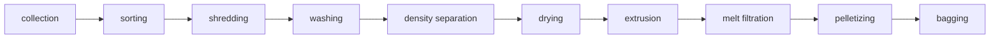

These ten selections contain **21 separately queued substeps**. For example, washing contains
prewash, friction wash, hotwash and rinse; drying separates mechanical dewatering, thermal
drying and buffering.

A fresh run waits for all ten distinct authenticated roles to register and acknowledge an
initial snapshot. The coordinator then advances one logical tick per pacing interval:

1. Downstream operations use previously committed inventory first. Newly received material
   cannot traverse another substep in that tick.
2. Residence time, throughput, available buffer capacity and electrical/thermal supply
   determine which transformations can run. Disabled or unavailable equipment, jams,
   strand breaks and utility constraints freeze the affected residence progress.
3. Transformations split or merge component-wise source contributions. The complete result
   is journaled before it becomes visible to clients or process views.

Defaults are a fixed seed of `104729`, 30 logical seconds per tick, one wall-clock second
between automatic ticks, 24 source batches, 60 kg buffers, 6 kg/tick throughput, 4 kg complete
packages, and one to four residence ticks. Each source batch contains 5 kg dry material plus
0.25 kg water. These settings are in
[`RecyclingConfiguration`](RecyclingServer/Simulation/RecyclingConfiguration.cs).

Mass is counted in integer **milligrams**, separately for natural polymer, colored polymer,
dense polymer, labels, dirt and water. Every transition checks the following balance globally,
per source, per substep and per split/merge:

```text
source inputs + utility additions
  = active inventory + complete packages + rejects/wastewater + evaporation
```

Optical sorting removes contaminants; washes add tracked water and remove dirt/labels.
Density separation rejects dense polymer while retaining natural and colored polymer equally.
Mechanical drying drains water; thermal drying and extrusion evaporate it. Filtration removes
particles, not dissolved color. Screening removes proportional fines. Bagging merges
contributions into exact full packages and retains any incomplete package as inventory.

The named [scenarios](RecyclingServer/scenarios) are `healthy`, `sorter-drift`,
`utility-disturbance`, `equipment-faults`, `combined` and `recovery`. Fault windows use logical
ticks. Jam/strand-break counts are absolute onset counters, not counters incremented by reads.
Source zones, synthetic hotwash pH and package RGB also belong to committed coordinator state.

### Holds and recovery

Equipment execution, data availability and material disposition are separate. Color/moisture
holds follow descendants and merged packages; recovering equipment does not release material.
An authorized operator or administrator explicitly releases or rejects a hold. Produced-package
count can therefore differ from released-product count.

The coordinator writes complete state and accepted command outcomes before acknowledging them.
Requests carry line/run identity, expected revision and a caller-owned request ID. Identical
control-command retries return the original outcome, including after restart; conflicting reuse
or operationally stale revisions are rejected. Membership-only metadata changes do not invalidate an
otherwise current control precondition; material ticks, other controls, lifecycle changes and coordinator
recovery do. Membership requests separately fence changes to their own role and its lease,
without conflicting on material ticks, controls or unrelated roles' metadata. Their observed
revision records the image actually applied by the view. Authenticated session ownership is unchanged.
Equipment and hold actions separately fence explicit control changes, so continuous material
ticks cannot starve a confirmed enable/disable or hold-disposition action.
The console forwards the original expected revision unchanged; the coordinator rejects
future revisions and mismatched runs. Request IDs and submitted payloads are never rewritten
to obtain this compatibility. Reconnection and repeated projections do not duplicate material.

The journal uses length-delimited SHA-256 frames, atomic same-directory publication and an
exclusive `writer.lock`. Checkpoints precede removal of superseded generations. Recovery checks
the chain, configuration and embedded model, and refuses corrupt/incompatible state rather than
starting an empty replacement run. A valid commit can recover past an interrupted `.pending`
write. Storage is single-writer process-crash recovery, not distributed consensus or a universal
power-loss guarantee. The retained schema is version 2; schema-1 stores are rejected.

A paused run stays paused after recovery. Pausing freezes material time but not membership,
administration or disposition. Old session leases are invalidated on restart; participants
re-register without resetting production. The default lease lasts 30 wall-clock seconds, and
loss of a process eventually blocks its flow while upstream buffers remain finite.

Default bounds are 256 active parcels, 4,096 retained records per material/history category,
4,096 control receipts, 64 admitted writer calls, 32 local observers and 10 administrative
steps per command. Heartbeats retain only their latest durable outcome per process, separately
from control receipts. Held material still consumes retention capacity.
Exhausted material retention enters `ResourceLimited`; a full writer
queue refuses the call and automatic pacing retries on the next interval. Frames are capped
at 64 MiB; the [connection-health guidance](#recognize-idle-constrained-and-unavailable-states)
describes the UA transport limits.

## What the servers expose

`Coordinator.State` is a structured `SnapshotDataType`, not JSON in a UA string. It contains
run/lifecycle identity, revision, logical tick/time, stages, parcels, complete packages, sinks,
source contributions, holds, the latest execution per stage and source admission, participant leases and
electrical/thermal energy.
`ProcessView.State` exposes the same live projection alongside `Process`, `LineId`,
`Available` and `CompanionBindingsComplete`. Live values are coalescible current state, not a
genealogy archive: repeating all historical executions in every monitored notification causes
serialization, cloning and delivery backpressure as a run grows. `Coordinator.ReadSnapshot`
still returns the complete retained snapshot; `Coordinator.ReadGenealogy` pages every retained
execution. No journal records or authoritative material history are discarded.
Servers retain at most two retransmission messages per subscription.

Every sample stage also exposes `RunState`, `Available`, `Timestamp`, `MachineId`, `Process`, `RunId`,
`Revision`, `Tick`, `Stage`, `Material`, `Contributions`, `SourceIds`, `SourceBinId`, `SourceZone`,
`LotId`, `Executions` and `ThroughputKgHr`. Mixed lots retain every contribution; `SourceZone`
reports `mixed` while the contribution records preserve individual zone labels.

### Companion assets and process data

Each stage is discoverable from `ProcessView`, DI `DeviceSet` and Machinery `Machines`.
AMB's `AssetsByProductInstanceUri` aliases identify the actual equipment. Machinery identification
uses `urn:recycling-sample:<line-id>:<asset-name>`. Instance NodeIds are stable URI-qualified
containment paths, independent of run IDs and numeric namespace-table positions.

The table lists the process selections, default endpoint ports and principal live bindings.
The sample namespace carries process-specific measurements alongside the native companion objects.

| Selection / port | Equipment and substeps | Exposed measurements and state |
| --- | --- | --- |
| `collection` / 62571 | Collection bin and transport; native `VehicleScaleType`. | Inventory, source contributions/zones and vehicle weight in kg. |
| `sorting` / 62572 | Inbound identification, feed conveyor, two optical stations; `SimpleScaleType`, Part 1 `VisionSystemType`, Part 2 `VisionSystemAssetType` and identified cameras. | `BeltSpeedMps`, `ThroughputTph`, `JamAlarm`/`JamEvents`, `ClassificationAccuracyPct`, `ContaminationPpm`, `DriftScore`, `CameraHealth` and native vision results. |
| `shredding` / 62573 | Primary reduction and secondary granulation with DI/Machinery state. | `MotorLoadPct`, `FeedRateKgMin`, `FlakeSizeAvgMm`, `ThroughputKgHr` and jam flags/counters. |
| `washing` / 62574 | Prewash, friction wash, hotwash and rinse; native circulation/drain `PumpType` instruments. | Pump status, `TurbidityNtu`, `WaterTempC`, `FaultState`, `WashEffectivenessPct`, `MotorLoadPct`, `BathTempC`, `Ph`, `AdhesiveRemovalPct`. |
| `density-separation` / 62575 | Float/sink process and native circulation pump. | `CirculationPumpStatus`, `SeparationPurityPct`, `HdpeRecoveryPct` (a target-polymer recovery proxy). |
| `drying` / 62576 | Mechanical dewatering, native OPC 40082-6 `GranulateDryingDeviceType` with bin/desiccant bed, then dry-material buffer. | `OutletMoisturePct`, throughput, native temperature, airflow, dewpoint, residence durations, power and energy. |
| `extrusion` / 62577 | Native OPC 40084 `ExtrusionLine_InterfaceType`, `Extruder_InterfaceType` and temperature zones. | Melt temperature/pressure, zone actual/set values, throughput and sample `ExtrusionStabilityScore`. |
| `melt-filtration` / 62578 | Native OPC 40084-6 `Filter_InterfaceType`, `FilterPackageType`, `ScreenPackageType` and temperature zones. | Mesh fineness, filter status; sample `AlarmState`, `DiffPressureBar`, `CloggingPct`, `MeltCleanlinessIndex`. |
| `pelletizing` / 62579 | Native OPC 40084-8 `Pelletizer_InterfaceType`, drive, knives and die plate; pellet screening. | Native drive speed, sample `PelletSizeAvgMm`, throughput, `FaultState`, `StrandBreakAlarm`/`StrandBreakEvents`. |
| `bagging` / 62580 | `BaggingStationType`, native `AutomaticFillingScaleType` and PackML state. | `BagWeightKg`, `PackageCount`, `BagsPerHr`, `LotId`, `ColourR`, `ColourG`, `ColourB`, `QualityClassification` and absolute weighing statistics. |

Vision's `latest` result contains typed `ExecutionDataType` content, a run/execution `JobId`
and `IsSimulated=true`; reprojecting it does not publish a new inspection. Mechanical dewatering
remains a separate process, not a desiccant dryer. Filter differential pressure is a sample
measurement because the standard screen-package type has no such member.

Each pump's `Operational/PumpActuation/Status` exposes the mandatory `FalseState`
and `TrueState` properties as `Stopped` and `Running`. Status reflects committed
electrical demand; the labels describe the synthetic pump state, not a local command.

The package models are described in [Machinery](../../docs/Machinery.md),
[Vision](../../docs/Vision.md), [Pumps](../../docs/Pumps.md), [Scales](../../docs/Scales.md),
[AMB](../../docs/AMB.md), [Extrusion](../../docs/Extrusion.md) and
[Plastics/rubber, including granulate drying](../../docs/PlasticsRubber.md).

### Units, timestamps and quality

- Numeric sample signals use `SyntheticMeasurementType` (`AnalogUnitRangeType`) with
  `EngineeringUnits`, `EURange`, `SemanticField` and `Formula`. Weights are kg; native extrusion
  throughput is kg/h, pressure bar, mesh fineness micrometres and pelletizer speed rpm.
  Dryer durations are milliseconds, electrical energy kWh, bin airflow m³/h and bed airflow l/s.
- Rates are **run-to-date averages**, not instantaneous flow. Removal, purity, recovery and
  moisture derive from cumulative committed material. `Energy` exposes separate electrical
  and thermal joule totals divided by packaged dry mass, including held packages;
  a zero denominator sets `IsApplicable=false`.
- pH defaults to a committed synthetic 8.5 set-point observation. RGB is the floored
  polymer-mass-weighted mix of configured natural/colored anchors, not calibrated colorimetry.
  Their individual source timestamps survive subsequent commits and reconnects.
  Other display coefficients are in
  [`RecyclingSignalDefaults`](RecyclingServer/Hosting/RecyclingSignalDefaults.cs) and
  [`RecyclingNativeProcessOptions`](RecyclingServer/Hosting/RecyclingNativeProcessOptions.cs).
- Views publish atomic images with coordinator-owned values and source times. On connection loss,
  `Available=false`; present equipment readings retain their last values/time with
  `UncertainLastUsableValue`, while the root snapshot reports unavailable status.
  Missing observations or undefined ratios report `BadNoData`, not fabricated zero readings.
- A `Good` DataValue means usable data, not accepted product. `CompanionBindingsComplete=true`
  identifies this selected read-only equipment binding, not optional remote controls or formal
  conformance. Signals and weighing are synthetic, not calibrated/legal-for-trade measurements
  or a reproduction of an external producer schema.
- The console sends 64-bit revisions and identifiers to the browser as JSON strings.
  Exact mass arithmetic stays in C#. It does not infer capacity, OEE, ETA or utility-supply percentages.

## Run the sample

### Secure identities

The host uses encrypted/signed OPC UA sessions, RSA-SHA256 application certificates and X.509
user authentication. Anonymous access and automatic trust of unknown peers are disabled.
Each role has a separate application PKI root; each process view also has a distinct user
certificate and private key. Certificate provisioning uses the stack's
[certificate manager](../../docs/CertificateManager.md) and
[certificate stores](../../docs/Certificates.md).

Application public certificates go into peer trust; user public certificates go into user trust.
The external role map authorizes already authenticated user certificates:

```json
{
  "identities": [
    {
      "certificateSha256": "<64 hexadecimal SHA-256 digits of the DER user certificate>",
      "identity": "collection-view",
      "access": "ProcessView",
      "process": "Collection"
    }
  ]
}
```

Replace the placeholder and include one distinct `ProcessView` identity per process, plus any
`Observer`, `Operator` and `SimulatorAdministrator` users. The mapping contains fingerprints,
not keys. The application URI is `urn:localhost:OPCFoundation:Recycling-<line-id>-<role>`;
the certificate's names must match the advertised `--endpoint`.

### One shared scenario

All eleven roles use the **same effective configuration and embedded sample model**. Each
executable independently defaults to `healthy`, so another scenario must be passed to both
the coordinator and all ten views. For `--scenario <file.json>`, every role needs a readable
copy with identical effective settings; container copies are mounted read-only.

JSON scenario files override the documented top-level defaults: omitted fields retain
their defaults, while explicit zero values, nulls and unknown members still undergo
normal validation. The checked-in scenario files have the same effective settings as
their corresponding named scenarios.

Views compare the full configuration/model hash before membership or projection. It includes
residence, seconds per tick, source settings, fault schedules, leases and bounds—not just the
scenario name. A mismatch or missing identity reports `BadConfigurationError` and stops automatic
reconnect, retaining the last compatible image as unavailable. Correcting the view's inputs/build
and restarting it preserves the coordinator's retained state. Host endpoints, certificate stores,
`--pace-ms`, and `--view-poll-ms` may differ; they are outside the simulation identity.

### Build and start the roles

Build with the repository's **.NET 10 SDK**. For managed builds and runs, select `net8.0`,
`net9.0` or `net10.0` and install the corresponding runtime. The examples select `net10.0`;
substitute your choice in both `-f` and `CustomTestTarget` for the managed commands.

From the repository root:

```powershell
dotnet build samples\Recycling\RecyclingServer\RecyclingServer.csproj -f net10.0 -p:CustomTestTarget=net10.0
```

Start each role in a separate terminal **from `samples\Recycling\RecyclingServer`**, where
the default `.recycling` directory is ignored by Git. The following assumes provisioned
`roles.json`, application PKI stores and user stores; explicit `--pki-root` and `--state-root`
can select external locations.

```powershell
dotnet run -f net10.0 --no-build -- --role coordinator --line-id line-1 --scenario healthy --identities .\roles.json
```

The coordinator listens on `opc.tcp://localhost:62570/Recycling`. Start a view with its own
user store and subject, then repeat for every selection/port in the equipment table:

```powershell
dotnet run -f net10.0 --no-build -- --process collection --line-id line-1 --scenario healthy `
    --coordinator opc.tcp://localhost:62570/Recycling --identities .\roles.json `
    --identity-store .\user-stores\collection --identity-subject CN=CollectionView
```

`--pace-ms` changes wall-clock pacing, not logical seconds per tick. Views may start before the
coordinator; production starts only after all ten initialize. `--help` lists the flags.
[Docker Compose and Kubernetes examples](RecyclingServer/deploy/README.md) run the same eleven
roles with isolated storage; their single server Docker image uses the managed .NET 10 target.

For larger retained snapshots, `--view-poll-ms 10000` reduces each view's durable lease-refresh
and fallback-read traffic with the default 30-second lease. The default period is 2 seconds;
it must remain below half the lease duration. This setting does not slow the separate UA
subscription. Views retry `BadTimeout` and `BadRequestTimeout` as temporary communication
failures; authorization/configuration rejections remain terminal.

## Operator console

The console is a local ASP.NET Core 10 host serving HTML, SVG, CSS and JavaScript.
It connects directly to the coordinator and configured process servers over encrypted OPC UA;
the browser uses HTTP and server-sent events (SSE), not OPC UA, MCP or MQTT.
`Recycling.Client` is shared with the servers as a sample-local, non-packable library.

### Build and configure

Build from the repository root with the .NET 10 SDK:

```powershell
dotnet build samples\Recycling\RecyclingOperatorConsole\RecyclingOperatorConsole.csproj `
    -f net10.0 -p:CustomTestTarget=net10.0
```

Provision the workstation's application identity, a dedicated UA user certificate and an
unpredictable bootstrap key **outside the repository and container build context**.
Use the [certificate manager](../../docs/CertificateManager.md) and
[certificate stores](../../docs/Certificates.md). Do not copy a process-view private key
into the workstation, disable hostname validation or auto-accept unknown certificates.
Trust the workstation application on each server it accesses, put server application
certificates in workstation peer trust, and bind the UA user's public fingerprint to its
role in the coordinator's external identity mapping and user trust.

One console host uses one UA user identity, not a separate identity per browser tab.
Its configured role is a permission ceiling: the default `Observer` is read-only, and a
local setting cannot grant permissions denied by the server.

The host reads standard .NET configuration environment variables:

| Key prefix `RecyclingConsole__` | Meaning |
| --- | --- |
| `Endpoint` | Explicit coordinator `opc.tcp` endpoint. |
| `LineId` | Expected line identity; must match the selected coordinator. |
| `Role` | Permission ceiling: `Observer` (default), `Operator`, or `SimulatorAdministrator`. |
| `BootstrapKeyFile` | Required external text file containing a random 32-byte key encoded as hexadecimal. |
| `UserCertificatePath` | External directory certificate store for the single configured UA user identity. |
| `UserCertificateSubject` | Subject selector within that store, for example `CN=Recycling-line-1-observer`. |
| `UserCertificatePasswordFile` | External text file holding the user store's private-key password; not the password itself. |
| `ApplicationCertificateStore` | Directory store for the host's separate application identity. |
| `TrustedPeerStore`, `TrustedIssuerStore`, `RejectedCertificateStore` | Application trust, issuer and rejected-certificate directory stores. |
| `AllowedHost` | Exact browser host/port, normally `localhost:8080`. |
| `ContainerBind` | `false` by default (loopback); `true` listens on container interfaces using the `AllowedHost` port. |
| `ProcessEndpoints__<process>` | Explicit mappings using names such as `Collection`, `DensitySeparation`, `MeltFiltration` and `Bagging`. |

For example, after provisioning the files and peer/user trust:

```powershell
$env:RecyclingConsole__Endpoint = 'opc.tcp://localhost:62570/Recycling'
$env:RecyclingConsole__LineId = 'line-1'
$env:RecyclingConsole__Role = 'Observer'
$env:RecyclingConsole__BootstrapKeyFile = 'D:\recycling-client\secrets\bootstrap-key'
$env:RecyclingConsole__UserCertificatePath = 'D:\recycling-client\secrets\users'
$env:RecyclingConsole__UserCertificateSubject = 'CN=Recycling-line-1-observer'
$env:RecyclingConsole__UserCertificatePasswordFile = 'D:\recycling-client\secrets\user-password'
$env:RecyclingConsole__ApplicationCertificateStore = 'D:\recycling-client\pki\own'
$env:RecyclingConsole__TrustedPeerStore = 'D:\recycling-client\pki\trusted'
$env:RecyclingConsole__TrustedIssuerStore = 'D:\recycling-client\pki\issuer'
$env:RecyclingConsole__RejectedCertificateStore = 'D:\recycling-client\pki\rejected'
dotnet run --project samples\Recycling\RecyclingOperatorConsole\RecyclingOperatorConsole.csproj `
    -f net10.0 -p:CustomTestTarget=net10.0 --no-launch-profile
```

Use advertised endpoints with matching certificate DNS names; `localhost` does not rewrite
discovery URLs. Set each native process mapping explicitly. The optional Compose
`operator-console` profile supplies those mappings and isolated client mounts; see the
[deployment guide](RecyclingServer/deploy/README.md#optional-operator-console).

Open `http://localhost:8080/bootstrap?token=<contents-of-bootstrap-key-file>` locally, or use
the authentication form in the walkthrough below. The launch credential is exchanged for a
short-lived HttpOnly, SameSite=Strict session cookie and the browser is redirected to `/`.
Treat that URL as a credential: keep it out of shared logs, screenshots and committed scripts,
and protect browser history and the key file. Commands require the browser session and a
same-origin CSRF token. Keep the allowed host explicit; do not add broad CORS or expose this
sample as a remote multiuser service. Rotate the bootstrap key and restart to revoke launch
access when needed.

## Operator console walkthrough

Start the coordinator, all ten process servers and the console using the
[deployment guide](RecyclingServer/deploy/README.md#optional-operator-console), or configure
the workstation host [above](#build-and-configure).
The browser has no **Start** button.

The screenshots below show an isolated synthetic line using the checked-in
[`combined` scenario](RecyclingServer/scenarios/combined.json). Its seed, finite source plan,
fault windows and material balances are server-owned; the browser does not generate telemetry.
The walkthrough uses a **SimulatorAdministrator** identity to show every action.

| Configured role | Available operations |
| --- | --- |
| Observer / unknown | Plant, Inspector, Trends, Material and Holds inspection; no mutations. |
| Operator | Observer operations, process enable/disable and explicit hold release/rejection. |
| SimulatorAdministrator | Operator operations plus Pause, Resume, Step one tick, Stop, Reset and Checkpoint. |

### Connect and read the plant

1. Open the configured local address, normally `http://localhost:8080`.
2. On **Connect the operator console**, paste the contents of the external bootstrap-key file into
   **Bootstrap token**, then select **Authenticate locally**. Alternatively, use the local
   bootstrap URL described [above](#build-and-configure).
3. Check the displayed role, **Connected** state, lifecycle and **Quality** before acting.
   If the browser session expires, authenticate locally again; this does not create a new run.

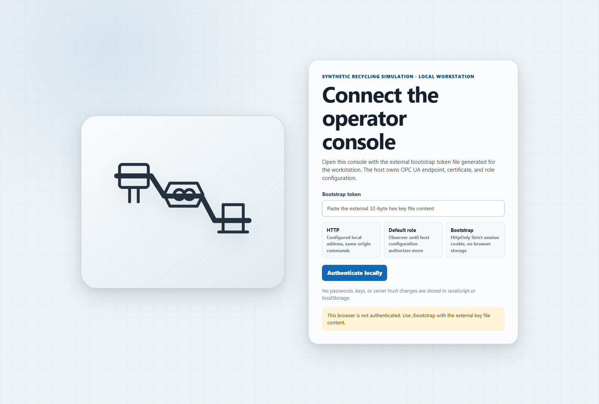

In **Plant**, follow the arrows from collection through bagging. Each equipment tile represents
one process; selecting it opens its substeps in the **Inspector**. The diagram shows process
order, not the plant's physical layout. The process list below the
schematic provides the same selection using keyboard focus and Enter. On narrower windows,
use **Inspector** in the navigation rail to open the inspection drawer.
Live updates patch existing SVG symbols and buttons in place to preserve pointer gestures,
keyboard focus and open inspector sections.

The top bar shows admitted **Input**, **Work in progress**, **Packaged** mass, complete
**Packages**, and electrical/thermal energy. These are committed cumulative counters, not
instantaneous rates or estimates. Packaged material can still be held. Arrows pulse only when
an observed committed transfer changes; they are not an independent animation of production.
The time beside the role is the browser session's expiry, not the simulation clock.
Process **Transferred** totals sum substep transfers: the same material can be counted at
several substeps, so do not add these totals to the plant mass balance.

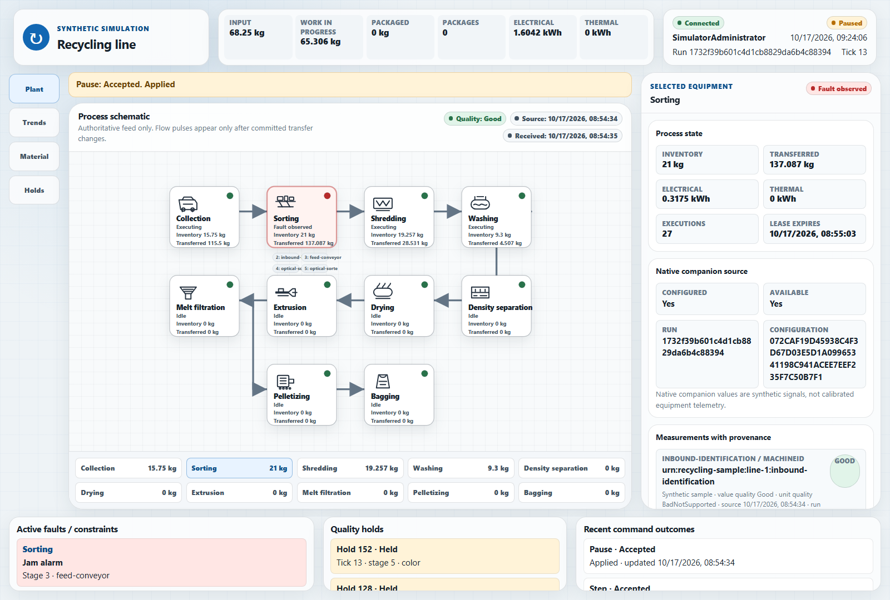

The footer separates **Active faults / constraints**, **Quality holds** and **Recent command
outcomes**. Select a fault to inspect the affected process. A jam or strand break freezes the
affected residence progress; downstream equipment can finish material it already holds,
while upstream finite buffers may fill. A utility shortage constrains work rather than
creating material or skipping a substep. In `combined`, the first fault/utility window is
ticks 8–24, with a conveyor jam at ticks 12–16; later windows affect shredding and pelletizing.
Pause preserves the current tick, so a fault paused inside its window remains visible.
Equipment badges retain the last committed substep activity: an **Executing** badge in a
paused snapshot does not mean material is advancing while logical time is frozen.

### Inspect equipment and companion readings

Select **Sorting**, then scroll within the Inspector. **Native companion source** reports
whether a process endpoint is configured and currently available, plus its run/configuration.
**Measurements with provenance** lists values, units, value/unit quality, original source time,
run, tick and projection lag. **Substeps** shows the separately queued equipment states and
enabled/fault flags. For example, Washing has four substeps, not one instantaneous wash.
An identifier or Boolean can have a Good value and `BadNotSupported` unit quality because it
has no engineering-unit metadata; inspect value quality separately from unit metadata quality.

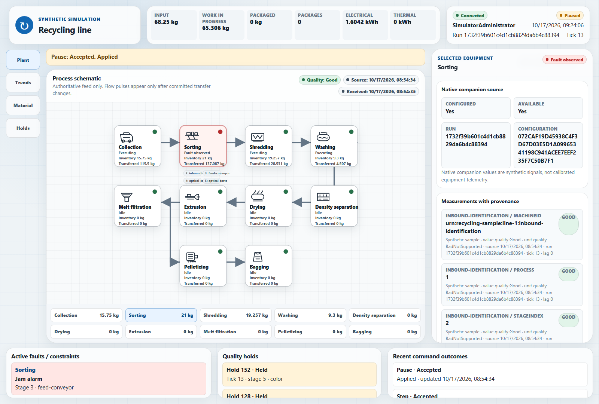

Try the other processes: Drying exposes its native drying-device measurements, Extrusion its
temperature/throughput bindings, and Bagging its scale/PackML projection. These are independent
reads from the configured process servers, not coordinator values relabeled as native data.
Missing endpoints or mismatched runs/configurations remain explicitly unavailable.
The [equipment table](#companion-assets-and-process-data) lists each process's bindings.

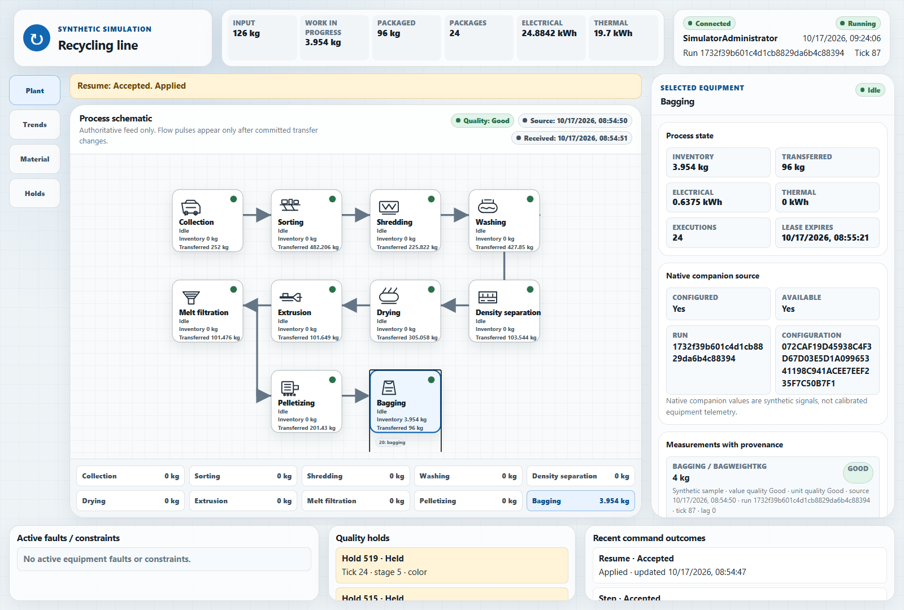

For the transformation rules, residence times and component-wise balances behind these
readings, see [Material, time and faults](#material-time-and-faults).

### Disable and enable a process

1. Select **Washing**, scroll to **Authorized commands**, then select **Disable process**.
2. Review the confirmation's command, selected process, run, revision and request ID.
   **Cancel** or Escape dismisses it without submitting. Select **Submit exact payload**
   only when the target is correct.
3. Wait for an **Accepted** outcome *and* the authoritative disabled substeps. The console
   does not optimistically change plant state after an HTTP response.
4. Select **Enable process** to re-enable those substeps. Enable is intentionally disabled
   while every substep is already enabled; it becomes available after Disable is observed.

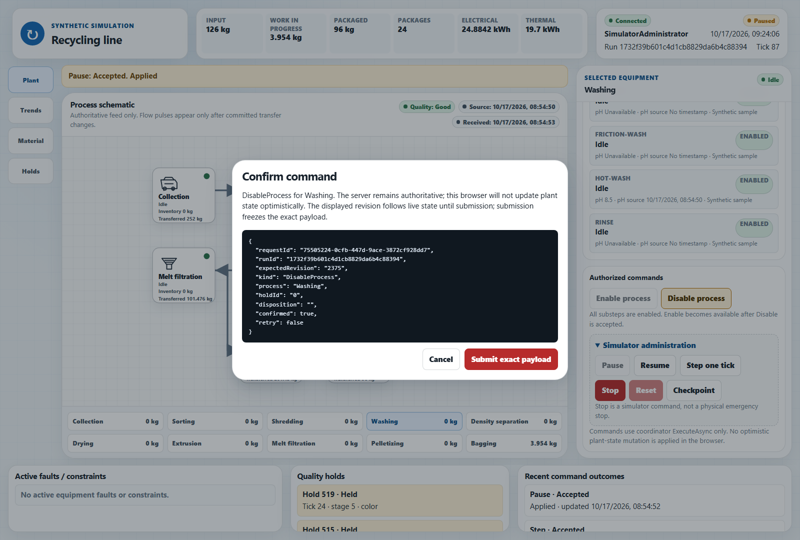

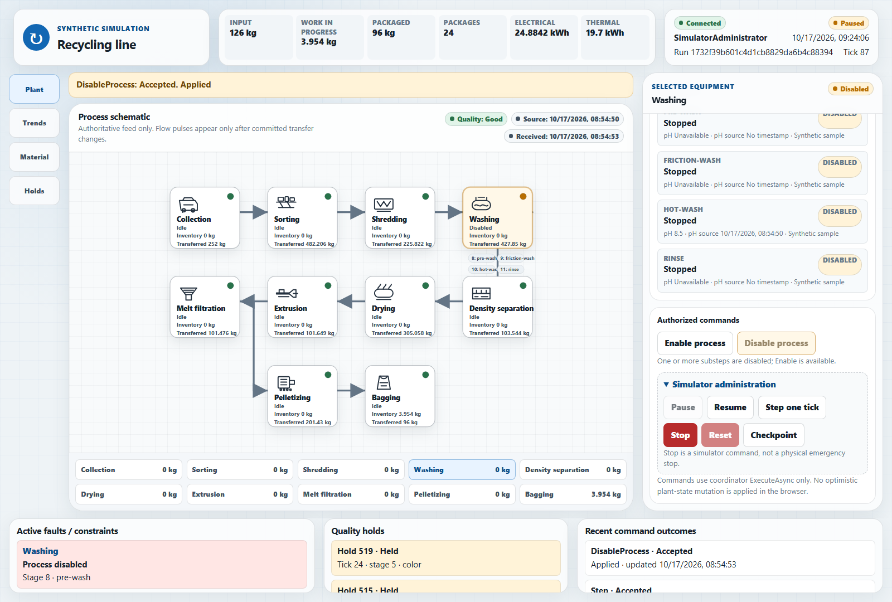

Disabling freezes that process's material progress; it does not disconnect its server,
stop the whole line or dispose its holds. Enabling allows progress when membership, utilities,
fault conditions and downstream capacity also permit it. A process can therefore be enabled
without executing.

A new confirmation follows live revisions until submission, but never retargets the process,
hold or run. Submission freezes the envelope. **Rejected** means the request was refused:
review the reason and refreshed state before choosing a new action. **Pending** or **Unknown**
is not proof of success or rejection: a timeout or failed response can follow a durable commit.
**Retry exact envelope** explicitly resubmits the original
request ID and payload to retrieve the durable outcome. Do not use a new request ID to retry
an unknown outcome. Run changes or loss of live delivery cancel pending confirmations.
Rejections remain visible across subsequent live updates; the browser never automatically
resubmits a conflicting command. Recent outcomes are bounded workstation-session observations,
not a full audit log. A console restart can lose in-memory pending actions; the coordinator's
durable receipts remain authoritative.

### Review and dispose quality holds

Open **Holds** rather than relying on the footer's short preview. **Outstanding** shows held
records; **All dispositions**, **Released** and **Rejected** include retained decisions.
Use **Next page**, **Previous page** and **Refresh page** to navigate the complete retained
set. The page's run/revision identifies its observation; refreshing is not a disposition.
The read-only `/api/holds` endpoint accepts `runId`, an `after` hold ID, `limit` (1..100),
and an optional `disposition`.

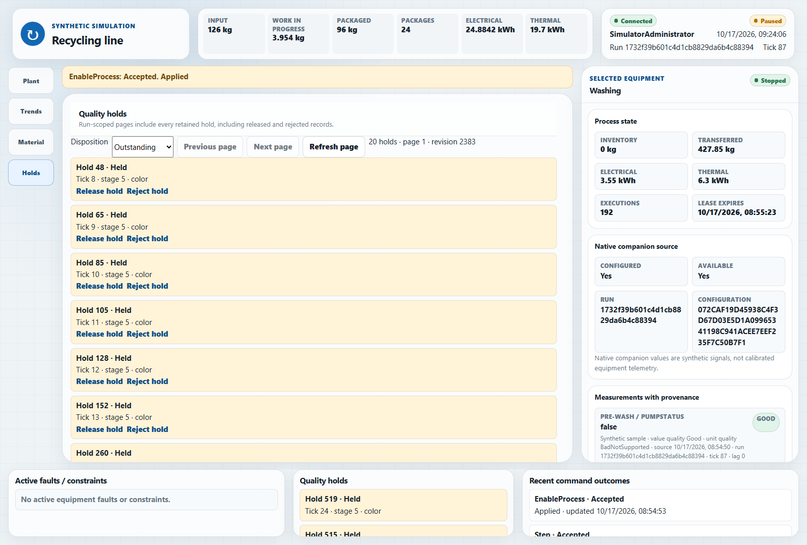

An Operator or SimulatorAdministrator can select **Release hold** or **Reject hold** for a
held record, review the confirmation, and submit. The decision changes that hold's disposition.
It does not repair equipment, add a package or remove the historical record.
Inspect the resulting disposition using **All dispositions**.
Descendants and mixed packages retain their quality history; one release does not clear
other outstanding holds affecting them.

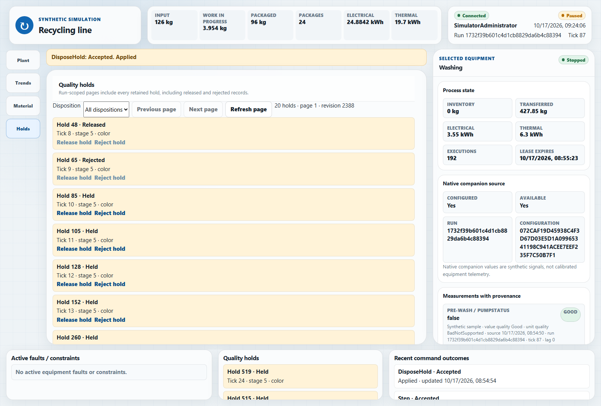

**Quality: Good** describes usable data. See [Holds and recovery](#holds-and-recovery)
for how product disposition remains separate from equipment recovery.

### Trace material and view trends

Open **Material**, select **Load material page**, then **Load history page**. Material records
show retained parcel/package/residue IDs, tick, substep, material form and total mass; execution
records identify the tick, substep and input/output IDs of a transformation. The buttons
request subsequent bounded pages; **Next page** text reports the cursor or `none`.
Use these IDs to trace parcels and packages through splits and merges back to their sources.

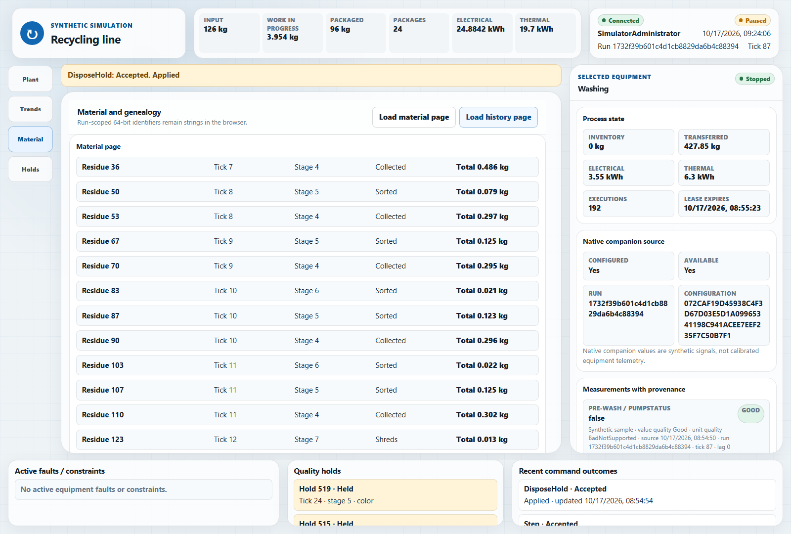

Scroll down within the Material panel to reach **Execution history page**:

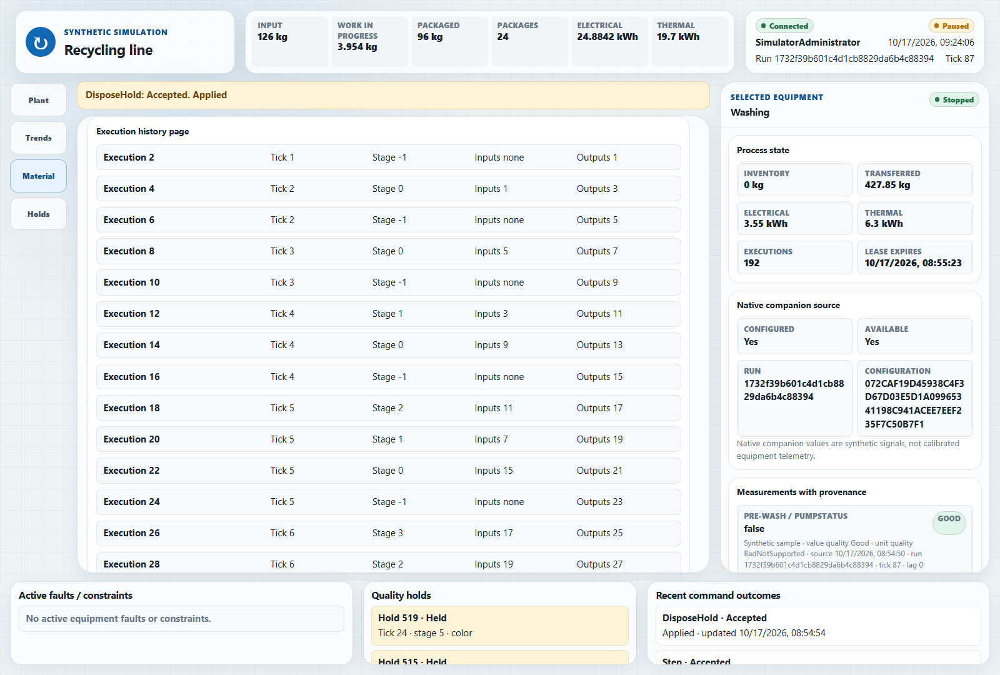

The browser shows a compact trace, not every component of the server's material ledger.
For exact source contributions and component-wise balances, inspect the typed
`ReadSnapshot`/`ReadGenealogy` data described [below](#observe-and-control-the-line).

Live UA notifications retain only each stage's latest execution and the latest source
admission. **Load history page** queries the complete retained genealogy separately; it is
not limited to what happened while this browser was open. Material/history requests remain
run-scoped. Direct snapshot reads before and after the genealogy call reject reset races
with HTTP 409, even if the subscription still exposes the old run.

Open **Trends** to compare work-in-progress and packaged mass over observed logical ticks.
The chart and recent rows start with this console's connection, are bounded in memory and
show observation gaps/reset boundaries. They are not a persisted historian: reconnecting or
opening another console does not reconstruct all earlier trend points.

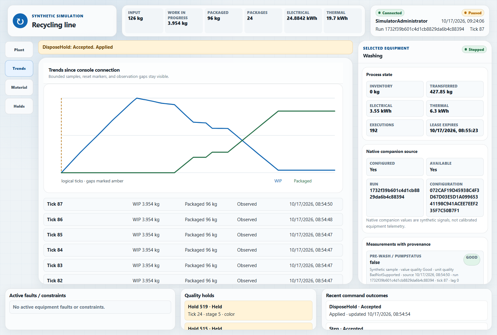

### Administer simulation time and persistence

With a SimulatorAdministrator identity, select a process, scroll to **Authorized commands**
and expand **Simulator administration**. These actions address the coordinator, not the
selected process's native companion controls.

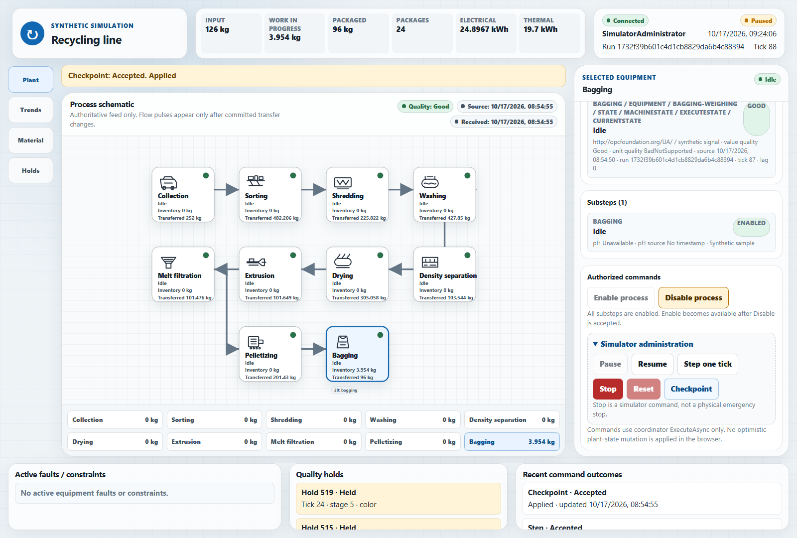

| Action | Preconditions and observable effect |
| --- | --- |
| Pause | Freezes automatic material ticks; membership/lease refresh, inspection and authorized controls continue. |
| Resume | Continues a paused or stopped run without replacing its identity or retained material. |
| Step one tick | Available while paused; advances exactly one logical material tick, then remains paused. |
| Stop | Requires confirmation. Stops automatic material progression, preserving the run for Resume or Reset. This is **not** a physical emergency stop. |
| Checkpoint | Persists/compacts the coordinator's retained state without restarting the run or clearing holds. |
| Reset | Requires a stopped run and confirmation. Creates a **new run** with fresh production state; it is not reconnect/recovery or a way to release a hold. |

To check stepping, Pause, record the tick, select Step one tick, and check that the
tick increases by exactly one while the lifecycle stays Paused. Revision can increase again
because membership or control metadata changes.
Checkpoint provides an explicit persisted boundary for a restart exercise; ordinary commits
are already durable and do not require a manual checkpoint. Use Stop followed by Resume to continue the
same run; use Stop followed by Reset only when deliberately starting a replacement run.

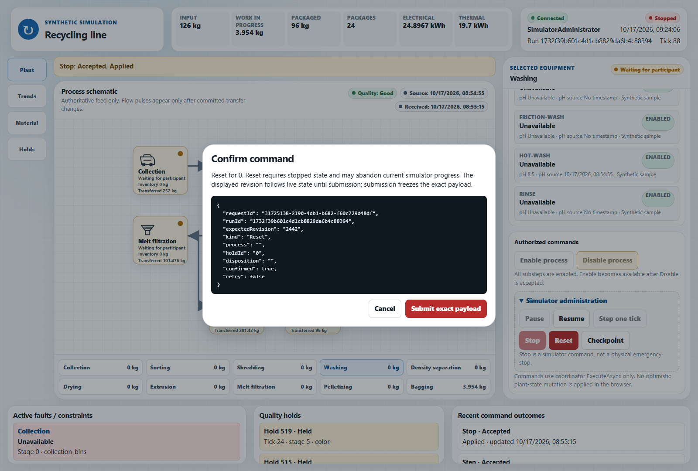

After Reset, inspect the new run ID and cleared run-scoped production views. Process roles
must initialize for the new run before production proceeds. In contrast, restarting the
coordinator on its compatible journal recovers the existing run; a paused run stays paused,
and process roles re-register without duplicating material. Closing the browser or console
is neither Stop nor Reset and does not stop the eleven servers.

### Recognize idle, constrained and unavailable states

Use lifecycle, tick, quality, material counters and fault details together:

| Observation | Interpretation and next check |
| --- | --- |
| WaitingForParticipants | The ten-role initialization barrier is incomplete; check missing process servers and matching configuration/identities outside the browser. |
| Running, tick advancing, no new input | The finite source plan may be complete. Downstream work can drain, then enabled equipment becomes idle. Defaults admit 24 source batches. |
| Idle with a small remaining inventory | A residence/throughput boundary or incomplete final package can leave material waiting; bagging does not invent mass to fill a bag. |
| Paused or Stopped, unchanged tick | Intentional lifecycle state. Resume, or use Step while paused; do not diagnose it from timestamp age alone. |
| Disabled, jammed or utility-constrained substeps | Production is blocked locally. Inspect the process and scenario window; enabled upstream equipment can become buffer-limited. |
| ResourceLimited | A configured retention/capacity bound was reached. Enable, page refresh and reconnect cannot remove it. Preserve the journal and review the configured limit before starting a new run; the browser cannot edit recipes. |
| Unavailable/reconnecting or non-Good quality | Retained values are not fresh measurements. Mutations are disabled until a new usable live observation arrives; inspect server/transport/trust/configuration health. |

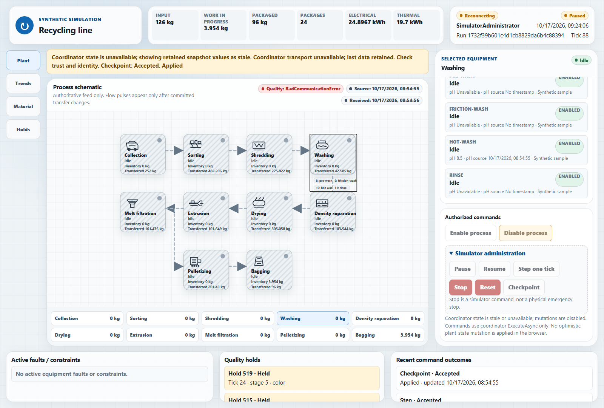

**Source** is the original observation time; **Received** is workstation receipt time.
An unchanged source time, pH or RGB is not alone a transport failure. Conversely, a healthy
HTTP page does not prove UA subscription health. The console distinguishes browser event
delivery, coordinator connectivity and native process availability, and does not promote
retained data to fresh data merely because a connection returns.

Channel/keep-alive failures and persistent Publish failures invalidate retained data even
when the managed session keeps its ID. Returning to Ready is insufficient: controls require
a fresh usable observation on the browser's live stream. SSE refusals, including the
live-consumer limit, trigger retries with bounded backoff. A one-off HTTP refresh cannot
re-enable controls; browsers without SSE remain read-only.

Clients and servers use matching 16 MiB message/byte-string quotas and 100,000-element array
quotas. Discovered endpoints inherit the application quotas. Larger recipes must fit them;
oversized responses fail delivery without changing certificate validation or authorization.

Recipe selection, pacing, fault injection, server startup/shutdown and certificate/role
provisioning remain command-line/deployment operations. The console does not edit recipes,
acknowledge/shelve synthetic alarm flags, write native companion production controls, or
provide physical safety functions.

## Observe and control the line

1. Connect an OPC UA client with a trusted application certificate and mapped **Observer**
   user certificate. Browse namespace URIs rather than assuming numeric namespace indexes.
2. Subscribe to `Coordinator.State`, `ProcessView.State` or individual equipment measurements.
   Compare `RunId`, `Revision`, `Tick`, `Available` and source timestamps: heartbeat/control
   commits can advance revision without advancing material time.
3. Follow `Parcels`, `Packages[].Material.Contributions`, `Holds` and `History` to trace material.
   `ReadGenealogy(afterExecutionId, maximumResults)` returns pages of up to 128 executions;
   `ReadSnapshot()` returns the current typed image.
4. Observe `sorter-drift` through classification, contamination and inherited holds;
   `utility-disturbance` through constrained stages/residence queues; and `equipment-faults`
   through jam/strand-break state and absolute counters. The `recovery` scenario restores
   equipment conditions without implicitly releasing product holds.

The generated clients are `RecyclingCoordinatorTypeClient` and `RecyclingProcessViewTypeClient`.
`RecyclingCoordinatorClient` wraps a managed session with typed calls and subscriptions. For an
already authenticated observer session:

```csharp
await using var client = new RecyclingCoordinatorClient(session, telemetry);
await foreach (CoordinatorNotification update in client.WatchAsync(cancellationToken))
{
    CommittedSnapshot state = update.Snapshot;
    Console.WriteLine(
        $"Available={update.IsAvailable}, tick={state.Tick}, packages={state.Packages.Count}");
}
```

The coordinator's typed `Execute` method accepts operator/admin enable/disable and hold-disposition
commands, plus administrator pause/resume/stop/reset/step/checkpoint commands. Stepping is
paused-only; reset requires an explicit stop and is not recovery. Retries preserve the original
request ID and payload. Native production writes/methods are refused; vision result retrieval
remains available. `ProcessView.ForwardCommand` is limited to its own process's enable/disable
commands and defaults to `BadNotSupported`; the optional forwarder preserves the originating
end-user certificate, never elevating the process service identity.

## Container images

Images CI registers `recyclingserver` and `recyclingclient` under its existing GHCR naming,
branch/version tags, PR no-publish policy and platform matrix. Published tags require a
successful publishing run. Build locally from the repository root:

```powershell
docker build -f samples\Recycling\RecyclingServer\Dockerfile -t recycling-server:local .
docker build -f samples\Recycling\RecyclingOperatorConsole\Dockerfile -t recycling-client:local .
```

Both Dockerfiles compile portable framework-dependent .NET 10 IL on `$BUILDPLATFORM`,
without a runtime identifier, app host or NativeAOT. The server image uses the .NET runtime;
the console uses the ASP.NET runtime and includes `wwwroot`. Both run as the non-root .NET
`app` user. Their build stages pin an SDK version independently of `global.json`;
the image SDK must meet the repository's minimum stable SDK version.

CI publishes once natively, then reuses the prebuilt output for `linux/amd64` and
`linux/arm64/v8` without compiling an SDK under QEMU. To reproduce the console path:

```powershell
dotnet publish samples\Recycling\RecyclingOperatorConsole\RecyclingOperatorConsole.csproj `
    -c Release -f net10.0 -p:CustomTestTarget=net10.0 `
    -p:PublishAot=false -p:UseAppHost=false -p:SelfContained=false `
    -o artifacts\docker\publish\recyclingclient
docker build -f samples\Recycling\RecyclingOperatorConsole\Dockerfile `
    --build-arg PUBLISH_SOURCE=prebuilt `
    --build-arg PUBLISH_DIR=artifacts/docker/publish/recyclingclient `
    -t recycling-client:prebuilt .
```

For the server, substitute its project, Dockerfile and `recyclingserver` publish directory.
Keep secrets, private scenarios and runtime journals outside either publish directory.
NativeAOT publication is a [separate target](#nativeaot-publication).

Podman can use the same Dockerfiles and topology through its Compose provider. Use
engine-accessible data paths or separately provisioned role-isolated volumes; Windows host
paths are not automatically Linux engine paths. Preserve the read-only secret mounts,
writable per-role stores and UID/GID 1654 permissions. On Windows, verify forwarding from
workstation loopback to the machine separately from the container port mapping. Any temporary
forwarder must bind only to loopback, target the intended port, and be stopped after use.
Do not widen HTTP bindings, relax Host/Origin checks or bypass UA certificate validation.

The [deployment guide](RecyclingServer/deploy/README.md#optional-operator-console) covers
the optional Compose profile. It enables container binding but publishes HTTP on **host
loopback only**. The Kubernetes example remains server-only.

## Validation

### Image contracts and live qualification

Image contract tests are in `RecyclingImageContractTests` in `Opc.Ua.Recycling.Operator.Tests`:

```powershell
dotnet test tests\Opc.Ua.Recycling.Operator.Tests\Opc.Ua.Recycling.Operator.Tests.csproj -f net10.0 `
    -p:CustomTestTarget=net10.0 --filter FullyQualifiedName~RecyclingImageContractTests
```

These are static checks. Separately build both Dockerfiles from source and prepublished
output, inspect both architectures and static assets, and run an isolated Compose line with
strict trust and a provisioned identity. Check native inspection, unavailable endpoints,
reconnect, pause, stale/unauthorized commands and exact retries on a host with a working
container engine.

### Browser interaction profile

The .NET 10 operator test project contains the NUnit `Explicit` class `OperatorBrowserTests`.
Build first to generate Playwright's installation script, install Chromium once for the
current user, then select the class:

```powershell
dotnet build tests\Opc.Ua.Recycling.Operator.Tests\Opc.Ua.Recycling.Operator.Tests.csproj `
    -c Release -f net10.0 -p:CustomTestTarget=net10.0
pwsh tests\Opc.Ua.Recycling.Operator.Tests\bin\Release\net10.0\playwright.ps1 install chromium
dotnet test tests\Opc.Ua.Recycling.Operator.Tests\Opc.Ua.Recycling.Operator.Tests.csproj `
    -c Release -f net10.0 -p:CustomTestTarget=net10.0 --no-build `
    --filter FullyQualifiedName~OperatorBrowserTests
```

Chromium is a test prerequisite, not an application dependency or an npm build. Unfiltered
runs do not execute this explicit profile. It serves the actual static UI to Chromium with
deterministic test-only HTTP responses and exercises viewport, keyboard, reduced-motion and
confirmation behavior. Live UA connectivity, certificate trust, production HTTP authentication
and container startup need the separate live qualification above.

### NativeAOT publication

Use a stable .NET SDK allowed by `global.json` and the platform's native toolchain.
Windows needs Visual Studio C++ Build Tools with the Desktop development with C++ workload
and a supported Windows SDK. Linux needs the NativeAOT prerequisites, including Clang and
development libraries.

From the repository root in a Visual Studio Developer PowerShell with the linker and Windows
SDK environment initialized, publish Windows x64:

```powershell
dotnet publish samples\Recycling\RecyclingOperatorConsole\RecyclingOperatorConsole.csproj `
    -c Release -f net10.0 -r win-x64 -p:CustomTestTarget=net10.0 `
    -o artifacts\recycling-console-native\published
.\artifacts\recycling-console-native\published\RecyclingOperatorConsole.exe
```

A runtime identifier enables AOT in the console project. Do not set `PublishAot=true`
globally: it would also apply to the .NET Standard source-generator projects.
Provision and export the external certificate, bootstrap and endpoint settings from
[Build and configure](#build-and-configure) before launching. The runtime identifier must
match the native build host.

The executable profile provisions isolated test certificates and a real coordinator:

```powershell
$env:OPCUA_RECYCLING_OPERATOR_NATIVE_EXE = (
    Resolve-Path artifacts\recycling-console-native\published\RecyclingOperatorConsole.exe).Path
dotnet test tests\Opc.Ua.Recycling.Operator.Tests\Opc.Ua.Recycling.Operator.Tests.csproj `
    -c Release -f net10.0 -p:CustomTestTarget=net10.0 `
    --filter FullyQualifiedName~NativeConsoleAuthenticatesStreamsAndControlsTheRealCoordinatorAsync
```

Also run the explicit graceful-shutdown profile against that executable:

```powershell
dotnet test tests\Opc.Ua.Recycling.Operator.Tests\Opc.Ua.Recycling.Operator.Tests.csproj `
    -c Release -f net10.0 -p:CustomTestTarget=net10.0 `
    --filter FullyQualifiedName~NativeConsoleGracefullyStopsWithoutStoppingTheCoordinatorAsync
```

It holds an SSE request open while sending an operating-system shutdown signal, requires a
clean native exit, then reads and resumes the independent coordinator through encrypted UA
and verifies continued ticks in the same run. Windows uses an isolated console and a built-in
Windows PowerShell helper that refuses to signal a console containing an unrelated process.
Other platforms use a PID-targeted `SIGTERM`. Forced termination is failure cleanup only.

SSE requests observe application shutdown, browser cancellation and session expiry so an open
browser does not consume the host's shutdown budget before UA services stop. Native
qualification must cover authentication, SSE, typed reads, authorized commands, static assets
and graceful shutdown; publishing alone does not verify them.

See the [developer guide](../../docs/DeveloperGuide.md#running-tests) for solution-level PR gates.
